# 실험별 figure와 table, 랩 NEO와 다른 점, 그리고 그 시점까지의 insight

이 문서는 toy-NEO에서 한 실험을 처음부터 순서대로 놓은 것이다. 실험마다 네 가지를 적는다. 무엇을 물었고 무엇을 했는지, 그 실험의 설정이 랩 NEO와 어디가 다른지, 그 실험의 figure와 table, 그리고 그 실험까지 쌓인 insight 전체다. figure와 table마다 그것이 랩 NEO와 무엇이 다른 설정에서 나왔는지를 한 줄씩 붙였다. insight 정리에서는 그 실험이 새로 알려 준 것과 앞선 말을 고친 것을 온전한 문장으로 적고, 그대로인 것은 한 줄씩으로 줄여 적는다. 앞선 말이 고쳐질 때는 고치기 전의 말과 무엇을 보고 고쳤는지를 함께 남긴다. 마지막 절에 지금의 정리 전체가 온전한 문장으로 있다. table은 원래 문서에서 그대로 가져왔고, 이 문서는 `scripts/build_insight_history.py`로 다시 만든다.

## 랩 NEO의 기준 설정

랩 NEO는 MLML 랩의 GeneralizedL2T에 있는 transformer NEO를 BabyTheorist의 15칸 격자로 옮긴 설정을 말한다. 첫 실험만 랩의 공식 NEO, 곧 격자 하나를 latent 하나에 담는 GridWorld 설정을 기준으로 한다. 랩이 논문에서 BabyTheorist에 쓴 설정과 코드는 받지 못했다. 아래 표의 항목이 실험마다 다른 점을 적는 틀이다.

| 항목 | 랩 NEO |
|---|---|
| 데이터 | BabyTheorist single-A 레벨 1의 학습 파일. pair 하나씩이고 70%가 primitive 여럿짜리다 |
| state encoder와 state decoder | 칸마다 128차원 token 하나. 미리 학습해 얼린다 |
| programmer | 지금 칸 token과 목표 칸 token을 따로 넣는 6층 transformer, 폭 128 |
| codebook | 랩 VQ. cosine으로 가장 가까운 code를 고른다. code 16개, 16차원, commitment 0.25 |
| executor | 4층 AdaLN-Zero transformer, 폭 128. code는 층마다 scale, shift, gate를 만드는 조절 신호다 |
| program 길이와 단계 사이로 넘기는 것 | 최대 다섯 단계. 단계 사이에 칸마다의 색 확률을 넘긴다 |
| code를 고르고 학습하는 방식 | programmer가 pair 하나를 보고 낸 출력에 가장 가까운 code를 쓴다. 길이는 길이마다 0.95를 곱한 cross-entropy가 가장 작은 것으로 고르고, 그 길이의 cross-entropy, grounding 항 0.1, codebook loss로 모든 부품을 함께 학습한다 |
| 학습 일정 | 학습률 3e-4, batch 256 episode, 78,200스텝, 가중치 평균 0.999 |
| 평가 때의 추론 | programmer가 support pair 하나를 보고 고른 code 열을 query에 그대로 실행한다. 탐색하지 않는다 |
| 학습이 읽는 정보 | 입력과 출력 격자만 읽는다 |
| 랩 NEO에 없는 단계 | 없다 |

## 1. 랩의 공식 NEO를 GridWorld 설정 그대로 BabyTheorist에

2026-11-20. 근거는 `docs/reports/2026-11-20-first-numbers.md`와 `docs/project-overview.md` 5.1절.

**물은 것.** 지금의 랩 NEO가 BabyTheorist의 가장 쉬운 설정에서 무엇을 하는가. 그 전에 state encoder와 state decoder가 15칸 격자를 그대로 다시 그리는가.

**한 것.** 랩 CNN state encoder와 state decoder는 격자가 10칸이 아니면 오류를 내서, 층은 같고 크기 계산만 다른 부품을 만들었다. latent 크기 다섯 가지와 칸마다 token을 두는 방식을 사전학습하고, 그 위에 공식 NEO를 32차원과 256차원 state로, MLP 폭을 키운 변형 둘로, 이동 넷만 쓰는 데이터로 seed 셋씩 학습했다.

**랩 NEO와 다른 점, 이 실험의 공통 설정.** 이 실험만 랩의 공식 NEO를 쓴다. 아래 표의 오른쪽 열이 공식 NEO의 부품이다.

| 항목 | 랩 NEO | 이 실험 |
|---|---|---|
| state encoder와 state decoder | 칸마다 128차원 token 하나. 미리 학습해 얼린다 | 랩 CNN과 층이 같고 크기 계산만 다른 cnn_vae_any로 격자 하나를 latent 하나에 담는다. latent는 32차원에서 256차원까지 다섯 크기 |
| programmer | 지금 칸 token과 목표 칸 token을 따로 넣는 6층 transformer, 폭 128 | MLP. 폭을 키운 변형 둘 포함 |
| codebook | 랩 VQ. cosine으로 가장 가까운 code를 고른다. code 16개, 16차원, commitment 0.25 | code 6개. 학습 중에는 표본으로 뽑는다 |
| executor | 4층 AdaLN-Zero transformer, 폭 128. code는 층마다 scale, shift, gate를 만드는 조절 신호다 | FiLM MLP |
| program 길이와 단계 사이로 넘기는 것 | 최대 다섯 단계. 단계 사이에 칸마다의 색 확률을 넘긴다 | 최대 네 단계. latent를 그대로 넘긴다 |
| 학습 일정 | 학습률 3e-4, batch 256 episode, 78,200스텝, 가중치 평균 0.999 | 학습률 5e-4, batch 128, 39,100스텝 |

표에 없는 항목은 랩 NEO와 같다.

**Table 1.1.** state encoder와 state decoder가 격자를 칸 하나 틀리지 않고 다시 그리는 비율

| state 표현 | 물체 하나 | 물체 둘 | 물체 셋 |
|---|---|---|---|
| 32차원 latent 하나 | 0.89 | 0.60 | 0.23 |
| 256차원 latent 하나 | 0.997 이상 | 0.997 이상 | 0.997 이상 |
| 칸마다 token | 1.0 | 1.0 | 1.0 |

랩 NEO와 다른 점: state encoder와 state decoder만 잰 것이다. 32차원 줄이 랩 GridWorld 설정의 크기이고 나머지 두 줄은 이 레포가 바꾼 크기다.

**Table 1.2.** 공식 NEO의 BabyTheorist 레벨 1 성능

| 설정 | 예시 쌍 재현 | transfer |
|---|---|---|
| 공식 NEO, GridWorld 설정 그대로, seed 셋 평균 | 1% | 0.02% |
| latent를 256차원으로 | | 0에 가까움 |
| MLP를 넓힘, 또는 primitive를 이동 넷으로 줄임 | | 0 |

랩 NEO와 다른 점: 첫 줄은 격자 크기에 맞춘 state encoder 말고는 랩 GridWorld 설정 그대로다. 아래 줄은 latent 크기, MLP 폭, 데이터의 primitive 수를 하나씩 바꿨다.

**Figure 1.1.** 공식 NEO가 primitive 하나짜리 과제에서 내놓은 틀린 답의 예, 32차원 latent, seed 43

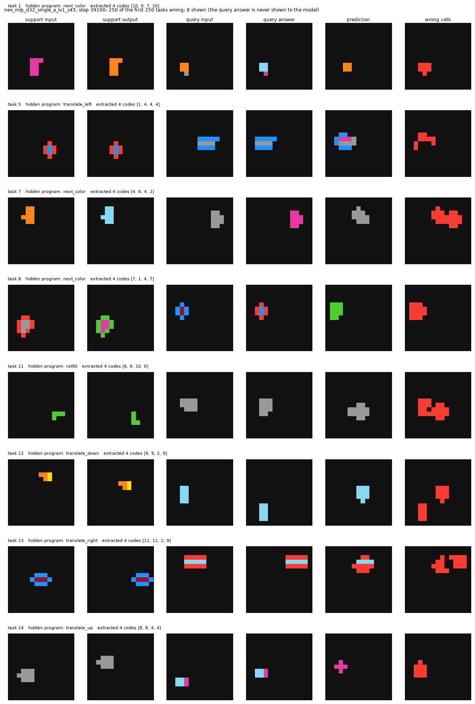

랩 NEO와 다른 점: 격자 크기에 맞춘 state encoder 말고는 랩 GridWorld 설정 그대로다.

**나온 것.** 32차원 latent 하나는 15칸 격자를 다시 그리지 못한다. latent를 키우면 그리지만 transfer는 그대로 0에 가깝다. 공개된 GridWorld 설정으로는 논문의 BabyTheorist 점수가 나오지 않는다. 이 관찰로 칸마다 token을 두는 transformer NEO로 넘어갔다.

### 1번째 실험까지의 insight

새로 알게 된 것.

- 격자 하나를 32차원 latent 하나에 담는 랩 GridWorld 설정은 15칸 격자를 다시 그리지 못한다. 물체 셋이면 23%만 온전히 그린다. 칸마다 token을 두면 100%다. 그런데 latent를 키워도 공식 NEO의 transfer는 0에 가깝다. 표현 크기만의 문제가 아니다.

## 2. 랩 transformer NEO의 첫 숫자와 code 대 primitive 표

2026-11-20에서 21. 근거는 `docs/project-overview.md` 5.2절.

**물은 것.** 칸마다 token을 두는 랩 transformer NEO는 BabyTheorist 레벨 1을 얼마나 배우는가. 막힌다면 primitive 하나를 배우는 데서 막히는가, 이어 붙이는 데서 막히는가.

**한 것.** 랩 transformer NEO 설정을 15칸 격자로 옮겨 seed 다섯을 12,000스텝, seed 하나를 36,000스텝 학습했다. 진단으로 primitive 하나짜리 과제만으로 학습한 run과 이동 넷만 쓰는 run을 더했다. 길이 1 과제에서 고른 code 번호와 숨은 primitive를 센 표를 run마다 남겼다.

**랩 NEO와 다른 점, 이 실험의 공통 설정.**

| 항목 | 랩 NEO | 이 실험 |
|---|---|---|
| 학습 일정 | 학습률 3e-4, batch 256 episode, 78,200스텝, 가중치 평균 0.999 | 12,000스텝 또는 36,000스텝. 랩 일정은 13시간이 걸려 줄였다 |

표에 없는 항목은 랩 NEO와 같다.

**Table 2.1.** 랩 transformer NEO의 레벨 1 재현과 transfer

| run | 예시 쌍 재현 | transfer |
|---|---|---|
| 12,000스텝, seed 42 | 30.3% | 7.1% |
| 12,000스텝, seed 다섯 | | 7.1%, 24.5%, 17.2%, 3.0%, 16.9% |
| 36,000스텝, seed 42 | 89.8% | 39.8% |
| primitive 하나짜리 과제만으로 학습 | | 23%에서 멈춤, primitive 둘만 배움 |
| 이동 넷만 쓰는 데이터 | 24.8% | 2.3% |

랩 NEO와 다른 점: 학습 스텝 수 말고는 랩 설정 그대로다. 아래 두 줄은 진단으로 학습 데이터만 바꿨다. 하나는 숨은 길이를 읽어 primitive 하나짜리 과제만 남겼고, 하나는 primitive를 이동 넷으로 줄였다.

**Figure 2.1.** 학습이 진행되는 동안 primitive마다 쓰는 code가 바뀌는 모습

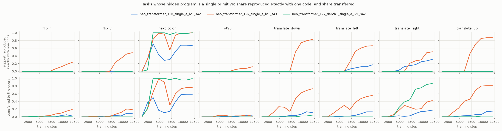

랩 NEO와 다른 점: 학습 스텝 수 말고는 랩 설정 그대로다.

**Figure 2.2.** 학습에 든 계산을 가로축으로 한 학습 곡선

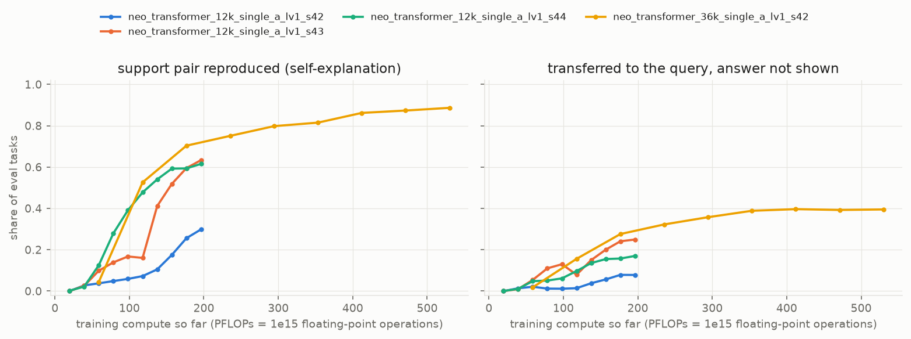

랩 NEO와 다른 점: 학습 스텝 수 말고는 랩 설정 그대로다.

**Figure 2.3.** primitive 하나짜리 과제에서 틀린 답의 예, seed 42

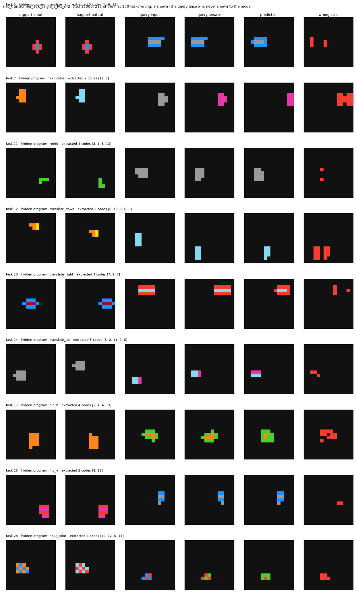

랩 NEO와 다른 점: 학습 스텝 수 말고는 랩 설정 그대로다.

**나온 것.** 12,000스텝의 transfer는 seed에 따라 3%에서 25%이고 36,000스텝은 40%다. primitive 하나짜리 과제에서 같은 code 하나가 예시 쌍과 새 입력 쌍을 모두 재현하면 transfer가 100%였고, primitive 둘짜리 과제의 transfer는 하나짜리의 제곱에 가까웠다. code는 색 바꾸기, 이동, 뒤집기, 회전 순으로 얻고 회전은 어떤 설정에서도 배우지 못했다. 처음에는 primitive가 초반에 갈리고 안 바뀐다고 가설을 세웠는데, 체크포인트 열 개를 따라가 보니 여러 code를 이어 설명하는 단계를 거쳐 차례로 code를 얻었다.

### 2번째 실험까지의 insight

새로 알게 된 것.

- transfer는 같은 code 하나가 support pair와 query를 모두 재현할 때만 된다. 전체 transfer를 정하는 것은 어떤 입력에서도 통하는 code 하나를 가진 primitive의 수다. 랩 transformer NEO가 막히는 곳은 이어 붙이기보다 primitive마다 code 하나를 찾는 일이다.
- 여러 단계로 학습하는 랩 transformer NEO에서 primitive는 code 하나로 굳기 전에 여러 code를 이어 설명하는 단계를 거친다. code를 얻는 순서는 seed마다 같아 색 바꾸기, 이동, 뒤집기, 회전이다.
- 랩 설정에서 primitive 하나짜리 과제만으로 학습하면 primitive 둘만 배우고 transfer 23%에서 멈춘다. 쉬운 과제만 주면 primitive를 더 못 찾는 것으로 보인다.
- seed마다 차이가 크다. 같은 랩 설정의 transfer가 3%에서 25%로 갈린다. seed 하나의 값으로 말하지 않는다.

그대로인 것.

- state 표현과 단계 사이로 넘기는 것
    - 격자 하나를 latent 하나에 담는 것은 15칸 격자에 모자라지만, 공식 NEO가 0에 머무는 이유는 그것만이 아니다

## 3. 잠: 겹친 code를 합치고 비운 code를 다시 쓰기

2026-11-21. 근거는 `docs/project-overview.md` 5.3절.

**물은 것.** 잠을 넣으면 code를 얻지 못한 primitive가 code를 얻는가.

**한 것.** code 8개로 학습한 모델의 14,400스텝에서 색 바꾸기가 code 둘을 차지하고 회전과 아래로 이동은 code가 없었다. 잠에서 겹친 code 둘을 합쳐 하나를 비우고, 비운 code를 설명하지 못하는 학습 쌍에 배정한 뒤 36,000스텝까지 이어 학습했다. 대조로 합치기만 한 것과 비운 code를 아무 방향에나 둔 것을 돌렸다. 이어서 꺼 둔 code를 켜는 codebook으로 잠을 여러 번 넣는 형태도 돌렸다.

**랩 NEO와 다른 점, 이 실험의 공통 설정.**

| 항목 | 랩 NEO | 이 실험 |
|---|---|---|
| codebook | 랩 VQ. cosine으로 가장 가까운 code를 고른다. code 16개, 16차원, commitment 0.25 | code 8개. 넓힌 형태는 꺼 둔 줄을 켤 수 있는 vq_growable이고 모든 줄을 켜면 랩 VQ와 출력이 같다 |
| 학습 일정 | 학습률 3e-4, batch 256 episode, 78,200스텝, 가중치 평균 0.999 | 36,000스텝 |
| 랩 NEO에 없는 단계 | 없다 | 잠. 겹친 code 둘을 합쳐 하나를 비우고 설명하지 못하는 학습 쌍에 배정한다. 떼어 둔 저장분의 재현이 1%p 넘게 떨어지지 않을 때만 받아들인다 |

표에 없는 항목은 랩 NEO와 같다.

**Table 3.1.** 잠 한 번과 대조의 최종 transfer, seed 42

| 조건 | 최종 transfer |
|---|---|
| code 8개, 잠 없음 | 44.2% |
| 합치기만 | 44.5% |
| 비운 code를 아무 방향에 | 47.6% |
| 비운 code를 설명하지 못하는 쌍에 배정 | 61.4% |
| code 16개, 36,000스텝 | 39.8% |

랩 NEO와 다른 점: code 수 8개와 잠 말고는 랩 설정 그대로다. 맨 아래 줄은 code 16개인 랩 설정이다. 단계 사이에 확률을 넘기는 랩 방식으로 잰 값이라 다음 실험에서 다시 읽게 된다.

**Figure 3.1.** 잠을 넣은 run과 대조의 학습 곡선, 가로축은 학습에 든 계산

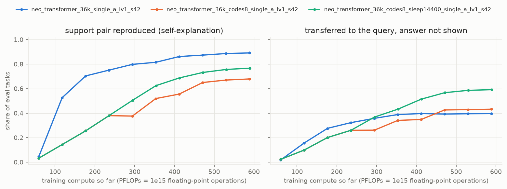

랩 NEO와 다른 점: code 8개와 잠 말고는 랩 설정 그대로다.

**Figure 3.2.** 잠에서 code를 켜 가는 형태의 학습 곡선

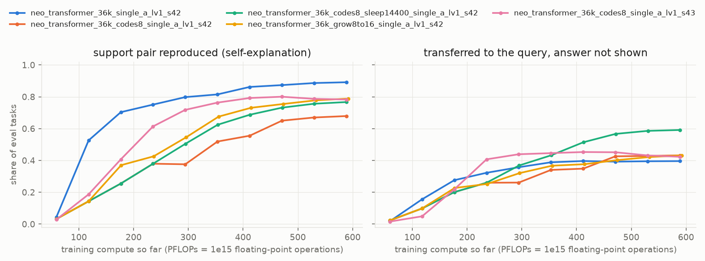

랩 NEO와 다른 점: codebook이 vq_growable이고 잠을 여러 번 넣는다. 나머지는 랩 설정 그대로다.

**나온 것.** 비운 code를 설명하지 못하는 쌍에 배정한 run만 61%로 올랐고 합치기만 한 run은 그대로였다. 겹친 code가 있는 때는 seed 42의 한 시점뿐이었다. code를 켜 가는 형태는 재현만 올리고 transfer는 그대로였다. 새 code가 이미 code를 가진 primitive를 입력에 따라 나누는 데 쓰였다.

### 3번째 실험까지의 insight

새로 알게 된 것.

- 잠에서 겹친 code를 합쳐 비우고 그 code를 설명하지 못하는 학습 쌍에 배정하면 transfer가 44%에서 61%로 오른다. 효과는 합치기가 아니라 배정에서 난다. seed 하나의 값이다.
- code를 더 켜 주면 재현은 오르지만 transfer는 그대로다. 새 code가 code 없는 primitive에 가지 않고, 이미 code를 가진 primitive를 입력에 따라 나누는 데 쓰인다.

그대로인 것.

- state 표현과 단계 사이로 넘기는 것
    - 격자 하나를 latent 하나에 담는 것은 15칸 격자에 모자라지만, 공식 NEO가 0에 머무는 이유는 그것만이 아니다
- code 형성: programmer와 codebook이 primitive마다 code를 세우는 일
    - transfer를 정하는 것은 어디서나 통하는 code 하나를 가진 primitive의 수다
    - 여러 단계로 학습하면 primitive는 여러 code로 설명되는 단계를 거쳐 차례로 code를 얻는다
    - primitive 하나짜리 과제만 주면 오히려 덜 배운다
- 재는 방법
    - seed 하나의 값으로 말하지 않는다

## 4. 단계 사이로 넘어가는 보이지 않는 정보

2026-11-21에서 22. 근거는 `docs/project-overview.md` 5.4절.

**물은 것.** 잠을 넣은 모델은 위아래 뒤집기를 code 하나로, 좌우 뒤집기를 그 code 두 번으로 설명하고 85%를 옮겼다. 두 번 뒤집으면 원래 격자여야 하는데 어떻게 된 것인가.

**한 것.** 중간 격자를 봤다. 36,000스텝 학습 다섯을 단계 사이에 격자만 넘기는 방식으로 다시 쟀다. 통로를 학습 때부터 막는 두 모델도 돌렸다. 랩 코드에 있는 형태와, 다음 단계가 격자에서 시작하되 gradient는 흘리는 새 부품이다.

**랩 NEO와 다른 점, 이 실험의 공통 설정.**

| 항목 | 랩 NEO | 이 실험 |
|---|---|---|
| program 길이와 단계 사이로 넘기는 것 | 최대 다섯 단계. 단계 사이에 칸마다의 색 확률을 넘긴다 | 평가에서 단계 사이에 확률이 가장 높은 색만 남긴 격자를 넘긴다. 학습 때부터 막는 형태는 랩 코드의 reencode_hard와 새 부품 neo_visible_state |

표에 없는 항목은 랩 NEO와 같다.

**Figure 4.1.** 단계 사이에 확률을 넘길 때와 격자만 넘길 때 같은 program이 내는 중간 격자

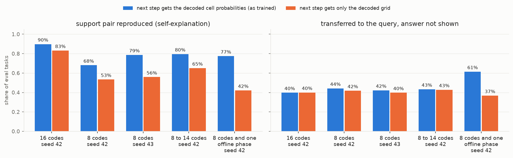

랩 NEO와 다른 점: 모델은 랩 설정으로 학습한 것이고, 실행할 때 단계 사이로 넘기는 것만 바꿨다.

**Table 4.1.** 같은 모델을 두 방식으로 잰 transfer

| run | 확률을 넘겨 잰 transfer | 격자만 넘겨 잰 transfer |
|---|---|---|
| 36,000스텝 학습 다섯 | 최고 61.4% | 40.0%, 41.8%, 39.8%, 42.8%, 36.8% |
| 그 가운데 잠 한 번을 넣은 run | 61.4% | 36.8% |

랩 NEO와 다른 점: 학습은 랩 설정이거나 앞 실험의 잠을 넣은 것이고, 평가에서 단계 사이로 넘기는 것만 다르다.

**나온 것.** 확률을 넘기면 둘째 단계가 좌우로 뒤집은 정답을 내고, 격자만 넘기면 입력으로 되돌아간다. 같은 code가 깨끗한 격자를 받으면 위아래로 뒤집고 자기가 낸 확률을 받으면 다른 일을 한다. 격자만 넘기면 다섯 run이 모두 37에서 43%이고 잠의 61%도 37%가 된다.

### 4번째 실험까지의 insight

새로 알게 된 것.

- 랩 transformer NEO는 program의 단계 사이에 칸마다의 색 확률을 넘기고, 학습된 모델은 격자에 보이지 않는 그 부분으로 정보를 넘긴다. 같은 code가 깨끗한 격자와 자기가 낸 확률에서 다른 일을 한다.
- transfer 정확도 하나로는 지름길이 가려진다. 이후 transfer는 단계 사이에 확률을 넘기는 방식과 격자만 넘기는 방식 둘 다로 잰다.

버린 것.

- 잠에서 겹친 code를 합쳐 비우고 그 code를 설명하지 못하는 학습 쌍에 배정하면 transfer가 44%에서 61%로 오른다. 효과는 합치기가 아니라 배정에서 난다. seed 하나의 값이다. 버린 이유: 61%는 단계 사이 확률에 기댄 program에서 나온 값이었다. 격자만 넘기면 37%로 다른 학습과 같다. code의 수, 잠, code를 켜는 규칙 가운데 40% 근처의 값을 움직인 것은 없다.

그대로인 것.

- state 표현과 단계 사이로 넘기는 것
    - 격자 하나를 latent 하나에 담는 것은 15칸 격자에 모자라지만, 공식 NEO가 0에 머무는 이유는 그것만이 아니다
- code 형성: programmer와 codebook이 primitive마다 code를 세우는 일
    - transfer를 정하는 것은 어디서나 통하는 code 하나를 가진 primitive의 수다
    - 여러 단계로 학습하면 primitive는 여러 code로 설명되는 단계를 거쳐 차례로 code를 얻는다
    - primitive 하나짜리 과제만 주면 오히려 덜 배운다
    - code를 더 주면 primitive가 아니라 입력에 따라 쪼개는 데 쓰인다
- 재는 방법
    - seed 하나의 값으로 말하지 않는다

## 5. 학습을 빠르게 하고 한 단계짜리 싼 판으로 부품 찾기

2026-11-22. 근거는 `docs/reports/2026-11-22-fast-search.md`와 `docs/project-overview.md` 5.5절.

**물은 것.** transformer NEO 하나에 여섯 시간이 걸려서는 아무것도 찾을 수 없다. 어디가 느리고, 어떤 부품이 primitive 여덟을 code 하나씩으로 배우는가.

**한 것.** forward를 torch.compile로 묶고 token 수를 절반으로 줄인 programmer를 만들어 한 스텝을 152ms에서 44ms로 줄였다. 그다음 primitive 하나짜리 학습 쌍만 쓰고 program을 한 단계로 제한한 싼 판에서 조건 80개쯤을 한꺼번에 돌렸다. programmer, code를 다시 뿌리는 codebook, 가중치 평균, batch, executor 폭과 깊이, commitment, code 차원, code 수를 바꿨다.

**랩 NEO와 다른 점, 이 실험의 공통 설정.**

| 항목 | 랩 NEO | 이 실험 |
|---|---|---|
| 데이터 | BabyTheorist single-A 레벨 1의 학습 파일. pair 하나씩이고 70%가 primitive 여럿짜리다 | primitive 하나짜리 학습 pair만 쓴다. 숨은 길이를 읽어 고른다 |
| programmer | 지금 칸 token과 목표 칸 token을 따로 넣는 6층 transformer, 폭 128 | 지금 칸과 목표 칸을 칸마다 이어 붙인 token을 넣는 token_pair_transformer, 폭 256 |
| codebook | 랩 VQ. cosine으로 가장 가까운 code를 고른다. code 16개, 16차원, commitment 0.25 | 조건에 따라 code 8개에서 32개, 안 쓰는 code를 지금의 programmer 출력으로 다시 뿌리는 vq_restart, commitment 0.25에서 1.0 |
| executor | 4층 AdaLN-Zero transformer, 폭 128. code는 층마다 scale, shift, gate를 만드는 조절 신호다 | 조건에 따라 폭 128 또는 256 |
| program 길이와 단계 사이로 넘기는 것 | 최대 다섯 단계. 단계 사이에 칸마다의 색 확률을 넘긴다 | program 한 단계 |
| 학습 일정 | 학습률 3e-4, batch 256 episode, 78,200스텝, 가중치 평균 0.999 | batch 128 pair, 24,000스텝, 가중치 평균 끔, programmer 학습률은 0.25배, forward를 torch.compile로 묶음 |
| 학습이 읽는 정보 | 입력과 출력 격자만 읽는다 | 입력과 출력 격자, 그리고 pair를 고르는 데 숨은 길이 |

표에 없는 항목은 랩 NEO와 같다.

**Table 5.1.** 한 단계 싼 판에서 부품을 바꾼 결과, primitive 하나짜리 평가 과제

| 조건 | 재현 | transfer |
|---|---|---|
| 랩 설정 그대로, seed 둘 | 53%, 17% | 53%, 17% |
| programmer만 교체, seed 둘 | 50%, 73% | 38%, 60% |
| 넓은 programmer와 다시 뿌리기, seed 둘 | 90%, 96% | 69%, 71% |
| 넓은 programmer, 다시 뿌리기 없음, 가중치 평균 끔 | 95% | 89% |
| 넓은 programmer와 폭 256 executor, 다시 뿌리기 | 99.5% | 85% |
| 다시 뿌리기, batch 128로 24,000스텝 | 99.7% | 92% |

랩 NEO와 다른 점: 첫 줄은 데이터와 program 길이만 싼 판이고 부품과 학습 일정은 랩 설정 그대로다. 그 아래는 줄에 적힌 부품을 바꿨다. programmer 교체는 token_pair_transformer, 다시 뿌리기는 vq_restart다.

**나온 것.** 랩 programmer는 처음 1,800스텝 동안 code를 하나만 쓴다. programmer를 바꾸면 300스텝부터 배운다. 다시 뿌리기는 code를 전부 쓰게 해 재현을 올리지만 뒤집기를 code 여러 개로 쪼개 transfer를 깎는다. 같은 데이터 양이면 작은 batch로 오래 도는 쪽이 낫다. code 수는 primitive 여덟에 8개면 다 찾지 못하고, 남는 code가 적을수록 쪼개기가 줄어 transfer가 오른다. 여기서 고른 부품이 이후의 기준 run이 됐다.

### 5번째 실험까지의 insight

새로 알게 된 것.

- 랩 transformer NEO가 느렸던 이유는 code를 못 찾아서였다. 랩 programmer는 처음 1,800스텝 동안 code를 하나만 쓰고, 지금 칸과 목표 칸을 칸마다 이어 붙인 폭 256 programmer는 300스텝부터 배운다.

고쳐진 것.

- 앞서 한 말: code를 더 켜 주면 재현은 오르지만 transfer는 그대로다. 새 code가 code 없는 primitive에 가지 않고, 이미 code를 가진 primitive를 입력에 따라 나누는 데 쓰인다.
  지금: code를 더 주거나 안 쓰는 code를 다시 뿌리면 재현은 오르고 transfer는 내려간다. 남는 code가 뒤집기 같은 primitive를 입력에 따라 쪼개는 데 쓰이기 때문이다. code 수는 primitive 수보다 조금 많은 정도가 가장 좋았다.
  무엇을 보고: 한 단계 싼 판에서 code 수와 다시 뿌리기를 바꿔 본 결과가 잠에서 본 것과 같은 방향이었다.

그대로인 것.

- state 표현과 단계 사이로 넘기는 것
    - 격자 하나를 latent 하나에 담는 것은 15칸 격자에 모자라지만, 공식 NEO가 0에 머무는 이유는 그것만이 아니다
    - 단계 사이에 확률을 넘기면 격자에 보이지 않는 정보가 건너간다
- code 형성: programmer와 codebook이 primitive마다 code를 세우는 일
    - transfer를 정하는 것은 어디서나 통하는 code 하나를 가진 primitive의 수다
    - 여러 단계로 학습하면 primitive는 여러 code로 설명되는 단계를 거쳐 차례로 code를 얻는다
    - primitive 하나짜리 과제만 주면 오히려 덜 배운다
- 재는 방법
    - seed 하나의 값으로 말하지 않는다
    - transfer는 확률을 넘기는 방식과 격자만 넘기는 방식 둘 다로 잰다

## 6. 찾은 부품을 다섯 단계 모델에 넣기: code가 주소가 된다

2026-11-22. 근거는 `docs/project-overview.md` 5.6절.

**물은 것.** 싼 판에서 고른 부품이 랩의 다섯 단계 모델도 고치는가.

**한 것.** 고른 부품을 단계 사이에 확률을 넘기는 다섯 단계 모델에 넣었다. 그리고 같은 부품으로 격자만 넘기며 학습하는 두 형태를 돌렸다.

**랩 NEO와 다른 점, 이 실험의 공통 설정.**

| 항목 | 랩 NEO | 이 실험 |
|---|---|---|
| programmer | 지금 칸 token과 목표 칸 token을 따로 넣는 6층 transformer, 폭 128 | 지금 칸과 목표 칸을 칸마다 이어 붙인 token을 넣는 token_pair_transformer, 폭 256 |
| codebook | 랩 VQ. cosine으로 가장 가까운 code를 고른다. code 16개, 16차원, commitment 0.25 | code 12개 또는 16개, 조건에 따라 code 차원 4 |
| program 길이와 단계 사이로 넘기는 것 | 최대 다섯 단계. 단계 사이에 칸마다의 색 확률을 넘긴다 | 다섯 단계. 확률을 넘기는 형태와, 격자만 넘기는 reencode_hard, neo_visible_state |
| 학습 일정 | 학습률 3e-4, batch 256 episode, 78,200스텝, 가중치 평균 0.999 | batch 128, 6,000에서 12,000스텝 |

표에 없는 항목은 랩 NEO와 같다.

**Table 6.1.** 확률을 넘기는 다섯 단계 모델에 빠른 부품을 넣은 결과

| 측정 | 값 |
|---|---|
| 재현, 7,200스텝 | 81% |
| transfer | 13% |
| 6,000스텝 모델을 격자만 넘겨 잰 재현 | 76.3%에서 2.3%로 |
| primitive 하나짜리 과제의 program | 전부 code 둘. 같은 primitive에 쓰는 code 쌍이 색 바꾸기 17가지, 좌우 뒤집기 78가지 |

랩 NEO와 다른 점: programmer, batch, code 차원이 랩과 다르고 단계 사이로 넘기는 것은 랩과 같다.

**Table 6.2.** 격자만 넘기며 학습한 다섯 단계 모델

| 모델 | 재현 | transfer | 숨은 길이 1, 2, 3, 4의 transfer |
|---|---|---|---|
| 랩 설정, 36,000스텝, 격자만 넘겨 평가 | 83.2% | 40.0% | 57%, 39%, 28%, 21% |
| 빠른 부품, `reencode_hard`, 12,000스텝 | 84.1% | 37.6% | 54%, 36%, 26%, 20% |
| 빠른 부품, `neo_visible_state`, 10,800스텝 | 69.6% | 29.6% | 49%, 28%, 15%, 9% |

랩 NEO와 다른 점: 첫 줄은 랩 설정으로 학습한 모델을 격자만 넘겨 평가한 것이다. 아래 두 줄은 programmer와 학습 일정이 싼 판에서 고른 것이고, 단계 사이로 넘기는 방식이 줄에 적힌 대로다.

**나온 것.** 확률을 넘기면 재현은 다섯 배 빨리 오르는데 transfer는 13%다. code 둘이 합쳐져 변환 하나를 가리키는 주소가 된다. 격자만 넘기며 학습하면 주소는 막히지만 code가 대충 하는 단계와 고치는 단계로 나뉘고 transfer는 랩 설정과 같은 40% 근처다.

### 6번째 실험까지의 insight

새로 알게 된 것.

- NEO의 학습 목표는 예시를 다시 만들기만 하면 채워지고, 단계마다 격자 위의 연산 하나를 하라는 요구는 어디에도 없다. 여러 단계를 한꺼번에 학습하면 code가 primitive가 아닌 것으로 굳는다. 확률을 넘기면 code 둘이 변환 하나를 가리키는 주소가 되고, 격자만 넘기면 대충 하는 단계와 고치는 단계로 나뉜다. 부품을 재현이 빨리 오르는 쪽으로 고를수록 이 해로 곧장 간다.

고쳐진 것.

- 앞서 한 말: 랩 transformer NEO는 program의 단계 사이에 칸마다의 색 확률을 넘기고, 학습된 모델은 격자에 보이지 않는 그 부분으로 정보를 넘긴다. 같은 code가 깨끗한 격자와 자기가 낸 확률에서 다른 일을 한다.
  지금: 랩 transformer NEO는 program의 단계 사이에 칸마다의 색 확률을 넘기고, 학습된 모델은 격자에 보이지 않는 그 부분으로 정보를 넘긴다. 이 통로가 열린 채 학습하면 첫 단계가 주소의 앞자리를 확률에 적고 둘째 단계가 뒷자리와 합쳐 실행하는 program이 생긴다. 격자만 넘겨 재면 재현이 76%에서 2%로 떨어진다.
  무엇을 보고: 빠른 부품을 넣은 다섯 단계 모델에서 primitive 하나짜리 과제의 program이 모두 code 둘이었다.

그대로인 것.

- state 표현과 단계 사이로 넘기는 것
    - 격자 하나를 latent 하나에 담는 것은 15칸 격자에 모자라지만, 공식 NEO가 0에 머무는 이유는 그것만이 아니다
- code 형성: programmer와 codebook이 primitive마다 code를 세우는 일
    - transfer를 정하는 것은 어디서나 통하는 code 하나를 가진 primitive의 수다
    - 여러 단계로 학습하면 primitive는 여러 code로 설명되는 단계를 거쳐 차례로 code를 얻는다
    - primitive 하나짜리 과제만 주면 오히려 덜 배운다
    - 남는 code와 다시 뿌리기는 primitive를 입력에 따라 쪼갠다
    - 랩 programmer는 code를 늦게 찾고, 칸마다 이어 붙인 넓은 programmer가 빨리 찾는다
- 재는 방법
    - seed 하나의 값으로 말하지 않는다
    - transfer는 확률을 넘기는 방식과 격자만 넘기는 방식 둘 다로 잰다

## 7. 한 단계로만 배운 모델은 이어 쓸 수 있다, 그리고 primitive 수 늘리기

2026-11-22. 근거는 `docs/project-overview.md` 5.7절.

**물은 것.** 여러 단계를 한꺼번에 학습하는 것이 code를 망가뜨린다면, 한 단계로 배운 code는 이어 쓸 수 있는가. primitive가 늘면 어떻게 되는가.

**한 것.** 한 단계 모델을 추가 학습 없이 평가 때만 다섯 단계까지 이어 쓰게 했다. programmer가 executor가 낸 격자를 다시 보고 다음 code를 고른다. 되는 한 단계 모델에서 여러 단계 학습을 이어 가는 것도 조건 일곱으로 돌렸다. 그리고 같은 물체 모양으로 primitive를 32개까지 늘린 데이터를 직접 만들어 한 단계 학습을 했다.

**랩 NEO와 다른 점, 이 실험의 공통 설정.**

| 항목 | 랩 NEO | 이 실험 |
|---|---|---|
| 데이터 | BabyTheorist single-A 레벨 1의 학습 파일. pair 하나씩이고 70%가 primitive 여럿짜리다 | primitive 하나짜리 학습 pair만 쓴다. 숨은 길이를 읽어 고른다 |
| programmer | 지금 칸 token과 목표 칸 token을 따로 넣는 6층 transformer, 폭 128 | 지금 칸과 목표 칸을 칸마다 이어 붙인 token을 넣는 token_pair_transformer, 폭 256 |
| codebook | 랩 VQ. cosine으로 가장 가까운 code를 고른다. code 16개, 16차원, commitment 0.25 | 랩 VQ 그대로이고 code 수만 primitive 수의 두 배 |
| program 길이와 단계 사이로 넘기는 것 | 최대 다섯 단계. 단계 사이에 칸마다의 색 확률을 넘긴다 | program 한 단계 |
| 학습 일정 | 학습률 3e-4, batch 256 episode, 78,200스텝, 가중치 평균 0.999 | batch 128 pair, 24,000스텝, 가중치 평균 끔, programmer 학습률은 0.25배, forward를 torch.compile로 묶음 |
| 평가 때의 추론 | programmer가 support pair 하나를 보고 고른 code 열을 query에 그대로 실행한다. 탐색하지 않는다 | 평가 때만 다섯 단계까지 이어 쓴다. 단계마다 programmer가 executor가 낸 격자를 보고 다음 code를 고르고, 단계 사이에는 격자만 넘긴다 |
| 학습이 읽는 정보 | 입력과 출력 격자만 읽는다 | 입력과 출력 격자, 그리고 pair를 고르는 데 숨은 길이 |

표에 없는 항목은 랩 NEO와 같다.

**Table 7.1.** 여러 단계로 학습한 랩 설정과 한 단계로만 학습한 모델, 레벨 1

| 모델 | 재현 | 레벨 1 transfer | 숨은 길이 1, 2, 3, 4, 5 이상 |
|---|---|---|---|
| 랩 설정, 여러 단계 36,000스텝 | 83.2% | 40.0% | 57%, 39%, 28%, 21%, 10% |
| 한 단계로만 학습, code 16개, seed 42 | 87.2% | 83.2% | 97%, 87%, 69%, 62%, 29% |

랩 NEO와 다른 점: 첫 줄은 랩 설정을 격자만 넘겨 평가한 것이다. 둘째 줄은 이 실험의 공통 설정이다.

**Table 7.2.** primitive 수를 늘린 한 단계 학습

| primitive 수 | code 수 | primitive 하나짜리 transfer | code 하나로 90% 넘게 옮겨 가는 primitive |
|---|---|---|---|
| 8, 직접 만든 데이터 | 16 | 96.4% | 8개 중 7개 |
| 11, BabyTheorist | 22 | 97.9% | 9개 |
| 16 | 32 | 58.9% | 16개 중 6개 |
| 24 | 48 | 62.8% | 24개 중 9개 |
| 32 | 64 | 73.2% | 32개 중 17개 |
| 32, executor 폭 256 | 64 | 85.3% | 32개 중 21개 |

랩 NEO와 다른 점: 공통 설정에 더해 데이터가 이 레포의 생성기로 만든 primitive 묶음이다. 11개 줄만 BabyTheorist의 데이터다. 맨 아래 줄은 executor 폭이 256이다.

**나온 것.** 이어 쓴 레벨 1 transfer는 seed 42가 83%이고 seed 여섯 평균은 64%로, 여러 단계로 학습한 랩 설정의 40%보다 높다. 숨은 길이를 읽지 않고 전체 학습 쌍으로 한 단계 학습을 하면 19에서 35%다. 되는 한 단계 모델에서 여러 단계 학습을 이어 가면 150에서 300스텝 사이에 무너진다. primitive가 11개까지는 거의 다 되고 16개부터 회전, 뒤집기, 전치가 8에서 24%로 빠진다.

### 7번째 실험까지의 insight

새로 알게 된 것.

- primitive 하나짜리 과제로 program 한 단계만 학습한 모델은 추가 학습 없이 여러 단계로 이어 쓸 수 있다. 레벨 1 transfer가 seed 여섯 평균 64%로, 여러 단계로 학습한 랩 설정의 40%보다 높다. 다만 숨은 길이를 읽어 과제를 고른 진단이고 seed에 따라 31%에서 84%로 갈린다.
- 되는 한 단계 모델에서 여러 단계 학습을 이어 가면 수백 스텝 안에 83%에서 6에서 19%로 무너진다. 망가지는 것은 programmer가 code를 고르는 능력이다.
- primitive가 11개까지는 거의 다 code 하나씩을 얻지만 16개를 넘으면 회전, 뒤집기, 전치 계열이 8에서 24%로 빠지고 이동은 code의 기준이 칸 수로 바뀐다. 예시 하나로는 위로 3칸과 자기 높이인 3칸만큼 위로가 구별되지 않는다.
- 한 단계 모델을 이어 쓰면 길이 하나마다 transfer가 0.8배쯤으로 줄다가 길이 6부터 빨리 준다.

고쳐진 것.

- 앞서 한 말: seed마다 차이가 크다. 같은 랩 설정의 transfer가 3%에서 25%로 갈린다. seed 하나의 값으로 말하지 않는다.
  지금: seed마다 차이가 크다. 한 단계 모델의 이어 쓴 transfer를 seed 하나로 83%라고 했다가 여섯 seed 평균 64%로 고쳤다. seed 하나의 값으로 말하지 않는다.
  무엇을 보고: seed를 여섯으로 늘리자 31%에서 84%로 갈렸다.

버린 것.

- 랩 설정에서 primitive 하나짜리 과제만으로 학습하면 primitive 둘만 배우고 transfer 23%에서 멈춘다. 쉬운 과제만 주면 primitive를 더 못 찾는 것으로 보인다. 버린 이유: 빠른 부품으로 primitive 하나짜리 과제만 한 단계 학습하면 오히려 primitive를 잘 찾는다. 앞의 관찰은 랩 programmer가 code를 늦게 찾던 탓이었다.

그대로인 것.

- state 표현과 단계 사이로 넘기는 것
    - 격자 하나를 latent 하나에 담는 것은 15칸 격자에 모자라지만, 공식 NEO가 0에 머무는 이유는 그것만이 아니다
    - 단계 사이에 확률을 넘기면 격자에 보이지 않는 정보가 건너가고, code 둘이 주소가 된다
- code 형성: programmer와 codebook이 primitive마다 code를 세우는 일
    - transfer를 정하는 것은 어디서나 통하는 code 하나를 가진 primitive의 수다
    - 여러 단계로 학습하면 primitive는 여러 code로 설명되는 단계를 거쳐 차례로 code를 얻는다
    - 남는 code와 다시 뿌리기는 primitive를 입력에 따라 쪼갠다
    - 랩 programmer는 code를 늦게 찾고, 칸마다 이어 붙인 넓은 programmer가 빨리 찾는다
    - 예시를 다시 만들기만 하면 채워지는 목표 아래에서 여러 단계를 함께 학습하면 code가 primitive가 아닌 것으로 굳는다
- 재는 방법
    - transfer는 확률을 넘기는 방식과 격자만 넘기는 방식 둘 다로 잰다

## 8. program 길이를 점진적으로 늘리기

2026-11-22에서 23. 근거는 `docs/project-overview.md` 5.8절.

**물은 것.** program 길이를 1, 2, 4처럼 점진적으로 키워 가며 학습하면 여러 단계 학습이 code를 망가뜨리지 않는가.

**한 것.** 한 단계 모델에서 출발해 길이 2까지를 숨은 깊이 2 이하인 pair로 3,000스텝, 이어서 길이 4까지를 깊이 4 이하인 pair로 3,000스텝 학습했다. 대조 둘로 효과가 어디서 오는지 갈랐다. 길이는 2로 줄이되 모든 깊이의 pair를 주는 것과, 길이는 5인데 깊이 2 이하 pair만 주는 것이다.

**랩 NEO와 다른 점, 이 실험의 공통 설정.**

| 항목 | 랩 NEO | 이 실험 |
|---|---|---|
| 데이터 | BabyTheorist single-A 레벨 1의 학습 파일. pair 하나씩이고 70%가 primitive 여럿짜리다 | 한 단계 모델에서 출발해, 그때 허락된 길이 이하의 숨은 깊이를 가진 pair만 준다 |
| programmer | 지금 칸 token과 목표 칸 token을 따로 넣는 6층 transformer, 폭 128 | 지금 칸과 목표 칸을 칸마다 이어 붙인 token을 넣는 token_pair_transformer, 폭 256 |
| codebook | 랩 VQ. cosine으로 가장 가까운 code를 고른다. code 16개, 16차원, commitment 0.25 | 랩 VQ 그대로이고 code 수만 primitive 수의 두 배 |
| program 길이와 단계 사이로 넘기는 것 | 최대 다섯 단계. 단계 사이에 칸마다의 색 확률을 넘긴다 | 길이 2, 이어서 길이 4까지. 단계 사이에는 격자만 넘긴다 |
| 학습 일정 | 학습률 3e-4, batch 256 episode, 78,200스텝, 가중치 평균 0.999 | 단계마다 3,000스텝. 학습률 3e-5에 grounding 항을 끈 쪽과 기본 학습률 쪽 |
| 학습이 읽는 정보 | 입력과 출력 격자만 읽는다 | 입력과 출력 격자, 그리고 pair를 거르는 데 숨은 깊이 |

표에 없는 항목은 랩 NEO와 같다.

**Table 8.1.** 길이를 점진적으로 늘린 학습과 대조

| 조건 | 3,000스텝 끝 transfer |
|---|---|
| seed 42, 길이 2 단계 | 82% |
| seed 42, 길이 4 단계 | 84% |
| rollout 길이 2, 모든 깊이 pair | 25%. 300스텝에 15%로 무너짐 |
| rollout 길이 5, 깊이 2 이하 pair | 85% |
| seed 43, 출발 43%에서 길이 2 뒤, 길이 4 뒤 | 41%, 12% |
| seed 44, 출발 64%에서 길이 2 뒤, 길이 4 뒤 | 28%, 25% |

랩 NEO와 다른 점: 공통 설정 그대로이고 줄마다 rollout 길이와 주는 pair의 깊이가 다르다.

**Figure 8.1.** program 길이를 한 번에 늘릴 때와 점진적으로 늘릴 때

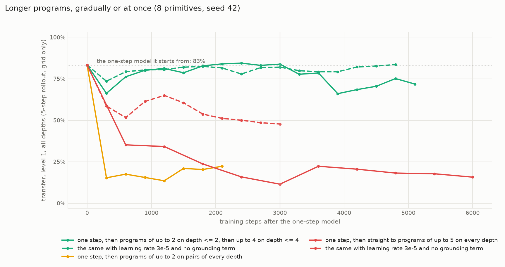

랩 NEO와 다른 점: 공통 설정 그대로다.

**나온 것.** seed 42에서는 두 단계 내내 83% 근처를 지켰다. 효과는 rollout 길이가 아니라 지금 허락된 길이로 설명할 수 없는 pair를 빼는 데서 나왔다. seed 43과 44에서는 무너져 세 seed 평균이 63%, 50%, 40%다.

### 8번째 실험까지의 insight

고쳐진 것.

- 앞서 한 말: 되는 한 단계 모델에서 여러 단계 학습을 이어 가면 수백 스텝 안에 83%에서 6에서 19%로 무너진다. 망가지는 것은 programmer가 code를 고르는 능력이다.
  지금: 되는 한 단계 모델에서 여러 단계 학습을 이어 가면 수백 스텝 안에 무너진다. 허락된 길이로 설명할 수 없는 pair를 빼면 seed 42에서는 83%를 지킨다. 효과는 rollout 길이가 아니라 데이터 제한에서 온다. 다만 출발 code가 덜 깨끗한 seed 43과 44에서는 무너졌고, 깊이를 제한하려면 숨은 깊이를 읽어야 한다.
  무엇을 보고: 길이를 줄이고 모든 깊이를 준 대조는 25%로 무너졌고, 길이는 5인데 깊이 2 이하만 준 대조는 85%였다.

그대로인 것.

- state 표현과 단계 사이로 넘기는 것
    - 격자 하나를 latent 하나에 담는 것은 15칸 격자에 모자라지만, 공식 NEO가 0에 머무는 이유는 그것만이 아니다
    - 단계 사이에 확률을 넘기면 격자에 보이지 않는 정보가 건너가고, code 둘이 주소가 된다
- code 형성: programmer와 codebook이 primitive마다 code를 세우는 일
    - transfer를 정하는 것은 어디서나 통하는 code 하나를 가진 primitive의 수다
    - 여러 단계로 학습하면 primitive는 여러 code로 설명되는 단계를 거쳐 차례로 code를 얻는다
    - 남는 code와 다시 뿌리기는 primitive를 입력에 따라 쪼갠다
    - 랩 programmer는 code를 늦게 찾고, 칸마다 이어 붙인 넓은 programmer가 빨리 찾는다
    - 예시를 다시 만들기만 하면 채워지는 목표 아래에서 여러 단계를 함께 학습하면 code가 primitive가 아닌 것으로 굳는다
    - primitive 하나짜리 과제로 한 단계만 배운 code는 이어 쓸 수 있다
    - primitive가 16개를 넘으면 회전, 뒤집기, 전치 계열이 빠진다
- 여러 단계 program: programmer의 계획과 평가 때의 탐색
    - 이어 쓰면 길이가 늘수록 transfer가 줄고 길이 6부터 급히 준다
- 재는 방법
    - seed 하나의 값으로 말하지 않는다
    - transfer는 확률을 넘기는 방식과 격자만 넘기는 방식 둘 다로 잰다

## 9. 양을 code에 담기: 학습하지 않은 칸 수를 말할 수 있는가

2026-11-22에서 23. 근거는 `docs/reports/2026-11-22-kind-and-amount.md`와 `docs/project-overview.md` 5.9절.

**물은 것.** 한 칸, 두 칸, 세 칸 이동을 배운 모델이 네 칸 이동을 학습하지 않고도 말할 수 있는가.

**한 것.** 네 방향 한 칸에서 여섯 칸 이동 24개의 묶음에서 네 칸 이동 넷을 학습에서 뺐다. 네 갈래를 시험했다. code를 종류와 정수 양으로 부르고 양만큼 회전시켜 만드는 codebook, 양이 더해지게 하는 학습 항, code 하나와 실행 횟수로 된 program, 그리고 programmer가 종류와 양을 함께 말하고 executor가 단위 code를 양만큼 반복 실행하는 모델이다.

**랩 NEO와 다른 점, 이 실험의 공통 설정.**

| 항목 | 랩 NEO | 이 실험 |
|---|---|---|
| 데이터 | BabyTheorist single-A 레벨 1의 학습 파일. pair 하나씩이고 70%가 primitive 여럿짜리다 | 네 방향 한 칸에서 여섯 칸 이동 24개. 네 칸 이동 넷은 학습 파일에서 빼고 평가에만 둔다. 모두 primitive 하나짜리다 |
| programmer | 지금 칸 token과 목표 칸 token을 따로 넣는 6층 transformer, 폭 128 | 지금 칸과 목표 칸을 칸마다 이어 붙인 token을 넣는 token_pair_transformer, 폭 256 |
| codebook | 랩 VQ. cosine으로 가장 가까운 code를 고른다. code 16개, 16차원, commitment 0.25 | 갈래에 따라 랩 VQ, code를 종류와 양으로 부르는 vq_orbit, 회전 각을 고정한 Lie algebra codebook |
| program 길이와 단계 사이로 넘기는 것 | 최대 다섯 단계. 단계 사이에 칸마다의 색 확률을 넘긴다 | program 한 단계 |
| code를 고르고 학습하는 방식 | programmer가 pair 하나를 보고 낸 출력에 가장 가까운 code를 쓴다. 길이는 길이마다 0.95를 곱한 cross-entropy가 가장 작은 것으로 고르고, 그 길이의 cross-entropy, grounding 항 0.1, codebook loss로 모든 부품을 함께 학습한다 | 갈래에 따라 랩 방식, 양이 더해지게 하는 항을 더한 neo_compose, code 하나를 횟수만큼 실행하는 neo_repeat, programmer가 종류와 양을 고르는 neo_counted |
| 학습 일정 | 학습률 3e-4, batch 256 episode, 78,200스텝, 가중치 평균 0.999 | batch 128 pair, 24,000스텝, 가중치 평균 끔, programmer 학습률은 0.25배, forward를 torch.compile로 묶음 |
| 평가 때의 추론 | programmer가 support pair 하나를 보고 고른 code 열을 query에 그대로 실행한다. 탐색하지 않는다 | 갈래에 따라 code 하나를 1번에서 6번 이어 실행하는 탐색을 쓴다 |
| 학습이 읽는 정보 | 입력과 출력 격자만 읽는다 | 입력과 출력 격자, 그리고 pair를 고르는 데 숨은 길이 |

표에 없는 항목은 랩 NEO와 같다.

**Table 9.1.** codebook에 구조만 넣은 첫 시도, seed 42

| 모델 | 학습한 20개, 설명 / transfer | 네 칸, code 하나 | 네 칸, code 둘짜리 program | 네 칸, code 하나를 반복 |
|---|---|---|---|---|
| 랩 VQ | 90.5% / 85.7% | 0% / 0% | 51.1% / 42.6% | 100% / 95.3% |
| 회전 codebook | 100% / 100% | 3.4% / 1.7% | 84.0% / 77.9% | 100% / 93.8% |

랩 NEO와 다른 점: 첫 줄은 codebook이 랩 VQ다. 둘째 줄은 codebook만 vq_orbit이다. 오른쪽 두 열은 평가 때 code 둘짜리 program이나 code 하나의 반복을 탐색한 값이다.

**Table 9.2.** 회전 각을 고정한 Lie algebra codebook의 학습하지 않은 네 칸 이동

| seed | 끝 checkpoint의 4칸 transfer | 비고 |
|---|---|---|
| 42 | 92% | 21,600스텝 94% |
| 43 | 99% | |
| 44 | 53% | 21,600스텝 76%였다가 끝에 학습한 이동까지 57%로 떨어짐 |
| 대조: 항목을 관계없는 벡터로 둠, 세 seed | 0%에서 4% | 학습한 20개는 78%까지 감 |

랩 NEO와 다른 점: codebook이 Lie algebra 형태이고 programmer가 종류와 양을 함께 고르며 executor가 단위 code를 양만큼 반복 실행한다. 대조 줄은 항목을 관계없는 벡터로 둔 것이다.

**Figure 9.1.** 작은 이동 묶음에서 모델별로 본 결과

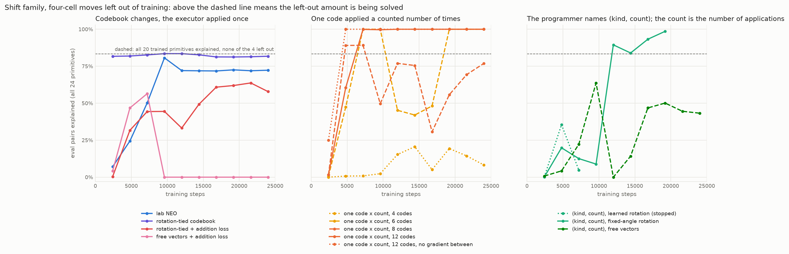

랩 NEO와 다른 점: 공통 설정 그대로이고 선마다 codebook과 실행 방식이 다르다.

**Figure 9.2.** Lie algebra codebook이 학습하지 않은 네 칸 이동을 맞히는 비율의 학습 곡선

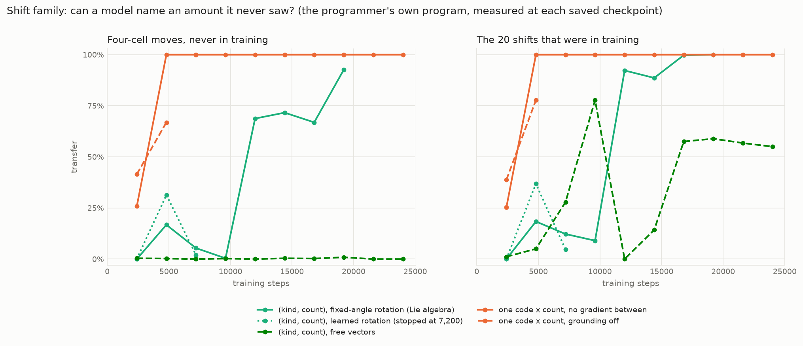

랩 NEO와 다른 점: codebook이 Lie algebra 형태인 것과 관계없는 벡터인 것의 비교다.

**나온 것.** codebook에 구조만 넣은 첫 시도는 학습하지 않은 양을 내지 못했다. 양이 더해지게 하는 학습 항은 모두 학습을 망가뜨렸다. 양은 실행 횟수에 이미 들어 있었다. code 하나를 여러 번 이어 실행하는 탐색으로는 네 칸을 100% 재현했다. programmer가 종류와 횟수를 스스로 고르는 Lie algebra codebook 모델은 학습에서 뺀 네 칸 이동을 92%, 99%, 53% 풀었고 관계없는 벡터로 둔 대조는 0에서 4%였다.

### 9번째 실험까지의 insight

새로 알게 된 것.

- 양이 더해지는 성질은 loss로 가르칠 수 없었고 실행 방식으로 보장해야 했다. 덧셈을 loss로 건 시도는 모두 학습을 망가뜨렸고, code 하나를 여러 번 이어 실행하면 학습하지 않은 네 칸 이동이 100% 재현됐다.
- code를 종류와 양으로 부르고 양만큼 회전시켜 만드는 codebook에서 programmer가 종류와 횟수를 고르게 하면, 학습에서 뺀 네 칸 이동을 seed 셋에서 92%, 99%, 53% 푼다. 항목을 관계없는 벡터로 두면 0에서 4%다.
- code 벡터가 놓인 모양과 executor가 그 벡터로 하는 일은 별개다. 이동 칸 수의 code들은 한 평면의 호 위에 순서대로 놓이지만, 그 호를 따라 한 칸 더 간 벡터를 executor에 주면 학습된 code와 cosine이 0.94인데도 정확히 옮기는 비율이 32%다.

그대로인 것.

- state 표현과 단계 사이로 넘기는 것
    - 격자 하나를 latent 하나에 담는 것은 15칸 격자에 모자라지만, 공식 NEO가 0에 머무는 이유는 그것만이 아니다
    - 단계 사이에 확률을 넘기면 격자에 보이지 않는 정보가 건너가고, code 둘이 주소가 된다
- code 형성: programmer와 codebook이 primitive마다 code를 세우는 일
    - transfer를 정하는 것은 어디서나 통하는 code 하나를 가진 primitive의 수다
    - 여러 단계로 학습하면 primitive는 여러 code로 설명되는 단계를 거쳐 차례로 code를 얻는다
    - 남는 code와 다시 뿌리기는 primitive를 입력에 따라 쪼갠다
    - 랩 programmer는 code를 늦게 찾고, 칸마다 이어 붙인 넓은 programmer가 빨리 찾는다
    - 예시를 다시 만들기만 하면 채워지는 목표 아래에서 여러 단계를 함께 학습하면 code가 primitive가 아닌 것으로 굳는다
    - primitive 하나짜리 과제로 한 단계만 배운 code는 이어 쓸 수 있다
    - 여러 단계 학습은 허락된 길이로 설명할 수 없는 pair를 억지로 맞출 때 code를 휘게 한다
    - primitive가 16개를 넘으면 회전, 뒤집기, 전치 계열이 빠진다
- 여러 단계 program: programmer의 계획과 평가 때의 탐색
    - 이어 쓰면 길이가 늘수록 transfer가 줄고 길이 6부터 급히 준다
- 재는 방법
    - seed 하나의 값으로 말하지 않는다
    - transfer는 확률을 넘기는 방식과 격자만 넘기는 방식 둘 다로 잰다

## 10. 크기 사다리: primitive 8개에서 64개까지

2026-11-22. 근거는 `docs/reports/2026-11-22-scaling.html`과 `docs/project-overview.md` 5.10절.

**물은 것.** primitive 수만 늘리면 같은 모델이 어떻게 변하는가. 환경이 커져도 배우는 속도와 닿는 높이가 유지되는가.

**한 것.** primitive 묶음을 8, 16, 24, 32, 52, 64개로 만들어 앞 크기의 묶음이 뒤 크기에 그대로 들어가게 했다. 크기마다 처음부터 같은 24,000스텝을 primitive 하나짜리 pair로 학습했다. 랩 방식의 한 단계 모델, code 하나를 반복 실행하는 모델, Lie algebra codebook 모델을 같은 사다리에 올렸다.

**랩 NEO와 다른 점, 이 실험의 공통 설정.**

| 항목 | 랩 NEO | 이 실험 |
|---|---|---|
| 데이터 | BabyTheorist single-A 레벨 1의 학습 파일. pair 하나씩이고 70%가 primitive 여럿짜리다 | 이 레포의 생성기로 만든 primitive 묶음 8, 16, 24, 32, 52, 64개. 숨은 길이를 읽어 primitive 하나짜리 pair만 쓴다 |
| programmer | 지금 칸 token과 목표 칸 token을 따로 넣는 6층 transformer, 폭 128 | 지금 칸과 목표 칸을 칸마다 이어 붙인 token을 넣는 token_pair_transformer, 폭 256 |
| codebook | 랩 VQ. cosine으로 가장 가까운 code를 고른다. code 16개, 16차원, commitment 0.25 | 랩 VQ 그대로이고 code 수만 primitive 수의 두 배 |
| program 길이와 단계 사이로 넘기는 것 | 최대 다섯 단계. 단계 사이에 칸마다의 색 확률을 넘긴다 | program 한 단계 |
| 학습 일정 | 학습률 3e-4, batch 256 episode, 78,200스텝, 가중치 평균 0.999 | batch 128 pair, 24,000스텝, 가중치 평균 끔, programmer 학습률은 0.25배, forward를 torch.compile로 묶음 |
| 학습이 읽는 정보 | 입력과 출력 격자만 읽는다 | 입력과 출력 격자, 그리고 pair를 고르는 데 숨은 길이 |

표에 없는 항목은 랩 NEO와 같다.

**Table 10.1.** 크기마다 더해진 primitive

| 크기 | 더해진 primitive |
|---|---|
| 8 | rot90, flip_h, flip_v, next_color, translate_up, translate_down, translate_left, translate_right |
| 16 | shift_up, shift_down, shift_left, shift_right, rot180, rot270, transpose, prev_color |
| 24 | to_top, to_bottom, to_left, to_right, anti_transpose, color_plus3, hollow, add_border |
| 32 | fill_bbox, invert_in_bbox, scale2, stretch_w, mirror_right, mirror_left, mirror_down, mirror_up |
| 52 | 네 방향 2, 3, 5, 6칸 이동 16개. 4칸 이동 넷은 학습에서 뺐다 |
| 64 | color_plus2, color_plus4, color_plus5, color_plus6, 대각선 1칸과 2칸 이동 8개 |

랩 NEO와 다른 점: 데이터의 정의다. 8개가 BabyTheorist의 기본 primitive이고 나머지는 이 레포가 더했다.

**Table 10.2.** 환경 크기별 학습 batch 정답률과 transfer

| 크기 | 8 | 16 | 24 | 32 | 52 | 64 |
|---|---|---|---|---|---|---|
| 학습 batch, 끝 | 99% | 93% | 80% | 92% | 93% | 93% |
| transfer, 끝 | 97% | 59% | 61% | 74% | 80% | 80% |

랩 NEO와 다른 점: 공통 설정 그대로다. 부품과 code를 고르는 방식은 랩과 같다.

**Table 10.3.** 숨은 program 길이별 transfer

| 크기 | 길이 1 | 길이 2 | 길이 3 | 길이 4 |
|---|---|---|---|---|
| 8 | 97% | 84% | 62% | 35% |
| 16 | 58% | 33% | 16% | 7% |
| 24 | 61% | 33% | 14% | 4% |
| 32 | 74% | 34% | 11% | 4% |

랩 NEO와 다른 점: 공통 설정에 더해, 평가 때 단계마다 격자로 읽어 다음 code를 고르며 이어 쓴다.

**Figure 10.1.** 랩 방식 한 단계 모델, 환경 크기마다 한 선

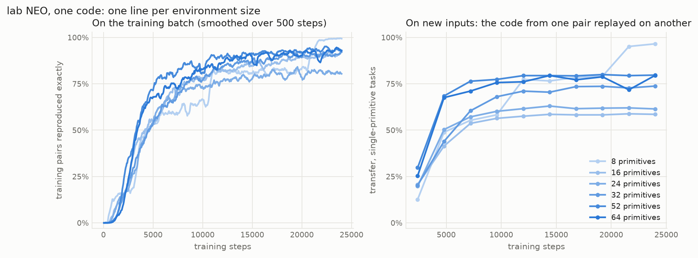

랩 NEO와 다른 점: 공통 설정 그대로다.

**Figure 10.2.** 과제 종류별로 본 끝 성능

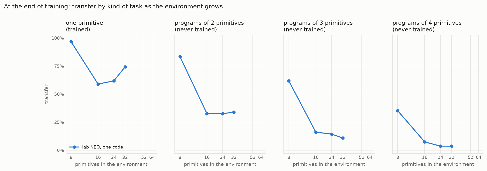

랩 NEO와 다른 점: 공통 설정 그대로다.

**Figure 10.3.** 환경이 커질 때 이미 있던 primitive의 transfer

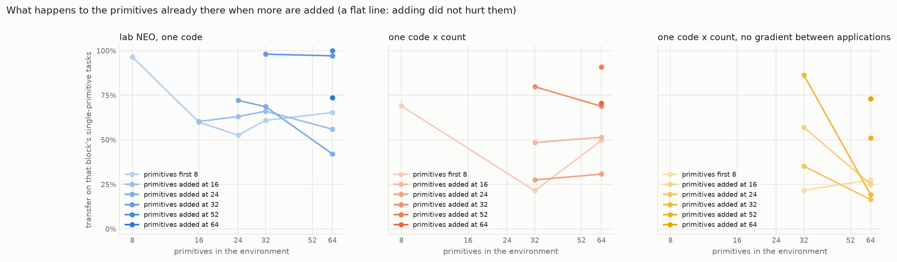

랩 NEO와 다른 점: 공통 설정 그대로다.

**Figure 10.4.** 숨은 program이 길어질 때

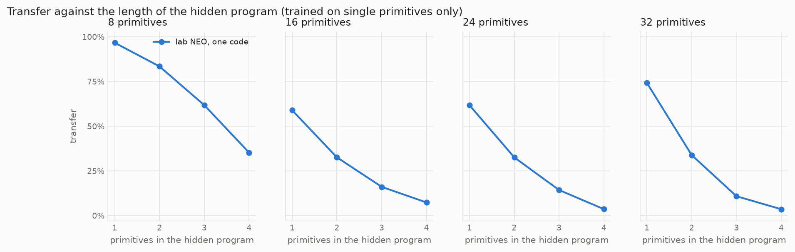

랩 NEO와 다른 점: 공통 설정에 더해 평가 때 이어 쓴다.

**Figure 10.5.** 일정 수준에 닿는 데 걸린 학습량

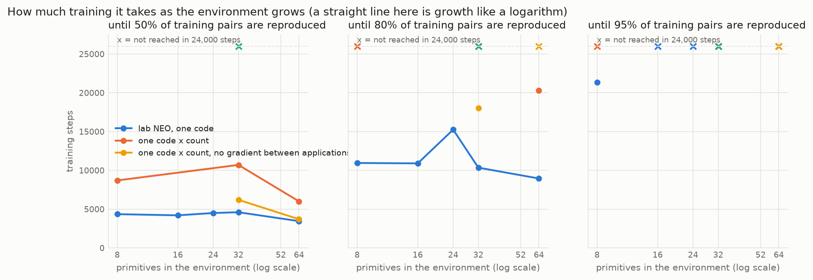

랩 NEO와 다른 점: 공통 설정 그대로다.

**Figure 10.6.** 모델을 나란히 놓은 학습 곡선

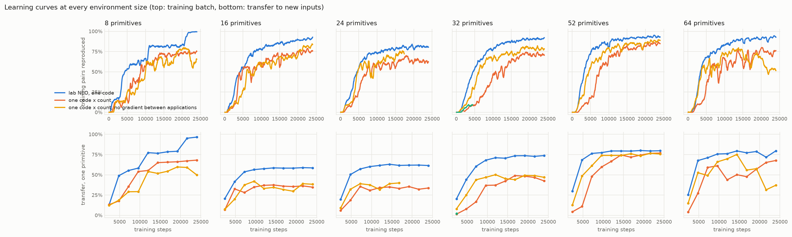

랩 NEO와 다른 점: 선마다 모델이 다르다. 랩 방식, code 하나를 횟수만큼 실행하는 모델, Lie algebra codebook 모델이다.

**Figure 10.7.** code 하나를 횟수만큼 실행하는 모델, 환경 크기마다 한 선

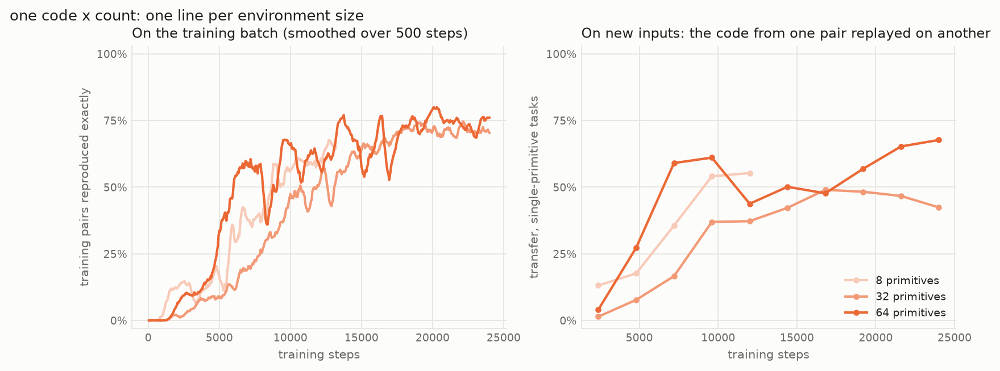

랩 NEO와 다른 점: program이 code 하나와 실행 횟수로 되어 있다.

**Figure 10.8.** 같은 모델에서 실행 사이 gradient를 끊은 것

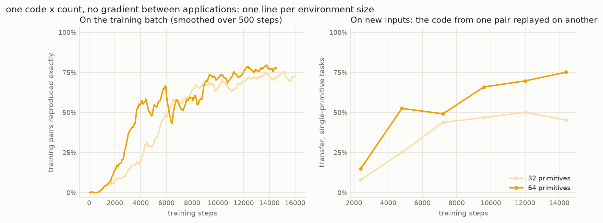

랩 NEO와 다른 점: program이 code 하나와 실행 횟수이고 반복 실행 사이에 gradient를 끊는다.

**Figure 10.9.** 회전 각을 고정한 Lie algebra codebook 모델, 환경 크기마다 한 선

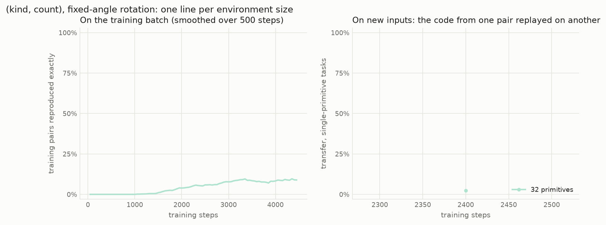

랩 NEO와 다른 점: codebook이 Lie algebra 형태이고 programmer가 종류와 양을 고른다.

**나온 것.** 환경이 커져도 학습 batch 정답률이 50%에 닿는 스텝은 3,500에서 4,750으로 느려지지 않는다. 갈리는 것은 닿는 높이다. 처음 8개의 transfer는 8개 환경에서 96%인데 16개 환경에서 60%다. 16개에서 들어온 것은 기존 회전과 뒤집기와 비슷한 일을 하는 primitive다. 기존 것과 겹치지 않는 primitive는 98% 근처이고 해를 끼치지 않는다.

### 10번째 실험까지의 insight

새로 알게 된 것.

- primitive를 8개에서 64개로 늘려도 학습 batch 정답률이 50%에 닿는 스텝은 느려지지 않는다. 갈리는 것은 닿는 높이다.

고쳐진 것.

- 앞서 한 말: primitive가 11개까지는 거의 다 code 하나씩을 얻지만 16개를 넘으면 회전, 뒤집기, 전치 계열이 8에서 24%로 빠지고 이동은 code의 기준이 칸 수로 바뀐다. 예시 하나로는 위로 3칸과 자기 높이인 3칸만큼 위로가 구별되지 않는다.
  지금: 환경의 어려움은 primitive 수가 아니라 비슷한 일을 하는 primitive가 함께 있느냐가 정한다. 처음 8개의 transfer가 8개 환경에서 96%인데 회전과 전치가 더해진 16개 환경에서 60%로 내려간다. 기존 것과 겹치지 않는 primitive는 98% 근처이고 해를 끼치지 않는다.
  무엇을 보고: 64개 환경의 transfer가 16개와 24개보다 높았다. 52개와 64개에 더한 것은 대부분 쉬운 이동이다.
- 앞서 한 말: 한 단계 모델을 이어 쓰면 길이 하나마다 transfer가 0.8배쯤으로 줄다가 길이 6부터 빨리 준다.
  지금: 한 단계 모델을 이어 쓴 transfer는 길이 1의 transfer를 길이만큼 곱한 값에 가깝다. 16개 이상 환경에서는 길이가 하나 늘 때마다 대략 절반이 된다.
  무엇을 보고: 여섯 크기에서 길이별 값을 나란히 놓았다.

그대로인 것.

- state 표현과 단계 사이로 넘기는 것
    - 격자 하나를 latent 하나에 담는 것은 15칸 격자에 모자라지만, 공식 NEO가 0에 머무는 이유는 그것만이 아니다
    - 단계 사이에 확률을 넘기면 격자에 보이지 않는 정보가 건너가고, code 둘이 주소가 된다
- code 형성: programmer와 codebook이 primitive마다 code를 세우는 일
    - transfer를 정하는 것은 어디서나 통하는 code 하나를 가진 primitive의 수다
    - 여러 단계로 학습하면 primitive는 여러 code로 설명되는 단계를 거쳐 차례로 code를 얻는다
    - 남는 code와 다시 뿌리기는 primitive를 입력에 따라 쪼갠다
    - 랩 programmer는 code를 늦게 찾고, 칸마다 이어 붙인 넓은 programmer가 빨리 찾는다
    - 예시를 다시 만들기만 하면 채워지는 목표 아래에서 여러 단계를 함께 학습하면 code가 primitive가 아닌 것으로 굳는다
    - primitive 하나짜리 과제로 한 단계만 배운 code는 이어 쓸 수 있다
    - 여러 단계 학습은 허락된 길이로 설명할 수 없는 pair를 억지로 맞출 때 code를 휘게 한다
- executor: code가 어디서나 같은 변환인가
    - code가 놓인 모양과 executor가 하는 일은 별개다
- 양과 구조를 넣은 codebook
    - 양이 더해지는 성질은 loss가 아니라 실행 방식으로 보장해야 한다
    - 구조를 넣은 codebook은 본 적 없는 양을 말한다
- 재는 방법
    - seed 하나의 값으로 말하지 않는다
    - transfer는 확률을 넘기는 방식과 격자만 넘기는 방식 둘 다로 잰다

## 11. 커지는 환경: 새 primitive 하나를 배우는 비용

2026-11-22에서 23. 근거는 `docs/project-overview.md` 5.11절.

**물은 것.** 모델 하나가 학습을 멈추지 않는 동안 환경이 커질 때, 새 primitive 하나를 배우는 비용이 어떻게 변하고 옛것은 유지되는가.

**한 것.** 모델 하나를 8, 16, 24, 32, 52, 64개 환경으로 단계마다 6,000스텝씩 이어 학습했다. codebook은 처음부터 128개다. 대조는 환경을 8개로 둔 채 단계만 나눈 사슬이다. 새 primitive의 비용은 새로 들어온 묶음이 transfer 50%에 닿을 때까지 primitive 하나당 본 pair 수로 센다.

**랩 NEO와 다른 점, 이 실험의 공통 설정.**

| 항목 | 랩 NEO | 이 실험 |
|---|---|---|
| 데이터 | BabyTheorist single-A 레벨 1의 학습 파일. pair 하나씩이고 70%가 primitive 여럿짜리다 | 학습 도중 환경이 8, 16, 24, 32, 52, 64개로 커진다. 단계마다 그 단계의 전체 묶음으로 6,000스텝 |
| programmer | 지금 칸 token과 목표 칸 token을 따로 넣는 6층 transformer, 폭 128 | 지금 칸과 목표 칸을 칸마다 이어 붙인 token을 넣는 token_pair_transformer, 폭 256 |
| codebook | 랩 VQ. cosine으로 가장 가까운 code를 고른다. code 16개, 16차원, commitment 0.25 | 처음부터 code 128개. 모델에 따라 랩 VQ나 Lie algebra codebook |
| executor | 4층 AdaLN-Zero transformer, 폭 128. code는 층마다 scale, shift, gate를 만드는 조절 신호다 | 모델에 따라 랩 executor, code 하나를 반복 실행하는 형태, 공유 up-projection과 code별 low-rank를 둔 형태 |
| program 길이와 단계 사이로 넘기는 것 | 최대 다섯 단계. 단계 사이에 칸마다의 색 확률을 넘긴다 | program 한 단계 |
| 학습 일정 | 학습률 3e-4, batch 256 episode, 78,200스텝, 가중치 평균 0.999 | batch 128 pair, 24,000스텝, 가중치 평균 끔, programmer 학습률은 0.25배, forward를 torch.compile로 묶음 |
| 학습이 읽는 정보 | 입력과 출력 격자만 읽는다 | 입력과 출력 격자, 그리고 pair를 고르는 데 숨은 길이 |

표에 없는 항목은 랩 NEO와 같다.

**Table 11.1.** 커지는 환경에서 새 primitive의 비용과 처음 8개의 유지

| 모델 | 16 | 24 | 32 | 52 | 64 |
|---|---|---|---|---|---|
| 랩 NEO, 50%까지 스텝 | 1,000 | 3,000 | 2,000 | 4,000 | 5,000 |
| 랩 NEO, primitive 하나당 pair | 8,000 | 16,000 | 8,000 | 10,667 | 10,667 |
| 랩 NEO, 처음 8개의 단계 끝 transfer | 73% | 71% | 74% | 62% | 53% |
| 환경을 8개로 둔 대조, 같은 시점 | 79% | 98% | 98% | 98% | 98% |

랩 NEO와 다른 점: 랩 방식 줄은 공통 설정 그대로, 곧 부품과 code를 고르는 방식이 랩과 같고 codebook만 128개다.

**Figure 11.1.** 점점 커지는 환경에서의 transfer

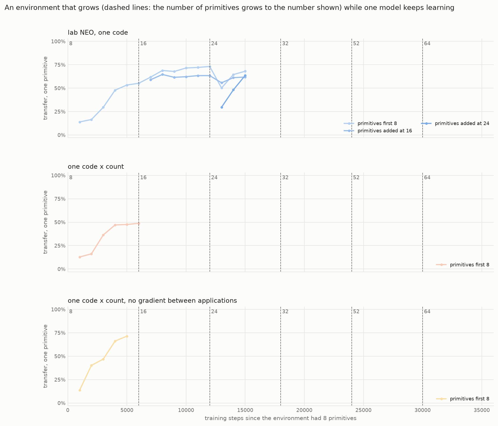

랩 NEO와 다른 점: 선마다 모델이 다르다. 랩 방식, code 하나 반복, Lie algebra codebook이다.

**Figure 11.2.** 새로 들어온 primitive를 배우는 속도

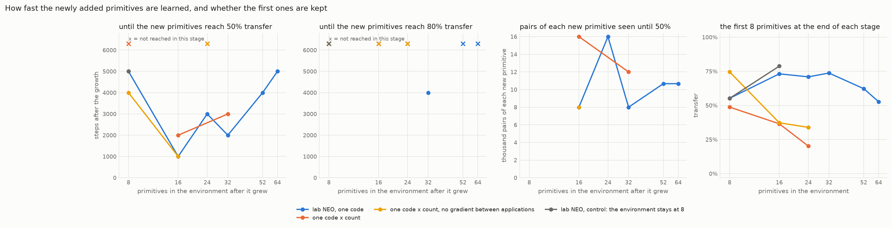

랩 NEO와 다른 점: 선마다 모델이 다르다. 랩 방식, code 하나 반복, Lie algebra codebook이다.

**나온 것.** 랩 방식에서 새 primitive 하나의 비용은 primitive 하나당 본 pair로 세면 8천에서 1만 6천으로 거의 평평하다. 다만 새 것이 옛것을 밀어낸다. 처음 8개는 64개 단계 끝에 53%로, 같은 시간 8개만 본 대조의 98%보다 크게 낮다. Lie algebra codebook 모델은 이 사슬에서 처음 8개가 5에서 39%에 머물렀다.

### 11번째 실험까지의 insight

새로 알게 된 것.

- 커지는 환경에서 랩 방식이 새 primitive 하나를 배우는 비용은 primitive 하나당 본 pair로 세면 8천에서 1만 6천으로 거의 평평하다.
- 커지는 환경에서 새 primitive가 들어오면 옛것이 밀려난다. 처음 8개의 transfer가 64개 단계 끝에 53%로, 같은 시간 8개만 본 대조의 98%보다 크게 낮다.

고쳐진 것.

- 앞서 한 말: code를 종류와 양으로 부르고 양만큼 회전시켜 만드는 codebook에서 programmer가 종류와 횟수를 고르게 하면, 학습에서 뺀 네 칸 이동을 seed 셋에서 92%, 99%, 53% 푼다. 항목을 관계없는 벡터로 두면 0에서 4%다.
  지금: code를 종류와 양으로 부르는 codebook은 이동 24개의 작은 묶음에서 학습에서 뺀 네 칸 이동을 92%, 99%, 53% 풀었다. 그러나 커지는 환경에 넣으면 처음 8개가 5에서 39%에 머물러 그 결과가 넘어오지 않았다.
  무엇을 보고: 같은 모델을 커지는 환경의 사슬에 올렸다.

그대로인 것.

- state 표현과 단계 사이로 넘기는 것
    - 격자 하나를 latent 하나에 담는 것은 15칸 격자에 모자라지만, 공식 NEO가 0에 머무는 이유는 그것만이 아니다
    - 단계 사이에 확률을 넘기면 격자에 보이지 않는 정보가 건너가고, code 둘이 주소가 된다
- code 형성: programmer와 codebook이 primitive마다 code를 세우는 일
    - transfer를 정하는 것은 어디서나 통하는 code 하나를 가진 primitive의 수다
    - 여러 단계로 학습하면 primitive는 여러 code로 설명되는 단계를 거쳐 차례로 code를 얻는다
    - 남는 code와 다시 뿌리기는 primitive를 입력에 따라 쪼갠다
    - 랩 programmer는 code를 늦게 찾고, 칸마다 이어 붙인 넓은 programmer가 빨리 찾는다
    - 예시를 다시 만들기만 하면 채워지는 목표 아래에서 여러 단계를 함께 학습하면 code가 primitive가 아닌 것으로 굳는다
    - primitive 하나짜리 과제로 한 단계만 배운 code는 이어 쓸 수 있다
    - 여러 단계 학습은 허락된 길이로 설명할 수 없는 pair를 억지로 맞출 때 code를 휘게 한다
    - 환경의 어려움은 primitive 수가 아니라 비슷한 primitive가 함께 있느냐가 정한다
- executor: code가 어디서나 같은 변환인가
    - code가 놓인 모양과 executor가 하는 일은 별개다
- 여러 단계 program: programmer의 계획과 평가 때의 탐색
    - 이어 쓴 transfer는 길이 1의 값을 길이만큼 곱한 값에 가깝다
- 양과 구조를 넣은 codebook
    - 양이 더해지는 성질은 loss가 아니라 실행 방식으로 보장해야 한다
- 환경이 커질 때와 아는 것 위에 쌓기
    - 환경이 커져도 배우는 속도는 느려지지 않고 닿는 높이가 갈린다
- 재는 방법
    - seed 하나의 값으로 말하지 않는다
    - transfer는 확률을 넘기는 방식과 격자만 넘기는 방식 둘 다로 잰다

## 12. 회전 계열: 큰 환경에서 무너지는 일곱 개의 원인

2026-11-22에서 23. 근거는 `docs/project-overview.md` 5.12절.

**물은 것.** 24개 환경에서 회전, 뒤집기, 전치 계열 일곱 개만 12에서 20%로 무너진다. 어느 부품이 못 하는 것인가.

**한 것.** code 벡터의 비슷함, 원리적으로 구별되지 않는 pair의 비율, 생성원만 학습시킨 경우를 차례로 확인했다. primitive마다 정답 code를 주는 진단과 programmer 출력의 선형 분류기로 세 부품이 각각 배울 수 있는지 봤다. programmer가 이 계열을 어느 code로 보내는지 셌다. 그리고 라벨 없이 푸는 시도 열세 가지와 여덟 배 긴 학습을 돌렸다.

**랩 NEO와 다른 점, 이 실험의 공통 설정.**

| 항목 | 랩 NEO | 이 실험 |
|---|---|---|
| 데이터 | BabyTheorist single-A 레벨 1의 학습 파일. pair 하나씩이고 70%가 primitive 여럿짜리다 | 24개 환경. 숨은 길이를 읽어 primitive 하나짜리 pair만 쓴다 |
| programmer | 지금 칸 token과 목표 칸 token을 따로 넣는 6층 transformer, 폭 128 | 지금 칸과 목표 칸을 칸마다 이어 붙인 token을 넣는 token_pair_transformer, 폭 256 |
| codebook | 랩 VQ. cosine으로 가장 가까운 code를 고른다. code 16개, 16차원, commitment 0.25 | 랩 VQ 그대로이고 code 수만 primitive 수의 두 배 |
| executor | 4층 AdaLN-Zero transformer, 폭 128. code는 층마다 scale, shift, gate를 만드는 조절 신호다 | 시도마다 랩 executor, code마다 executor 하나, 공유 부분과 code별 low-rank, 층 단위로 공유와 code별을 나눈 것 |
| program 길이와 단계 사이로 넘기는 것 | 최대 다섯 단계. 단계 사이에 칸마다의 색 확률을 넘긴다 | program 한 단계 |
| code를 고르고 학습하는 방식 | programmer가 pair 하나를 보고 낸 출력에 가장 가까운 code를 쓴다. 길이는 길이마다 0.95를 곱한 cross-entropy가 가장 작은 것으로 고르고, 그 길이의 cross-entropy, grounding 항 0.1, codebook loss로 모든 부품을 함께 학습한다 | 시도마다 다르다. 랩 방식, 가까운 후보를 실행해 가장 잘 재현한 code만 학습, 굳은 뒤에 시작하는 soft EM, programmer와 executor 번갈아 얼리기, 그리고 primitive마다 정답 code를 주는 진단 |
| 학습 일정 | 학습률 3e-4, batch 256 episode, 78,200스텝, 가중치 평균 0.999 | batch 128 pair, 24,000스텝, 가중치 평균 끔, programmer 학습률은 0.25배, forward를 torch.compile로 묶음 |
| 학습이 읽는 정보 | 입력과 출력 격자만 읽는다 | 입력과 출력 격자, 그리고 pair를 고르는 데 숨은 길이 |
| 랩 NEO에 없는 단계 | 없다 | 시도 가운데 잠. 자주 쓰이는데 자기 pair를 60% 미만으로 재현하는 code 옆에 새 code를 놓는다 |

표에 없는 항목은 랩 NEO와 같다.

**Table 12.1.** 회전 계열에 시도한 것 전부, 24개 환경 seed 42

| 시도 | 출발 | 무엇을 바꿨나 | 회전 계열 평균, 범위 | 나머지 17개 |
|---|---|---|---|---|
| 랩 NEO, 출발점 | 처음부터 | 기준 run | 16%, 13%에서 20% | 82% |
| 랩 programmer | 처음부터 | 지금 칸과 목표 칸을 두 token으로 넣는 원래 구조 | 16% | 79% |
| 두 배 깊은 programmer | 처음부터 | 12층 | 16% | 88% |
| code마다 executor 하나 | 이어서 | 다 배운 랩 executor를 code 48개에 복사해 이어 학습. 사용자의 제안 | 17% | 90% |
| 공유 executor와 code별 low-rank | 처음부터 | up-projection은 공유, down-projection은 code별, rank 8. 사용자의 제안 | 16% | 82% |
| 공유 2층, code별 2층 | 처음부터 | 층 단위로 공유와 code별을 나눔. 사용자의 제안 | 9% | 49% |
| 실행으로 code 고르기, 후보 4개 | 이어서 | programmer가 낸 가까운 후보를 executor로 모두 실행해 가장 잘 재현한 code만 학습 | 17% | 91% |
| 실행으로 code 고르기, 후보 8개 | 이어서 | 같은 방식 | 16% | 89% |
| 잠: 섞인 code 옆에 새 code | 이어서 | 자주 쓰이는데 자기 pair를 60% 미만으로 재현하는 code를 섞인 것으로 보고, 옆에 조금 비튼 code 셋을 놓음 | 15% | 89% |
| 잠: 무작위 새 code, 한 사이클 | 이어서 | 새 code를 무작위 벡터로 놓고 부모가 가장 가까우면 모두 후보에 넣음 | 20%, 11%에서 47% | 90% |
| 잠: 네 사이클 | 이어서 | 같은 절차를 네 번 | 19% | 88% |
| programmer와 executor 번갈아 얼리기 | 이어서 | 1,000스텝마다 | 16% | 82% |
| soft EM, 온도 10에서 0.1 | 이어서 | 아래 설명 | 20% | 94% |
| soft EM, 온도 100에서 1 | 이어서 | 같은 방식, 더 뜨거운 시작 | 21% | 86% |
| 대조: 그냥 12,000스텝 더 | 이어서 | | 16% | 89% |
| 진단: primitive마다 정답 code | 처음부터 | 라벨을 쓰므로 해결책이 아님 | 90%, 83%에서 98% | 100% |

랩 NEO와 다른 점: 첫 줄이 공통 설정, 곧 부품과 code를 고르는 방식이 랩과 같은 한 단계 학습이다. 줄마다 무엇을 바꿨나 열에 적힌 것 하나만 다르다. 맨 아래 줄은 라벨을 쓰는 진단이다.

**Table 12.2.** 여덟 배 길게 학습한 run

| 200,000스텝 run, 끝 | rot90 | flip_h | flip_v | rot180 | rot270 | transpose | anti_transpose | 평균 | 나머지 17개 |
|---|---|---|---|---|---|---|---|---|---|
| 랩 executor | 17% | 78% | 65% | 28% | 24% | 24% | 19% | 36% | 82% |
| 폭 두 배 executor | 18% | 20% | 25% | 31% | 23% | 18% | 16% | 22% | 88% |

랩 NEO와 다른 점: 공통 설정에서 학습 길이만 200,000스텝이다. 둘째 줄은 executor 폭이 두 배다.

**Figure 12.1.** 회전 계열에 시도한 것 전부

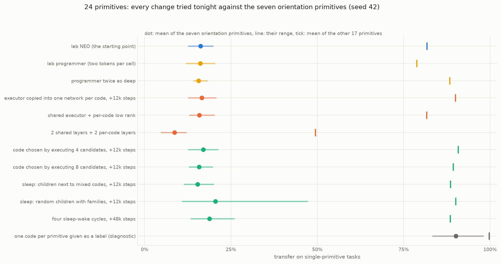

랩 NEO와 다른 점: 표와 같은 run들이다.

**Figure 12.2.** executor의 어느 층을 code끼리 공유할 것인가

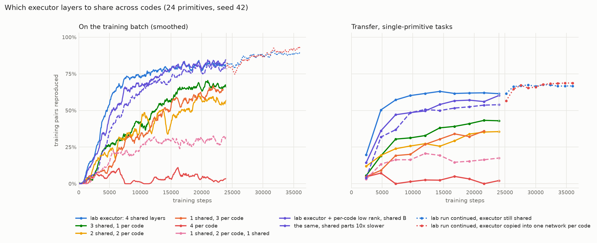

랩 NEO와 다른 점: executor를 공유 층과 code별 층으로 나눈 시도들이다. 나머지는 공통 설정이다.

**나온 것.** primitive마다 정답 code를 주면 같은 공유 executor가 이 계열을 83에서 98%로 해낸다. programmer 출력으로 일곱을 가르는 정확도는 보통 학습에서 38%이고 정답 code로 학습하면 82%다. 세 부품 모두 배울 수 있다. programmer는 90도 회전, 270도 회전, 전치, 반대 전치 넷을 같은 code로 보낸다. 넷은 bbox의 가로세로를 바꾼다는 공통점이 있다. 라벨 없이 시도한 열세 가지는 모두 9에서 21%였다. 여덟 배 길게 학습하면 뒤집기 둘은 풀리지만 넷은 17에서 24%로 남는다. 도중에 executor가 이 계열을 한꺼번에 담지 못한다고 해석했는데, 정답 code 진단을 보고 버렸다.

### 12번째 실험까지의 insight

새로 알게 된 것.

- executor는 primitive마다 code 하나가 정답으로 주어지면 회전 계열을 83에서 98%, 나머지를 100% 해낸다. 큰 환경의 실패는 executor의 용량 문제가 아니다. 폭을 두 배로 해도 풀리지 않는다.
- pair 하나를 재현하는지만 보는 학습 신호 안에는 한 code에 섞인 변환들을 떼어 놓는 힘이 없다. 후보를 실행해 고르기, 잠에서 섞인 code 옆에 새 code 놓기, 번갈아 얼리기, 굳은 뒤의 soft EM을 포함해 라벨 없이 시도한 열세 가지가 모두 9에서 21%였다.
- 24개 환경을 여덟 배인 200,000스텝 학습하면 뒤집기 둘은 78%와 65%로 풀리지만 가로세로를 바꾸는 넷은 17에서 24%로 남는다.

고쳐진 것.

- 앞서 한 말: 환경의 어려움은 primitive 수가 아니라 비슷한 일을 하는 primitive가 함께 있느냐가 정한다. 처음 8개의 transfer가 8개 환경에서 96%인데 회전과 전치가 더해진 16개 환경에서 60%로 내려간다. 기존 것과 겹치지 않는 primitive는 98% 근처이고 해를 끼치지 않는다.
  지금: 큰 환경에서 깨지는 것은 부품이 아니라 정답 없는 code 배정이다. bbox의 가로세로를 바꾸는 넷, 곧 90도와 270도 회전, 전치, 반대 전치가 처음에 한 code로 묶이면 그 code는 넷 가운데 어느 것도 맞추지 못하고, 더 나은 code가 생기지 않아 그대로 굳는다.
  무엇을 보고: programmer가 넷을 같은 code 둘로 보내는 것을 셌고, primitive마다 정답 code를 주면 같은 부품이 83에서 98%를 했다.

그대로인 것.

- state 표현과 단계 사이로 넘기는 것
    - 격자 하나를 latent 하나에 담는 것은 15칸 격자에 모자라지만, 공식 NEO가 0에 머무는 이유는 그것만이 아니다
    - 단계 사이에 확률을 넘기면 격자에 보이지 않는 정보가 건너가고, code 둘이 주소가 된다
- code 형성: programmer와 codebook이 primitive마다 code를 세우는 일
    - transfer를 정하는 것은 어디서나 통하는 code 하나를 가진 primitive의 수다
    - 여러 단계로 학습하면 primitive는 여러 code로 설명되는 단계를 거쳐 차례로 code를 얻는다
    - 남는 code와 다시 뿌리기는 primitive를 입력에 따라 쪼갠다
    - 랩 programmer는 code를 늦게 찾고, 칸마다 이어 붙인 넓은 programmer가 빨리 찾는다
    - 예시를 다시 만들기만 하면 채워지는 목표 아래에서 여러 단계를 함께 학습하면 code가 primitive가 아닌 것으로 굳는다
    - primitive 하나짜리 과제로 한 단계만 배운 code는 이어 쓸 수 있다
    - 여러 단계 학습은 허락된 길이로 설명할 수 없는 pair를 억지로 맞출 때 code를 휘게 한다
- executor: code가 어디서나 같은 변환인가
    - code가 놓인 모양과 executor가 하는 일은 별개다
- 여러 단계 program: programmer의 계획과 평가 때의 탐색
    - 이어 쓴 transfer는 길이 1의 값을 길이만큼 곱한 값에 가깝다
- 양과 구조를 넣은 codebook
    - 양이 더해지는 성질은 loss가 아니라 실행 방식으로 보장해야 한다
    - 구조를 넣은 codebook은 작은 이동 묶음에서만 본 적 없는 양을 말했다
- 환경이 커질 때와 아는 것 위에 쌓기
    - 환경이 커져도 배우는 속도는 느려지지 않고 닿는 높이가 갈린다
    - 새 primitive 하나의 비용은 본 pair 수로 세면 환경 크기에 거의 평평하다
    - 새 것이 옛것을 밀어낸다
- 재는 방법
    - seed 하나의 값으로 말하지 않는다
    - transfer는 확률을 넘기는 방식과 격자만 넘기는 방식 둘 다로 잰다

## 13. support로 검증하는 program 탐색

2026-11-23. 근거는 `docs/project-overview.md` 5.13절, 도구는 `scripts/babytheorist/support_search.py`.

**물은 것.** 한 단계 모델을 이어 쓰면 숨은 길이 8에서 transfer가 7%다. 다시 학습하지 않고 탐색만 바꿔 막을 수 있는가.

**한 것.** 8개 환경에서 한 단계로만 학습한 seed 여섯을 그대로 두고 평가 때의 탐색만 바꿨다. 레벨 1, 5, 7의 평가 과제 2,000개씩을 최대 10단계, 폭 1, 4, 8, 16으로 풀었다. 처음에는 갈래를 support 출력과의 칸별 오차로 줄 세웠는데 폭 4가 폭 1보다 나빠서 programmer의 선호를 누적한 점수로 바꿨다.

**랩 NEO와 다른 점, 이 실험의 공통 설정.**

| 항목 | 랩 NEO | 이 실험 |
|---|---|---|
| 데이터 | BabyTheorist single-A 레벨 1의 학습 파일. pair 하나씩이고 70%가 primitive 여럿짜리다 | primitive 하나짜리 학습 pair만 쓴다. 숨은 길이를 읽어 고른다 |
| programmer | 지금 칸 token과 목표 칸 token을 따로 넣는 6층 transformer, 폭 128 | 지금 칸과 목표 칸을 칸마다 이어 붙인 token을 넣는 token_pair_transformer, 폭 256 |
| codebook | 랩 VQ. cosine으로 가장 가까운 code를 고른다. code 16개, 16차원, commitment 0.25 | 랩 VQ 그대로이고 code 수만 primitive 수의 두 배 |
| program 길이와 단계 사이로 넘기는 것 | 최대 다섯 단계. 단계 사이에 칸마다의 색 확률을 넘긴다 | program 한 단계 |
| 학습 일정 | 학습률 3e-4, batch 256 episode, 78,200스텝, 가중치 평균 0.999 | batch 128 pair, 24,000스텝, 가중치 평균 끔, programmer 학습률은 0.25배, forward를 torch.compile로 묶음 |
| 평가 때의 추론 | programmer가 support pair 하나를 보고 고른 code 열을 query에 그대로 실행한다. 탐색하지 않는다 | support로 검증하는 탐색. 단계마다 programmer 출력에 가까운 code 여러 개를 executor로 실행하고, programmer의 선호를 누적한 점수로 상위 몇 갈래만 남긴다. support 둘을 모두 재현하는 첫 program을 query에 쓴다. 남기는 갈래 수가 폭이고 폭 1은 탐색 없는 이어 쓰기다. 최대 10단계 |
| 학습이 읽는 정보 | 입력과 출력 격자만 읽는다 | 입력과 출력 격자, 그리고 pair를 고르는 데 숨은 길이 |

표에 없는 항목은 랩 NEO와 같다.

**Table 13.1.** 탐색의 폭에 따른 길이별 transfer, seed 여섯 평균

| 숨은 길이 | 폭 1 | 폭 4 | 폭 8 | 폭 16 |
|---|---|---|---|---|
| 1 | 85% | 85% | 86% | 86% |
| 3 | 44% | 56% | 63% | 66% |
| 5 | 24% | 32% | 38% | 44% |
| 6 | 15% | 22% | 28% | 34% |
| 7 | 10% | 17% | 22% | 27% |
| 8 | 7% | 12% | 17% | 22% |

랩 NEO와 다른 점: 모델은 앞의 한 단계 모델 그대로이고 다시 학습하지 않았다. 평가 때의 추론이 랩과 다르다. 랩은 탐색하지 않는다.

**Figure 13.1.** 탐색의 폭에 따른 길이별 transfer

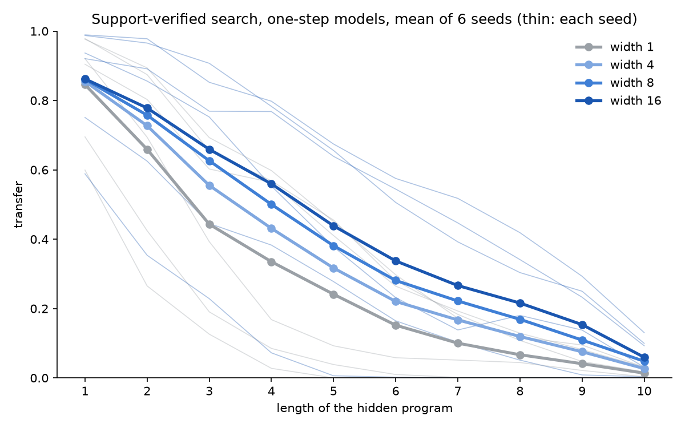

랩 NEO와 다른 점: 위 표와 같은 측정이다.

**Figure 13.2.** 둘째 support로 걸러지는 비율과, support 둘을 통과하고도 query에서 틀리는 비율

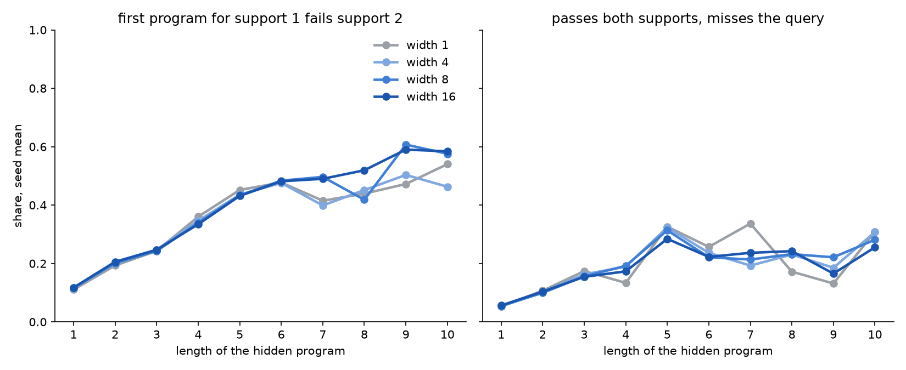

랩 NEO와 다른 점: 위 표와 같은 측정이다. support로 program을 거르는 단계는 랩 NEO에 없다.

**나온 것.** 길이 5에서 8 사이는 탐색만으로 2배에서 3배가 된다. code가 깨끗한 seed는 길이 5에서 8을 모은 transfer가 25% 근처에서 47에서 55%로 오르고, code가 갈라진 seed는 0에서 23%다. 두 support를 다 통과하고도 query에서 틀리는 비율은 길이 5 이후 20에서 30%다. 길이 8에서는 폭 16이어도 과제의 70%쯤이 두 support를 통과하는 program을 찾지 못한다.

### 13번째 실험까지의 insight

새로 알게 된 것.

- support 둘을 통과하고도 query에서 틀리는 program이 길이 5 이후 20에서 30% 있다. 그러나 더 큰 손실은 찾지 못하는 것이다. 길이 8에서는 폭 16이어도 과제의 70%쯤이 두 support를 통과하는 program을 찾지 못한다.

고쳐진 것.

- 앞서 한 말: 한 단계 모델을 이어 쓴 transfer는 길이 1의 transfer를 길이만큼 곱한 값에 가깝다. 16개 이상 환경에서는 길이가 하나 늘 때마다 대략 절반이 된다.
  지금: 한 단계 모델을 탐색 없이 이어 쓰면 길이가 늘수록 transfer가 급히 준다. 그 큰 부분은 한 번 틀리면 되돌리지 못하는 이어 쓰기 탓이다. support로 검증하는 탐색을 폭 16으로 넓히면 다시 학습하지 않고도 길이 8의 transfer가 7%에서 22%가 된다. 갈래의 순위는 support 출력과의 오차가 아니라 programmer의 선호를 누적한 점수로 매겨야 한다.
  무엇을 보고: 8개 환경 seed 여섯에서 폭 1, 4, 8, 16을 나란히 쟀다. 오차로 줄 세우면 폭 4가 폭 1보다 나빴다.

그대로인 것.

- state 표현과 단계 사이로 넘기는 것
    - 격자 하나를 latent 하나에 담는 것은 15칸 격자에 모자라지만, 공식 NEO가 0에 머무는 이유는 그것만이 아니다
    - 단계 사이에 확률을 넘기면 격자에 보이지 않는 정보가 건너가고, code 둘이 주소가 된다
- code 형성: programmer와 codebook이 primitive마다 code를 세우는 일
    - transfer를 정하는 것은 어디서나 통하는 code 하나를 가진 primitive의 수다
    - 여러 단계로 학습하면 primitive는 여러 code로 설명되는 단계를 거쳐 차례로 code를 얻는다
    - 남는 code와 다시 뿌리기는 primitive를 입력에 따라 쪼갠다
    - 랩 programmer는 code를 늦게 찾고, 칸마다 이어 붙인 넓은 programmer가 빨리 찾는다
    - 예시를 다시 만들기만 하면 채워지는 목표 아래에서 여러 단계를 함께 학습하면 code가 primitive가 아닌 것으로 굳는다
    - primitive 하나짜리 과제로 한 단계만 배운 code는 이어 쓸 수 있다
    - 여러 단계 학습은 허락된 길이로 설명할 수 없는 pair를 억지로 맞출 때 code를 휘게 한다
    - 큰 환경의 실패는 비슷한 변환이 한 code에 섞인 채 굳는 것이다
    - pair 하나만 보는 학습 신호 안에는 섞인 code를 떼어 놓는 힘이 없다
    - 오래 학습하면 일부만 풀린다
- executor: code가 어디서나 같은 변환인가
    - code가 놓인 모양과 executor가 하는 일은 별개다
    - executor는 정답 code가 주어지면 회전 계열을 해낸다. 용량 문제가 아니다
- 양과 구조를 넣은 codebook
    - 양이 더해지는 성질은 loss가 아니라 실행 방식으로 보장해야 한다
    - 구조를 넣은 codebook은 작은 이동 묶음에서만 본 적 없는 양을 말했다
- 환경이 커질 때와 아는 것 위에 쌓기
    - 환경이 커져도 배우는 속도는 느려지지 않고 닿는 높이가 갈린다
    - 새 primitive 하나의 비용은 본 pair 수로 세면 환경 크기에 거의 평평하다
    - 새 것이 옛것을 밀어낸다
- 재는 방법
    - seed 하나의 값으로 말하지 않는다
    - transfer는 확률을 넘기는 방식과 격자만 넘기는 방식 둘 다로 잰다

## 14. 정답 program을 그대로 실행한 상한

2026-11-23. 근거는 `docs/project-overview.md` 5.14절, 도구는 `scripts/babytheorist/oracle_program.py`.

**물은 것.** 길이 8에서 탐색이 program을 찾지 못하는 이유가 executor의 누적 오차인가, programmer가 맞는 code를 후보에 올리지 못하는 것인가.

**한 것.** primitive마다 깊이 1 과제에서 가장 자주 정확히 재현한 code를 그 primitive의 code로 정했다. 숨은 program을 그 code의 열로 바꿔 query 입력에 그대로 실행하고 단계 사이에는 격자만 넘겼다. 같은 seed 여섯, 같은 평가 과제다.

**랩 NEO와 다른 점, 이 실험의 공통 설정.**

| 항목 | 랩 NEO | 이 실험 |
|---|---|---|
| 데이터 | BabyTheorist single-A 레벨 1의 학습 파일. pair 하나씩이고 70%가 primitive 여럿짜리다 | primitive 하나짜리 학습 pair만 쓴다. 숨은 길이를 읽어 고른다 |
| programmer | 지금 칸 token과 목표 칸 token을 따로 넣는 6층 transformer, 폭 128 | 지금 칸과 목표 칸을 칸마다 이어 붙인 token을 넣는 token_pair_transformer, 폭 256 |
| codebook | 랩 VQ. cosine으로 가장 가까운 code를 고른다. code 16개, 16차원, commitment 0.25 | 랩 VQ 그대로이고 code 수만 primitive 수의 두 배 |
| program 길이와 단계 사이로 넘기는 것 | 최대 다섯 단계. 단계 사이에 칸마다의 색 확률을 넘긴다 | program 한 단계 |
| 학습 일정 | 학습률 3e-4, batch 256 episode, 78,200스텝, 가중치 평균 0.999 | batch 128 pair, 24,000스텝, 가중치 평균 끔, programmer 학습률은 0.25배, forward를 torch.compile로 묶음 |
| 평가 때의 추론 | programmer가 support pair 하나를 보고 고른 code 열을 query에 그대로 실행한다. 탐색하지 않는다 | 진단이다. 숨은 program을 primitive별 code의 열로 바꿔 query에 그대로 실행한다. 숨은 program을 읽는다 |
| 학습이 읽는 정보 | 입력과 출력 격자만 읽는다 | 입력과 출력 격자, 그리고 pair를 고르는 데 숨은 길이 |

표에 없는 항목은 랩 NEO와 같다.

**Table 14.1.** 길이 8의 query 정답률, 8개 환경

| seed | 정답 program 실행 | 탐색 폭 16 | greedy |
|---|---|---|---|
| 42 | 92% | 30% | 11% |
| 45 | 97% | 42% | 12% |
| 47 | 66% | 34% | 13% |
| 44 | 49% | 18% | 4% |
| 43 | 39% | 5% | 0% |
| 46 | 1% | 0% | 0% |

랩 NEO와 다른 점: 모델은 한 단계 모델 그대로다. 첫 열은 숨은 program을 읽는 진단이고, 둘째 열은 앞 실험의 탐색, 셋째 열은 탐색 없는 이어 쓰기다.

**나온 것.** code가 깨끗한 seed의 executor는 여덟 단계를 이어 실행해도 92에서 97%를 맞힌다. 같은 executor로 programmer가 고른 program은 탐색 폭 16에서 30에서 42%다. code가 갈라진 seed는 이 상한부터 낮다.

### 14번째 실험까지의 insight

새로 알게 된 것.

- 8개 환경에서 code가 깨끗한 seed의 executor는 정답 program을 여덟 단계 이어 실행해도 92에서 97%를 맞힌다. 한 단계로만 학습했는데도 그렇다.
- 긴 program에서 떨어지는 것은 executor가 아니라 programmer가 여러 단계 떨어진 목표를 보고 첫 code를 고르지 못하는 데서 온다. 길이 8에서 정답 program의 상한이 92에서 97%인데 탐색은 30에서 42%다. programmer는 학습 때 한 단계 떨어진 목표만 봤다.

그대로인 것.

- state 표현과 단계 사이로 넘기는 것
    - 격자 하나를 latent 하나에 담는 것은 15칸 격자에 모자라지만, 공식 NEO가 0에 머무는 이유는 그것만이 아니다
    - 단계 사이에 확률을 넘기면 격자에 보이지 않는 정보가 건너가고, code 둘이 주소가 된다
- code 형성: programmer와 codebook이 primitive마다 code를 세우는 일
    - transfer를 정하는 것은 어디서나 통하는 code 하나를 가진 primitive의 수다
    - 여러 단계로 학습하면 primitive는 여러 code로 설명되는 단계를 거쳐 차례로 code를 얻는다
    - 남는 code와 다시 뿌리기는 primitive를 입력에 따라 쪼갠다
    - 랩 programmer는 code를 늦게 찾고, 칸마다 이어 붙인 넓은 programmer가 빨리 찾는다
    - 예시를 다시 만들기만 하면 채워지는 목표 아래에서 여러 단계를 함께 학습하면 code가 primitive가 아닌 것으로 굳는다
    - primitive 하나짜리 과제로 한 단계만 배운 code는 이어 쓸 수 있다
    - 여러 단계 학습은 허락된 길이로 설명할 수 없는 pair를 억지로 맞출 때 code를 휘게 한다
    - 큰 환경의 실패는 비슷한 변환이 한 code에 섞인 채 굳는 것이다
    - pair 하나만 보는 학습 신호 안에는 섞인 code를 떼어 놓는 힘이 없다
    - 오래 학습하면 일부만 풀린다
- executor: code가 어디서나 같은 변환인가
    - code가 놓인 모양과 executor가 하는 일은 별개다
    - executor는 정답 code가 주어지면 회전 계열을 해낸다. 용량 문제가 아니다
- 여러 단계 program: programmer의 계획과 평가 때의 탐색
    - 긴 program에서 떨어지는 큰 부분은 탐색 없이 이어 쓰기 때문이고, 탐색을 넓히면 2배에서 3배가 된다
    - 긴 program에서는 support를 통과한 틀린 program보다 찾지 못하는 것이 더 큰 손실이다
- 양과 구조를 넣은 codebook
    - 양이 더해지는 성질은 loss가 아니라 실행 방식으로 보장해야 한다
    - 구조를 넣은 codebook은 작은 이동 묶음에서만 본 적 없는 양을 말했다
- 환경이 커질 때와 아는 것 위에 쌓기
    - 환경이 커져도 배우는 속도는 느려지지 않고 닿는 높이가 갈린다
    - 새 primitive 하나의 비용은 본 pair 수로 세면 환경 크기에 거의 평평하다
    - 새 것이 옛것을 밀어낸다
- 재는 방법
    - seed 하나의 값으로 말하지 않는다
    - transfer는 확률을 넘기는 방식과 격자만 넘기는 방식 둘 다로 잰다

## 15. code NMI를 평가에 넣기

2026-11-23. 근거는 `docs/project-overview.md` 5.15절.

**물은 것.** transfer 하나로는 code가 primitive와 어떻게 대응하는지 보이지 않는다. 회전 계열 문제의 판정에 쓸 숫자가 있는가.

**한 것.** 평가가 매번 code NMI를 내게 했다. 깊이 1 과제에서 primitive와 고른 code의 정규화 상호정보량이다. primitive마다 자기 code를 하나씩 쓰면 1이고, primitive끼리 code를 나눠 쓰거나 한 primitive가 여러 code로 흩어지면 낮다.

**랩 NEO와 다른 점, 이 실험의 공통 설정.** 모델과 학습은 앞 실험들의 것 그대로이고 재는 숫자만 더했다. 숨은 primitive는 채점에만 쓴다.

**Table 15.1.** 이미 끝난 run에서 잰 회전 계열의 code NMI

| run | 회전 계열 일곱만의 code NMI |
|---|---|
| 8개 환경 한 단계 모델 | 0.86 |
| primitive마다 정답 code를 준 진단 | 0.67 |
| 200,000스텝 학습 | 0.37 |
| 굳은 뒤에 시작한 soft EM | 0.16, 0.20 |
| 24개 환경 한 단계, 부품과 code 고르는 방식은 랩 그대로 | 0.14 |

랩 NEO와 다른 점: 앞 실험의 run들에 새 지표를 잰 것이다. 각 run의 설정은 그 실험에 적은 대로다.

**나온 것.** 회전 계열 일곱만의 NMI는 transfer와 같은 순서로 갈린다. 전체 primitive로 잰 NMI는 0.73에서 0.95로 덜 갈려서, 판정에는 회전 계열만의 NMI를 쓴다.

### 15번째 실험까지의 insight

새로 알게 된 것.

- primitive와 고른 code의 정규화 상호정보량을 회전 계열 일곱만으로 재면 transfer와 같은 순서로 갈린다. 8개 환경 0.86, 24개 환경 랩 방식 0.14다. 전체 primitive로 재면 덜 갈린다.

그대로인 것.

- state 표현과 단계 사이로 넘기는 것
    - 격자 하나를 latent 하나에 담는 것은 15칸 격자에 모자라지만, 공식 NEO가 0에 머무는 이유는 그것만이 아니다
    - 단계 사이에 확률을 넘기면 격자에 보이지 않는 정보가 건너가고, code 둘이 주소가 된다
- code 형성: programmer와 codebook이 primitive마다 code를 세우는 일
    - transfer를 정하는 것은 어디서나 통하는 code 하나를 가진 primitive의 수다
    - 여러 단계로 학습하면 primitive는 여러 code로 설명되는 단계를 거쳐 차례로 code를 얻는다
    - 남는 code와 다시 뿌리기는 primitive를 입력에 따라 쪼갠다
    - 랩 programmer는 code를 늦게 찾고, 칸마다 이어 붙인 넓은 programmer가 빨리 찾는다
    - 예시를 다시 만들기만 하면 채워지는 목표 아래에서 여러 단계를 함께 학습하면 code가 primitive가 아닌 것으로 굳는다
    - primitive 하나짜리 과제로 한 단계만 배운 code는 이어 쓸 수 있다
    - 여러 단계 학습은 허락된 길이로 설명할 수 없는 pair를 억지로 맞출 때 code를 휘게 한다
    - 큰 환경의 실패는 비슷한 변환이 한 code에 섞인 채 굳는 것이다
    - pair 하나만 보는 학습 신호 안에는 섞인 code를 떼어 놓는 힘이 없다
    - 오래 학습하면 일부만 풀린다
- executor: code가 어디서나 같은 변환인가
    - code가 놓인 모양과 executor가 하는 일은 별개다
    - executor는 정답 code가 주어지면 회전 계열을 해낸다. 용량 문제가 아니다
    - code가 깨끗하면 executor는 여덟 단계를 이어 실행해도 거의 틀리지 않는다
- 여러 단계 program: programmer의 계획과 평가 때의 탐색
    - 긴 program에서 떨어지는 큰 부분은 탐색 없이 이어 쓰기 때문이고, 탐색을 넓히면 2배에서 3배가 된다
    - 긴 program에서는 support를 통과한 틀린 program보다 찾지 못하는 것이 더 큰 손실이다
    - 긴 program의 병목은 executor가 아니라 programmer의 계획이다
- 양과 구조를 넣은 codebook
    - 양이 더해지는 성질은 loss가 아니라 실행 방식으로 보장해야 한다
    - 구조를 넣은 codebook은 작은 이동 묶음에서만 본 적 없는 양을 말했다
- 환경이 커질 때와 아는 것 위에 쌓기
    - 환경이 커져도 배우는 속도는 느려지지 않고 닿는 높이가 갈린다
    - 새 primitive 하나의 비용은 본 pair 수로 세면 환경 크기에 거의 평평하다
    - 새 것이 옛것을 밀어낸다
- 재는 방법
    - seed 하나의 값으로 말하지 않는다
    - transfer는 확률을 넘기는 방식과 격자만 넘기는 방식 둘 다로 잰다

## 16. 처음부터 학습하는 hard EM과 soft EM, pair 하나

2026-11-23. 근거는 `docs/project-overview.md` 5.16절, 모델은 `src/models/neo_em.py`.

**물은 것.** 앞선 soft EM은 넷이 이미 한 code로 굳은 run의 끝에서 시작했다. 처음부터 EM으로 code를 배정하면 섞인 code가 풀리는가.

**한 것.** 24개 환경에서 두 형태를 처음부터 24,000스텝, seed 셋으로 돌렸다. 둘 다 pair마다 codebook의 모든 code를 executor로 실행해 재현 오차를 잰다. 판정 기준은 미리 정한 대로 가로세로를 바꾸는 넷의 seed 평균 60%다.

**랩 NEO와 다른 점, 이 실험의 공통 설정.**

| 항목 | 랩 NEO | 이 실험 |
|---|---|---|
| 데이터 | BabyTheorist single-A 레벨 1의 학습 파일. pair 하나씩이고 70%가 primitive 여럿짜리다 | 24개 환경. 숨은 길이를 읽어 primitive 하나짜리 pair만 쓴다 |
| programmer | 지금 칸 token과 목표 칸 token을 따로 넣는 6층 transformer, 폭 128 | 지금 칸과 목표 칸을 칸마다 이어 붙인 token을 넣는 token_pair_transformer, 폭 256 |
| codebook | 랩 VQ. cosine으로 가장 가까운 code를 고른다. code 16개, 16차원, commitment 0.25 | 랩 VQ 그대로이고 code 수만 primitive 수의 두 배 |
| program 길이와 단계 사이로 넘기는 것 | 최대 다섯 단계. 단계 사이에 칸마다의 색 확률을 넘긴다 | program 한 단계 |
| code를 고르고 학습하는 방식 | programmer가 pair 하나를 보고 낸 출력에 가장 가까운 code를 쓴다. 길이는 길이마다 0.95를 곱한 cross-entropy가 가장 작은 것으로 고르고, 그 길이의 cross-entropy, grounding 항 0.1, codebook loss로 모든 부품을 함께 학습한다 | 처음부터 EM. pair마다 모든 code를 실행해 재현 오차를 잰다. soft EM은 오차로 책임 비율을 정해 상위 네 code로 학습하며 온도를 10에서 0.1로 내리고, hard EM은 오차가 가장 작은 code 하나로만 학습한다. programmer는 그 결과를 맞히게 학습한다. 아무도 고르지 않는 code는 오차를 깎아 주는 보너스로 구제한다 |
| 학습 일정 | 학습률 3e-4, batch 256 episode, 78,200스텝, 가중치 평균 0.999 | batch 128 pair, 24,000스텝, 가중치 평균 끔, programmer 학습률은 0.25배, forward를 torch.compile로 묶음 |
| 학습이 읽는 정보 | 입력과 출력 격자만 읽는다 | 입력과 출력 격자, 그리고 pair를 고르는 데 숨은 길이 |

표에 없는 항목은 랩 NEO와 같다.

**Table 16.1.** pair 하나로 처음부터 학습한 세 조건, seed 셋 평균

| 조건 | 가로세로를 바꾸는 넷 | 회전 계열 일곱 | 나머지 17개 | 회전 계열 NMI |
|---|---|---|---|---|
| 랩 설정, seed 셋 | 17% | 17% | 84% | 0.18 |
| soft EM 처음부터 | 25% | 25% | 95% | 0.16 |
| hard EM 처음부터 | 21% | 27% | 66% | 0.35 |

랩 NEO와 다른 점: 첫 줄은 부품과 code를 고르는 방식이 랩과 같은 한 단계 학습이다. 아래 두 줄은 code를 고르는 방식만 EM이다. 셋 다 pair 하나짜리 과제다.

**나온 것.** 둘 다 기준에 못 미친다. hard EM은 회전 계열 NMI를 두 배로 올렸지만 transfer가 거의 그대로이고 나머지 17개를 66%로 깎았다. 나머지 17개는 support를 98에서 100% 재현하는데 transfer는 69%이고 primitive 하나에 code가 평균 2.8개 붙는다.

### 16번째 실험까지의 insight

고쳐진 것.

- 앞서 한 말: pair 하나를 재현하는지만 보는 학습 신호 안에는 한 code에 섞인 변환들을 떼어 놓는 힘이 없다. 후보를 실행해 고르기, 잠에서 섞인 code 옆에 새 code 놓기, 번갈아 얼리기, 굳은 뒤의 soft EM을 포함해 라벨 없이 시도한 열세 가지가 모두 9에서 21%였다.
  지금: pair 하나를 재현하는지만 보는 학습 신호 안에는 한 code에 섞인 변환들을 떼어 놓는 힘이 없다. 굳은 뒤의 시도 열세 가지에 이어, 처음부터 하는 soft EM과 hard EM도 가로세로를 바꾸는 넷이 25%와 21%로 미리 정한 기준 60%에 못 미쳤다. hard EM은 code를 변환이 아니라 입력 모양별 전문가로 쪼갠다. pair 하나를 재현하는 것만 요구하면 잘게 쪼갤수록 재현은 쉬워지고 transfer는 떨어진다.
  무엇을 보고: hard EM의 나머지 17개가 support는 98% 넘게 재현하면서 transfer는 69%였고 primitive 하나에 code가 2.8개 붙었다.

그대로인 것.

- state 표현과 단계 사이로 넘기는 것
    - 격자 하나를 latent 하나에 담는 것은 15칸 격자에 모자라지만, 공식 NEO가 0에 머무는 이유는 그것만이 아니다
    - 단계 사이에 확률을 넘기면 격자에 보이지 않는 정보가 건너가고, code 둘이 주소가 된다
- code 형성: programmer와 codebook이 primitive마다 code를 세우는 일
    - transfer를 정하는 것은 어디서나 통하는 code 하나를 가진 primitive의 수다
    - 여러 단계로 학습하면 primitive는 여러 code로 설명되는 단계를 거쳐 차례로 code를 얻는다
    - 남는 code와 다시 뿌리기는 primitive를 입력에 따라 쪼갠다
    - 랩 programmer는 code를 늦게 찾고, 칸마다 이어 붙인 넓은 programmer가 빨리 찾는다
    - 예시를 다시 만들기만 하면 채워지는 목표 아래에서 여러 단계를 함께 학습하면 code가 primitive가 아닌 것으로 굳는다
    - primitive 하나짜리 과제로 한 단계만 배운 code는 이어 쓸 수 있다
    - 여러 단계 학습은 허락된 길이로 설명할 수 없는 pair를 억지로 맞출 때 code를 휘게 한다
    - 큰 환경의 실패는 비슷한 변환이 한 code에 섞인 채 굳는 것이다
    - 오래 학습하면 일부만 풀린다
- executor: code가 어디서나 같은 변환인가
    - code가 놓인 모양과 executor가 하는 일은 별개다
    - executor는 정답 code가 주어지면 회전 계열을 해낸다. 용량 문제가 아니다
    - code가 깨끗하면 executor는 여덟 단계를 이어 실행해도 거의 틀리지 않는다
- 여러 단계 program: programmer의 계획과 평가 때의 탐색
    - 긴 program에서 떨어지는 큰 부분은 탐색 없이 이어 쓰기 때문이고, 탐색을 넓히면 2배에서 3배가 된다
    - 긴 program에서는 support를 통과한 틀린 program보다 찾지 못하는 것이 더 큰 손실이다
    - 긴 program의 병목은 executor가 아니라 programmer의 계획이다
- 양과 구조를 넣은 codebook
    - 양이 더해지는 성질은 loss가 아니라 실행 방식으로 보장해야 한다
    - 구조를 넣은 codebook은 작은 이동 묶음에서만 본 적 없는 양을 말했다
- 환경이 커질 때와 아는 것 위에 쌓기
    - 환경이 커져도 배우는 속도는 느려지지 않고 닿는 높이가 갈린다
    - 새 primitive 하나의 비용은 본 pair 수로 세면 환경 크기에 거의 평평하다
    - 새 것이 옛것을 밀어낸다
- 재는 방법
    - seed 하나의 값으로 말하지 않는다
    - transfer는 확률을 넘기는 방식과 격자만 넘기는 방식 둘 다로 잰다
    - 회전 계열만의 code NMI가 code 배정의 상태를 transfer와 같은 순서로 보여 준다

## 17. 꿈 학습: programmer가 스스로 만든 여러 단계 program으로 배우기

2026-11-23. 근거는 `docs/project-overview.md` 5.17절, method는 `src/methods/neo_dream.py`.

**물은 것.** 긴 program의 병목이 programmer의 계획이라면, 라벨 없이 그 계획을 가르칠 수 있는가.

**한 것.** 8개 환경 한 단계 모델 seed 여섯 각각의 끝에서 programmer만 6,000스텝 더 학습했다. 모델 자신이 만든 여러 단계 program이 학습 데이터다. 격자가 바뀌지 않은 단계와 이미 지난 격자로 돌아오는 단계는 뺀다. 같은 탐색으로 쟀다.

**랩 NEO와 다른 점, 이 실험의 공통 설정.**

| 항목 | 랩 NEO | 이 실험 |
|---|---|---|
| 데이터 | BabyTheorist single-A 레벨 1의 학습 파일. pair 하나씩이고 70%가 primitive 여럿짜리다 | primitive 하나짜리 학습 pair만 쓴다. 숨은 길이를 읽어 고른다 |
| programmer | 지금 칸 token과 목표 칸 token을 따로 넣는 6층 transformer, 폭 128 | 지금 칸과 목표 칸을 칸마다 이어 붙인 token을 넣는 token_pair_transformer, 폭 256 |
| codebook | 랩 VQ. cosine으로 가장 가까운 code를 고른다. code 16개, 16차원, commitment 0.25 | 랩 VQ 그대로이고 code 수만 primitive 수의 두 배 |
| program 길이와 단계 사이로 넘기는 것 | 최대 다섯 단계. 단계 사이에 칸마다의 색 확률을 넘긴다 | program 한 단계 |
| 학습 일정 | 학습률 3e-4, batch 256 episode, 78,200스텝, 가중치 평균 0.999 | batch 128 pair, 24,000스텝, 가중치 평균 끔, programmer 학습률은 0.25배, forward를 torch.compile로 묶음 |
| 평가 때의 추론 | programmer가 support pair 하나를 보고 고른 code 열을 query에 그대로 실행한다. 탐색하지 않는다 | support로 검증하는 탐색. 단계마다 programmer 출력에 가까운 code 여러 개를 executor로 실행하고, programmer의 선호를 누적한 점수로 상위 몇 갈래만 남긴다. support 둘을 모두 재현하는 첫 program을 query에 쓴다. 남기는 갈래 수가 폭이고 폭 1은 탐색 없는 이어 쓰기다 |
| 학습이 읽는 정보 | 입력과 출력 격자만 읽는다 | 입력과 출력 격자, 그리고 pair를 고르는 데 숨은 길이 |
| 랩 NEO에 없는 단계 | 없다 | 꿈 학습. 한 단계 모델의 끝에서 programmer만 6,000스텝 더 학습한다. programmer가 고르는 빈도대로 code를 1개에서 8개 뽑아 얼린 executor로 실행하고, 마지막 격자를 목표로 삼아 중간 격자마다 다음에 실행한 code를 맞히게 한다. 나머지 부품은 얼린다 |

표에 없는 항목은 랩 NEO와 같다.

**Table 17.1.** 꿈 학습 전후의 길이별 transfer, seed 여섯 평균

| 숨은 길이 | 폭 16, 전 | 폭 16, 후 | greedy, 전 | greedy, 후 |
|---|---|---|---|---|
| 1 | 86% | 86% | 85% | 76% |
| 2 | 78% | 77% | 66% | 54% |
| 5 | 44% | 56% | 24% | 27% |
| 6 | 34% | 49% | 15% | 24% |
| 8 | 22% | 38% | 7% | 21% |
| 10 | 6% | 23% | 1% | 13% |

랩 NEO와 다른 점: 전 열은 한 단계 모델 그대로이고 후 열은 programmer만 꿈으로 더 학습한 것이다. greedy 열은 탐색 없는 이어 쓰기다.

**Figure 17.1.** 꿈 학습 전후의 길이별 transfer

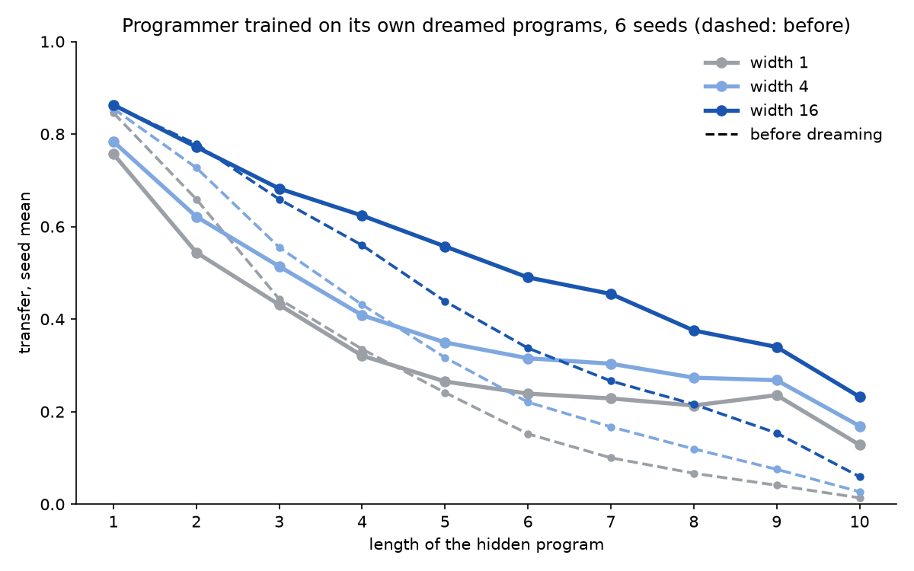

랩 NEO와 다른 점: 위 표와 같은 측정이다.

**나온 것.** 폭 16에서 길이 8이 seed 평균 22%에서 38%로 올랐다. code가 많이 갈라진 seed는 0%에서 그대로다. 대가도 있다. 탐색 없이 쓰면 길이 1이 85%에서 76%로 떨어지고, support 둘을 통과하고도 query에서 틀리는 비율이 길이 8에서 24%에서 36%로 늘었다.

### 17번째 실험까지의 insight

새로 알게 된 것.

- 확정된 executor로 모델이 스스로 만든 여러 단계 program을 programmer에게만 가르치면, 라벨 없이 긴 program이 오른다. 폭 16에서 길이 8이 22%에서 38%다. 다만 탐색 없이 쓰면 길이 1이 85%에서 76%로 떨어진다. 먼 목표를 배우면서 한 단계짜리 결정이 흐려진다.

그대로인 것.

- state 표현과 단계 사이로 넘기는 것
    - 격자 하나를 latent 하나에 담는 것은 15칸 격자에 모자라지만, 공식 NEO가 0에 머무는 이유는 그것만이 아니다
    - 단계 사이에 확률을 넘기면 격자에 보이지 않는 정보가 건너가고, code 둘이 주소가 된다
- code 형성: programmer와 codebook이 primitive마다 code를 세우는 일
    - transfer를 정하는 것은 어디서나 통하는 code 하나를 가진 primitive의 수다
    - 여러 단계로 학습하면 primitive는 여러 code로 설명되는 단계를 거쳐 차례로 code를 얻는다
    - 남는 code와 다시 뿌리기는 primitive를 입력에 따라 쪼갠다
    - 랩 programmer는 code를 늦게 찾고, 칸마다 이어 붙인 넓은 programmer가 빨리 찾는다
    - 예시를 다시 만들기만 하면 채워지는 목표 아래에서 여러 단계를 함께 학습하면 code가 primitive가 아닌 것으로 굳는다
    - primitive 하나짜리 과제로 한 단계만 배운 code는 이어 쓸 수 있다
    - 여러 단계 학습은 허락된 길이로 설명할 수 없는 pair를 억지로 맞출 때 code를 휘게 한다
    - 큰 환경의 실패는 비슷한 변환이 한 code에 섞인 채 굳는 것이다
    - pair 하나만 보는 학습 신호로는 처음부터 EM을 해도 섞인 code가 풀리지 않는다
    - 오래 학습하면 일부만 풀린다
- executor: code가 어디서나 같은 변환인가
    - code가 놓인 모양과 executor가 하는 일은 별개다
    - executor는 정답 code가 주어지면 회전 계열을 해낸다. 용량 문제가 아니다
    - code가 깨끗하면 executor는 여덟 단계를 이어 실행해도 거의 틀리지 않는다
- 여러 단계 program: programmer의 계획과 평가 때의 탐색
    - 긴 program에서 떨어지는 큰 부분은 탐색 없이 이어 쓰기 때문이고, 탐색을 넓히면 2배에서 3배가 된다
    - 긴 program에서는 support를 통과한 틀린 program보다 찾지 못하는 것이 더 큰 손실이다
    - 긴 program의 병목은 executor가 아니라 programmer의 계획이다
- 양과 구조를 넣은 codebook
    - 양이 더해지는 성질은 loss가 아니라 실행 방식으로 보장해야 한다
    - 구조를 넣은 codebook은 작은 이동 묶음에서만 본 적 없는 양을 말했다
- 환경이 커질 때와 아는 것 위에 쌓기
    - 환경이 커져도 배우는 속도는 느려지지 않고 닿는 높이가 갈린다
    - 새 primitive 하나의 비용은 본 pair 수로 세면 환경 크기에 거의 평평하다
    - 새 것이 옛것을 밀어낸다
- 재는 방법
    - seed 하나의 값으로 말하지 않는다
    - transfer는 확률을 넘기는 방식과 격자만 넘기는 방식 둘 다로 잰다
    - 회전 계열만의 code NMI가 code 배정의 상태를 transfer와 같은 순서로 보여 준다

## 18. 같은 program의 pair 둘을 한 학습 과제로

2026-11-23. 근거는 `docs/project-overview.md` 5.18절, 부품은 `babytheorist_episodes`, `neo_episode`, 두 pair 기준의 `neo_em`.

**물은 것.** 지금의 학습 신호에는 같은 code가 다른 입력에서도 같은 일을 하라는 요구가 없다. 그 요구를 넣으면 섞인 code가 풀리는가.

**한 것.** 학습 과제를 같은 program을 다른 물체 둘에 적용한 pair 둘로 줬다. 숨은 program 이름은 쓰지 않지만 어느 pair끼리 같은 규칙인지는 알려 준다. 24개 환경에서 seed 셋, 이어서 둘을 더 돌렸고 32개 환경은 seed 하나다. 랩 방식은 첫 pair에서 고른 code를 두 입력에 모두 실행해 두 출력을 학습하고, hard EM은 두 pair의 재현 오차의 합으로 code를 고른다.

**랩 NEO와 다른 점, 이 실험의 공통 설정.**

| 항목 | 랩 NEO | 이 실험 |
|---|---|---|
| 데이터 | BabyTheorist single-A 레벨 1의 학습 파일. pair 하나씩이고 70%가 primitive 여럿짜리다 | 이 레포의 생성기로 만든 primitive 묶음. 같은 program을 다른 물체 둘에 적용한 pair 둘이 한 과제이고 primitive 하나짜리만 쓴다 |
| programmer | 지금 칸 token과 목표 칸 token을 따로 넣는 6층 transformer, 폭 128 | 지금 칸과 목표 칸을 칸마다 이어 붙인 token을 넣는 token_pair_transformer, 폭 256 |
| codebook | 랩 VQ. cosine으로 가장 가까운 code를 고른다. code 16개, 16차원, commitment 0.25 | 랩 VQ 그대로이고 code 수만 primitive 수의 두 배 |
| program 길이와 단계 사이로 넘기는 것 | 최대 다섯 단계. 단계 사이에 칸마다의 색 확률을 넘긴다 | program 한 단계 |
| code를 고르고 학습하는 방식 | programmer가 pair 하나를 보고 낸 출력에 가장 가까운 code를 쓴다. 길이는 길이마다 0.95를 곱한 cross-entropy가 가장 작은 것으로 고르고, 그 길이의 cross-entropy, grounding 항 0.1, codebook loss로 모든 부품을 함께 학습한다 | hard EM. 과제마다 codebook의 모든 code를 두 pair에 실행해 오차의 합이 가장 작은 code를 고르고, executor는 그 code로 두 pair를 학습하고 programmer는 그 code를 맞히게 학습한다. 아무도 고르지 않는 code는 오차를 깎아 주는 보너스로 구제한다 |
| 학습 일정 | 학습률 3e-4, batch 256 episode, 78,200스텝, 가중치 평균 0.999 | batch 128 pair, 24,000스텝, 가중치 평균 끔, programmer 학습률은 0.25배, forward를 torch.compile로 묶음 |
| 학습이 읽는 정보 | 입력과 출력 격자만 읽는다 | 입력과 출력 격자, 어느 pair 둘이 같은 규칙인지, 그리고 한 단계 과제만 남기는 데 숨은 길이 |

표에 없는 항목은 랩 NEO와 같다.

**Table 18.1.** pair 하나와 pair 둘, 랩 방식과 hard EM, 24개 환경

| 조건 | 가로세로를 바꾸는 넷, seed별 | seed 평균 | 나머지 17개 | 회전 계열 NMI |
|---|---|---|---|---|
| 랩 모델, 한 pair | 16%, 15%, 20% | 17% | 84% | 0.18 |
| 랩 모델, 두 pair | 35%, 34%, 34% | 34% | 88% | 0.53 |
| hard EM, 한 pair | 30%, 13%, 20% | 21% | 66% | 0.35 |
| hard EM, 두 pair | 96%, 35%, 37%, 83%, 71% | seed 셋 56%, 다섯 64% | 97% | 0.64 |

랩 NEO와 다른 점: 랩 모델 줄은 code를 고르는 방식이 랩과 같다. 두 pair 줄은 과제가 pair 둘이다. hard EM 두 pair 줄이 이 실험의 공통 설정이다.

**Figure 18.1.** 조건별 가로세로를 바꾸는 넷, 나머지 17개, 회전 계열 NMI, seed마다 점 하나

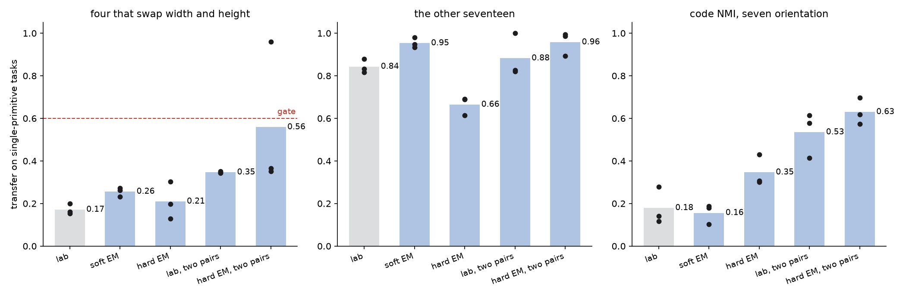

랩 NEO와 다른 점: 위 표와 같은 조건들이다.

**Table 18.2.** 한 단계로 학습한 모델을 최대 네 단계까지 이어 쓴 transfer, 24개 환경

| 모델 | 숨은 길이 1 | 2 | 3 | 4 | 전체 |
|---|---|---|---|---|---|
| 랩 설정, 한 pair, seed 42 | 61% | 35% | 14% | 4% | 41% |
| 랩 모델, 두 pair, seed 42 | 75% | 43% | 19% | 11% | 50% |
| hard EM, 두 pair, seed 42 | 99% | 78% | 47% | 25% | 81% |
| hard EM, 두 pair, seed 43 | 87% | 64% | 36% | 22% | 67% |

랩 NEO와 다른 점: 줄마다 학습 과제의 꼴과 code를 고르는 방식이 다르고, 평가 때 탐색 없이 이어 쓰는 것은 같다.

**나온 것.** pair 둘을 주는 것만으로 랩 방식도 넷이 17%에서 34%가 된다. 두 pair hard EM은 seed 다섯에서 96%, 35%, 37%, 83%, 71%다. 미리 정한 seed 셋으로는 56%라 기준에 못 미치고 다섯으로는 64%다. seed 42는 primitive마다 정답 code를 준 진단과 같은 수준까지 라벨 없이 갔다. seed 43과 44는 넷이 여전히 code 하나를 함께 쓴 채 멈췄다. 나머지 17개는 97%로 입력별 전문가 code가 사라졌다.

### 18번째 실험까지의 insight

새로 알게 된 것.

- 두 pair hard EM에서도 초반에 갈라지지 않은 seed는 넷이 code 하나를 함께 쓴 채 35% 근처에서 굳는다. 잘 풀린 seed는 7,200스텝에 이미 95%였다.

고쳐진 것.

- 앞서 한 말: pair 하나를 재현하는지만 보는 학습 신호 안에는 한 code에 섞인 변환들을 떼어 놓는 힘이 없다. 굳은 뒤의 시도 열세 가지에 이어, 처음부터 하는 soft EM과 hard EM도 가로세로를 바꾸는 넷이 25%와 21%로 미리 정한 기준 60%에 못 미쳤다. hard EM은 code를 변환이 아니라 입력 모양별 전문가로 쪼갠다. pair 하나를 재현하는 것만 요구하면 잘게 쪼갤수록 재현은 쉬워지고 transfer는 떨어진다.
  지금: 섞인 code를 푸는 데 빠져 있던 것은 같은 code가 다른 입력에서도 같은 일을 하라는 요구다. pair 하나만 보면 어떤 방법도 풀지 못했다. 같은 program을 다른 물체 둘에 적용한 pair 둘을 한 과제로 주면 이 요구가 들어간다. 그것만으로 랩 방식도 넷이 17%에서 34%가 되고, 두 pair의 오차로 code를 고르는 hard EM은 seed 다섯 평균 64%, 한 seed는 96%다. 입력별 전문가 code가 사라져 나머지도 97%다. 미리 정한 seed 셋으로는 56%로 기준 60%에 못 미친다. pair의 묶음은 숨은 program보다 약하지만 벤치마크 학습 파일에는 없는 정보다.
  무엇을 보고: 두 pair hard EM의 seed 42가 primitive마다 정답 code를 준 진단과 같은 수준까지 갔다.
- 앞서 한 말: primitive 하나짜리 과제로 program 한 단계만 학습한 모델은 추가 학습 없이 여러 단계로 이어 쓸 수 있다. 레벨 1 transfer가 seed 여섯 평균 64%로, 여러 단계로 학습한 랩 설정의 40%보다 높다. 다만 숨은 길이를 읽어 과제를 고른 진단이고 seed에 따라 31%에서 84%로 갈린다.
  지금: primitive 하나짜리 과제로 program 한 단계만 학습한 모델은 추가 학습 없이 여러 단계로 이어 쓸 수 있다. code가 깨끗할수록 잘 된다. 24개 환경에서 길이 2의 transfer가 랩 방식 35%, 두 pair hard EM 78%다. 다만 한 단계 과제만 남기는 데 숨은 길이를 읽는다.
  무엇을 보고: 두 pair hard EM 모델을 네 단계까지 이어 쓴 값을 랩 방식과 나란히 쟀다.

그대로인 것.

- state 표현과 단계 사이로 넘기는 것
    - 격자 하나를 latent 하나에 담는 것은 15칸 격자에 모자라지만, 공식 NEO가 0에 머무는 이유는 그것만이 아니다
    - 단계 사이에 확률을 넘기면 격자에 보이지 않는 정보가 건너가고, code 둘이 주소가 된다
- code 형성: programmer와 codebook이 primitive마다 code를 세우는 일
    - transfer를 정하는 것은 어디서나 통하는 code 하나를 가진 primitive의 수다
    - 여러 단계로 학습하면 primitive는 여러 code로 설명되는 단계를 거쳐 차례로 code를 얻는다
    - 남는 code와 다시 뿌리기는 primitive를 입력에 따라 쪼갠다
    - 랩 programmer는 code를 늦게 찾고, 칸마다 이어 붙인 넓은 programmer가 빨리 찾는다
    - 예시를 다시 만들기만 하면 채워지는 목표 아래에서 여러 단계를 함께 학습하면 code가 primitive가 아닌 것으로 굳는다
    - 여러 단계 학습은 허락된 길이로 설명할 수 없는 pair를 억지로 맞출 때 code를 휘게 한다
    - 큰 환경의 실패는 비슷한 변환이 한 code에 섞인 채 굳는 것이다
    - 오래 학습하면 일부만 풀린다
- executor: code가 어디서나 같은 변환인가
    - code가 놓인 모양과 executor가 하는 일은 별개다
    - executor는 정답 code가 주어지면 회전 계열을 해낸다. 용량 문제가 아니다
    - code가 깨끗하면 executor는 여덟 단계를 이어 실행해도 거의 틀리지 않는다
- 여러 단계 program: programmer의 계획과 평가 때의 탐색
    - 긴 program에서 떨어지는 큰 부분은 탐색 없이 이어 쓰기 때문이고, 탐색을 넓히면 2배에서 3배가 된다
    - 긴 program에서는 support를 통과한 틀린 program보다 찾지 못하는 것이 더 큰 손실이다
    - 긴 program의 병목은 executor가 아니라 programmer의 계획이다
    - 얼린 executor로 꾼 꿈으로 programmer의 여러 단계 계획을 일부 채울 수 있다
- 양과 구조를 넣은 codebook
    - 양이 더해지는 성질은 loss가 아니라 실행 방식으로 보장해야 한다
    - 구조를 넣은 codebook은 작은 이동 묶음에서만 본 적 없는 양을 말했다
- 환경이 커질 때와 아는 것 위에 쌓기
    - 환경이 커져도 배우는 속도는 느려지지 않고 닿는 높이가 갈린다
    - 새 primitive 하나의 비용은 본 pair 수로 세면 환경 크기에 거의 평평하다
    - 새 것이 옛것을 밀어낸다
- 재는 방법
    - seed 하나의 값으로 말하지 않는다
    - transfer는 확률을 넘기는 방식과 격자만 넘기는 방식 둘 다로 잰다
    - 회전 계열만의 code NMI가 code 배정의 상태를 transfer와 같은 순서로 보여 준다

## 19. 꿈 학습에 검증된 실제 pair 섞기

2026-11-24. 근거는 `docs/project-overview.md` 5.19절.

**물은 것.** 꿈 학습만 하면 탐색 없이 쓸 때 길이 1이 85%에서 76%로 떨어진다. 이 손해를 없앨 수 있는가.

**한 것.** 꿈 학습의 위치 절반을 실제 학습 pair로 채웠다. 실제 pair마다 모든 code를 실행해 재현 오차가 가장 작은 code의 출력이 정확히 같을 때만 남긴다. 숨은 깊이 대신 executor로 검증해 한 단계짜리 pair를 고르는 것이다. 8개 환경 seed 여섯이다.

**랩 NEO와 다른 점, 이 실험의 공통 설정.**

| 항목 | 랩 NEO | 이 실험 |
|---|---|---|
| 데이터 | BabyTheorist single-A 레벨 1의 학습 파일. pair 하나씩이고 70%가 primitive 여럿짜리다 | primitive 하나짜리 학습 pair만 쓴다. 숨은 길이를 읽어 고른다 |
| programmer | 지금 칸 token과 목표 칸 token을 따로 넣는 6층 transformer, 폭 128 | 지금 칸과 목표 칸을 칸마다 이어 붙인 token을 넣는 token_pair_transformer, 폭 256 |
| codebook | 랩 VQ. cosine으로 가장 가까운 code를 고른다. code 16개, 16차원, commitment 0.25 | 랩 VQ 그대로이고 code 수만 primitive 수의 두 배 |
| program 길이와 단계 사이로 넘기는 것 | 최대 다섯 단계. 단계 사이에 칸마다의 색 확률을 넘긴다 | program 한 단계 |
| 학습 일정 | 학습률 3e-4, batch 256 episode, 78,200스텝, 가중치 평균 0.999 | batch 128 pair, 24,000스텝, 가중치 평균 끔, programmer 학습률은 0.25배, forward를 torch.compile로 묶음 |
| 평가 때의 추론 | programmer가 support pair 하나를 보고 고른 code 열을 query에 그대로 실행한다. 탐색하지 않는다 | support로 검증하는 탐색. 단계마다 programmer 출력에 가까운 code 여러 개를 executor로 실행하고, programmer의 선호를 누적한 점수로 상위 몇 갈래만 남긴다. support 둘을 모두 재현하는 첫 program을 query에 쓴다. 남기는 갈래 수가 폭이고 폭 1은 탐색 없는 이어 쓰기다 |
| 학습이 읽는 정보 | 입력과 출력 격자만 읽는다 | 입력과 출력 격자, 그리고 pair를 고르는 데 숨은 길이 |
| 랩 NEO에 없는 단계 | 없다 | 꿈 학습. 한 단계 모델의 끝에서 programmer만 6,000스텝 더 학습한다. programmer가 고르는 빈도대로 code를 1개에서 8개 뽑아 얼린 executor로 실행하고, 마지막 격자를 목표로 삼아 중간 격자마다 다음에 실행한 code를 맞히게 한다. 나머지 부품은 얼린다. 위치의 절반은 실제 학습 pair로 채운다. pair마다 모든 code를 실행해 한 code가 정확히 재현할 때만 남기고 그 code를 목표로 삼는다 |

표에 없는 항목은 랩 NEO와 같다.

**Table 19.1.** 꿈만 한 것과 검증된 실제 pair를 섞은 것, seed 여섯 평균

| 숨은 길이 | 폭 16: 전 / 꿈만 / 실제 pair 섞음 | greedy: 전 / 꿈만 / 실제 pair 섞음 |
|---|---|---|
| 1 | 86% / 86% / 87% | 85% / 76% / 86% |
| 3 | 66% / 68% / 70% | 44% / 43% / 62% |
| 5 | 44% / 56% / 58% | 24% / 27% / 41% |
| 8 | 22% / 38% / 42% | 7% / 21% / 24% |
| 10 | 6% / 23% / 25% | 1% / 13% / 12% |

랩 NEO와 다른 점: 셋 다 같은 한 단계 모델에서 출발하고 programmer만 더 학습한다. 꿈 학습은 랩 NEO에 없는 단계다.

**Figure 19.1.** 검증된 실제 pair를 섞은 꿈 학습 전후

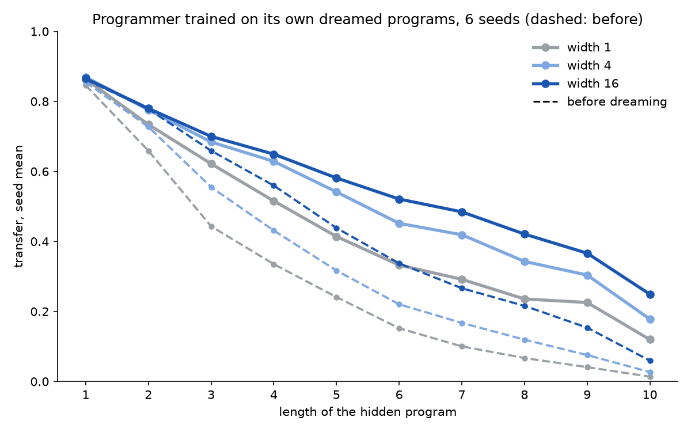

랩 NEO와 다른 점: 위 표와 같은 측정이다.

**나온 것.** 길이 1의 손실이 사라졌고 긴 program은 꿈만 했을 때보다 높다. 탐색 없이 쓴 길이 3이 44%에서 62%가 됐다. 폭 16 길이 8은 42%다. code가 크게 갈라진 seed는 그대로 0%다.

### 19번째 실험까지의 insight

고쳐진 것.

- 앞서 한 말: 확정된 executor로 모델이 스스로 만든 여러 단계 program을 programmer에게만 가르치면, 라벨 없이 긴 program이 오른다. 폭 16에서 길이 8이 22%에서 38%다. 다만 탐색 없이 쓰면 길이 1이 85%에서 76%로 떨어진다. 먼 목표를 배우면서 한 단계짜리 결정이 흐려진다.
  지금: 확정된 executor로 모델이 스스로 만든 여러 단계 program을 programmer에게만 가르치면 라벨 없이 긴 program이 오른다. 꿈만 하면 한 단계짜리 결정이 흐려지는데, 위치의 절반을 executor가 한 code로 정확히 재현하는 실제 pair로 채우면 그 손해가 사라진다. 8개 환경 폭 16에서 길이 8이 22%에서 42%이고 탐색 없이 쓴 길이 1은 86%로 유지된다.
  무엇을 보고: 꿈만 한 것과 실제 pair를 섞은 것을 같은 seed 여섯에서 나란히 쟀다.

그대로인 것.

- state 표현과 단계 사이로 넘기는 것
    - 격자 하나를 latent 하나에 담는 것은 15칸 격자에 모자라지만, 공식 NEO가 0에 머무는 이유는 그것만이 아니다
    - 단계 사이에 확률을 넘기면 격자에 보이지 않는 정보가 건너가고, code 둘이 주소가 된다
- code 형성: programmer와 codebook이 primitive마다 code를 세우는 일
    - transfer를 정하는 것은 어디서나 통하는 code 하나를 가진 primitive의 수다
    - 여러 단계로 학습하면 primitive는 여러 code로 설명되는 단계를 거쳐 차례로 code를 얻는다
    - 남는 code와 다시 뿌리기는 primitive를 입력에 따라 쪼갠다
    - 랩 programmer는 code를 늦게 찾고, 칸마다 이어 붙인 넓은 programmer가 빨리 찾는다
    - 예시를 다시 만들기만 하면 채워지는 목표 아래에서 여러 단계를 함께 학습하면 code가 primitive가 아닌 것으로 굳는다
    - 깨끗한 한 단계 code는 이어 쓸 수 있고, code가 깨끗할수록 여러 단계 과제도 나아진다
    - 여러 단계 학습은 허락된 길이로 설명할 수 없는 pair를 억지로 맞출 때 code를 휘게 한다
    - 큰 환경의 실패는 비슷한 변환이 한 code에 섞인 채 굳는 것이다
    - 섞인 code를 푸는 데 빠져 있던 것은 같은 code가 다른 입력에서도 같은 일을 하라는 요구다
    - 오래 학습하면 일부만 풀린다
    - 두 pair hard EM에서도 초반에 갈라지지 않은 seed는 넷이 한 code를 쓴 채 굳는다
- executor: code가 어디서나 같은 변환인가
    - code가 놓인 모양과 executor가 하는 일은 별개다
    - executor는 정답 code가 주어지면 회전 계열을 해낸다. 용량 문제가 아니다
    - code가 깨끗하면 executor는 여덟 단계를 이어 실행해도 거의 틀리지 않는다
- 여러 단계 program: programmer의 계획과 평가 때의 탐색
    - 긴 program에서 떨어지는 큰 부분은 탐색 없이 이어 쓰기 때문이고, 탐색을 넓히면 2배에서 3배가 된다
    - 긴 program에서는 support를 통과한 틀린 program보다 찾지 못하는 것이 더 큰 손실이다
    - 긴 program의 병목은 executor가 아니라 programmer의 계획이다
- 양과 구조를 넣은 codebook
    - 양이 더해지는 성질은 loss가 아니라 실행 방식으로 보장해야 한다
    - 구조를 넣은 codebook은 작은 이동 묶음에서만 본 적 없는 양을 말했다
- 환경이 커질 때와 아는 것 위에 쌓기
    - 환경이 커져도 배우는 속도는 느려지지 않고 닿는 높이가 갈린다
    - 새 primitive 하나의 비용은 본 pair 수로 세면 환경 크기에 거의 평평하다
    - 새 것이 옛것을 밀어낸다
- 재는 방법
    - seed 하나의 값으로 말하지 않는다
    - transfer는 확률을 넘기는 방식과 격자만 넘기는 방식 둘 다로 잰다
    - 회전 계열만의 code NMI가 code 배정의 상태를 transfer와 같은 순서로 보여 준다

## 20. 처음에 굳은 배정을 이른 탐색으로 풀기

2026-11-24. 근거는 `docs/project-overview.md` 5.20절.

**물은 것.** 두 pair hard EM에서 넷이 code 하나에 묶인 채 굳는 seed를 초반의 탐색을 강하게 해서 풀 수 있는가.

**한 것.** 두 형태를 돌렸다. 구제 보너스를 한 스텝 0.5 nats씩 200까지 주는 것과, 온도를 10에서 시작해 첫 6,000스텝에 0.01로 내리는 것이다. 온도를 내린 run의 끝에서 온도를 다시 올렸다 내리며 12,000스텝 더 학습하는 것도 했다. 남은 덩어리가 대칭인 물체에서 두 변환이 같은 결과를 내는 탓인지도 셌다.

**랩 NEO와 다른 점, 이 실험의 공통 설정.**

| 항목 | 랩 NEO | 이 실험 |
|---|---|---|
| 데이터 | BabyTheorist single-A 레벨 1의 학습 파일. pair 하나씩이고 70%가 primitive 여럿짜리다 | 이 레포의 생성기로 만든 primitive 묶음. 같은 program을 다른 물체 둘에 적용한 pair 둘이 한 과제이고 primitive 하나짜리만 쓴다 |
| programmer | 지금 칸 token과 목표 칸 token을 따로 넣는 6층 transformer, 폭 128 | 지금 칸과 목표 칸을 칸마다 이어 붙인 token을 넣는 token_pair_transformer, 폭 256 |
| codebook | 랩 VQ. cosine으로 가장 가까운 code를 고른다. code 16개, 16차원, commitment 0.25 | 랩 VQ 그대로이고 code 수만 primitive 수의 두 배 |
| program 길이와 단계 사이로 넘기는 것 | 최대 다섯 단계. 단계 사이에 칸마다의 색 확률을 넘긴다 | program 한 단계 |
| code를 고르고 학습하는 방식 | programmer가 pair 하나를 보고 낸 출력에 가장 가까운 code를 쓴다. 길이는 길이마다 0.95를 곱한 cross-entropy가 가장 작은 것으로 고르고, 그 길이의 cross-entropy, grounding 항 0.1, codebook loss로 모든 부품을 함께 학습한다 | hard EM. 과제마다 codebook의 모든 code를 두 pair에 실행해 오차의 합이 가장 작은 code를 고르고, executor는 그 code로 두 pair를 학습하고 programmer는 그 code를 맞히게 학습한다. 아무도 고르지 않는 code는 오차를 깎아 주는 보너스로 구제한다. 형태 둘을 더 시험한다. 구제 보너스를 열 배로 키운 것과, 온도를 10에서 시작해 첫 6,000스텝에 0.01로 내리며 상위 네 code로 학습하는 것 |
| 학습 일정 | 학습률 3e-4, batch 256 episode, 78,200스텝, 가중치 평균 0.999 | batch 128 pair, 24,000스텝, 가중치 평균 끔, programmer 학습률은 0.25배, forward를 torch.compile로 묶음 |
| 학습이 읽는 정보 | 입력과 출력 격자만 읽는다 | 입력과 출력 격자, 어느 pair 둘이 같은 규칙인지, 그리고 한 단계 과제만 남기는 데 숨은 길이 |

표에 없는 항목은 랩 NEO와 같다.

**Table 20.1.** 가로세로를 바꾸는 넷의 끝값, 형태별

| 형태 | seed 43 | seed 44 | seed 45 | 평균 | 나머지 17개 |
|---|---|---|---|---|---|
| 기본 | 35% | 37% | 83% | 52% | 89%에서 100% |
| 구제 강화 | 37% | 96% | 35% | 56% | 90%에서 99% |
| soft에서 hard로 | 73% | 51% | 61% | 62% | 세 seed 모두 100% |

랩 NEO와 다른 점: 기본 줄이 두 pair hard EM이고 아래 두 줄은 초반에 code를 고르는 방식만 다르다.

**Table 20.2.** seed 다섯으로 본 두 형태와 다시 달구기

| 형태 | seed 42 | 43 | 44 | 45 | 46 | 평균 |
|---|---|---|---|---|---|---|
| 기본 | 96% | 35% | 37% | 83% | 71% | 64% |
| 온도를 처음부터 천천히 내리는 형태 | 50% | 73% | 51% | 61% | 50% | 57% |
| 그 run의 끝에서 다시 달군 뒤 | | 72% | 50% | 63% | | |

랩 NEO와 다른 점: 공통 설정에서 온도의 시간표만 다르다.

**나온 것.** 구제 강화는 어느 seed가 풀리느냐만 바꿨다. 온도를 천천히 내리는 형태는 35%에 멈춘 seed가 없고 나머지가 모두 100%지만 완전히 풀리는 seed도 없다. 넷이 한꺼번에 묶였던 덩어리가 둘이나 셋짜리로 줄었을 뿐이다. 다시 달궈도 그대로다. programmer 출력으로 굳은 code의 과제를 묶어 보면 순도가 0.28로 우연 수준이다. 남은 짝은 혼동으로 설명되지 않는다. 과제의 대부분은 두 변환을 구별할 정보를 갖고 있다.

### 20번째 실험까지의 insight

고쳐진 것.

- 앞서 한 말: 두 pair hard EM에서도 초반에 갈라지지 않은 seed는 넷이 code 하나를 함께 쓴 채 35% 근처에서 굳는다. 잘 풀린 seed는 7,200스텝에 이미 95%였다.
  지금: 두 pair hard EM에서 넷의 갈라짐은 2,400스텝과 7,200스텝 사이에 정해진다. 굳은 뒤에는 구제 보너스를 키워도, 온도를 다시 올렸다 내려도 풀리지 않는다. 온도를 처음부터 천천히 내리면 멈추는 seed가 사라지지만 완전히 풀리는 seed도 사라져 평균이 57%로 기본의 64%보다 낮다. programmer 출력에는 넷을 가를 정보가 없고, 남은 덩어리는 대칭인 물체에서의 혼동으로 설명되지 않는다.
  무엇을 보고: 보너스 강화, 온도 시간표, 다시 달구기를 같은 seed에서 나란히 돌렸고, 굳은 code의 과제를 programmer 출력으로 묶은 순도가 우연 수준이었다.

그대로인 것.

- state 표현과 단계 사이로 넘기는 것
    - 격자 하나를 latent 하나에 담는 것은 15칸 격자에 모자라지만, 공식 NEO가 0에 머무는 이유는 그것만이 아니다
    - 단계 사이에 확률을 넘기면 격자에 보이지 않는 정보가 건너가고, code 둘이 주소가 된다
- code 형성: programmer와 codebook이 primitive마다 code를 세우는 일
    - transfer를 정하는 것은 어디서나 통하는 code 하나를 가진 primitive의 수다
    - 여러 단계로 학습하면 primitive는 여러 code로 설명되는 단계를 거쳐 차례로 code를 얻는다
    - 남는 code와 다시 뿌리기는 primitive를 입력에 따라 쪼갠다
    - 랩 programmer는 code를 늦게 찾고, 칸마다 이어 붙인 넓은 programmer가 빨리 찾는다
    - 예시를 다시 만들기만 하면 채워지는 목표 아래에서 여러 단계를 함께 학습하면 code가 primitive가 아닌 것으로 굳는다
    - 깨끗한 한 단계 code는 이어 쓸 수 있고, code가 깨끗할수록 여러 단계 과제도 나아진다
    - 여러 단계 학습은 허락된 길이로 설명할 수 없는 pair를 억지로 맞출 때 code를 휘게 한다
    - 큰 환경의 실패는 비슷한 변환이 한 code에 섞인 채 굳는 것이다
    - 섞인 code를 푸는 데 빠져 있던 것은 같은 code가 다른 입력에서도 같은 일을 하라는 요구다
    - 오래 학습하면 일부만 풀린다
- executor: code가 어디서나 같은 변환인가
    - code가 놓인 모양과 executor가 하는 일은 별개다
    - executor는 정답 code가 주어지면 회전 계열을 해낸다. 용량 문제가 아니다
    - code가 깨끗하면 executor는 여덟 단계를 이어 실행해도 거의 틀리지 않는다
- 여러 단계 program: programmer의 계획과 평가 때의 탐색
    - 긴 program에서 떨어지는 큰 부분은 탐색 없이 이어 쓰기 때문이고, 탐색을 넓히면 2배에서 3배가 된다
    - 긴 program에서는 support를 통과한 틀린 program보다 찾지 못하는 것이 더 큰 손실이다
    - 긴 program의 병목은 executor가 아니라 programmer의 계획이다
    - 꿈은 먼 목표로 가는 첫걸음을, 검증된 실제 pair는 한 단계짜리 결정을 가르친다
- 양과 구조를 넣은 codebook
    - 양이 더해지는 성질은 loss가 아니라 실행 방식으로 보장해야 한다
    - 구조를 넣은 codebook은 작은 이동 묶음에서만 본 적 없는 양을 말했다
- 환경이 커질 때와 아는 것 위에 쌓기
    - 환경이 커져도 배우는 속도는 느려지지 않고 닿는 높이가 갈린다
    - 새 primitive 하나의 비용은 본 pair 수로 세면 환경 크기에 거의 평평하다
    - 새 것이 옛것을 밀어낸다
- 재는 방법
    - seed 하나의 값으로 말하지 않는다
    - transfer는 확률을 넘기는 방식과 격자만 넘기는 방식 둘 다로 잰다
    - 회전 계열만의 code NMI가 code 배정의 상태를 transfer와 같은 순서로 보여 준다

## 21. 깨끗한 code 위의 꿈 학습, 24개 환경

2026-11-24. 근거는 `docs/project-overview.md` 5.21절.

**물은 것.** 꿈 학습은 8개 환경에서만 시험했다. 두 pair hard EM으로 세운 24개 환경의 깨끗한 code 위에서도 programmer의 계획을 채우는가. code가 섞인 모델에서도 그런가.

**한 것.** 두 pair hard EM의 code가 깨끗한 seed 셋, 넷이 섞인 채 멈춘 seed 하나, 그리고 pair 하나로 학습한 랩 방식 seed 하나 각각의 끝에서 검증된 실제 pair를 반 섞은 꿈 학습을 6,000스텝 했다. 24개 환경 평가 과제 3,000개를 폭 16으로 탐색해 쟀다.

**랩 NEO와 다른 점, 이 실험의 공통 설정.**

| 항목 | 랩 NEO | 이 실험 |
|---|---|---|
| 데이터 | BabyTheorist single-A 레벨 1의 학습 파일. pair 하나씩이고 70%가 primitive 여럿짜리다 | 이 레포의 생성기로 만든 primitive 묶음. 같은 program을 다른 물체 둘에 적용한 pair 둘이 한 과제이고 primitive 하나짜리만 쓴다 |
| programmer | 지금 칸 token과 목표 칸 token을 따로 넣는 6층 transformer, 폭 128 | 지금 칸과 목표 칸을 칸마다 이어 붙인 token을 넣는 token_pair_transformer, 폭 256 |
| codebook | 랩 VQ. cosine으로 가장 가까운 code를 고른다. code 16개, 16차원, commitment 0.25 | 랩 VQ 그대로이고 code 수만 primitive 수의 두 배 |
| program 길이와 단계 사이로 넘기는 것 | 최대 다섯 단계. 단계 사이에 칸마다의 색 확률을 넘긴다 | program 한 단계 |
| code를 고르고 학습하는 방식 | programmer가 pair 하나를 보고 낸 출력에 가장 가까운 code를 쓴다. 길이는 길이마다 0.95를 곱한 cross-entropy가 가장 작은 것으로 고르고, 그 길이의 cross-entropy, grounding 항 0.1, codebook loss로 모든 부품을 함께 학습한다 | hard EM. 과제마다 codebook의 모든 code를 두 pair에 실행해 오차의 합이 가장 작은 code를 고르고, executor는 그 code로 두 pair를 학습하고 programmer는 그 code를 맞히게 학습한다. 아무도 고르지 않는 code는 오차를 깎아 주는 보너스로 구제한다 |
| 학습 일정 | 학습률 3e-4, batch 256 episode, 78,200스텝, 가중치 평균 0.999 | batch 128 pair, 24,000스텝, 가중치 평균 끔, programmer 학습률은 0.25배, forward를 torch.compile로 묶음 |
| 평가 때의 추론 | programmer가 support pair 하나를 보고 고른 code 열을 query에 그대로 실행한다. 탐색하지 않는다 | support로 검증하는 탐색. 단계마다 programmer 출력에 가까운 code 여러 개를 executor로 실행하고, programmer의 선호를 누적한 점수로 상위 몇 갈래만 남긴다. support 둘을 모두 재현하는 첫 program을 query에 쓴다. 남기는 갈래 수가 폭이고 폭 1은 탐색 없는 이어 쓰기다. 폭 16 |
| 학습이 읽는 정보 | 입력과 출력 격자만 읽는다 | 입력과 출력 격자, 어느 pair 둘이 같은 규칙인지, 그리고 한 단계 과제만 남기는 데 숨은 길이 |
| 랩 NEO에 없는 단계 | 없다 | 꿈 학습. 한 단계 모델의 끝에서 programmer만 6,000스텝 더 학습한다. programmer가 고르는 빈도대로 code를 1개에서 8개 뽑아 얼린 executor로 실행하고, 마지막 격자를 목표로 삼아 중간 격자마다 다음에 실행한 code를 맞히게 한다. 나머지 부품은 얼린다. 위치의 절반은 실제 학습 pair로 채운다. pair마다 모든 code를 실행해 한 code가 정확히 재현할 때만 남기고 그 code를 목표로 삼는다 |

표에 없는 항목은 랩 NEO와 같다.

**Table 21.1.** 24개 환경에서 꿈 학습 전후의 숨은 길이 1, 2, 3, 4

| 모델 | 꿈 학습 전 | 후 | 평가 파일 전체 |
|---|---|---|---|
| 한 pair 랩 설정, seed 42 | 60%, 39%, 22%, 6% | 60%, 39%, 20%, 11% | 43%에서 44% |
| 두 pair hard EM, seed 42 | 99%, 93%, 72%, 47% | 100%, 96%, 76%, 53% | 92%에서 94% |
| 두 pair hard EM, seed 45 | 98%, 87%, 64%, 37% | 98%, 91%, 73%, 52% | 87%에서 91% |
| 두 pair hard EM, seed 46 | 98%, 90%, 69%, 45% | 98%, 93%, 74%, 58% | 89%에서 92% |
| 두 pair hard EM, seed 43, 넷이 섞임 | 87%, 72%, 53%, 35% | 87%, 75%, 58%, 39% | 74%에서 76% |

랩 NEO와 다른 점: 첫 줄은 pair 하나로 학습하고 code를 고르는 방식이 랩과 같은 모델이다. 나머지는 공통 설정인 두 pair hard EM이다. 모두 꿈 학습과 탐색을 쓴다.

**나온 것.** code가 깨끗한 모델에서 꿈 학습은 길이 4를 seed 셋 평균 43%에서 54%로 올렸다. code가 섞인 랩 방식 모델에서는 거의 효과가 없다. support 둘을 통과하고도 query에서 틀리는 비율은 2에서 7%로 낮게 유지됐다.

### 21번째 실험까지의 insight

고쳐진 것.

- 앞서 한 말: 확정된 executor로 모델이 스스로 만든 여러 단계 program을 programmer에게만 가르치면 라벨 없이 긴 program이 오른다. 꿈만 하면 한 단계짜리 결정이 흐려지는데, 위치의 절반을 executor가 한 code로 정확히 재현하는 실제 pair로 채우면 그 손해가 사라진다. 8개 환경 폭 16에서 길이 8이 22%에서 42%이고 탐색 없이 쓴 길이 1은 86%로 유지된다.
  지금: 확정된 executor로 모델이 스스로 만든 여러 단계 program과, executor가 한 code로 정확히 재현하는 실제 pair를 반씩 programmer에게만 가르치면 라벨 없이 긴 program이 오른다. 깨끗한 code가 먼저다. 24개 환경에서 code가 깨끗한 모델은 길이 4가 43%에서 54%로 오르고, code가 섞인 모델에서는 거의 효과가 없다.
  무엇을 보고: 같은 꿈 학습을 code가 깨끗한 모델 셋과 섞인 모델 둘에 했다.

그대로인 것.

- state 표현과 단계 사이로 넘기는 것
    - 격자 하나를 latent 하나에 담는 것은 15칸 격자에 모자라지만, 공식 NEO가 0에 머무는 이유는 그것만이 아니다
    - 단계 사이에 확률을 넘기면 격자에 보이지 않는 정보가 건너가고, code 둘이 주소가 된다
- code 형성: programmer와 codebook이 primitive마다 code를 세우는 일
    - transfer를 정하는 것은 어디서나 통하는 code 하나를 가진 primitive의 수다
    - 여러 단계로 학습하면 primitive는 여러 code로 설명되는 단계를 거쳐 차례로 code를 얻는다
    - 남는 code와 다시 뿌리기는 primitive를 입력에 따라 쪼갠다
    - 랩 programmer는 code를 늦게 찾고, 칸마다 이어 붙인 넓은 programmer가 빨리 찾는다
    - 예시를 다시 만들기만 하면 채워지는 목표 아래에서 여러 단계를 함께 학습하면 code가 primitive가 아닌 것으로 굳는다
    - 깨끗한 한 단계 code는 이어 쓸 수 있고, code가 깨끗할수록 여러 단계 과제도 나아진다
    - 여러 단계 학습은 허락된 길이로 설명할 수 없는 pair를 억지로 맞출 때 code를 휘게 한다
    - 큰 환경의 실패는 비슷한 변환이 한 code에 섞인 채 굳는 것이다
    - 섞인 code를 푸는 데 빠져 있던 것은 같은 code가 다른 입력에서도 같은 일을 하라는 요구다
    - 오래 학습하면 일부만 풀린다
    - 배정은 초반에 정해지고, 굳은 뒤에는 보너스를 키워도 온도를 다시 올려도 풀리지 않는다
- executor: code가 어디서나 같은 변환인가
    - code가 놓인 모양과 executor가 하는 일은 별개다
    - executor는 정답 code가 주어지면 회전 계열을 해낸다. 용량 문제가 아니다
    - code가 깨끗하면 executor는 여덟 단계를 이어 실행해도 거의 틀리지 않는다
- 여러 단계 program: programmer의 계획과 평가 때의 탐색
    - 긴 program에서 떨어지는 큰 부분은 탐색 없이 이어 쓰기 때문이고, 탐색을 넓히면 2배에서 3배가 된다
    - 긴 program에서는 support를 통과한 틀린 program보다 찾지 못하는 것이 더 큰 손실이다
    - 긴 program의 병목은 executor가 아니라 programmer의 계획이다
- 양과 구조를 넣은 codebook
    - 양이 더해지는 성질은 loss가 아니라 실행 방식으로 보장해야 한다
    - 구조를 넣은 codebook은 작은 이동 묶음에서만 본 적 없는 양을 말했다
- 환경이 커질 때와 아는 것 위에 쌓기
    - 환경이 커져도 배우는 속도는 느려지지 않고 닿는 높이가 갈린다
    - 새 primitive 하나의 비용은 본 pair 수로 세면 환경 크기에 거의 평평하다
    - 새 것이 옛것을 밀어낸다
- 재는 방법
    - seed 하나의 값으로 말하지 않는다
    - transfer는 확률을 넘기는 방식과 격자만 넘기는 방식 둘 다로 잰다
    - 회전 계열만의 code NMI가 code 배정의 상태를 transfer와 같은 순서로 보여 준다

## 22. 라벨 없는 검증 점수로 run 고르기

2026-11-24. 근거는 `docs/project-overview.md` 5.22절, 도구는 `scripts/babytheorist/pair_validation.py`.

**물은 것.** 두 pair hard EM은 seed에 따라 넷이 35%에서 96%로 갈린다. 어느 run이 잘 풀렸는지를 라벨 없이 알 수 있는가.

**한 것.** 학습에 쓰지 않은 두 pair 과제 4,000개를 새로 만들었다. programmer가 첫 pair를 보고 고른 code가 두 pair를 모두 재현하는 비율을 점수로 삼는다. 숨은 program도 깊이도 읽지 않는다. 두 pair hard EM 열 run에서 쟀다.

**랩 NEO와 다른 점, 이 실험의 공통 설정.** 모델은 앞의 두 pair hard EM run들이고 run을 고르는 점수만 더했다.

| 항목 | 랩 NEO | 이 실험 |
|---|---|---|
| 데이터 | BabyTheorist single-A 레벨 1의 학습 파일. pair 하나씩이고 70%가 primitive 여럿짜리다 | 이 레포의 생성기로 만든 primitive 묶음. 같은 program을 다른 물체 둘에 적용한 pair 둘이 한 과제이고 primitive 하나짜리만 쓴다 |
| programmer | 지금 칸 token과 목표 칸 token을 따로 넣는 6층 transformer, 폭 128 | 지금 칸과 목표 칸을 칸마다 이어 붙인 token을 넣는 token_pair_transformer, 폭 256 |
| codebook | 랩 VQ. cosine으로 가장 가까운 code를 고른다. code 16개, 16차원, commitment 0.25 | 랩 VQ 그대로이고 code 수만 primitive 수의 두 배 |
| program 길이와 단계 사이로 넘기는 것 | 최대 다섯 단계. 단계 사이에 칸마다의 색 확률을 넘긴다 | program 한 단계 |
| code를 고르고 학습하는 방식 | programmer가 pair 하나를 보고 낸 출력에 가장 가까운 code를 쓴다. 길이는 길이마다 0.95를 곱한 cross-entropy가 가장 작은 것으로 고르고, 그 길이의 cross-entropy, grounding 항 0.1, codebook loss로 모든 부품을 함께 학습한다 | hard EM. 과제마다 codebook의 모든 code를 두 pair에 실행해 오차의 합이 가장 작은 code를 고르고, executor는 그 code로 두 pair를 학습하고 programmer는 그 code를 맞히게 학습한다. 아무도 고르지 않는 code는 오차를 깎아 주는 보너스로 구제한다 |
| 학습 일정 | 학습률 3e-4, batch 256 episode, 78,200스텝, 가중치 평균 0.999 | batch 128 pair, 24,000스텝, 가중치 평균 끔, programmer 학습률은 0.25배, forward를 torch.compile로 묶음 |
| 학습이 읽는 정보 | 입력과 출력 격자만 읽는다 | 입력과 출력 격자, 어느 pair 둘이 같은 규칙인지, 그리고 한 단계 과제만 남기는 데 숨은 길이 |
| 랩 NEO에 없는 단계 | 없다 | run 고르기. 학습에 쓰지 않은 두 pair 과제에서 programmer가 고른 code가 두 pair를 모두 재현하는 비율이 가장 높은 run을 쓴다 |

표에 없는 항목은 랩 NEO와 같다.

**Table 22.1.** 라벨 없는 검증 점수와 가로세로를 바꾸는 넷

| run | 검증 점수 | 가로세로를 바꾸는 넷 |
|---|---|---|
| 기본, seed 42 | 0.364 | 96% |
| 기본, seed 45 | 0.347 | 83% |
| soft에서 hard로, seed 43 | 0.340 | 73% |
| 기본, seed 46 | 0.333 | 71% |
| soft에서 hard로, seed 45 | 0.330 | 61% |
| 나머지 다섯 | 0.246에서 0.321 | 35%에서 51% |

랩 NEO와 다른 점: run은 모두 두 pair hard EM이다. 검증 점수는 라벨 없이 재고, 넷의 값은 숨은 primitive로 채점한 것이다.

**나온 것.** 검증 점수와 넷의 순위 상관이 0.98이다. 가장 높은 점수의 run이 가장 잘 풀린 run이다. 섞인 code는 두 pair를 함께 재현하지 못하니 이 점수가 낮아진다.

### 22번째 실험까지의 insight

새로 알게 된 것.

- 학습에 쓰지 않은 두 pair 과제에서 programmer가 첫 pair를 보고 고른 code가 두 pair를 모두 재현하는 비율은 라벨 없이 잘 풀린 run을 고른다. 24개 환경 열 run에서 가로세로를 바꾸는 넷과의 순위 상관이 0.98이다.

그대로인 것.

- state 표현과 단계 사이로 넘기는 것
    - 격자 하나를 latent 하나에 담는 것은 15칸 격자에 모자라지만, 공식 NEO가 0에 머무는 이유는 그것만이 아니다
    - 단계 사이에 확률을 넘기면 격자에 보이지 않는 정보가 건너가고, code 둘이 주소가 된다
- code 형성: programmer와 codebook이 primitive마다 code를 세우는 일
    - transfer를 정하는 것은 어디서나 통하는 code 하나를 가진 primitive의 수다
    - 여러 단계로 학습하면 primitive는 여러 code로 설명되는 단계를 거쳐 차례로 code를 얻는다
    - 남는 code와 다시 뿌리기는 primitive를 입력에 따라 쪼갠다
    - 랩 programmer는 code를 늦게 찾고, 칸마다 이어 붙인 넓은 programmer가 빨리 찾는다
    - 예시를 다시 만들기만 하면 채워지는 목표 아래에서 여러 단계를 함께 학습하면 code가 primitive가 아닌 것으로 굳는다
    - 깨끗한 한 단계 code는 이어 쓸 수 있고, code가 깨끗할수록 여러 단계 과제도 나아진다
    - 여러 단계 학습은 허락된 길이로 설명할 수 없는 pair를 억지로 맞출 때 code를 휘게 한다
    - 큰 환경의 실패는 비슷한 변환이 한 code에 섞인 채 굳는 것이다
    - 섞인 code를 푸는 데 빠져 있던 것은 같은 code가 다른 입력에서도 같은 일을 하라는 요구다
    - 오래 학습하면 일부만 풀린다
    - 배정은 초반에 정해지고, 굳은 뒤에는 보너스를 키워도 온도를 다시 올려도 풀리지 않는다
- executor: code가 어디서나 같은 변환인가
    - code가 놓인 모양과 executor가 하는 일은 별개다
    - executor는 정답 code가 주어지면 회전 계열을 해낸다. 용량 문제가 아니다
    - code가 깨끗하면 executor는 여덟 단계를 이어 실행해도 거의 틀리지 않는다
- 여러 단계 program: programmer의 계획과 평가 때의 탐색
    - 긴 program에서 떨어지는 큰 부분은 탐색 없이 이어 쓰기 때문이고, 탐색을 넓히면 2배에서 3배가 된다
    - 긴 program에서는 support를 통과한 틀린 program보다 찾지 못하는 것이 더 큰 손실이다
    - 긴 program의 병목은 executor가 아니라 programmer의 계획이다
    - 깨끗한 code가 먼저이고, 꿈 학습은 그 위에서 계획을 채운다
- 양과 구조를 넣은 codebook
    - 양이 더해지는 성질은 loss가 아니라 실행 방식으로 보장해야 한다
    - 구조를 넣은 codebook은 작은 이동 묶음에서만 본 적 없는 양을 말했다
- 환경이 커질 때와 아는 것 위에 쌓기
    - 환경이 커져도 배우는 속도는 느려지지 않고 닿는 높이가 갈린다
    - 새 primitive 하나의 비용은 본 pair 수로 세면 환경 크기에 거의 평평하다
    - 새 것이 옛것을 밀어낸다
- 재는 방법
    - seed 하나의 값으로 말하지 않는다
    - transfer는 확률을 넘기는 방식과 격자만 넘기는 방식 둘 다로 잰다
    - 회전 계열만의 code NMI가 code 배정의 상태를 transfer와 같은 순서로 보여 준다

## 23. 평가 때의 탐색 다듬기: 남은 거리 예측기와 답 투표

2026-11-24, 일부 2026-11-27. 근거는 `docs/ablations.md` 3절.

**물은 것.** 탐색이 긴 program을 찾지 못하는 것과, support를 통과하고도 query에서 틀리는 것을 평가 때의 방법만으로 줄일 수 있는가.

**한 것.** 꿈으로 학습한 남은 거리 예측의 기댓값을 갈래의 순위에 더했다. support를 통과한 program이 여럿일 때 처음 통과한 것을 쓰는 대신 그 program들을 query에 실행해 표를 모으는 방식 셋을 견줬다. 꿈 학습을 네 배로 늘린 것과 탐색 길이를 10에서 14로 늘린 것도 쟀다.

**랩 NEO와 다른 점, 이 실험의 공통 설정.**

| 항목 | 랩 NEO | 이 실험 |
|---|---|---|
| 데이터 | BabyTheorist single-A 레벨 1의 학습 파일. pair 하나씩이고 70%가 primitive 여럿짜리다 | primitive 하나짜리 학습 pair만 쓴다. 숨은 길이를 읽어 고른다 |
| programmer | 지금 칸 token과 목표 칸 token을 따로 넣는 6층 transformer, 폭 128 | 지금 칸과 목표 칸을 칸마다 이어 붙인 token을 넣는 token_pair_transformer, 폭 256 |
| codebook | 랩 VQ. cosine으로 가장 가까운 code를 고른다. code 16개, 16차원, commitment 0.25 | 랩 VQ 그대로이고 code 수만 primitive 수의 두 배 |
| program 길이와 단계 사이로 넘기는 것 | 최대 다섯 단계. 단계 사이에 칸마다의 색 확률을 넘긴다 | program 한 단계 |
| 학습 일정 | 학습률 3e-4, batch 256 episode, 78,200스텝, 가중치 평균 0.999 | batch 128 pair, 24,000스텝, 가중치 평균 끔, programmer 학습률은 0.25배, forward를 torch.compile로 묶음 |
| 평가 때의 추론 | programmer가 support pair 하나를 보고 고른 code 열을 query에 그대로 실행한다. 탐색하지 않는다 | support로 검증하는 탐색. 단계마다 programmer 출력에 가까운 code 여러 개를 executor로 실행하고, programmer의 선호를 누적한 점수로 상위 몇 갈래만 남긴다. support 둘을 모두 재현하는 첫 program을 query에 쓴다. 남기는 갈래 수가 폭이고 폭 1은 탐색 없는 이어 쓰기다. 여기에 둘을 더한다. 꿈으로 학습한 남은 거리 예측의 기댓값을 갈래의 순위에 더하고, support를 통과한 program이 여럿이면 query에 실행한 답으로 투표하되 program 길이가 하나 늘 때마다 표의 무게를 반으로 한다 |
| 학습이 읽는 정보 | 입력과 출력 격자만 읽는다 | 입력과 출력 격자, 그리고 pair를 고르는 데 숨은 길이 |
| 랩 NEO에 없는 단계 | 없다 | 꿈 학습. 한 단계 모델의 끝에서 programmer만 6,000스텝 더 학습한다. programmer가 고르는 빈도대로 code를 1개에서 8개 뽑아 얼린 executor로 실행하고, 마지막 격자를 목표로 삼아 중간 격자마다 다음에 실행한 code를 맞히게 한다. 나머지 부품은 얼린다. 위치의 절반은 실제 학습 pair로 채운다. pair마다 모든 code를 실행해 한 code가 정확히 재현할 때만 남기고 그 code를 목표로 삼는다 |

표에 없는 항목은 랩 NEO와 같다.

**Figure 23.1.** 11월 24일 시점의 최선을 한 장으로 그린 것. 깨어 있을 때의 검증된 탐색, code를 배우는 방식, 잠의 꿈 학습

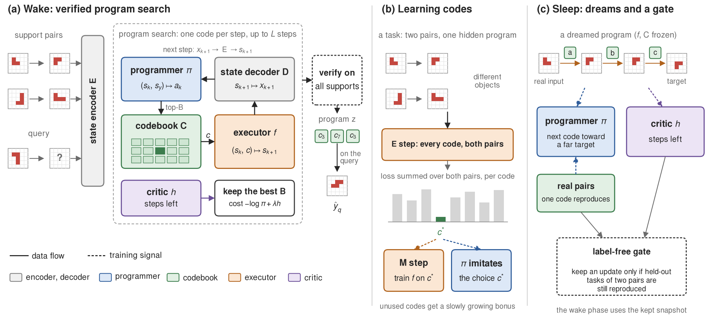

랩 NEO와 다른 점: state encoder, state decoder, codebook, executor는 랩 부품 그대로다. 랩 NEO에 없는 것은 support로 검증하는 탐색, 남은 거리를 예측하는 critic, 두 pair를 모두 실행해 code를 고르는 E 단계와 죽은 code의 보너스, 그리고 꿈 학습이다.

**Table 23.1.** support를 통과한 program이 여럿일 때 답을 고르는 방식. 앞에서부터 처음 통과, 같은 무게 투표, 가장 짧은 것만, 길이로 무게를 준 투표

| 질문 | 비교 | 조건 | 결과 | 결론 | 날짜 |
|---|---|---|---|---|---|
| 다시 학습하지 않고 탐색만 넓히면 | support 검증 탐색, 폭 1, 4, 16 | 8개 환경 한 단계 모델 seed 6 | 길이 8 transfer 7%, 폭 16에서 22% | 채택 | 11-23 |
| 탐색 순위 기준 | 출력과의 오차 대 programmer 선호 누적 | 같음 | 오차 기준은 폭 4가 폭 1보다 나쁨 | programmer 선호 채택 | 11-23 |
| 병목은 executor인가 programmer인가 | 정답 program을 primitive별 code로 실행 | 같음 | 길이 8에서 code가 깨끗한 seed 92%에서 97% | 8개 환경의 병목은 programmer | 11-23 |
| 꿈 학습 | 얼린 executor로 만든 1에서 8단계 program으로 programmer 학습 | seed 6, 6,000스텝 | 폭 16 길이 8이 22%에서 38%, greedy 길이 1이 85%에서 76% | 짧은 결정을 해침 | 11-23 |
| 꿈에 검증된 실제 pair 섞기 | 꿈 위치의 절반을 한 code가 정확히 재현하는 실제 pair로 | seed 6 | 폭 16 길이 8 42%, greedy 길이 1 86% | 채택 | 11-24 |
| 꿈을 네 배로 | 24,000스텝 | seed 42, 45 | seed 42 2에서 4점, seed 45 그대로 | 수확 체감 | 11-24 |
| 남은 거리 예측기 | 꿈으로 학습한 예측의 기댓값을 탐색 순위에 더함 | seed 42, 45, 레벨 5와 7, 폭 4와 16 | 여덟 조건 모두 오름, 폭 4에서 크게, 예 67.5%에서 74.3% | 채택 | 11-24 |
| support를 통과한 program이 여럿일 때 | 처음 통과, 같은 무게 투표, 가장 짧은 것만 투표, 길이마다 무게 반 | 아래 표 | 여섯 조건 가운데 다섯에서 길이로 무게를 준 투표가 가장 좋음 | 채택, 예외 하나 기록 | 11-24, 11-27 |
| 탐색 길이 10 대 14 | 레벨 7, 폭 16 | seed 45, 42 | 처음 통과 78.9%에서 80.7%, 71.6%에서 72.6%. 투표와 함께 85.0%, 78.5% | 숨은 길이 11 이상이 있어 늘리면 소폭 이득 | 11-27 |

랩 NEO와 다른 점: 8개 환경 줄은 한 단계 모델에 꿈 학습을 한 것이고, 24개 환경 줄은 두 pair hard EM에 꿈 학습을 한 것이다. 평가 때 답을 고르는 방식만 다르다.

**Table 23.2.** 탐색의 다른 조정들

| 질문 | 조건 | 결과 |
|---|---|---|
| 남은 거리 예측기를 순위에 더하면 | 8개 환경 seed 42와 45, 레벨 5와 7, 폭 4와 16 | 여덟 조건 모두 오름. 폭 4에서 크고, 한 예가 67.5%에서 74.3% |
| 꿈 학습을 네 배인 24,000스텝으로 | 8개 환경 seed 42와 45 | seed 42는 2에서 4점, seed 45는 그대로 |
| 탐색 길이를 10에서 14로 | 레벨 7, 폭 16, seed 45와 42 | 처음 통과한 program으로 78.9%에서 80.7%, 71.6%에서 72.6% |

랩 NEO와 다른 점: 모두 한 단계 모델에 꿈 학습을 한 것이고 평가 때의 탐색이나 꿈의 길이만 다르다.

**나온 것.** 길이로 무게를 준 투표가 일곱 조건 가운데 여섯에서 가장 좋았다. 같은 무게로 투표하면 긴 과제는 오르지만 짧은 과제가 내려간다. 남은 거리 예측기는 폭이 좁을 때 크게 돕는다. 꿈을 네 배로 늘린 이득은 작다.

### 23번째 실험까지의 insight

고쳐진 것.

- 앞서 한 말: support 둘을 통과하고도 query에서 틀리는 program이 길이 5 이후 20에서 30% 있다. 그러나 더 큰 손실은 찾지 못하는 것이다. 길이 8에서는 폭 16이어도 과제의 70%쯤이 두 support를 통과하는 program을 찾지 못한다.
  지금: support 둘을 통과하고도 query에서 틀리는 program이 있고, 긴 program에서는 찾지 못하는 것이 더 큰 손실이다. 통과한 program이 여럿이면 query에 실행한 답으로 투표하되 길이가 하나 늘 때마다 무게를 반으로 하는 방식이 처음 통과한 program을 쓰는 것보다 낫다. 8개 환경 레벨 7에서 71.6%가 77.4%가 된다. 찾지 못하는 쪽은 남은 거리 예측을 순위에 더하면 준다.
  무엇을 보고: 투표 방식 셋과 예측기를 여러 seed와 레벨에서 견줬다.
- 앞서 한 말: 확정된 executor로 모델이 스스로 만든 여러 단계 program과, executor가 한 code로 정확히 재현하는 실제 pair를 반씩 programmer에게만 가르치면 라벨 없이 긴 program이 오른다. 깨끗한 code가 먼저다. 24개 환경에서 code가 깨끗한 모델은 길이 4가 43%에서 54%로 오르고, code가 섞인 모델에서는 거의 효과가 없다.
  지금: 확정된 executor로 모델이 스스로 만든 여러 단계 program과, executor가 한 code로 정확히 재현하는 실제 pair를 반씩 programmer에게만 가르치면 라벨 없이 긴 program이 오른다. 깨끗한 code가 먼저다. code가 섞인 모델에서는 거의 효과가 없다. 꿈 학습을 네 배로 늘려도 이득은 0에서 4점이다.
  무엇을 보고: 꿈 학습을 24,000스텝으로 늘린 run 둘을 쟀다.

그대로인 것.

- state 표현과 단계 사이로 넘기는 것
    - 격자 하나를 latent 하나에 담는 것은 15칸 격자에 모자라지만, 공식 NEO가 0에 머무는 이유는 그것만이 아니다
    - 단계 사이에 확률을 넘기면 격자에 보이지 않는 정보가 건너가고, code 둘이 주소가 된다
- code 형성: programmer와 codebook이 primitive마다 code를 세우는 일
    - transfer를 정하는 것은 어디서나 통하는 code 하나를 가진 primitive의 수다
    - 여러 단계로 학습하면 primitive는 여러 code로 설명되는 단계를 거쳐 차례로 code를 얻는다
    - 남는 code와 다시 뿌리기는 primitive를 입력에 따라 쪼갠다
    - 랩 programmer는 code를 늦게 찾고, 칸마다 이어 붙인 넓은 programmer가 빨리 찾는다
    - 예시를 다시 만들기만 하면 채워지는 목표 아래에서 여러 단계를 함께 학습하면 code가 primitive가 아닌 것으로 굳는다
    - 깨끗한 한 단계 code는 이어 쓸 수 있고, code가 깨끗할수록 여러 단계 과제도 나아진다
    - 여러 단계 학습은 허락된 길이로 설명할 수 없는 pair를 억지로 맞출 때 code를 휘게 한다
    - 큰 환경의 실패는 비슷한 변환이 한 code에 섞인 채 굳는 것이다
    - 섞인 code를 푸는 데 빠져 있던 것은 같은 code가 다른 입력에서도 같은 일을 하라는 요구다
    - 오래 학습하면 일부만 풀린다
    - 배정은 초반에 정해지고, 굳은 뒤에는 보너스를 키워도 온도를 다시 올려도 풀리지 않는다
- executor: code가 어디서나 같은 변환인가
    - code가 놓인 모양과 executor가 하는 일은 별개다
    - executor는 정답 code가 주어지면 회전 계열을 해낸다. 용량 문제가 아니다
    - code가 깨끗하면 executor는 여덟 단계를 이어 실행해도 거의 틀리지 않는다
- 여러 단계 program: programmer의 계획과 평가 때의 탐색
    - 긴 program에서 떨어지는 큰 부분은 탐색 없이 이어 쓰기 때문이고, 탐색을 넓히면 2배에서 3배가 된다
    - 긴 program의 병목은 executor가 아니라 programmer의 계획이다
- 양과 구조를 넣은 codebook
    - 양이 더해지는 성질은 loss가 아니라 실행 방식으로 보장해야 한다
    - 구조를 넣은 codebook은 작은 이동 묶음에서만 본 적 없는 양을 말했다
- 환경이 커질 때와 아는 것 위에 쌓기
    - 환경이 커져도 배우는 속도는 느려지지 않고 닿는 높이가 갈린다
    - 새 primitive 하나의 비용은 본 pair 수로 세면 환경 크기에 거의 평평하다
    - 새 것이 옛것을 밀어낸다
- 재는 방법
    - seed 하나의 값으로 말하지 않는다
    - transfer는 확률을 넘기는 방식과 격자만 넘기는 방식 둘 다로 잰다
    - 회전 계열만의 code NMI가 code 배정의 상태를 transfer와 같은 순서로 보여 준다
    - 학습에 쓰지 않은 두 pair 과제의 재현율이 잘 풀린 run을 라벨 없이 고른다

## 24. 큰 환경의 code 형성, 깊이 없이 과제 고르기, 본보기로 code 나누기

2026-11-24에서 27. 근거는 `docs/ablations.md` 1절과 4절.

**물은 것.** 두 pair hard EM의 갈림이 52개와 64개 환경에서도 같은가. 숨은 길이를 읽지 않고 한 단계 과제를 고를 수 있는가. 섞인 code를 본보기 과제로 나눌 수 있는가.

**한 것.** 52개와 64개 환경에서 두 pair hard EM의 기본 형태와 온도를 내리는 형태를 seed 셋씩 돌리고, 검증 점수가 잘 풀린 run을 고르는지 봤다. 숨은 길이 대신 가장 잘 맞는 code의 오차로 과제를 줄 세워 절반이나 30%만 학습하는 것을 돌렸다. 섞인 code의 과제 일부를 본보기로 삼아 새 code를 학습한 뒤 재배정하는 것도 돌렸다.

**랩 NEO와 다른 점, 이 실험의 공통 설정.**

| 항목 | 랩 NEO | 이 실험 |
|---|---|---|
| 데이터 | BabyTheorist single-A 레벨 1의 학습 파일. pair 하나씩이고 70%가 primitive 여럿짜리다 | 24, 32, 52, 64개 환경의 두 pair 과제. 한 갈래는 숨은 길이 대신 모델의 오차로 과제를 고른다 |
| programmer | 지금 칸 token과 목표 칸 token을 따로 넣는 6층 transformer, 폭 128 | 지금 칸과 목표 칸을 칸마다 이어 붙인 token을 넣는 token_pair_transformer, 폭 256 |
| codebook | 랩 VQ. cosine으로 가장 가까운 code를 고른다. code 16개, 16차원, commitment 0.25 | 랩 VQ 그대로이고 code 수만 primitive 수의 두 배 |
| program 길이와 단계 사이로 넘기는 것 | 최대 다섯 단계. 단계 사이에 칸마다의 색 확률을 넘긴다 | program 한 단계 |
| code를 고르고 학습하는 방식 | programmer가 pair 하나를 보고 낸 출력에 가장 가까운 code를 쓴다. 길이는 길이마다 0.95를 곱한 cross-entropy가 가장 작은 것으로 고르고, 그 길이의 cross-entropy, grounding 항 0.1, codebook loss로 모든 부품을 함께 학습한다 | hard EM. 과제마다 codebook의 모든 code를 두 pair에 실행해 오차의 합이 가장 작은 code를 고르고, executor는 그 code로 두 pair를 학습하고 programmer는 그 code를 맞히게 학습한다. 아무도 고르지 않는 code는 오차를 깎아 주는 보너스로 구제한다 |
| 학습 일정 | 학습률 3e-4, batch 256 episode, 78,200스텝, 가중치 평균 0.999 | batch 128 pair, 24,000스텝, 가중치 평균 끔, programmer 학습률은 0.25배, forward를 torch.compile로 묶음 |
| 학습이 읽는 정보 | 입력과 출력 격자만 읽는다 | 입력과 출력 격자, 어느 pair 둘이 같은 규칙인지, 그리고 한 단계 과제만 남기는 데 숨은 길이 |

표에 없는 항목은 랩 NEO와 같다.

**Table 24.1.** 환경 크기별 가로세로를 바꾸는 넷

| 환경 | 랩 pair 하나 | 랩 pair 둘 | hard EM pair 둘 | 온도를 내리는 형태 | 검증 점수로 고른 run |
|---|---|---|---|---|---|
| 24개 | 17%, seed 3 | 34%, seed 3 | 64%, seed 5 | 57%, seed 5 | 96% |
| 32개 | 15% | 38% | 59% | 돌리지 않음 | |
| 52개 | 16% | 27% | 98%, 39%, 38% | 79%, 55%, 78% | 98% |
| 64개 | 11% | 36% | 37%, 92%, 38% | 96%, 59%, 53% | 96% |

랩 NEO와 다른 점: 랩 pair 하나 열은 부품과 code를 고르는 방식이 랩과 같은 한 단계 학습이고, 랩 pair 둘 열은 거기에 두 pair 과제만 더한 것이다. 나머지 열이 hard EM이다.

**Table 24.2.** 숨은 길이 없이 과제 고르기와 본보기로 code 나누기, 24개 환경

| 질문 | 비교 | 결과, 넷 | 결과, 나머지 |
|---|---|---|---|
| 숨은 길이를 읽지 않고 한 단계 과제를 고르면 | 가장 잘 맞는 code의 오차로 과제를 줄 세워 절반만 학습 | 34%, 33%, 35% | 89%, 99%, 99% |
| | 같은 방식으로 30%만 학습 | 40%, 57%, 46% | 70%, 68%, 67% |
| 섞인 code를 본보기 과제로 나누면 | 본보기로 새 code를 학습한 뒤 재배정하고 12,000스텝 이어 학습 | 학습 과제 재현은 35%에서 94%, 평가는 34%. 이어 학습 33%, 대조 35% | |

랩 NEO와 다른 점: 두 pair hard EM에서 학습 과제를 고르는 방식, 또는 굳은 뒤에 code를 나누는 단계만 다르다.

**나온 것.** 52개와 64개 환경에서도 기본 형태는 seed 셋 가운데 하나만 98%와 92%로 풀리고 나머지는 37에서 39%다. 검증 점수의 순위는 넷의 순위와 정확히 같아 크기마다 가장 잘 풀린 run을 고른다. 숨은 길이를 읽지 않고 과제를 고르면 깊이로 고른 데이터에 못 미친다. 많이 버리면 넷은 오르고 나머지가 내려간다. 본보기로 만든 새 code는 학습 과제는 재현하지만 평가에서는 그대로다.

### 24번째 실험까지의 insight

새로 알게 된 것.

- 두 pair hard EM은 환경이 커져도 같은 식으로 갈린다. 가로세로를 바꾸는 넷이 52개 환경에서 98%, 39%, 38%, 64개 환경에서 37%, 92%, 38%다.
- 한 단계 학습은 primitive 하나짜리 과제를 고르는 데 숨은 길이를 읽는다. 모델의 오차로 과제를 줄 세워 고르면 깊이로 고른 데이터에 못 미친다. 절반을 남기면 넷이 34% 근처이고, 30%만 남기면 넷은 오르지만 나머지가 68%로 내려간다.
- 굳은 뒤에 섞인 code의 과제 일부를 본보기로 삼아 새 code를 학습하면, 학습 과제 재현은 35%에서 94%로 오르지만 평가는 34%로 그대로다. 새 code가 변환이 아니라 본보기의 물체를 외운다.

고쳐진 것.

- 앞서 한 말: 학습에 쓰지 않은 두 pair 과제에서 programmer가 첫 pair를 보고 고른 code가 두 pair를 모두 재현하는 비율은 라벨 없이 잘 풀린 run을 고른다. 24개 환경 열 run에서 가로세로를 바꾸는 넷과의 순위 상관이 0.98이다.
  지금: 학습에 쓰지 않은 두 pair 과제에서 programmer가 첫 pair를 보고 고른 code가 두 pair를 모두 재현하는 비율은 라벨 없이 잘 풀린 run을 고른다. 24개 환경 열 run에서 순위 상관이 0.98이고, 52개와 64개 환경에서는 순위가 정확히 같다. seed 여러 개를 돌려 이 점수로 고르면 세 크기에서 넷이 96에서 98%인 run이 나온다.
  무엇을 보고: 52개와 64개 환경의 run 여섯씩에서 같은 점수를 쟀다.

그대로인 것.

- state 표현과 단계 사이로 넘기는 것
    - 격자 하나를 latent 하나에 담는 것은 15칸 격자에 모자라지만, 공식 NEO가 0에 머무는 이유는 그것만이 아니다
    - 단계 사이에 확률을 넘기면 격자에 보이지 않는 정보가 건너가고, code 둘이 주소가 된다
- code 형성: programmer와 codebook이 primitive마다 code를 세우는 일
    - transfer를 정하는 것은 어디서나 통하는 code 하나를 가진 primitive의 수다
    - 여러 단계로 학습하면 primitive는 여러 code로 설명되는 단계를 거쳐 차례로 code를 얻는다
    - 남는 code와 다시 뿌리기는 primitive를 입력에 따라 쪼갠다
    - 랩 programmer는 code를 늦게 찾고, 칸마다 이어 붙인 넓은 programmer가 빨리 찾는다
    - 예시를 다시 만들기만 하면 채워지는 목표 아래에서 여러 단계를 함께 학습하면 code가 primitive가 아닌 것으로 굳는다
    - 깨끗한 한 단계 code는 이어 쓸 수 있고, code가 깨끗할수록 여러 단계 과제도 나아진다
    - 여러 단계 학습은 허락된 길이로 설명할 수 없는 pair를 억지로 맞출 때 code를 휘게 한다
    - 큰 환경의 실패는 비슷한 변환이 한 code에 섞인 채 굳는 것이다
    - 섞인 code를 푸는 데 빠져 있던 것은 같은 code가 다른 입력에서도 같은 일을 하라는 요구다
    - 오래 학습하면 일부만 풀린다
    - 배정은 초반에 정해지고, 굳은 뒤에는 보너스를 키워도 온도를 다시 올려도 풀리지 않는다
- executor: code가 어디서나 같은 변환인가
    - code가 놓인 모양과 executor가 하는 일은 별개다
    - executor는 정답 code가 주어지면 회전 계열을 해낸다. 용량 문제가 아니다
    - code가 깨끗하면 executor는 여덟 단계를 이어 실행해도 거의 틀리지 않는다
- 여러 단계 program: programmer의 계획과 평가 때의 탐색
    - 긴 program에서 떨어지는 큰 부분은 탐색 없이 이어 쓰기 때문이고, 탐색을 넓히면 2배에서 3배가 된다
    - support를 통과한 program이 여럿이면 짧은 program에 무게를 주어 투표한다
    - 긴 program의 병목은 executor가 아니라 programmer의 계획이다
    - 깨끗한 code가 먼저이고, 꿈 학습은 그 위에서 계획을 채운다. 더 오래 꿔도 이득은 작다
- 양과 구조를 넣은 codebook
    - 양이 더해지는 성질은 loss가 아니라 실행 방식으로 보장해야 한다
    - 구조를 넣은 codebook은 작은 이동 묶음에서만 본 적 없는 양을 말했다
- 환경이 커질 때와 아는 것 위에 쌓기
    - 환경이 커져도 배우는 속도는 느려지지 않고 닿는 높이가 갈린다
    - 새 primitive 하나의 비용은 본 pair 수로 세면 환경 크기에 거의 평평하다
    - 새 것이 옛것을 밀어낸다
- 재는 방법
    - seed 하나의 값으로 말하지 않는다
    - transfer는 확률을 넘기는 방식과 격자만 넘기는 방식 둘 다로 잰다
    - 회전 계열만의 code NMI가 code 배정의 상태를 transfer와 같은 순서로 보여 준다

## 25. code는 학습 분포 밖에서도 같은 함수인가: 사다리 측정과 24개 환경의 긴 program

2026-11-26. 근거는 `docs/ablations.md` 2절과 3.1절, 도구는 `scripts/babytheorist/code_function_ladder.py`.

**물은 것.** code가 어떤 기능을 한다고 단정할 수 있는가. 다른 primitive를 거친 물체나 학습 때보다 큰 물체에서도 같은 code가 같은 변환을 하는가.

**한 것.** primitive마다 가장 자주 그 primitive를 재현한 code를 정답 code로 두고, 학습 분포에서 점점 멀어지는 state에서 한 번 실행한 정확도를 쟀다. 새로 뽑은 물체, 무작위 primitive를 1에서 5개 거친 물체, 학습 때보다 큰 물체의 순서다. 라벨 없는 확인으로, 모델이 새 물체에서 스스로 보인 code 사이의 되돌림 관계가 유지되는 비율도 쟀다. 24개 환경에서 숨은 길이 5, 6, 7인 평가 파일을 만들어 정답 program의 상한과 탐색도 쟀다.

**랩 NEO와 다른 점, 이 실험의 공통 설정.** 모델은 앞 실험들의 것 그대로이고 재는 방식만 새로 만들었다.

| 항목 | 랩 NEO | 이 실험 |
|---|---|---|
| 데이터 | BabyTheorist single-A 레벨 1의 학습 파일. pair 하나씩이고 70%가 primitive 여럿짜리다 | 이 레포의 생성기로 만든 primitive 묶음. 같은 program을 다른 물체 둘에 적용한 pair 둘이 한 과제이고 primitive 하나짜리만 쓴다 |
| programmer | 지금 칸 token과 목표 칸 token을 따로 넣는 6층 transformer, 폭 128 | 지금 칸과 목표 칸을 칸마다 이어 붙인 token을 넣는 token_pair_transformer, 폭 256 |
| codebook | 랩 VQ. cosine으로 가장 가까운 code를 고른다. code 16개, 16차원, commitment 0.25 | 랩 VQ 그대로이고 code 수만 primitive 수의 두 배 |
| program 길이와 단계 사이로 넘기는 것 | 최대 다섯 단계. 단계 사이에 칸마다의 색 확률을 넘긴다 | program 한 단계 |
| code를 고르고 학습하는 방식 | programmer가 pair 하나를 보고 낸 출력에 가장 가까운 code를 쓴다. 길이는 길이마다 0.95를 곱한 cross-entropy가 가장 작은 것으로 고르고, 그 길이의 cross-entropy, grounding 항 0.1, codebook loss로 모든 부품을 함께 학습한다 | hard EM. 과제마다 codebook의 모든 code를 두 pair에 실행해 오차의 합이 가장 작은 code를 고르고, executor는 그 code로 두 pair를 학습하고 programmer는 그 code를 맞히게 학습한다. 아무도 고르지 않는 code는 오차를 깎아 주는 보너스로 구제한다 |
| 학습 일정 | 학습률 3e-4, batch 256 episode, 78,200스텝, 가중치 평균 0.999 | batch 128 pair, 24,000스텝, 가중치 평균 끔, programmer 학습률은 0.25배, forward를 torch.compile로 묶음 |
| 평가 때의 추론 | programmer가 support pair 하나를 보고 고른 code 열을 query에 그대로 실행한다. 탐색하지 않는다 | 진단이다. primitive마다 정답 code를 정해 학습 분포에서 멀어지는 state에서 한 번 실행한다. 숨은 primitive를 읽는다 |
| 학습이 읽는 정보 | 입력과 출력 격자만 읽는다 | 입력과 출력 격자, 어느 pair 둘이 같은 규칙인지, 그리고 한 단계 과제만 남기는 데 숨은 길이 |

표에 없는 항목은 랩 NEO와 같다.

**Table 25.1.** 정답 code를 한 번 실행한 정확도, 학습 분포에서 멀어지는 순서

| 모델 | 새 물체 | 1단계 거친 물체 | 3단계 | 5단계 | 큰 물체 | 되돌림 관계 유지, 새 물체에서 5단계 |
|---|---|---|---|---|---|---|
| 8개 환경, seed 45 | 99% | 99% | 98% | 98% | 72% | 해당 쌍 없음 |
| 24개 환경 hard EM pair 둘, seed 42 | 99% | 94% | 86% | 79% | 63% | 100%에서 61% |
| 24개 환경 hard EM pair 둘, seed 46 | 94% | 89% | 82% | 75% | 59% | 99%에서 70% |
| 24개 환경 랩 방식 pair 둘 | 75% | 68% | 59% | 51% | 45% | |
| 24개 환경 랩 방식 pair 하나 | 65% | 60% | 55% | 50% | 41% | |
| 52개 환경 hard EM pair 둘 | 90% | 83% | 69% | 63% | 60% | 100%에서 58% |
| 64개 환경 온도를 내리는 형태 | 92% | 88% | 78% | 71% | 68% | 98%에서 63% |

랩 NEO와 다른 점: 줄마다 모델이 다르다. 8개 환경 줄은 한 단계 모델, hard EM 줄은 두 pair hard EM, 랩 방식 줄은 code를 고르는 방식이 랩과 같은 한 단계 학습이다. 재는 방식은 랩 NEO에 없는 진단이다.

**Table 25.2.** 24개 환경의 긴 program, 폭 16

| 모델 | 정답 program 상한, 길이 5, 6, 7 | 꿈 전 탐색 | 꿈 후 탐색 | 남은 거리 예측기까지 |
|---|---|---|---|---|
| hard EM pair 둘 seed 42 | 69%, 62%, 56% | 34%, 24%, 17% | 46%, 35%, 22% | 52%, 41%, 27% |
| hard EM pair 둘 seed 46 | 51%, 43%, 32% | 33%, 21%, 15% | 46%, 36%, 29% | 49%, 39%, 34% |
| 랩 방식 pair 하나 seed 42 | 12%, 6%, 0% | 6%, 3%, 0% | | |

랩 NEO와 다른 점: hard EM 줄은 두 pair hard EM에 꿈 학습과 탐색을 얹은 것이다. 랩 방식 줄은 code를 고르는 방식이 랩과 같은 한 단계 학습이다.

**나온 것.** 정답 code의 정확도가 새 물체에서는 99%인데 무작위 primitive를 다섯 번 거친 물체에서는 79%, 큰 물체에서는 63%다. 긴 program의 중간 격자가 바로 그런 물체다. 그래서 24개 환경에서는 정답 program의 상한 자체가 길이 7에서 56%다. 환경이 클수록 더 가파르게 떨어진다.

### 25번째 실험까지의 insight

고쳐진 것.

- 앞서 한 말: 8개 환경에서 code가 깨끗한 seed의 executor는 정답 program을 여덟 단계 이어 실행해도 92에서 97%를 맞힌다. 한 단계로만 학습했는데도 그렇다.
  지금: 8개 환경에서 code가 깨끗한 seed의 executor는 정답 program을 여덟 단계 이어 실행해도 92에서 97%를 맞힌다. 그러나 24개 환경에서는 정답 code를 한 번 실행한 정확도가 새 물체 99%, 무작위 primitive를 다섯 번 거친 물체 79%, 큰 물체 63%다. code가 알맞게 골라져도 executor가 그 code를 학습 분포 밖의 state에서 같은 변환으로 실행하지 못한다. 환경이 클수록 더 가파르게 떨어진다.
  무엇을 보고: 정답 code를 학습 분포에서 멀어지는 state에서 실행하는 측정을 새로 했다.
- 앞서 한 말: 긴 program에서 떨어지는 것은 executor가 아니라 programmer가 여러 단계 떨어진 목표를 보고 첫 code를 고르지 못하는 데서 온다. 길이 8에서 정답 program의 상한이 92에서 97%인데 탐색은 30에서 42%다. programmer는 학습 때 한 단계 떨어진 목표만 봤다.
  지금: 긴 program의 병목은 환경에 따라 다르다. 8개 환경에서는 정답 program의 상한이 92에서 97%인데 탐색이 30에서 42%라 programmer의 계획이 병목이다. 24개 환경에서는 상한 자체가 길이 5, 6, 7에서 69%, 62%, 56%라 executor가 병목이다.
  무엇을 보고: 24개 환경에서 숨은 길이 5에서 7의 평가 파일을 만들어 상한을 쟀다.

그대로인 것.

- state 표현과 단계 사이로 넘기는 것
    - 격자 하나를 latent 하나에 담는 것은 15칸 격자에 모자라지만, 공식 NEO가 0에 머무는 이유는 그것만이 아니다
    - 단계 사이에 확률을 넘기면 격자에 보이지 않는 정보가 건너가고, code 둘이 주소가 된다
- code 형성: programmer와 codebook이 primitive마다 code를 세우는 일
    - transfer를 정하는 것은 어디서나 통하는 code 하나를 가진 primitive의 수다
    - 여러 단계로 학습하면 primitive는 여러 code로 설명되는 단계를 거쳐 차례로 code를 얻는다
    - 남는 code와 다시 뿌리기는 primitive를 입력에 따라 쪼갠다
    - 랩 programmer는 code를 늦게 찾고, 칸마다 이어 붙인 넓은 programmer가 빨리 찾는다
    - 예시를 다시 만들기만 하면 채워지는 목표 아래에서 여러 단계를 함께 학습하면 code가 primitive가 아닌 것으로 굳는다
    - 깨끗한 한 단계 code는 이어 쓸 수 있고, code가 깨끗할수록 여러 단계 과제도 나아진다
    - 여러 단계 학습은 허락된 길이로 설명할 수 없는 pair를 억지로 맞출 때 code를 휘게 한다
    - 큰 환경의 실패는 비슷한 변환이 한 code에 섞인 채 굳는 것이다
    - 섞인 code를 푸는 데 빠져 있던 것은 같은 code가 다른 입력에서도 같은 일을 하라는 요구다
    - 오래 학습하면 일부만 풀린다
    - 배정은 초반에 정해지고, 굳은 뒤에는 보너스를 키워도 온도를 다시 올려도 풀리지 않는다
    - 숨은 길이를 읽지 않고 한 단계 과제를 고르는 방법은 아직 없다
    - 굳은 code를 본보기 과제로 나누면 새 code가 변환이 아니라 그 물체들을 외운다
- executor: code가 어디서나 같은 변환인가
    - code가 놓인 모양과 executor가 하는 일은 별개다
    - executor는 정답 code가 주어지면 회전 계열을 해낸다. 용량 문제가 아니다
- 여러 단계 program: programmer의 계획과 평가 때의 탐색
    - 긴 program에서 떨어지는 큰 부분은 탐색 없이 이어 쓰기 때문이고, 탐색을 넓히면 2배에서 3배가 된다
    - support를 통과한 program이 여럿이면 짧은 program에 무게를 주어 투표한다
    - 깨끗한 code가 먼저이고, 꿈 학습은 그 위에서 계획을 채운다. 더 오래 꿔도 이득은 작다
- 양과 구조를 넣은 codebook
    - 양이 더해지는 성질은 loss가 아니라 실행 방식으로 보장해야 한다
    - 구조를 넣은 codebook은 작은 이동 묶음에서만 본 적 없는 양을 말했다
- 환경이 커질 때와 아는 것 위에 쌓기
    - 환경이 커져도 배우는 속도는 느려지지 않고 닿는 높이가 갈린다
    - 새 primitive 하나의 비용은 본 pair 수로 세면 환경 크기에 거의 평평하다
    - 새 것이 옛것을 밀어낸다
    - 두 pair hard EM의 seed에 따른 갈림은 52개와 64개 환경에서도 같다
- 재는 방법
    - seed 하나의 값으로 말하지 않는다
    - transfer는 확률을 넘기는 방식과 격자만 넘기는 방식 둘 다로 잰다
    - 회전 계열만의 code NMI가 code 배정의 상태를 transfer와 같은 순서로 보여 준다
    - 학습에 쓰지 않은 두 pair 과제의 재현율이 잘 풀린 run을 라벨 없이 고른다. 큰 환경에서도 그렇다

## 26. codebook이 자리 잡는 과정과 굳는 원인

2026-11-26에서 27. 근거는 `docs/reports/2026-11-27-autoresearch.md` 2절과 `docs/ablations.md` 1.1절.

**물은 것.** 두 pair hard EM에서 가로세로를 바꾸는 넷의 배정은 언제, 왜 굳는가. 굳는 시기에 넷을 가를 신호가 모델 어딘가에 있는가.

**한 것.** 잘 풀린 seed 42와 굳은 seed 43을 같은 설정으로 다시 돌리며 100스텝마다 codebook을 기록했다. primitive마다 고른 code, 그 code의 재현, code 벡터, 죽은 code 보너스다. 그리고 200스텝마다의 체크포인트에서 한 code에 묶인 과제들의 gradient, executor의 특이성, programmer 출력과 은닉 벡터가 넷을 가르는지를 쟀다.

**랩 NEO와 다른 점, 이 실험의 공통 설정.** 모델은 두 pair hard EM 그대로이고 학습 도중의 기록만 더했다.

| 항목 | 랩 NEO | 이 실험 |
|---|---|---|
| 데이터 | BabyTheorist single-A 레벨 1의 학습 파일. pair 하나씩이고 70%가 primitive 여럿짜리다 | 이 레포의 생성기로 만든 primitive 묶음. 같은 program을 다른 물체 둘에 적용한 pair 둘이 한 과제이고 primitive 하나짜리만 쓴다 |
| programmer | 지금 칸 token과 목표 칸 token을 따로 넣는 6층 transformer, 폭 128 | 지금 칸과 목표 칸을 칸마다 이어 붙인 token을 넣는 token_pair_transformer, 폭 256 |
| codebook | 랩 VQ. cosine으로 가장 가까운 code를 고른다. code 16개, 16차원, commitment 0.25 | 랩 VQ 그대로이고 code 수만 primitive 수의 두 배 |
| program 길이와 단계 사이로 넘기는 것 | 최대 다섯 단계. 단계 사이에 칸마다의 색 확률을 넘긴다 | program 한 단계 |
| code를 고르고 학습하는 방식 | programmer가 pair 하나를 보고 낸 출력에 가장 가까운 code를 쓴다. 길이는 길이마다 0.95를 곱한 cross-entropy가 가장 작은 것으로 고르고, 그 길이의 cross-entropy, grounding 항 0.1, codebook loss로 모든 부품을 함께 학습한다 | hard EM. 과제마다 codebook의 모든 code를 두 pair에 실행해 오차의 합이 가장 작은 code를 고르고, executor는 그 code로 두 pair를 학습하고 programmer는 그 code를 맞히게 학습한다. 아무도 고르지 않는 code는 오차를 깎아 주는 보너스로 구제한다 |
| 학습 일정 | 학습률 3e-4, batch 256 episode, 78,200스텝, 가중치 평균 0.999 | batch 128 pair, 24,000스텝, 가중치 평균 끔, programmer 학습률은 0.25배, forward를 torch.compile로 묶음 |
| 학습이 읽는 정보 | 입력과 출력 격자만 읽는다 | 입력과 출력 격자, 어느 pair 둘이 같은 규칙인지, 그리고 한 단계 과제만 남기는 데 숨은 길이 |

표에 없는 항목은 랩 NEO와 같다.

**Figure 26.1.** 100스텝마다 본 primitive별 code 배정

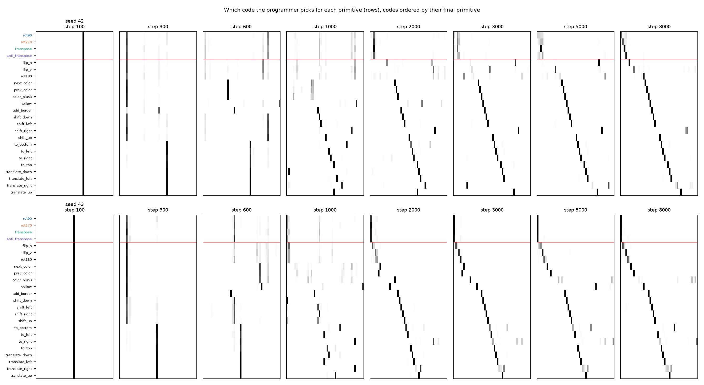

랩 NEO와 다른 점: 두 pair hard EM 그대로다. 숨은 primitive는 그림의 줄을 나누는 데만 썼다.

**Figure 26.2.** codebook이 자리 잡는 동안의 지표

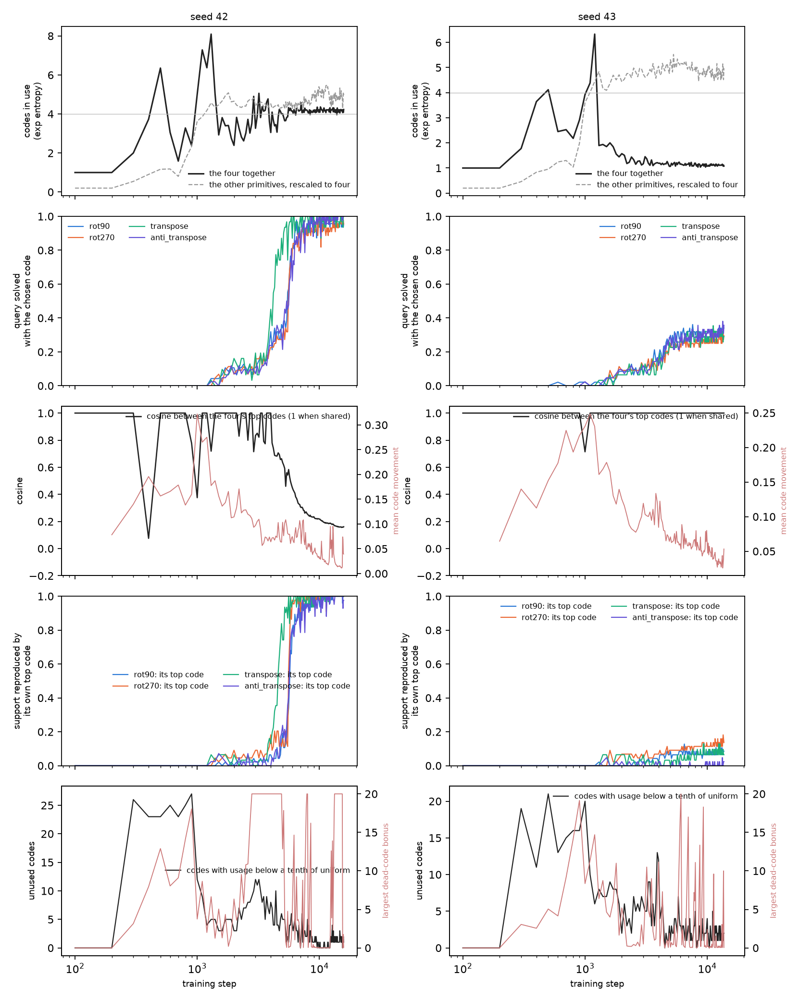

랩 NEO와 다른 점: 두 pair hard EM 그대로다.

**Figure 26.3.** 가로세로를 바꾸는 넷의 배정과 재현, 풀린 seed와 굳은 seed

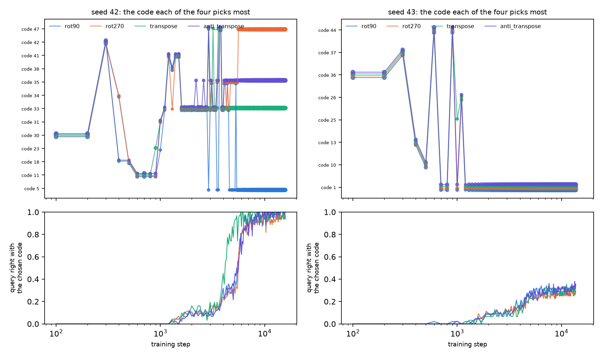

랩 NEO와 다른 점: 두 pair hard EM 그대로다.

**Table 26.1.** 굳는 원인을 찾는 측정

| 질문 | 측정 | 결과 | 날짜 |
|---|---|---|---|
| codebook은 어떤 순서로 자리 잡는가 | seed 42와 43을 같은 설정으로 다시 돌리며 100스텝마다 기록 | 굵은 묶음에서 가는 묶음으로 갈라짐. 넷은 가장 늦게까지 한 묶음. 두 run이 원래 결과를 재현 | 11-27 |
| 넷의 배정은 언제 정해지는가 | 같은 기록 | 1,000에서 1,300스텝에 정해지며 이때 executor는 넷을 거의 재현하지 못함 | 11-27 |
| seed 42는 어떻게 갈라졌는가 | 같은 기록의 죽은 code 보너스 | 보너스가 2,800스텝에 상한 20 nats에 닿은 뒤 3,000에서 5,000스텝에 넷이 하나씩 다른 code로 옮겨 감 | 11-27 |
| 한 code의 과제별 gradient가 넷을 가르는가 | 200에서 4,000스텝, 200스텝마다, code 벡터와 executor 조건 벡터에 대한 gradient | seed 42와 43 모두 모든 시점에서 순도가 우연 수준 | 11-27 |
| 모델 어딘가에 넷을 가르는 정보가 있는가 | 배정 순도, executor 특이성, 같은 과제 두 pair의 gradient 일치, programmer 출력과 은닉 벡터의 선형 분류기, 200에서 6,000스텝 | 4,000스텝까지 배정, executor, gradient는 두 seed 모두 우연 수준. programmer 은닉 벡터만 1,200스텝 무렵부터 넷을 0.32에서 0.44 맞힘, 우연 수준 0.25. 학습 끝 seed 42는 0.89 | 11-27 |
| 갈라질 때 무엇이 먼저 움직이는가 | seed 42의 4,200에서 6,000스텝 | 배정 순도가 4,200에서 4,800스텝에 먼저 오르고, executor가 한 primitive를 더 잘하는 정도가 5,200스텝부터, gradient의 primitive 신호가 5,600스텝부터 오름 | 11-27 |

랩 NEO와 다른 점: 모두 두 pair hard EM의 학습 도중을 잰 것이다. 라벨은 채점에만 썼다.

**나온 것.** codebook은 굵은 묶음에서 가는 묶음으로 갈라지고 넷은 가장 늦게까지 한 묶음이다. 넷의 배정은 1,000에서 1,300스텝에 정해지는데 이때 executor는 넷을 거의 재현하지 못한다. 4,000스텝까지 배정, executor, gradient 어디에도 넷을 가르는 신호가 없다. programmer의 은닉 벡터에만 약한 정보가 있다. 풀린 seed는 죽은 code 보너스가 상한에 닿은 뒤 넷이 하나씩 다른 code로 옮겨 갔다.

### 26번째 실험까지의 insight

새로 알게 된 것.

- 한 단계 학습에서 codebook은 굵은 묶음에서 가는 묶음으로 갈라진다. 가로세로를 바꾸는 넷은 가장 늦게까지 한 묶음으로 남는다.

고쳐진 것.

- 앞서 한 말: 두 pair hard EM에서 넷의 갈라짐은 2,400스텝과 7,200스텝 사이에 정해진다. 굳은 뒤에는 구제 보너스를 키워도, 온도를 다시 올렸다 내려도 풀리지 않는다. 온도를 처음부터 천천히 내리면 멈추는 seed가 사라지지만 완전히 풀리는 seed도 사라져 평균이 57%로 기본의 64%보다 낮다. programmer 출력에는 넷을 가를 정보가 없고, 남은 덩어리는 대칭인 물체에서의 혼동으로 설명되지 않는다.
  지금: 두 pair hard EM에서 넷의 배정은 1,000에서 1,300스텝에 정해진다. 이때 executor는 넷을 거의 재현하지 못하고, 4,000스텝까지 배정, executor, 과제별 gradient 어디에도 넷을 가르는 신호가 없다. programmer의 은닉 벡터에만 약한 정보가 있다. 풀린 seed는 죽은 code 보너스가 상한에 닿은 뒤 3,000에서 5,000스텝에 넷이 하나씩 다른 code로 옮겨 가서 풀렸다. 갈라질 때는 배정이 먼저 움직이고 executor와 gradient가 뒤따른다. 굳은 뒤에는 보너스를 키워도 온도를 다시 올려도 풀리지 않는다.
  무엇을 보고: 앞서는 갈라짐이 2,400스텝과 7,200스텝 사이에 정해진다고 했다. 100스텝마다 기록하니 배정은 그보다 훨씬 이른 1,000에서 1,300스텝에 정해졌다.

그대로인 것.

- state 표현과 단계 사이로 넘기는 것
    - 격자 하나를 latent 하나에 담는 것은 15칸 격자에 모자라지만, 공식 NEO가 0에 머무는 이유는 그것만이 아니다
    - 단계 사이에 확률을 넘기면 격자에 보이지 않는 정보가 건너가고, code 둘이 주소가 된다
- code 형성: programmer와 codebook이 primitive마다 code를 세우는 일
    - transfer를 정하는 것은 어디서나 통하는 code 하나를 가진 primitive의 수다
    - 여러 단계로 학습하면 primitive는 여러 code로 설명되는 단계를 거쳐 차례로 code를 얻는다
    - 남는 code와 다시 뿌리기는 primitive를 입력에 따라 쪼갠다
    - 랩 programmer는 code를 늦게 찾고, 칸마다 이어 붙인 넓은 programmer가 빨리 찾는다
    - 예시를 다시 만들기만 하면 채워지는 목표 아래에서 여러 단계를 함께 학습하면 code가 primitive가 아닌 것으로 굳는다
    - 깨끗한 한 단계 code는 이어 쓸 수 있고, code가 깨끗할수록 여러 단계 과제도 나아진다
    - 여러 단계 학습은 허락된 길이로 설명할 수 없는 pair를 억지로 맞출 때 code를 휘게 한다
    - 큰 환경의 실패는 비슷한 변환이 한 code에 섞인 채 굳는 것이다
    - 섞인 code를 푸는 데 빠져 있던 것은 같은 code가 다른 입력에서도 같은 일을 하라는 요구다
    - 오래 학습하면 일부만 풀린다
    - 숨은 길이를 읽지 않고 한 단계 과제를 고르는 방법은 아직 없다
    - 굳은 code를 본보기 과제로 나누면 새 code가 변환이 아니라 그 물체들을 외운다
- executor: code가 어디서나 같은 변환인가
    - code가 놓인 모양과 executor가 하는 일은 별개다
    - executor는 정답 code가 주어지면 회전 계열을 해낸다. 용량 문제가 아니다
    - code는 학습 때 본 state에서만 같은 함수다. 다른 primitive를 거친 물체와 큰 물체에서는 executor가 틀린다
- 여러 단계 program: programmer의 계획과 평가 때의 탐색
    - 긴 program에서 떨어지는 큰 부분은 탐색 없이 이어 쓰기 때문이고, 탐색을 넓히면 2배에서 3배가 된다
    - support를 통과한 program이 여럿이면 짧은 program에 무게를 주어 투표한다
    - 긴 program의 병목은 8개 환경에서는 programmer이고, 24개 환경에서는 executor로 옮겨 간다
    - 깨끗한 code가 먼저이고, 꿈 학습은 그 위에서 계획을 채운다. 더 오래 꿔도 이득은 작다
- 양과 구조를 넣은 codebook
    - 양이 더해지는 성질은 loss가 아니라 실행 방식으로 보장해야 한다
    - 구조를 넣은 codebook은 작은 이동 묶음에서만 본 적 없는 양을 말했다
- 환경이 커질 때와 아는 것 위에 쌓기
    - 환경이 커져도 배우는 속도는 느려지지 않고 닿는 높이가 갈린다
    - 새 primitive 하나의 비용은 본 pair 수로 세면 환경 크기에 거의 평평하다
    - 새 것이 옛것을 밀어낸다
    - 두 pair hard EM의 seed에 따른 갈림은 52개와 64개 환경에서도 같다
- 재는 방법
    - seed 하나의 값으로 말하지 않는다
    - transfer는 확률을 넘기는 방식과 격자만 넘기는 방식 둘 다로 잰다
    - 회전 계열만의 code NMI가 code 배정의 상태를 transfer와 같은 순서로 보여 준다
    - 학습에 쓰지 않은 두 pair 과제의 재현율이 잘 풀린 run을 라벨 없이 고른다. 큰 환경에서도 그렇다

## 27. E-step 후보를 줄이는 것과 계산 효율

2026-11-27. 근거는 `docs/ablations.md` 1절과 5절.

**물은 것.** hard EM은 과제마다 모든 code를 실행해 느리다. 후보를 16개로 줄여도 code가 세워지는가. 시간은 어디에 쓰이는가.

**한 것.** E-step에서 모든 code 대신 programmer가 가까운 8개와 무작위 8개만 시도하는 형태를 seed 셋으로 돌렸다. 한 스텝의 시간을 부분별로 재고, 한 GPU에 run을 겹쳐 띄울 때의 속도를 쟀다.

**랩 NEO와 다른 점, 이 실험의 공통 설정.**

| 항목 | 랩 NEO | 이 실험 |
|---|---|---|
| 데이터 | BabyTheorist single-A 레벨 1의 학습 파일. pair 하나씩이고 70%가 primitive 여럿짜리다 | 이 레포의 생성기로 만든 primitive 묶음. 같은 program을 다른 물체 둘에 적용한 pair 둘이 한 과제이고 primitive 하나짜리만 쓴다 |
| programmer | 지금 칸 token과 목표 칸 token을 따로 넣는 6층 transformer, 폭 128 | 지금 칸과 목표 칸을 칸마다 이어 붙인 token을 넣는 token_pair_transformer, 폭 256 |
| codebook | 랩 VQ. cosine으로 가장 가까운 code를 고른다. code 16개, 16차원, commitment 0.25 | 랩 VQ 그대로이고 code 수만 primitive 수의 두 배 |
| program 길이와 단계 사이로 넘기는 것 | 최대 다섯 단계. 단계 사이에 칸마다의 색 확률을 넘긴다 | program 한 단계 |
| code를 고르고 학습하는 방식 | programmer가 pair 하나를 보고 낸 출력에 가장 가까운 code를 쓴다. 길이는 길이마다 0.95를 곱한 cross-entropy가 가장 작은 것으로 고르고, 그 길이의 cross-entropy, grounding 항 0.1, codebook loss로 모든 부품을 함께 학습한다 | hard EM. 과제마다 codebook의 모든 code를 두 pair에 실행해 오차의 합이 가장 작은 code를 고르고, executor는 그 code로 두 pair를 학습하고 programmer는 그 code를 맞히게 학습한다. 아무도 고르지 않는 code는 오차를 깎아 주는 보너스로 구제한다. 한 갈래는 모든 code 대신 programmer가 가까운 8개와 무작위 8개만 시도한다 |
| 학습 일정 | 학습률 3e-4, batch 256 episode, 78,200스텝, 가중치 평균 0.999 | batch 128 pair, 24,000스텝, 가중치 평균 끔, programmer 학습률은 0.25배, forward를 torch.compile로 묶음 |
| 학습이 읽는 정보 | 입력과 출력 격자만 읽는다 | 입력과 출력 격자, 어느 pair 둘이 같은 규칙인지, 그리고 한 단계 과제만 남기는 데 숨은 길이 |

표에 없는 항목은 랩 NEO와 같다.

**Table 27.1.** E-step 후보를 16개로 줄인 결과, 24개 환경

| 조건 | 가로세로를 바꾸는 넷, seed 42, 43, 44 | 나머지 | 한 스텝 속도 |
|---|---|---|---|
| 모든 code를 시도 | 96%, 35%, 37% | 97% | 기준 |
| 후보 16개만 시도 | 37%, 36%, 37% | 99%, 98%, 99% | 24개 환경 2.3배, 64개 환경 5.6배 빠름 |

랩 NEO와 다른 점: 두 pair hard EM에서 E-step이 시도하는 code의 수만 다르다. 랩 NEO에는 E-step이 없다.

**Table 27.2.** 계산 효율

| 질문 | 결과 | 결론 | 날짜 |
|---|---|---|---|
| 한 스텝의 시간은 어디에 쓰이는가 | 24개 환경 hard EM 0.131초 가운데 모든 code를 실행하는 E-step이 87%, 64개 환경 0.317초 가운데 95%. 랩 방식 0.017초 | 계산 비용이 codebook 크기에 비례 | 11-27 |
| 커널 효율 | 행렬 곱 커널 77 TFLOP/s, 이 GPU의 큰 행렬 곱 405 TFLOP/s, executor 모양의 행렬 곱 129 TFLOP/s | 모델 폭 128과 크기 16인 head가 한계. 커널 조정의 여지는 작음 | 11-27 |
| 한 GPU에 run을 겹쳐 띄우면 | hard EM은 둘이면 각 2.16배, 넷이면 4.3배 느려지고 전체 처리량 8% 감소. 랩 방식은 둘이면 전체 1.33배, 넷이면 1.68배 | GPU를 채우는 run은 겹쳐도 이득 없음 | 11-27 |
| 메모리 | 평가 뒤 캐시를 비우지 않아 7.4GB면 되는 run이 18GB를 잡음. 수정 뒤 평가가 끝나면 반환 | 수정 | 11-27 |

랩 NEO와 다른 점: hard EM과 랩 방식의 한 스텝 시간을 견준 것이다. 랩 방식은 code를 하나만 실행한다.

**나온 것.** 후보를 줄이면 빨라지지만 세 seed 모두 넷이 36에서 37%로 굳었다. 모든 code를 시도할 때 풀리던 seed까지 굳었다. 죽은 code가 후보에 거의 들지 못해 보너스가 작동하지 않은 것으로 본다. hard EM의 한 스텝은 E-step이 87에서 95%를 차지한다.

### 27번째 실험까지의 insight

새로 알게 된 것.

- hard EM의 E-step 후보를 16개로 줄이면 2배에서 6배 빨라지지만 세 seed 모두 넷이 36에서 37%로 굳는다. 죽은 code가 후보에 들지 못해 구제 보너스가 작동하지 않기 때문으로 본다. 넷이 풀리려면 쓰이지 않던 code가 넷의 과제를 가져갈 수 있어야 한다.
- hard EM의 한 스텝은 모든 code를 실행하는 E-step이 87에서 95%를 차지한다. 24개 환경에서 랩 방식보다 여덟 배쯤 느리고 계산이 codebook 크기에 비례한다. GPU를 채우는 run은 겹쳐 띄워도 이득이 없다.

그대로인 것.

- state 표현과 단계 사이로 넘기는 것
    - 격자 하나를 latent 하나에 담는 것은 15칸 격자에 모자라지만, 공식 NEO가 0에 머무는 이유는 그것만이 아니다
    - 단계 사이에 확률을 넘기면 격자에 보이지 않는 정보가 건너가고, code 둘이 주소가 된다
- code 형성: programmer와 codebook이 primitive마다 code를 세우는 일
    - transfer를 정하는 것은 어디서나 통하는 code 하나를 가진 primitive의 수다
    - 여러 단계로 학습하면 primitive는 여러 code로 설명되는 단계를 거쳐 차례로 code를 얻는다
    - 남는 code와 다시 뿌리기는 primitive를 입력에 따라 쪼갠다
    - 랩 programmer는 code를 늦게 찾고, 칸마다 이어 붙인 넓은 programmer가 빨리 찾는다
    - 예시를 다시 만들기만 하면 채워지는 목표 아래에서 여러 단계를 함께 학습하면 code가 primitive가 아닌 것으로 굳는다
    - 깨끗한 한 단계 code는 이어 쓸 수 있고, code가 깨끗할수록 여러 단계 과제도 나아진다
    - 여러 단계 학습은 허락된 길이로 설명할 수 없는 pair를 억지로 맞출 때 code를 휘게 한다
    - 큰 환경의 실패는 비슷한 변환이 한 code에 섞인 채 굳는 것이다
    - 섞인 code를 푸는 데 빠져 있던 것은 같은 code가 다른 입력에서도 같은 일을 하라는 요구다
    - 오래 학습하면 일부만 풀린다
    - 넷의 배정은 executor가 넷을 구별하기 전에 정해지고, 그 시기에는 넷을 가를 신호가 모델 어디에도 없다
    - 숨은 길이를 읽지 않고 한 단계 과제를 고르는 방법은 아직 없다
    - 굳은 code를 본보기 과제로 나누면 새 code가 변환이 아니라 그 물체들을 외운다
    - codebook은 굵은 묶음에서 가는 묶음으로 갈라지고, 닮은 변환일수록 늦게까지 한 묶음이다
- executor: code가 어디서나 같은 변환인가
    - code가 놓인 모양과 executor가 하는 일은 별개다
    - executor는 정답 code가 주어지면 회전 계열을 해낸다. 용량 문제가 아니다
    - code는 학습 때 본 state에서만 같은 함수다. 다른 primitive를 거친 물체와 큰 물체에서는 executor가 틀린다
- 여러 단계 program: programmer의 계획과 평가 때의 탐색
    - 긴 program에서 떨어지는 큰 부분은 탐색 없이 이어 쓰기 때문이고, 탐색을 넓히면 2배에서 3배가 된다
    - support를 통과한 program이 여럿이면 짧은 program에 무게를 주어 투표한다
    - 긴 program의 병목은 8개 환경에서는 programmer이고, 24개 환경에서는 executor로 옮겨 간다
    - 깨끗한 code가 먼저이고, 꿈 학습은 그 위에서 계획을 채운다. 더 오래 꿔도 이득은 작다
- 양과 구조를 넣은 codebook
    - 양이 더해지는 성질은 loss가 아니라 실행 방식으로 보장해야 한다
    - 구조를 넣은 codebook은 작은 이동 묶음에서만 본 적 없는 양을 말했다
- 환경이 커질 때와 아는 것 위에 쌓기
    - 환경이 커져도 배우는 속도는 느려지지 않고 닿는 높이가 갈린다
    - 새 primitive 하나의 비용은 본 pair 수로 세면 환경 크기에 거의 평평하다
    - 새 것이 옛것을 밀어낸다
    - 두 pair hard EM의 seed에 따른 갈림은 52개와 64개 환경에서도 같다
- 재는 방법
    - seed 하나의 값으로 말하지 않는다
    - transfer는 확률을 넘기는 방식과 격자만 넘기는 방식 둘 다로 잰다
    - 회전 계열만의 code NMI가 code 배정의 상태를 transfer와 같은 순서로 보여 준다
    - 학습에 쓰지 않은 두 pair 과제의 재현율이 잘 풀린 run을 라벨 없이 고른다. 큰 환경에서도 그렇다

## 28. 가격: 먼저 넉넉히 가르고 나중에 합치기

2026-11-27. 근거는 `docs/reports/2026-11-27-autoresearch.md` 3절.

**물은 것.** 배정이 executor가 구별하기 전에 굳는다면, 초반에는 과제를 여러 code로 넉넉히 퍼뜨리고 합치는 일을 executor가 구별할 수 있을 때까지 미루면 풀리는가.

**한 것.** E-step의 오차에 최근에 많이 쓰인 code일수록 큰 가격을 더했다. 무게 2 nats를 3,000스텝 유지하고 8,000스텝에 0으로 내린다. 24개 환경 seed 다섯, 52개 환경 seed 셋이다. 이어서 가격을 16,000스텝까지 두는 형태와, 시간표 없이 code가 자기 과제를 재현하는 비율만큼 가격을 깎는 적합도 가격을 seed 셋으로 돌렸다.

**랩 NEO와 다른 점, 이 실험의 공통 설정.**

| 항목 | 랩 NEO | 이 실험 |
|---|---|---|
| 데이터 | BabyTheorist single-A 레벨 1의 학습 파일. pair 하나씩이고 70%가 primitive 여럿짜리다 | 이 레포의 생성기로 만든 primitive 묶음. 같은 program을 다른 물체 둘에 적용한 pair 둘이 한 과제이고 primitive 하나짜리만 쓴다 |
| programmer | 지금 칸 token과 목표 칸 token을 따로 넣는 6층 transformer, 폭 128 | 지금 칸과 목표 칸을 칸마다 이어 붙인 token을 넣는 token_pair_transformer, 폭 256 |
| codebook | 랩 VQ. cosine으로 가장 가까운 code를 고른다. code 16개, 16차원, commitment 0.25 | 랩 VQ 그대로이고 code 수만 primitive 수의 두 배 |
| program 길이와 단계 사이로 넘기는 것 | 최대 다섯 단계. 단계 사이에 칸마다의 색 확률을 넘긴다 | program 한 단계 |
| code를 고르고 학습하는 방식 | programmer가 pair 하나를 보고 낸 출력에 가장 가까운 code를 쓴다. 길이는 길이마다 0.95를 곱한 cross-entropy가 가장 작은 것으로 고르고, 그 길이의 cross-entropy, grounding 항 0.1, codebook loss로 모든 부품을 함께 학습한다 | hard EM. 과제마다 codebook의 모든 code를 두 pair에 실행해 오차의 합이 가장 작은 code를 고르고, executor는 그 code로 두 pair를 학습하고 programmer는 그 code를 맞히게 학습한다. 아무도 고르지 않는 code는 오차를 깎아 주는 보너스로 구제한다. 그리고 학습 초반에 최근에 많이 쓰인 code일수록 오차에 가격을 더한다. 무게 2 nats를 3,000스텝 유지하고 8,000스텝에 0으로 내린다 |
| 학습 일정 | 학습률 3e-4, batch 256 episode, 78,200스텝, 가중치 평균 0.999 | batch 128 pair, 24,000스텝, 가중치 평균 끔, programmer 학습률은 0.25배, forward를 torch.compile로 묶음 |
| 학습이 읽는 정보 | 입력과 출력 격자만 읽는다 | 입력과 출력 격자, 어느 pair 둘이 같은 규칙인지, 그리고 한 단계 과제만 남기는 데 숨은 길이 |

표에 없는 항목은 랩 NEO와 같다.

**Table 28.1.** 가격의 효과, 24개 환경 seed 42, 43, 44

| seed | 가격 없이, 넷 | 가격 있음, 넷 | 가격 있음, 나머지 |
|---|---|---|---|
| 42 | 96% | 96% | 99% |
| 43 | 35% | 95% | 100% |
| 44 | 37% | 98% | 100% |

랩 NEO와 다른 점: 가격 없이 열이 두 pair hard EM이고 가격 있음 열이 이 실험의 공통 설정이다.

**Table 28.2.** seed 45와 46

| seed | 가격 없이, 넷 | 가격 있음, 넷 |
|---|---|---|
| 45 | 83% | 51% |
| 46 | 71% | 53% |

랩 NEO와 다른 점: 위와 같은 비교다.

**Table 28.3.** 가격을 거두는 방식 셋, 24,000스텝 최종값

| seed | 기본 가격 | 오래 둔 가격 | 적합도 가격 |
|---|---|---|---|
| 43 | 95% | 96% | 96% |
| 45 | 51% | 44% | 65% |
| 46 | 53% | 44% | 87% |
| 평균 | 66% | 61% | 83% |

랩 NEO와 다른 점: 셋 다 두 pair hard EM에 가격을 더한 것이고 가격을 거두는 방식만 다르다. 적합도 가격은 code가 이긴 과제를 두 pair 모두 재현하는 비율의 이동 평균을 1에서 빼 가격에 곱한다.

**Table 28.4.** 52개 환경에서의 가격

| 환경 | 가격 없이, seed 42, 43, 44 | 가격 있음 |
|---|---|---|
| 52개, 가로세로를 바꾸는 넷 | 98%, 39%, 38% | 99%, 99%, 98% |
| 52개, 나머지 | | 99%, 99%, 98% |

랩 NEO와 다른 점: 24개 환경과 같은 가격을 52개 환경의 두 pair 과제에 쓴 것이다.

**나온 것.** 굳던 seed 43과 44는 95%와 97%로 풀렸다. seed 45와 46은 51%와 53%로 가격 없이보다 나빠졌다. 가격이 사라지는 8,000스텝에 그 두 seed의 executor는 아직 넷을 구별하지 못했다. 가격을 그냥 오래 두는 것은 돕지 못했고, 적합도 가격은 두 seed를 65%와 87%로 올렸다. 52개 환경에서는 세 seed가 모두 풀렸다.

### 28번째 실험까지의 insight

새로 알게 된 것.

- 두 pair hard EM의 E-step에 최근에 많이 쓰인 code일수록 큰 가격을 붙여 초반에 과제를 여러 code로 퍼뜨리면 굳던 seed가 풀린다. 24개 환경 seed 다섯 평균이 64%에서 78%가 되고 52개 환경은 세 seed 모두 98% 이상이다. 가격을 시간표로 거두면 executor가 구별하기 전에 가격이 사라진 seed에서 오히려 나빠진다. code가 자기 과제를 재현하는 만큼만 가격을 거두면 어려운 seed 셋의 평균이 66%에서 83%로 오르지만 한 seed는 65%에 남는다.

그대로인 것.

- state 표현과 단계 사이로 넘기는 것
    - 격자 하나를 latent 하나에 담는 것은 15칸 격자에 모자라지만, 공식 NEO가 0에 머무는 이유는 그것만이 아니다
    - 단계 사이에 확률을 넘기면 격자에 보이지 않는 정보가 건너가고, code 둘이 주소가 된다
- code 형성: programmer와 codebook이 primitive마다 code를 세우는 일
    - transfer를 정하는 것은 어디서나 통하는 code 하나를 가진 primitive의 수다
    - 여러 단계로 학습하면 primitive는 여러 code로 설명되는 단계를 거쳐 차례로 code를 얻는다
    - 남는 code와 다시 뿌리기는 primitive를 입력에 따라 쪼갠다
    - 랩 programmer는 code를 늦게 찾고, 칸마다 이어 붙인 넓은 programmer가 빨리 찾는다
    - 예시를 다시 만들기만 하면 채워지는 목표 아래에서 여러 단계를 함께 학습하면 code가 primitive가 아닌 것으로 굳는다
    - 깨끗한 한 단계 code는 이어 쓸 수 있고, code가 깨끗할수록 여러 단계 과제도 나아진다
    - 여러 단계 학습은 허락된 길이로 설명할 수 없는 pair를 억지로 맞출 때 code를 휘게 한다
    - 큰 환경의 실패는 비슷한 변환이 한 code에 섞인 채 굳는 것이다
    - 섞인 code를 푸는 데 빠져 있던 것은 같은 code가 다른 입력에서도 같은 일을 하라는 요구다
    - 오래 학습하면 일부만 풀린다
    - 넷의 배정은 executor가 넷을 구별하기 전에 정해지고, 그 시기에는 넷을 가를 신호가 모델 어디에도 없다
    - 숨은 길이를 읽지 않고 한 단계 과제를 고르는 방법은 아직 없다
    - 굳은 code를 본보기 과제로 나누면 새 code가 변환이 아니라 그 물체들을 외운다
    - codebook은 굵은 묶음에서 가는 묶음으로 갈라지고, 닮은 변환일수록 늦게까지 한 묶음이다
    - E-step 후보를 줄이면 죽은 code가 후보에 들지 못해 풀리던 seed까지 굳는다
- executor: code가 어디서나 같은 변환인가
    - code가 놓인 모양과 executor가 하는 일은 별개다
    - executor는 정답 code가 주어지면 회전 계열을 해낸다. 용량 문제가 아니다
    - code는 학습 때 본 state에서만 같은 함수다. 다른 primitive를 거친 물체와 큰 물체에서는 executor가 틀린다
- 여러 단계 program: programmer의 계획과 평가 때의 탐색
    - 긴 program에서 떨어지는 큰 부분은 탐색 없이 이어 쓰기 때문이고, 탐색을 넓히면 2배에서 3배가 된다
    - support를 통과한 program이 여럿이면 짧은 program에 무게를 주어 투표한다
    - 긴 program의 병목은 8개 환경에서는 programmer이고, 24개 환경에서는 executor로 옮겨 간다
    - 깨끗한 code가 먼저이고, 꿈 학습은 그 위에서 계획을 채운다. 더 오래 꿔도 이득은 작다
- 양과 구조를 넣은 codebook
    - 양이 더해지는 성질은 loss가 아니라 실행 방식으로 보장해야 한다
    - 구조를 넣은 codebook은 작은 이동 묶음에서만 본 적 없는 양을 말했다
- 환경이 커질 때와 아는 것 위에 쌓기
    - 환경이 커져도 배우는 속도는 느려지지 않고 닿는 높이가 갈린다
    - 새 primitive 하나의 비용은 본 pair 수로 세면 환경 크기에 거의 평평하다
    - 새 것이 옛것을 밀어낸다
    - 두 pair hard EM의 seed에 따른 갈림은 52개와 64개 환경에서도 같다
- 재는 방법
    - seed 하나의 값으로 말하지 않는다
    - transfer는 확률을 넘기는 방식과 격자만 넘기는 방식 둘 다로 잰다
    - 회전 계열만의 code NMI가 code 배정의 상태를 transfer와 같은 순서로 보여 준다
    - 학습에 쓰지 않은 두 pair 과제의 재현율이 잘 풀린 run을 라벨 없이 고른다. 큰 환경에서도 그렇다
    - hard EM의 계산은 codebook 크기에 비례한다

## 29. pair의 묶음 없이도 되는가: pair 하나 학습에 가격

2026-11-27. 근거는 `docs/reports/2026-11-27-autoresearch.md` 4절.

**물은 것.** 두 pair 과제는 벤치마크 학습 파일에 없는 묶음 정보를 쓴다. 가격 방식이 그 묶음 없이도 되는가.

**한 것.** pair 하나짜리 학습 데이터에 같은 가격을 붙인 hard EM을 seed 셋으로 돌렸다.

**랩 NEO와 다른 점, 이 실험의 공통 설정.**

| 항목 | 랩 NEO | 이 실험 |
|---|---|---|
| 데이터 | BabyTheorist single-A 레벨 1의 학습 파일. pair 하나씩이고 70%가 primitive 여럿짜리다 | 24개 환경의 pair 하나짜리 과제. 숨은 길이를 읽어 primitive 하나짜리만 쓴다 |
| programmer | 지금 칸 token과 목표 칸 token을 따로 넣는 6층 transformer, 폭 128 | 지금 칸과 목표 칸을 칸마다 이어 붙인 token을 넣는 token_pair_transformer, 폭 256 |
| codebook | 랩 VQ. cosine으로 가장 가까운 code를 고른다. code 16개, 16차원, commitment 0.25 | 랩 VQ 그대로이고 code 수만 primitive 수의 두 배 |
| program 길이와 단계 사이로 넘기는 것 | 최대 다섯 단계. 단계 사이에 칸마다의 색 확률을 넘긴다 | program 한 단계 |
| code를 고르고 학습하는 방식 | programmer가 pair 하나를 보고 낸 출력에 가장 가까운 code를 쓴다. 길이는 길이마다 0.95를 곱한 cross-entropy가 가장 작은 것으로 고르고, 그 길이의 cross-entropy, grounding 항 0.1, codebook loss로 모든 부품을 함께 학습한다 | pair 하나의 오차로 code를 고르는 hard EM에 같은 가격을 붙인다 |
| 학습 일정 | 학습률 3e-4, batch 256 episode, 78,200스텝, 가중치 평균 0.999 | batch 128 pair, 24,000스텝, 가중치 평균 끔, programmer 학습률은 0.25배, forward를 torch.compile로 묶음 |
| 학습이 읽는 정보 | 입력과 출력 격자만 읽는다 | 입력과 출력 격자, 그리고 한 단계 과제만 남기는 데 숨은 길이. pair의 묶음은 읽지 않는다 |

표에 없는 항목은 랩 NEO와 같다.

**Table 29.1.** pair 하나 학습에 가격을 쓴 결과

| seed | 넷 | 나머지 |
|---|---|---|
| 42 | 29% | 67% |
| 43 | 28% | 64% |
| 44 | 13% | 65% |

랩 NEO와 다른 점: 앞 실험에서 과제를 pair 하나로 바꾼 것만 다르다.

**나온 것.** 넷이 13에서 29%, 나머지가 64에서 67%로 가격 없이 pair 하나로 배운 hard EM과 같다. 가격은 code를 넉넉히 쓰게 할 뿐, 같은 code가 다른 물체에서도 같은 일을 하라는 요구를 대신하지 못한다. 사용자와 상의해 두 pair 학습을 쓰기로 했다.

### 29번째 실험까지의 insight

고쳐진 것.

- 앞서 한 말: 섞인 code를 푸는 데 빠져 있던 것은 같은 code가 다른 입력에서도 같은 일을 하라는 요구다. pair 하나만 보면 어떤 방법도 풀지 못했다. 같은 program을 다른 물체 둘에 적용한 pair 둘을 한 과제로 주면 이 요구가 들어간다. 그것만으로 랩 방식도 넷이 17%에서 34%가 되고, 두 pair의 오차로 code를 고르는 hard EM은 seed 다섯 평균 64%, 한 seed는 96%다. 입력별 전문가 code가 사라져 나머지도 97%다. 미리 정한 seed 셋으로는 56%로 기준 60%에 못 미친다. pair의 묶음은 숨은 program보다 약하지만 벤치마크 학습 파일에는 없는 정보다.
  지금: 섞인 code를 푸는 데 빠져 있던 것은 같은 code가 다른 입력에서도 같은 일을 하라는 요구이고, 이 요구는 같은 규칙의 pair 둘을 묶은 과제에서만 나온다. pair 하나만 보면 EM도 가격도 풀지 못한다. pair 하나에 가격을 붙인 hard EM은 넷이 13에서 29%다. 두 pair를 주면 랩 방식도 넷이 17%에서 34%가 되고 hard EM은 seed 다섯 평균 64%다. 사용자가 두 pair 학습을 쓰기로 정했다. 근거는 같은 상황에서 연달아 본 것은 같은 규칙을 따른다는 시간 구조이고, 에이전트 환경에서는 에피소드가 이 묶음을 준다.
  무엇을 보고: 가격을 pair 하나 학습에 붙여도 입력별 전문가 code가 그대로였다.

그대로인 것.

- state 표현과 단계 사이로 넘기는 것
    - 격자 하나를 latent 하나에 담는 것은 15칸 격자에 모자라지만, 공식 NEO가 0에 머무는 이유는 그것만이 아니다
    - 단계 사이에 확률을 넘기면 격자에 보이지 않는 정보가 건너가고, code 둘이 주소가 된다
- code 형성: programmer와 codebook이 primitive마다 code를 세우는 일
    - transfer를 정하는 것은 어디서나 통하는 code 하나를 가진 primitive의 수다
    - 여러 단계로 학습하면 primitive는 여러 code로 설명되는 단계를 거쳐 차례로 code를 얻는다
    - 남는 code와 다시 뿌리기는 primitive를 입력에 따라 쪼갠다
    - 랩 programmer는 code를 늦게 찾고, 칸마다 이어 붙인 넓은 programmer가 빨리 찾는다
    - 예시를 다시 만들기만 하면 채워지는 목표 아래에서 여러 단계를 함께 학습하면 code가 primitive가 아닌 것으로 굳는다
    - 깨끗한 한 단계 code는 이어 쓸 수 있고, code가 깨끗할수록 여러 단계 과제도 나아진다
    - 여러 단계 학습은 허락된 길이로 설명할 수 없는 pair를 억지로 맞출 때 code를 휘게 한다
    - 큰 환경의 실패는 비슷한 변환이 한 code에 섞인 채 굳는 것이다
    - 오래 학습하면 일부만 풀린다
    - 넷의 배정은 executor가 넷을 구별하기 전에 정해지고, 그 시기에는 넷을 가를 신호가 모델 어디에도 없다
    - 숨은 길이를 읽지 않고 한 단계 과제를 고르는 방법은 아직 없다
    - 굳은 code를 본보기 과제로 나누면 새 code가 변환이 아니라 그 물체들을 외운다
    - codebook은 굵은 묶음에서 가는 묶음으로 갈라지고, 닮은 변환일수록 늦게까지 한 묶음이다
    - E-step 후보를 줄이면 죽은 code가 후보에 들지 못해 풀리던 seed까지 굳는다
    - 초반에 과하게 쓰인 code에 가격을 붙이면 굳던 seed가 풀리지만 모든 seed는 아니다
- executor: code가 어디서나 같은 변환인가
    - code가 놓인 모양과 executor가 하는 일은 별개다
    - executor는 정답 code가 주어지면 회전 계열을 해낸다. 용량 문제가 아니다
    - code는 학습 때 본 state에서만 같은 함수다. 다른 primitive를 거친 물체와 큰 물체에서는 executor가 틀린다
- 여러 단계 program: programmer의 계획과 평가 때의 탐색
    - 긴 program에서 떨어지는 큰 부분은 탐색 없이 이어 쓰기 때문이고, 탐색을 넓히면 2배에서 3배가 된다
    - support를 통과한 program이 여럿이면 짧은 program에 무게를 주어 투표한다
    - 긴 program의 병목은 8개 환경에서는 programmer이고, 24개 환경에서는 executor로 옮겨 간다
    - 깨끗한 code가 먼저이고, 꿈 학습은 그 위에서 계획을 채운다. 더 오래 꿔도 이득은 작다
- 양과 구조를 넣은 codebook
    - 양이 더해지는 성질은 loss가 아니라 실행 방식으로 보장해야 한다
    - 구조를 넣은 codebook은 작은 이동 묶음에서만 본 적 없는 양을 말했다
- 환경이 커질 때와 아는 것 위에 쌓기
    - 환경이 커져도 배우는 속도는 느려지지 않고 닿는 높이가 갈린다
    - 새 primitive 하나의 비용은 본 pair 수로 세면 환경 크기에 거의 평평하다
    - 새 것이 옛것을 밀어낸다
    - 두 pair hard EM의 seed에 따른 갈림은 52개와 64개 환경에서도 같다
- 재는 방법
    - seed 하나의 값으로 말하지 않는다
    - transfer는 확률을 넘기는 방식과 격자만 넘기는 방식 둘 다로 잰다
    - 회전 계열만의 code NMI가 code 배정의 상태를 transfer와 같은 순서로 보여 준다
    - 학습에 쓰지 않은 두 pair 과제의 재현율이 잘 풀린 run을 라벨 없이 고른다. 큰 환경에서도 그렇다
    - hard EM의 계산은 codebook 크기에 비례한다

## 30. 환경 키우기: 24개 환경 모델에서 52개 환경으로

2026-11-27. 근거는 `docs/reports/2026-11-27-autoresearch.md` 5절.

**물은 것.** 아는 것에서 출발하면 새 primitive를 더 싸게 배우는가. 원래 지식은 유지되는가.

**한 것.** 24개 환경에서 가격 방식으로 학습을 마친 모델의 모든 부품을 가져오고, code 48개는 그대로 두고 새 code 56개를 덧붙여 52개 환경의 두 pair 데이터로 이어 배웠다. 같은 데이터와 방법으로 처음부터 배우는 run과 seed 셋에서 견줬다. 52개 환경의 새 primitive 28개 가운데 4칸 이동 넷은 학습에서 뺐다.

**랩 NEO와 다른 점, 이 실험의 공통 설정.**

| 항목 | 랩 NEO | 이 실험 |
|---|---|---|
| 데이터 | BabyTheorist single-A 레벨 1의 학습 파일. pair 하나씩이고 70%가 primitive 여럿짜리다 | 52개 환경의 두 pair 과제. 4칸 이동 넷은 학습에서 빼고 평가에만 둔다 |
| programmer | 지금 칸 token과 목표 칸 token을 따로 넣는 6층 transformer, 폭 128 | 지금 칸과 목표 칸을 칸마다 이어 붙인 token을 넣는 token_pair_transformer, 폭 256 |
| codebook | 랩 VQ. cosine으로 가장 가까운 code를 고른다. code 16개, 16차원, commitment 0.25 | 24개 환경 모델의 code 48개를 그대로 두고 새 code 56개를 덧붙여 104개 |
| program 길이와 단계 사이로 넘기는 것 | 최대 다섯 단계. 단계 사이에 칸마다의 색 확률을 넘긴다 | program 한 단계 |
| code를 고르고 학습하는 방식 | programmer가 pair 하나를 보고 낸 출력에 가장 가까운 code를 쓴다. 길이는 길이마다 0.95를 곱한 cross-entropy가 가장 작은 것으로 고르고, 그 길이의 cross-entropy, grounding 항 0.1, codebook loss로 모든 부품을 함께 학습한다 | hard EM. 과제마다 codebook의 모든 code를 두 pair에 실행해 오차의 합이 가장 작은 code를 고르고, executor는 그 code로 두 pair를 학습하고 programmer는 그 code를 맞히게 학습한다. 아무도 고르지 않는 code는 오차를 깎아 주는 보너스로 구제한다. 그리고 학습 초반에 최근에 많이 쓰인 code일수록 오차에 가격을 더한다. 무게 2 nats를 3,000스텝 유지하고 8,000스텝에 0으로 내린다 |
| 학습 일정 | 학습률 3e-4, batch 256 episode, 78,200스텝, 가중치 평균 0.999 | 24개 환경에서 학습을 마친 모델에서 출발해 24,000스텝 |
| 학습이 읽는 정보 | 입력과 출력 격자만 읽는다 | 입력과 출력 격자, 어느 pair 둘이 같은 규칙인지, 그리고 한 단계 과제만 남기는 데 숨은 길이 |

표에 없는 항목은 랩 NEO와 같다.

**Figure 30.1.** 이어 배운 run과 처음부터 배운 run의 primitive 묶음별 학습 곡선

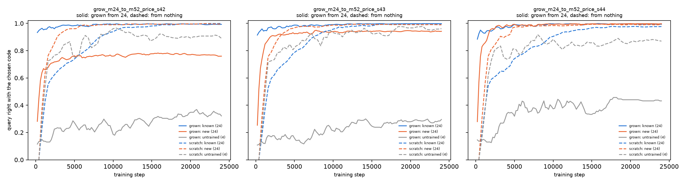

랩 NEO와 다른 점: 두 run 모두 공통 설정이고 출발점만 다르다.

**Table 30.1.** 같은 스텝끼리의 비교

| seed, 스텝 | 이어 배운 run: 원래 24개, 새 24개, 가로세로를 바꾸는 넷 | 처음부터 run: 같은 셋 |
|---|---|---|
| 42, 400 | 95%, 49%, 95% | 0%, 0%, 0% |
| 42, 3,200 | 98%, 74%, 91% | 65%, 94%, 11% |
| 42, 10,000 | 98%, 75%, 99% | 95%, 99%, 91% |
| 43, 400 | 93%, 64%, 95% | 0%, 0%, 0% |
| 43, 3,200 | 98%, 92%, 92% | 70%, 92%, 18% |
| 43, 10,000 | 99%, 94%, 97% | 95%, 99%, 91% |
| 44, 400 | 93%, 62%, 92% | 0%, 0%, 0% |
| 44, 3,200 | 97%, 98%, 92% | 65%, 92%, 10% |
| 44, 10,000 | 99%, 99%, 97% | 92%, 99%, 77% |

랩 NEO와 다른 점: 두 열 모두 공통 설정이고 출발점만 다르다.

**Table 30.2.** 24,000스텝 최종값

| seed | 이어 배운 run: 새 24개, 학습에 없는 4칸 이동, 새것이 80%에 닿는 스텝의 중앙값 | 처음부터 run: 같은 셋 |
|---|---|---|
| 42 | 76%, 32%, 800스텝 | 100%, 89%, 1,400스텝 |
| 43 | 94%, 30%, 600스텝 | 99%, 96%, 1,600스텝 |
| 44 | 100%, 43%, 700스텝 | 99%, 87%, 1,600스텝 |

랩 NEO와 다른 점: 위와 같다.

**나온 것.** 이어 배운 run은 원래 지식을 처음부터 갖고 시작해 끝까지 유지한다. 새 primitive가 80%에 닿는 스텝은 절반 이하다. 하지만 끝 성능은 seed 둘에서 처음부터 배운 쪽보다 낮고, 학습에 없던 4칸 이동은 30에서 43% 대 87에서 96%다. 이어 배운 모델은 24개 환경에서 굳힌 자기 높이만큼 이동이라는 code에 4칸 이동을 주고, 처음부터 배운 모델은 그 개념을 칸 수별로 나눠 4칸 이동을 푼다. 적합도 가격으로 키우면 섞임이 줄어 새 primitive가 76%에서 92%가 된다.

### 30번째 실험까지의 insight

새로 알게 된 것.

- 아는 것에서 출발해 이어 배우면 새 primitive가 80%에 닿는 스텝이 절반 이하다. 그러나 끝 성능은 처음부터 배운 쪽이 같거나 높고, 학습에 없던 4칸 이동으로의 일반화는 30에서 43% 대 87에서 96%로 훨씬 낮다. 먼저 배운 개념의 경계가 새 환경에서 개념을 나누는 방식을 묶는다. 출발 모델의 executor가 좋아져도 이 한계는 그대로다.

고쳐진 것.

- 앞서 한 말: 커지는 환경에서 새 primitive가 들어오면 옛것이 밀려난다. 처음 8개의 transfer가 64개 단계 끝에 53%로, 같은 시간 8개만 본 대조의 98%보다 크게 낮다.
  지금: 랩 방식으로 커지는 환경을 이어 학습하면 처음 8개가 53%로 밀려났다. 두 pair hard EM과 가격으로 세운 깨끗한 code에서 출발해 키우면 원래 24개가 처음부터 끝까지 99% 안팎으로 유지된다.
  무엇을 보고: 24개 환경 가격 모델에서 52개 환경으로 키운 seed 셋에서 원래 24개가 내려가지 않았다.

그대로인 것.

- state 표현과 단계 사이로 넘기는 것
    - 격자 하나를 latent 하나에 담는 것은 15칸 격자에 모자라지만, 공식 NEO가 0에 머무는 이유는 그것만이 아니다
    - 단계 사이에 확률을 넘기면 격자에 보이지 않는 정보가 건너가고, code 둘이 주소가 된다
- code 형성: programmer와 codebook이 primitive마다 code를 세우는 일
    - transfer를 정하는 것은 어디서나 통하는 code 하나를 가진 primitive의 수다
    - 여러 단계로 학습하면 primitive는 여러 code로 설명되는 단계를 거쳐 차례로 code를 얻는다
    - 남는 code와 다시 뿌리기는 primitive를 입력에 따라 쪼갠다
    - 랩 programmer는 code를 늦게 찾고, 칸마다 이어 붙인 넓은 programmer가 빨리 찾는다
    - 예시를 다시 만들기만 하면 채워지는 목표 아래에서 여러 단계를 함께 학습하면 code가 primitive가 아닌 것으로 굳는다
    - 깨끗한 한 단계 code는 이어 쓸 수 있고, code가 깨끗할수록 여러 단계 과제도 나아진다
    - 여러 단계 학습은 허락된 길이로 설명할 수 없는 pair를 억지로 맞출 때 code를 휘게 한다
    - 큰 환경의 실패는 비슷한 변환이 한 code에 섞인 채 굳는 것이다
    - 같은 code가 다른 입력에서도 같은 일을 하라는 요구는 pair의 묶음에서만 나온다
    - 오래 학습하면 일부만 풀린다
    - 넷의 배정은 executor가 넷을 구별하기 전에 정해지고, 그 시기에는 넷을 가를 신호가 모델 어디에도 없다
    - 숨은 길이를 읽지 않고 한 단계 과제를 고르는 방법은 아직 없다
    - 굳은 code를 본보기 과제로 나누면 새 code가 변환이 아니라 그 물체들을 외운다
    - codebook은 굵은 묶음에서 가는 묶음으로 갈라지고, 닮은 변환일수록 늦게까지 한 묶음이다
    - E-step 후보를 줄이면 죽은 code가 후보에 들지 못해 풀리던 seed까지 굳는다
    - 초반에 과하게 쓰인 code에 가격을 붙이면 굳던 seed가 풀리지만 모든 seed는 아니다
- executor: code가 어디서나 같은 변환인가
    - code가 놓인 모양과 executor가 하는 일은 별개다
    - executor는 정답 code가 주어지면 회전 계열을 해낸다. 용량 문제가 아니다
    - code는 학습 때 본 state에서만 같은 함수다. 다른 primitive를 거친 물체와 큰 물체에서는 executor가 틀린다
- 여러 단계 program: programmer의 계획과 평가 때의 탐색
    - 긴 program에서 떨어지는 큰 부분은 탐색 없이 이어 쓰기 때문이고, 탐색을 넓히면 2배에서 3배가 된다
    - support를 통과한 program이 여럿이면 짧은 program에 무게를 주어 투표한다
    - 긴 program의 병목은 8개 환경에서는 programmer이고, 24개 환경에서는 executor로 옮겨 간다
    - 깨끗한 code가 먼저이고, 꿈 학습은 그 위에서 계획을 채운다. 더 오래 꿔도 이득은 작다
- 양과 구조를 넣은 codebook
    - 양이 더해지는 성질은 loss가 아니라 실행 방식으로 보장해야 한다
    - 구조를 넣은 codebook은 작은 이동 묶음에서만 본 적 없는 양을 말했다
- 환경이 커질 때와 아는 것 위에 쌓기
    - 환경이 커져도 배우는 속도는 느려지지 않고 닿는 높이가 갈린다
    - 새 primitive 하나의 비용은 본 pair 수로 세면 환경 크기에 거의 평평하다
    - 두 pair hard EM의 seed에 따른 갈림은 52개와 64개 환경에서도 같다
- 재는 방법
    - seed 하나의 값으로 말하지 않는다
    - transfer는 확률을 넘기는 방식과 격자만 넘기는 방식 둘 다로 잰다
    - 회전 계열만의 code NMI가 code 배정의 상태를 transfer와 같은 순서로 보여 준다
    - 학습에 쓰지 않은 두 pair 과제의 재현율이 잘 풀린 run을 라벨 없이 고른다. 큰 환경에서도 그렇다
    - hard EM의 계산은 codebook 크기에 비례한다

## 31. 비슷한 세계로 옮기기: 큰 물체 세계에 가중치로 적응하기

2026-11-27. 근거는 `docs/reports/2026-11-27-autoresearch.md` 6절.

**물은 것.** 바탕이 같은 두 환경에서 한쪽에서 배운 것이 다른 쪽의 빠른 적응으로 이어지는가. 예시 수로 재면 얼마가 드는가.

**한 것.** 같은 24개 primitive를 학습 때보다 큰 물체에 적용한 세계를 만들었다. 보통 크기 세계에서 배운 모델을 큰 물체 과제 4만 개로 이어 배우고, 과제를 64개, 256개, 1,024개로 줄여 봤다. 덜 바꾸는 방법 셋도 견줬다. executor만 학습, 낮은 학습률, 배치 절반을 원래 세계로 재생하는 것이다.

**랩 NEO와 다른 점, 이 실험의 공통 설정.**

| 항목 | 랩 NEO | 이 실험 |
|---|---|---|
| 데이터 | BabyTheorist single-A 레벨 1의 학습 파일. pair 하나씩이고 70%가 primitive 여럿짜리다 | 같은 24개 primitive를 큰 물체에 적용한 세계. 물체가 16에서 29칸이고 가로세로 7칸까지다. 두 pair 과제 4만 개, 또는 64개, 256개, 1,024개 |
| programmer | 지금 칸 token과 목표 칸 token을 따로 넣는 6층 transformer, 폭 128 | 지금 칸과 목표 칸을 칸마다 이어 붙인 token을 넣는 token_pair_transformer, 폭 256 |
| codebook | 랩 VQ. cosine으로 가장 가까운 code를 고른다. code 16개, 16차원, commitment 0.25 | 랩 VQ 그대로이고 code 수만 primitive 수의 두 배 |
| program 길이와 단계 사이로 넘기는 것 | 최대 다섯 단계. 단계 사이에 칸마다의 색 확률을 넘긴다 | program 한 단계 |
| code를 고르고 학습하는 방식 | programmer가 pair 하나를 보고 낸 출력에 가장 가까운 code를 쓴다. 길이는 길이마다 0.95를 곱한 cross-entropy가 가장 작은 것으로 고르고, 그 길이의 cross-entropy, grounding 항 0.1, codebook loss로 모든 부품을 함께 학습한다 | hard EM. 과제마다 codebook의 모든 code를 두 pair에 실행해 오차의 합이 가장 작은 code를 고르고, executor는 그 code로 두 pair를 학습하고 programmer는 그 code를 맞히게 학습한다. 아무도 고르지 않는 code는 오차를 깎아 주는 보너스로 구제한다. 그리고 학습 초반에 최근에 많이 쓰인 code일수록 오차에 가격을 더한다. 무게 2 nats를 3,000스텝 유지하고 8,000스텝에 0으로 내린다 |
| 학습 일정 | 학습률 3e-4, batch 256 episode, 78,200스텝, 가중치 평균 0.999 | 24개 환경 가격 모델에서 출발해 2,000에서 6,000스텝. 조건에 따라 배치 절반을 원래 세계의 과제로 재생한다 |
| 학습이 읽는 정보 | 입력과 출력 격자만 읽는다 | 입력과 출력 격자, 어느 pair 둘이 같은 규칙인지, 그리고 한 단계 과제만 남기는 데 숨은 길이 |

표에 없는 항목은 랩 NEO와 같다.

**Figure 31.1.** 큰 물체 세계로의 적응, seed 43

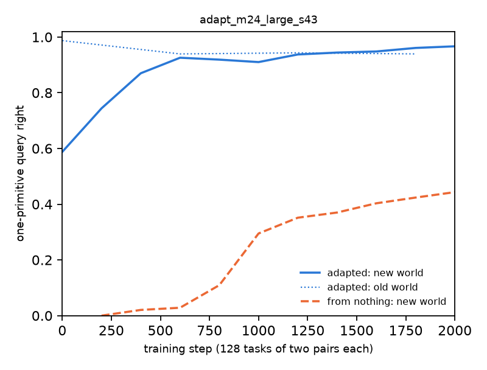

랩 NEO와 다른 점: 출발 모델은 24개 환경 가격 run이고 큰 물체 과제로 이어 배운다.

**Table 31.1.** 큰 물체 학습 과제의 수와 적응 방식

| 큰 물체 학습 과제 | 큰 세계 | 원래 세계 |
|---|---|---|
| 0개, 출발점 | 59% | 99% |
| 64개 | 37%로 떨어짐 | 61% |
| 256개 | 58% | 77% |
| 1,024개 | 최고 76% | 88% |
| 256개, executor만 학습 | 62% | 92% |
| 256개, 학습률 10분의 1 | 57% | 88% |
| 256개, 원래 세계 절반 재생 | 72% | 98% |

랩 NEO와 다른 점: 모두 24개 환경 가격 모델에서 출발한 이어 배우기이고 과제 수와 무엇을 학습하는지만 다르다.

**나온 것.** 보통 크기에서 배운 모델은 큰 물체 세계의 한 단계 과제를 59%만 맞힌다. 과제 4만 개로 이어 배우면 1,000스텝에 93%로, 처음부터 배우는 것보다 훨씬 빠르다. 하지만 과제를 64개만 주면 37%로 오히려 떨어지고 256개로는 58%다. 원래 세계를 재생하면 256개로 72%까지 오르고 원래 세계도 지킨다.

### 31번째 실험까지의 insight

새로 알게 된 것.

- 같은 24개 primitive를 학습 때보다 큰 물체에 적용하면 한 단계 과제의 정답률이 100%에서 59%로 떨어진다. code는 알맞게 골라지지만 executor가 큰 물체에서 그 변환을 실행하지 못한다.
- 아는 것에서 출발하면 스텝으로는 훨씬 빨리 적응하지만 예시 수로는 수만 개가 든다. 큰 물체 과제 64개로 가중치를 고치면 59%가 37%로 떨어지고 원래 세계도 61%가 된다. 적은 예시에 과적합하면서 원래 일반화하던 부분까지 무너진다. 원래 세계를 재생하는 것이 가장 낫다.

그대로인 것.

- state 표현과 단계 사이로 넘기는 것
    - 격자 하나를 latent 하나에 담는 것은 15칸 격자에 모자라지만, 공식 NEO가 0에 머무는 이유는 그것만이 아니다
    - 단계 사이에 확률을 넘기면 격자에 보이지 않는 정보가 건너가고, code 둘이 주소가 된다
- code 형성: programmer와 codebook이 primitive마다 code를 세우는 일
    - transfer를 정하는 것은 어디서나 통하는 code 하나를 가진 primitive의 수다
    - 여러 단계로 학습하면 primitive는 여러 code로 설명되는 단계를 거쳐 차례로 code를 얻는다
    - 남는 code와 다시 뿌리기는 primitive를 입력에 따라 쪼갠다
    - 랩 programmer는 code를 늦게 찾고, 칸마다 이어 붙인 넓은 programmer가 빨리 찾는다
    - 예시를 다시 만들기만 하면 채워지는 목표 아래에서 여러 단계를 함께 학습하면 code가 primitive가 아닌 것으로 굳는다
    - 깨끗한 한 단계 code는 이어 쓸 수 있고, code가 깨끗할수록 여러 단계 과제도 나아진다
    - 여러 단계 학습은 허락된 길이로 설명할 수 없는 pair를 억지로 맞출 때 code를 휘게 한다
    - 큰 환경의 실패는 비슷한 변환이 한 code에 섞인 채 굳는 것이다
    - 같은 code가 다른 입력에서도 같은 일을 하라는 요구는 pair의 묶음에서만 나온다
    - 오래 학습하면 일부만 풀린다
    - 넷의 배정은 executor가 넷을 구별하기 전에 정해지고, 그 시기에는 넷을 가를 신호가 모델 어디에도 없다
    - 숨은 길이를 읽지 않고 한 단계 과제를 고르는 방법은 아직 없다
    - 굳은 code를 본보기 과제로 나누면 새 code가 변환이 아니라 그 물체들을 외운다
    - codebook은 굵은 묶음에서 가는 묶음으로 갈라지고, 닮은 변환일수록 늦게까지 한 묶음이다
    - E-step 후보를 줄이면 죽은 code가 후보에 들지 못해 풀리던 seed까지 굳는다
    - 초반에 과하게 쓰인 code에 가격을 붙이면 굳던 seed가 풀리지만 모든 seed는 아니다
- executor: code가 어디서나 같은 변환인가
    - code가 놓인 모양과 executor가 하는 일은 별개다
    - executor는 정답 code가 주어지면 회전 계열을 해낸다. 용량 문제가 아니다
    - code는 학습 때 본 state에서만 같은 함수다. 다른 primitive를 거친 물체와 큰 물체에서는 executor가 틀린다
- 여러 단계 program: programmer의 계획과 평가 때의 탐색
    - 긴 program에서 떨어지는 큰 부분은 탐색 없이 이어 쓰기 때문이고, 탐색을 넓히면 2배에서 3배가 된다
    - support를 통과한 program이 여럿이면 짧은 program에 무게를 주어 투표한다
    - 긴 program의 병목은 8개 환경에서는 programmer이고, 24개 환경에서는 executor로 옮겨 간다
    - 깨끗한 code가 먼저이고, 꿈 학습은 그 위에서 계획을 채운다. 더 오래 꿔도 이득은 작다
- 양과 구조를 넣은 codebook
    - 양이 더해지는 성질은 loss가 아니라 실행 방식으로 보장해야 한다
    - 구조를 넣은 codebook은 작은 이동 묶음에서만 본 적 없는 양을 말했다
- 환경이 커질 때와 아는 것 위에 쌓기
    - 환경이 커져도 배우는 속도는 느려지지 않고 닿는 높이가 갈린다
    - 새 primitive 하나의 비용은 본 pair 수로 세면 환경 크기에 거의 평평하다
    - code가 깨끗한 모델에서 키우면 옛것이 밀려나지 않는다
    - 두 pair hard EM의 seed에 따른 갈림은 52개와 64개 환경에서도 같다
    - 이어 배우면 초반은 빠르지만, 먼저 배운 개념의 경계가 새 개념을 나누는 방식을 묶는다
- 재는 방법
    - seed 하나의 값으로 말하지 않는다
    - transfer는 확률을 넘기는 방식과 격자만 넘기는 방식 둘 다로 잰다
    - 회전 계열만의 code NMI가 code 배정의 상태를 transfer와 같은 순서로 보여 준다
    - 학습에 쓰지 않은 두 pair 과제의 재현율이 잘 풀린 run을 라벨 없이 고른다. 큰 환경에서도 그렇다
    - hard EM의 계산은 codebook 크기에 비례한다

## 32. 학습 state 넓히기

2026-11-27. 근거는 `docs/reports/2026-11-27-autoresearch.md` 7절.

**물은 것.** executor가 다른 primitive를 거친 물체와 큰 물체에서 틀리는 것은 학습 때 그런 state를 보지 못해서인가.

**한 것.** 생성기에 선택지를 하나 더해, 학습 pair의 물체가 먼저 무작위 primitive를 0에서 4개 거친 뒤 과제의 primitive를 받게 했다. 큰 물체는 일부러 넣지 않았다. 학습 방법은 가격 방식 그대로다. 24개 환경 seed 셋, 52개 환경 seed 하나다. 사다리, 큰 물체 세계, 긴 program 상한, 꿈 학습 뒤의 탐색을 쟀다.

**랩 NEO와 다른 점, 이 실험의 공통 설정.**

| 항목 | 랩 NEO | 이 실험 |
|---|---|---|
| 데이터 | BabyTheorist single-A 레벨 1의 학습 파일. pair 하나씩이고 70%가 primitive 여럿짜리다 | 가격 run과 같은 두 pair 과제인데, 학습 pair의 물체가 먼저 무작위 primitive를 0에서 4개 거친 뒤 과제의 primitive를 받는다 |
| programmer | 지금 칸 token과 목표 칸 token을 따로 넣는 6층 transformer, 폭 128 | 지금 칸과 목표 칸을 칸마다 이어 붙인 token을 넣는 token_pair_transformer, 폭 256 |
| codebook | 랩 VQ. cosine으로 가장 가까운 code를 고른다. code 16개, 16차원, commitment 0.25 | 랩 VQ 그대로이고 code 수만 primitive 수의 두 배 |
| program 길이와 단계 사이로 넘기는 것 | 최대 다섯 단계. 단계 사이에 칸마다의 색 확률을 넘긴다 | program 한 단계 |
| code를 고르고 학습하는 방식 | programmer가 pair 하나를 보고 낸 출력에 가장 가까운 code를 쓴다. 길이는 길이마다 0.95를 곱한 cross-entropy가 가장 작은 것으로 고르고, 그 길이의 cross-entropy, grounding 항 0.1, codebook loss로 모든 부품을 함께 학습한다 | hard EM. 과제마다 codebook의 모든 code를 두 pair에 실행해 오차의 합이 가장 작은 code를 고르고, executor는 그 code로 두 pair를 학습하고 programmer는 그 code를 맞히게 학습한다. 아무도 고르지 않는 code는 오차를 깎아 주는 보너스로 구제한다. 그리고 학습 초반에 최근에 많이 쓰인 code일수록 오차에 가격을 더한다. 무게 2 nats를 3,000스텝 유지하고 8,000스텝에 0으로 내린다 |
| 학습 일정 | 학습률 3e-4, batch 256 episode, 78,200스텝, 가중치 평균 0.999 | batch 128 pair, 24,000스텝, 가중치 평균 끔, programmer 학습률은 0.25배, forward를 torch.compile로 묶음 |
| 학습이 읽는 정보 | 입력과 출력 격자만 읽는다 | 입력과 출력 격자, 어느 pair 둘이 같은 규칙인지, 그리고 한 단계 과제만 남기는 데 숨은 길이 |

표에 없는 항목은 랩 NEO와 같다.

**Figure 32.1.** 정답 code를 한 번 실행한 정확도, 환경 크기와 학습 state에 따라

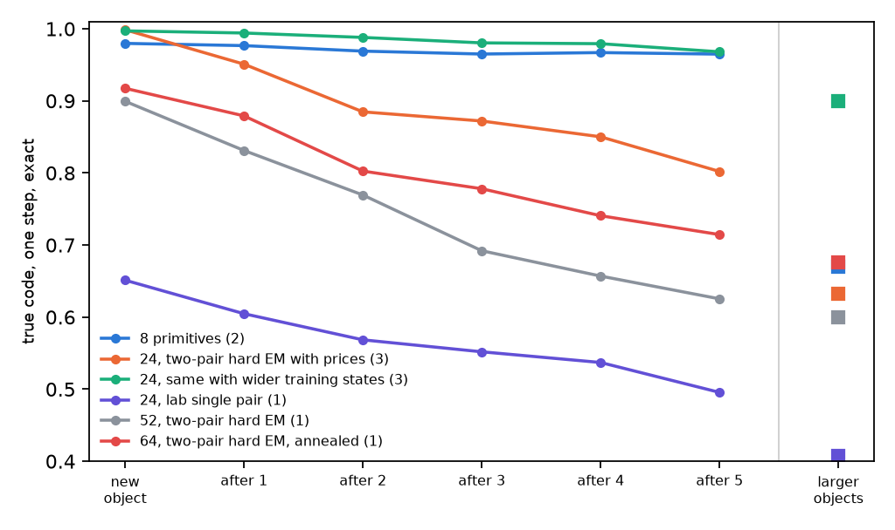

랩 NEO와 다른 점: 선마다 환경 크기와 학습 데이터가 다르다. 넓힌 학습 선만 학습 pair의 물체가 무작위 primitive를 먼저 거친다.

**Table 32.1.** 24개 환경의 사다리

| 모델 | 새 물체 | 1단계 거친 물체 | 3단계 | 5단계 | 큰 물체 |
|---|---|---|---|---|---|
| 가격 run, seed 42 | 100% | 95% | 87% | 80% | 62% |
| 가격 run, seed 43 | 100% | 95% | 87% | 80% | 65% |
| 넓힌 학습, seed 42 | 100% | 99% | 98% | 97% | 90% |
| 넓힌 학습, seed 43 | 99% | 99% | 97% | 95% | 86% |
| 넓힌 학습, seed 44 | 100% | 100% | 99% | 98% | 94% |

랩 NEO와 다른 점: 가격 run 줄과 넓힌 학습 줄은 학습 pair의 물체를 뽑는 방식만 다르다.

**Table 32.2.** 52개 환경의 사다리

| 모델 | 새 물체 | 1단계 거친 물체 | 3단계 | 5단계 | 큰 물체 |
|---|---|---|---|---|---|
| 52개 환경 가격 run, seed 42 | 95% | 88% | 72% | 66% | 64% |
| 52개 환경 넓힌 학습, seed 42 | 95% | 94% | 92% | 91% | 91% |

랩 NEO와 다른 점: 위와 같은 비교를 52개 환경에서 한 것이다.

**Table 32.3.** 24개 환경 긴 program의 정답 program 상한

| 모델 | 길이 5 | 길이 6 | 길이 7 |
|---|---|---|---|
| 가격 run, seed 42, 43, 44 | 69에서 73% | 59에서 65% | 54에서 57% |
| 넓힌 학습, seed 42, 43, 44 | 90에서 96% | 87에서 94% | 80에서 87% |

랩 NEO와 다른 점: 위와 같은 두 모델이고 숨은 program을 읽는 진단이다.

**Table 32.4.** 넓힌 학습 모델 위의 꿈 학습과 탐색

| 모델 | 꿈 전 탐색, 길이 5, 6, 7 | 꿈 후 탐색 |
|---|---|---|
| 넓힌 학습 seed 42 | 51%, 37%, 26% | 64%, 55%, 50% |
| 넓힌 학습 seed 43 | 42%, 27%, 19% | 63%, 46%, 43% |
| 넓힌 학습 seed 44 | 51%, 33%, 24% | 64%, 50%, 38% |
| 이전 최고, hard EM pair 둘 seed 42에 꿈과 남은 거리 예측기 | | 52%, 41%, 27% |

랩 NEO와 다른 점: 넓힌 학습 모델에 꿈 학습과 폭 16 탐색을 얹었다. 맨 아래 줄은 넓히지 않은 두 pair hard EM 위의 이전 최고다.

**나온 것.** 사다리가 거의 평평해졌다. 24개 환경에서 다섯 단계 거친 물체가 80%에서 97%, 학습에 넣지 않은 큰 물체가 62%에서 90%다. 52개 환경에서도 66%에서 91%, 64%에서 91%다. 긴 program의 상한이 길이 7에서 54에서 57%이던 것이 80에서 87%가 됐고, 꿈 학습 뒤의 탐색이 길이 5, 6, 7에서 64%, 55%, 50%로 이전 최고를 넘었다. code 배정은 그대로 좋다.

### 32번째 실험까지의 insight

고쳐진 것.

- 앞서 한 말: 8개 환경에서 code가 깨끗한 seed의 executor는 정답 program을 여덟 단계 이어 실행해도 92에서 97%를 맞힌다. 그러나 24개 환경에서는 정답 code를 한 번 실행한 정확도가 새 물체 99%, 무작위 primitive를 다섯 번 거친 물체 79%, 큰 물체 63%다. code가 알맞게 골라져도 executor가 그 code를 학습 분포 밖의 state에서 같은 변환으로 실행하지 못한다. 환경이 클수록 더 가파르게 떨어진다.
  지금: code가 알맞게 골라져도 executor는 학습 때 본 state에서만 그 code를 같은 변환으로 실행한다. 새 물체로만 학습하면 다섯 단계 거친 물체에서 80%, 큰 물체에서 62%다. 학습 pair의 물체가 먼저 무작위 primitive를 0에서 4개 거치게 하면 97%와 90%가 된다. 52개 환경에서도 66%와 64%가 91%와 91%가 된다. executor의 일반화를 정하는 것은 학습 때 보는 state의 다양성이다.
  무엇을 보고: 학습 pair의 물체를 뽑는 방식만 바꾼 run의 사다리가 평평해졌다. 가격만 붙인 run의 사다리는 그대로였다.
- 앞서 한 말: 긴 program의 병목은 환경에 따라 다르다. 8개 환경에서는 정답 program의 상한이 92에서 97%인데 탐색이 30에서 42%라 programmer의 계획이 병목이다. 24개 환경에서는 상한 자체가 길이 5, 6, 7에서 69%, 62%, 56%라 executor가 병목이다.
  지금: 긴 program의 병목은 executor가 얼마나 함수에 가까운가에 따라 옮겨 다닌다. 새 물체로만 학습한 24개 환경 모델은 상한 자체가 길이 7에서 56%라 executor가 병목이었다. 학습 state를 넓히면 상한이 80에서 87%로 오르고, 꿈 학습 뒤의 탐색은 50% 안팎이라 병목이 다시 programmer의 탐색이 된다.
  무엇을 보고: 넓힌 학습 모델 셋에서 상한과 탐색을 다시 쟀다.
- 앞서 한 말: 같은 24개 primitive를 학습 때보다 큰 물체에 적용하면 한 단계 과제의 정답률이 100%에서 59%로 떨어진다. code는 알맞게 골라지지만 executor가 큰 물체에서 그 변환을 실행하지 못한다.
  지금: 같은 primitive라도 학습 때보다 큰 물체에서는 executor가 틀려 한 단계 과제가 59%다. 큰 물체를 학습에 넣지 않고도, 학습 pair의 물체가 다른 primitive를 먼저 거치게 하면 82%가 된다. 확대나 거울상 붙이기로 커진 물체를 본 덕으로 본다.
  무엇을 보고: 넓힌 학습 모델을 적응 없이 큰 물체 세계에서 쟀다.

그대로인 것.

- state 표현과 단계 사이로 넘기는 것
    - 격자 하나를 latent 하나에 담는 것은 15칸 격자에 모자라지만, 공식 NEO가 0에 머무는 이유는 그것만이 아니다
    - 단계 사이에 확률을 넘기면 격자에 보이지 않는 정보가 건너가고, code 둘이 주소가 된다
- code 형성: programmer와 codebook이 primitive마다 code를 세우는 일
    - transfer를 정하는 것은 어디서나 통하는 code 하나를 가진 primitive의 수다
    - 여러 단계로 학습하면 primitive는 여러 code로 설명되는 단계를 거쳐 차례로 code를 얻는다
    - 남는 code와 다시 뿌리기는 primitive를 입력에 따라 쪼갠다
    - 랩 programmer는 code를 늦게 찾고, 칸마다 이어 붙인 넓은 programmer가 빨리 찾는다
    - 예시를 다시 만들기만 하면 채워지는 목표 아래에서 여러 단계를 함께 학습하면 code가 primitive가 아닌 것으로 굳는다
    - 깨끗한 한 단계 code는 이어 쓸 수 있고, code가 깨끗할수록 여러 단계 과제도 나아진다
    - 여러 단계 학습은 허락된 길이로 설명할 수 없는 pair를 억지로 맞출 때 code를 휘게 한다
    - 큰 환경의 실패는 비슷한 변환이 한 code에 섞인 채 굳는 것이다
    - 같은 code가 다른 입력에서도 같은 일을 하라는 요구는 pair의 묶음에서만 나온다
    - 오래 학습하면 일부만 풀린다
    - 넷의 배정은 executor가 넷을 구별하기 전에 정해지고, 그 시기에는 넷을 가를 신호가 모델 어디에도 없다
    - 숨은 길이를 읽지 않고 한 단계 과제를 고르는 방법은 아직 없다
    - 굳은 code를 본보기 과제로 나누면 새 code가 변환이 아니라 그 물체들을 외운다
    - codebook은 굵은 묶음에서 가는 묶음으로 갈라지고, 닮은 변환일수록 늦게까지 한 묶음이다
    - E-step 후보를 줄이면 죽은 code가 후보에 들지 못해 풀리던 seed까지 굳는다
    - 초반에 과하게 쓰인 code에 가격을 붙이면 굳던 seed가 풀리지만 모든 seed는 아니다
- executor: code가 어디서나 같은 변환인가
    - code가 놓인 모양과 executor가 하는 일은 별개다
    - executor는 정답 code가 주어지면 회전 계열을 해낸다. 용량 문제가 아니다
- 여러 단계 program: programmer의 계획과 평가 때의 탐색
    - 긴 program에서 떨어지는 큰 부분은 탐색 없이 이어 쓰기 때문이고, 탐색을 넓히면 2배에서 3배가 된다
    - support를 통과한 program이 여럿이면 짧은 program에 무게를 주어 투표한다
    - 깨끗한 code가 먼저이고, 꿈 학습은 그 위에서 계획을 채운다. 더 오래 꿔도 이득은 작다
- 양과 구조를 넣은 codebook
    - 양이 더해지는 성질은 loss가 아니라 실행 방식으로 보장해야 한다
    - 구조를 넣은 codebook은 작은 이동 묶음에서만 본 적 없는 양을 말했다
- 환경이 커질 때와 아는 것 위에 쌓기
    - 환경이 커져도 배우는 속도는 느려지지 않고 닿는 높이가 갈린다
    - 새 primitive 하나의 비용은 본 pair 수로 세면 환경 크기에 거의 평평하다
    - code가 깨끗한 모델에서 키우면 옛것이 밀려나지 않는다
    - 두 pair hard EM의 seed에 따른 갈림은 52개와 64개 환경에서도 같다
    - 이어 배우면 초반은 빠르지만, 먼저 배운 개념의 경계가 새 개념을 나누는 방식을 묶는다
    - 아는 것에서 출발하면 스텝으로는 빠르지만, 적은 예시로 가중치를 고치면 오히려 무너진다
- 재는 방법
    - seed 하나의 값으로 말하지 않는다
    - transfer는 확률을 넘기는 방식과 격자만 넘기는 방식 둘 다로 잰다
    - 회전 계열만의 code NMI가 code 배정의 상태를 transfer와 같은 순서로 보여 준다
    - 학습에 쓰지 않은 두 pair 과제의 재현율이 잘 풀린 run을 라벨 없이 고른다. 큰 환경에서도 그렇다
    - hard EM의 계산은 codebook 크기에 비례한다

## 33. 빠른 기억, 얼린 모델에서: executor 안의 보정과 새 code 하나

2026-11-27. 근거는 `docs/reports/2026-11-27-autoresearch.md` 8.1절과 8.2절, 도구는 `memory_adapt.py`와 `memory_new_codes.py`.

**물은 것.** 새 세계의 예시를 가중치가 아니라 빠른 기억에 담아 쓰면, 적은 예시로 적응하면서 원래 지식을 지킬 수 있는가.

**한 것.** 모델을 얼렸다. 큰 물체 세계에서는 기억 과제 256개를 code별로 묶어 executor 안에 더하는 보정을 맞췄다. 자리는 code 벡터, executor의 조건 벡터, 층마다의 modulation 셋이고, 세계 전체에 보정 하나를 두는 판도 했다. 52개 환경에서는 새 primitive마다 예시 과제 몇 개로 새 code 벡터 하나만 맞추고 처음 보는 과제로 쟀다. 이것은 primitive 이름으로 예시를 묶는 진단이다.

**랩 NEO와 다른 점, 이 실험의 공통 설정.**

| 항목 | 랩 NEO | 이 실험 |
|---|---|---|
| 데이터 | BabyTheorist single-A 레벨 1의 학습 파일. pair 하나씩이고 70%가 primitive 여럿짜리다 | 이 레포의 생성기로 만든 primitive 묶음. 같은 program을 다른 물체 둘에 적용한 pair 둘이 한 과제이고 primitive 하나짜리만 쓴다 |
| programmer | 지금 칸 token과 목표 칸 token을 따로 넣는 6층 transformer, 폭 128 | 지금 칸과 목표 칸을 칸마다 이어 붙인 token을 넣는 token_pair_transformer, 폭 256 |
| codebook | 랩 VQ. cosine으로 가장 가까운 code를 고른다. code 16개, 16차원, commitment 0.25 | 랩 VQ 그대로이고 code 수만 primitive 수의 두 배 |
| program 길이와 단계 사이로 넘기는 것 | 최대 다섯 단계. 단계 사이에 칸마다의 색 확률을 넘긴다 | program 한 단계 |
| code를 고르고 학습하는 방식 | programmer가 pair 하나를 보고 낸 출력에 가장 가까운 code를 쓴다. 길이는 길이마다 0.95를 곱한 cross-entropy가 가장 작은 것으로 고르고, 그 길이의 cross-entropy, grounding 항 0.1, codebook loss로 모든 부품을 함께 학습한다 | hard EM. 과제마다 codebook의 모든 code를 두 pair에 실행해 오차의 합이 가장 작은 code를 고르고, executor는 그 code로 두 pair를 학습하고 programmer는 그 code를 맞히게 학습한다. 아무도 고르지 않는 code는 오차를 깎아 주는 보너스로 구제한다. 그리고 학습 초반에 최근에 많이 쓰인 code일수록 오차에 가격을 더한다. 무게 2 nats를 3,000스텝 유지하고 8,000스텝에 0으로 내린다 |
| 학습 일정 | 학습률 3e-4, batch 256 episode, 78,200스텝, 가중치 평균 0.999 | batch 128 pair, 24,000스텝, 가중치 평균 끔, programmer 학습률은 0.25배, forward를 torch.compile로 묶음 |
| 평가 때의 추론 | programmer가 support pair 하나를 보고 고른 code 열을 query에 그대로 실행한다. 탐색하지 않는다 | 보정한 code와 원래 code를 모두 support에 실행하고, 보정한 쪽만 support를 재현할 때 그것으로 답한다 |
| 학습이 읽는 정보 | 입력과 출력 격자만 읽는다 | 입력과 출력 격자, 어느 pair 둘이 같은 규칙인지, 그리고 한 단계 과제만 남기는 데 숨은 길이 |
| 랩 NEO에 없는 단계 | 없다 | 빠른 기억. 가중치는 얼리고 새 세계의 예시에 맞춘 작은 값만 바꾼다. 한 갈래는 executor 안에 더하는 보정이고, 한 갈래는 새 primitive마다 새로 맞춘 code 벡터 하나다. code 벡터의 길이는 묶지 않는다 |

표에 없는 항목은 랩 NEO와 같다.

**Table 33.1.** 큰 물체 세계에서 executor 안의 보정, 기억 과제 256개

| 보정을 더하는 자리 | 기억 과제 재현 | 새 과제, 보정한 code로 | 검증으로 고른 답 |
|---|---|---|---|
| 보정 없음 | 63% | | 45.6% |
| code 벡터 16개 숫자, code마다 | 66% | 32.8% | 45.9에서 46.3% |
| executor 조건 벡터 128개, code마다 | 70% | 32.2% | 같은 범위 |
| modulation 3,072개, code마다 | 100% | 38.8% | 같은 범위 |
| modulation, 세계 전체에 하나 | 65% | 29.9% | |
| 조건 벡터, 세계 전체에 하나 | 56% | 37.3% | |

랩 NEO와 다른 점: 모델은 얼린 24개 환경 가격 run이다. 보정과 검증은 랩 NEO에 없는 단계다.

**Table 33.2.** 새 primitive마다 새 code 벡터 하나를 예시 몇 개로 맞춘 결과, 새 primitive 평균

| 예시 과제 수 | 1 | 2 | 4 | 16 | 64 |
|---|---|---|---|---|---|
| 0에서 출발 | | | 31% | 50% | 54% |
| 가장 잘 맞는 기존 code에서 출발 | 15% | 33% | 47% | 56% | 56% |

랩 NEO와 다른 점: 모델은 얼린 24개 환경 가격 run이고 code 벡터 하나만 새로 맞춘다. primitive 이름으로 예시를 묶는 진단이다.

**Table 33.3.** 새 code의 길이를 codebook처럼 1로 묶었을 때

| 예시 과제 수 | 1 | 2 | 4 | 16 | 64 |
|---|---|---|---|---|---|
| 새 code의 길이를 묶지 않음 | 15% | 33% | 47% | 56% | 56% |
| 새 code의 길이를 1로 묶음 | 15% | 23% | 33% | 44% | 45% |

랩 NEO와 다른 점: 랩 VQ는 code를 길이 1로 정규화해 읽는다. 위 줄은 그 묶음을 풀고 맞춘 것이다.

**나온 것.** executor 안의 보정은 큰 물체를 고치지 못했다. code마다 두면 기억 과제를 외우기만 하고, 세계 전체에 하나를 두면 기억 과제도 못 맞춘다. 새 code 하나는 primitive의 종류에 따라 갈렸다. 이동 거리만 다른 이동은 예시 16개로 90% 안팎까지 가고, 거울상 붙이기와 확대는 예시 64개로도 0에서 22%다. 새 code는 길이를 풀어 주면 처음 보는 과제에서 10점 넘게 높다.

### 33번째 실험까지의 insight

새로 알게 된 것.

- 얼린 모델의 executor 안에 code 벡터, 조건 벡터, modulation의 보정을 더해 큰 물체 세계의 예시에 맞추면, code마다 둘 때는 기억 과제를 외우기만 하고 세계 전체에 하나를 둘 때는 기억 과제도 맞추지 못한다. 검증 덕에 원래 세계는 지켜지지만 이득이 없다.
- 얼린 모델에 새 code 벡터 하나만 예시 몇 개로 맞추면, executor가 이미 할 줄 아는 계산의 조합인 새 primitive는 가중치를 바꾸지 않고 붙는다. 이동 거리만 다른 이동은 예시 16개로 90% 안팎이다. 거울상 붙이기나 확대처럼 새 계산이 필요한 것은 예시 64개로도 0에서 22%다.

고쳐진 것.

- 앞서 한 말: code 벡터가 놓인 모양과 executor가 그 벡터로 하는 일은 별개다. 이동 칸 수의 code들은 한 평면의 호 위에 순서대로 놓이지만, 그 호를 따라 한 칸 더 간 벡터를 executor에 주면 학습된 code와 cosine이 0.94인데도 정확히 옮기는 비율이 32%다.
  지금: code 벡터가 놓인 모양과 executor가 그 벡터로 하는 일은 별개다. 호를 따라 한 칸 더 간 벡터를 주면 cosine이 0.94인데도 정확히 옮기는 비율이 32%다. 한편 executor는 학습 때 길이 1인 code만 받았는데도 길이가 다른 code에서 쓸모 있는 변환을 낸다. 새 code의 길이를 1로 묶으면 처음 보는 과제의 정답률이 예시 16개에서 56%가 44%로 내려간다. codebook이 code의 길이를 버리는 것은 손해일 수 있다.
  무엇을 보고: 새 code를 길이를 묶고 맞춘 것과 풀고 맞춘 것을 같은 예시로 견줬다.

그대로인 것.

- state 표현과 단계 사이로 넘기는 것
    - 격자 하나를 latent 하나에 담는 것은 15칸 격자에 모자라지만, 공식 NEO가 0에 머무는 이유는 그것만이 아니다
    - 단계 사이에 확률을 넘기면 격자에 보이지 않는 정보가 건너가고, code 둘이 주소가 된다
- code 형성: programmer와 codebook이 primitive마다 code를 세우는 일
    - transfer를 정하는 것은 어디서나 통하는 code 하나를 가진 primitive의 수다
    - 여러 단계로 학습하면 primitive는 여러 code로 설명되는 단계를 거쳐 차례로 code를 얻는다
    - 남는 code와 다시 뿌리기는 primitive를 입력에 따라 쪼갠다
    - 랩 programmer는 code를 늦게 찾고, 칸마다 이어 붙인 넓은 programmer가 빨리 찾는다
    - 예시를 다시 만들기만 하면 채워지는 목표 아래에서 여러 단계를 함께 학습하면 code가 primitive가 아닌 것으로 굳는다
    - 깨끗한 한 단계 code는 이어 쓸 수 있고, code가 깨끗할수록 여러 단계 과제도 나아진다
    - 여러 단계 학습은 허락된 길이로 설명할 수 없는 pair를 억지로 맞출 때 code를 휘게 한다
    - 큰 환경의 실패는 비슷한 변환이 한 code에 섞인 채 굳는 것이다
    - 같은 code가 다른 입력에서도 같은 일을 하라는 요구는 pair의 묶음에서만 나온다
    - 오래 학습하면 일부만 풀린다
    - 넷의 배정은 executor가 넷을 구별하기 전에 정해지고, 그 시기에는 넷을 가를 신호가 모델 어디에도 없다
    - 숨은 길이를 읽지 않고 한 단계 과제를 고르는 방법은 아직 없다
    - 굳은 code를 본보기 과제로 나누면 새 code가 변환이 아니라 그 물체들을 외운다
    - codebook은 굵은 묶음에서 가는 묶음으로 갈라지고, 닮은 변환일수록 늦게까지 한 묶음이다
    - E-step 후보를 줄이면 죽은 code가 후보에 들지 못해 풀리던 seed까지 굳는다
    - 초반에 과하게 쓰인 code에 가격을 붙이면 굳던 seed가 풀리지만 모든 seed는 아니다
- executor: code가 어디서나 같은 변환인가
    - executor는 정답 code가 주어지면 회전 계열을 해낸다. 용량 문제가 아니다
    - executor가 어디서나 같은 변환을 하느냐는 학습 때 본 state의 다양성이 정한다
    - 큰 물체에서의 실패도 학습 state를 넓히면 대부분 사라진다
- 여러 단계 program: programmer의 계획과 평가 때의 탐색
    - 긴 program에서 떨어지는 큰 부분은 탐색 없이 이어 쓰기 때문이고, 탐색을 넓히면 2배에서 3배가 된다
    - support를 통과한 program이 여럿이면 짧은 program에 무게를 주어 투표한다
    - executor가 함수에 가까워지면 긴 program의 병목은 다시 programmer의 탐색이다
    - 깨끗한 code가 먼저이고, 꿈 학습은 그 위에서 계획을 채운다. 더 오래 꿔도 이득은 작다
- 양과 구조를 넣은 codebook
    - 양이 더해지는 성질은 loss가 아니라 실행 방식으로 보장해야 한다
    - 구조를 넣은 codebook은 작은 이동 묶음에서만 본 적 없는 양을 말했다
- 환경이 커질 때와 아는 것 위에 쌓기
    - 환경이 커져도 배우는 속도는 느려지지 않고 닿는 높이가 갈린다
    - 새 primitive 하나의 비용은 본 pair 수로 세면 환경 크기에 거의 평평하다
    - code가 깨끗한 모델에서 키우면 옛것이 밀려나지 않는다
    - 두 pair hard EM의 seed에 따른 갈림은 52개와 64개 환경에서도 같다
    - 이어 배우면 초반은 빠르지만, 먼저 배운 개념의 경계가 새 개념을 나누는 방식을 묶는다
    - 아는 것에서 출발하면 스텝으로는 빠르지만, 적은 예시로 가중치를 고치면 오히려 무너진다
- 재는 방법
    - seed 하나의 값으로 말하지 않는다
    - transfer는 확률을 넘기는 방식과 격자만 넘기는 방식 둘 다로 잰다
    - 회전 계열만의 code NMI가 code 배정의 상태를 transfer와 같은 순서로 보여 준다
    - 학습에 쓰지 않은 두 pair 과제의 재현율이 잘 풀린 run을 라벨 없이 고른다. 큰 환경에서도 그렇다
    - hard EM의 계산은 codebook 크기에 비례한다

## 34. 라벨 없이 하나씩 받는 온라인 빠른 기억과 이어 쓰기

2026-11-27. 근거는 `docs/reports/2026-11-27-autoresearch.md` 8.3절, 도구는 `scripts/babytheorist/memory_online.py`.

**물은 것.** 라벨 없이, 과제가 하나씩 올 때 기억을 키워 가며 새 primitive에 답할 수 있는가.

**한 것.** 얼린 24개 환경 모델에 52개 환경의 한 단계 과제 800개를 정한 순서로 줬다. 첫 판은 검증에 실패하면 바로 새 code를 할당했다. 둘째 판은 그 사이에 한 단계를 넣었다. 손실이 낮은 새 code 셋을 그 기억과 이 과제로 다시 맞춰 보고, 이 과제와 기억 과제의 75% 이상을 재현하면 그 code를 이어 쓴다. 학습 state를 넓힌 모델로도 같은 흐름을 돌렸다.

**랩 NEO와 다른 점, 이 실험의 공통 설정.**

| 항목 | 랩 NEO | 이 실험 |
|---|---|---|
| 데이터 | BabyTheorist single-A 레벨 1의 학습 파일. pair 하나씩이고 70%가 primitive 여럿짜리다 | 얼린 24개 환경 모델에 52개 환경의 한 단계 과제를 정한 순서로 하나씩 준다. 과제는 support pair 둘과 query 하나다 |
| programmer | 지금 칸 token과 목표 칸 token을 따로 넣는 6층 transformer, 폭 128 | 지금 칸과 목표 칸을 칸마다 이어 붙인 token을 넣는 token_pair_transformer, 폭 256 |
| codebook | 랩 VQ. cosine으로 가장 가까운 code를 고른다. code 16개, 16차원, commitment 0.25 | 랩 VQ 그대로이고 code 수만 primitive 수의 두 배 |
| program 길이와 단계 사이로 넘기는 것 | 최대 다섯 단계. 단계 사이에 칸마다의 색 확률을 넘긴다 | program 한 단계 |
| code를 고르고 학습하는 방식 | programmer가 pair 하나를 보고 낸 출력에 가장 가까운 code를 쓴다. 길이는 길이마다 0.95를 곱한 cross-entropy가 가장 작은 것으로 고르고, 그 길이의 cross-entropy, grounding 항 0.1, codebook loss로 모든 부품을 함께 학습한다 | hard EM. 과제마다 codebook의 모든 code를 두 pair에 실행해 오차의 합이 가장 작은 code를 고르고, executor는 그 code로 두 pair를 학습하고 programmer는 그 code를 맞히게 학습한다. 아무도 고르지 않는 code는 오차를 깎아 주는 보너스로 구제한다. 그리고 학습 초반에 최근에 많이 쓰인 code일수록 오차에 가격을 더한다. 무게 2 nats를 3,000스텝 유지하고 8,000스텝에 0으로 내린다 |
| 학습 일정 | 학습률 3e-4, batch 256 episode, 78,200스텝, 가중치 평균 0.999 | batch 128 pair, 24,000스텝, 가중치 평균 끔, programmer 학습률은 0.25배, forward를 torch.compile로 묶음 |
| 평가 때의 추론 | programmer가 support pair 하나를 보고 고른 code 열을 query에 그대로 실행한다. 탐색하지 않는다 | support 둘을 재현하는 code로 query에 답한다. 자기 code가 여럿 통과하면 programmer가 가장 선호하는 것을 쓴다 |
| 학습이 읽는 정보 | 입력과 출력 격자만 읽는다 | 이 단계는 입력과 출력 격자만 읽는다. 숨은 primitive는 채점에만 쓴다 |
| 랩 NEO에 없는 단계 | 없다 | 온라인 빠른 기억. 모델을 얼리고 과제를 하나씩 받는다. 과제마다 자기 code와 지금까지 만든 새 code를 support 둘에 실행해 둘 다 재현하는 것을 찾는다. 없으면 손실이 낮은 새 code 셋을 그 기억과 이 과제로 다시 맞춰 보고, 그래도 없으면 새 code 벡터를 할당한다. 가중치는 바꾸지 않는다 |

표에 없는 항목은 랩 NEO와 같다.

**Figure 34.1.** 같은 primitive의 과제를 앞서 본 횟수에 따른 query 정답률

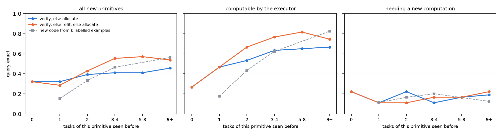

랩 NEO와 다른 점: 모델은 얼린 24개 환경 가격 run이고 초록 선만 학습 state를 넓힌 모델이다. 회색 점선은 앞 실험의 라벨을 쓴 진단이다.

**Table 34.1.** 온라인 빠른 기억 세 판, 과제 800개

| 방식 | 새 code | 계산할 수 있는 새것, 앞서 3에서 8번 본 뒤 | 새 계산이 필요한 새것 | 아는 24개 |
|---|---|---|---|---|
| 검증에 실패하면 바로 할당 | 290개 | 63에서 65% | 11에서 22% | 97에서 100% |
| 검증, 이어 쓰기, 그다음 할당 | 150개 | 77에서 82% | 11에서 22% | 97에서 100% |
| 같은 방식, 학습 state를 넓힌 모델 | 156개 | 70에서 77% | 17에서 31% | 96에서 100% |

랩 NEO와 다른 점: 셋 다 가중치를 바꾸지 않는다. 계산할 수 있는 새것은 앞 실험의 진단에서 예시 16개로 50%를 넘은 primitive 15개다.

**나온 것.** 이어 쓰기가 없으면 code가 늘기만 한다. 두 pair로 맞춘 code는 같은 primitive의 다음 과제를 정확히 재현하지 못해 검증에서 떨어지고 그때마다 새 code가 생긴다. 이어 쓰면 code가 절반으로 줄고 계산할 수 있는 새 primitive가 77에서 82%가 된다. 새 계산이 필요한 것은 두 판 모두 그대로 낮다. 아는 primitive는 건드리지 않는다.

### 34번째 실험까지의 insight

새로 알게 된 것.

- 얼린 모델이 과제를 하나씩 받으며 라벨 없이 새 code를 만들어 쓸 수 있다. 순서는 자기 code와 새 code의 검증, 기존 새 code를 다시 맞춰 이어 쓰기, 그다음 할당이다. 이어 쓰기가 없으면 과제 800개에 code가 290개 생기고, 넣으면 150개로 줄며 계산할 수 있는 새 primitive를 앞서 몇 번 본 뒤 77에서 82% 맞힌다. 아는 primitive는 97에서 100%로 그대로다. executor를 더 함수답게 만들어도 code 하나로 붙는 개념의 범위는 거의 넓어지지 않는다.

그대로인 것.

- state 표현과 단계 사이로 넘기는 것
    - 격자 하나를 latent 하나에 담는 것은 15칸 격자에 모자라지만, 공식 NEO가 0에 머무는 이유는 그것만이 아니다
    - 단계 사이에 확률을 넘기면 격자에 보이지 않는 정보가 건너가고, code 둘이 주소가 된다
- code 형성: programmer와 codebook이 primitive마다 code를 세우는 일
    - transfer를 정하는 것은 어디서나 통하는 code 하나를 가진 primitive의 수다
    - 여러 단계로 학습하면 primitive는 여러 code로 설명되는 단계를 거쳐 차례로 code를 얻는다
    - 남는 code와 다시 뿌리기는 primitive를 입력에 따라 쪼갠다
    - 랩 programmer는 code를 늦게 찾고, 칸마다 이어 붙인 넓은 programmer가 빨리 찾는다
    - 예시를 다시 만들기만 하면 채워지는 목표 아래에서 여러 단계를 함께 학습하면 code가 primitive가 아닌 것으로 굳는다
    - 깨끗한 한 단계 code는 이어 쓸 수 있고, code가 깨끗할수록 여러 단계 과제도 나아진다
    - 여러 단계 학습은 허락된 길이로 설명할 수 없는 pair를 억지로 맞출 때 code를 휘게 한다
    - 큰 환경의 실패는 비슷한 변환이 한 code에 섞인 채 굳는 것이다
    - 같은 code가 다른 입력에서도 같은 일을 하라는 요구는 pair의 묶음에서만 나온다
    - 오래 학습하면 일부만 풀린다
    - 넷의 배정은 executor가 넷을 구별하기 전에 정해지고, 그 시기에는 넷을 가를 신호가 모델 어디에도 없다
    - 숨은 길이를 읽지 않고 한 단계 과제를 고르는 방법은 아직 없다
    - 굳은 code를 본보기 과제로 나누면 새 code가 변환이 아니라 그 물체들을 외운다
    - codebook은 굵은 묶음에서 가는 묶음으로 갈라지고, 닮은 변환일수록 늦게까지 한 묶음이다
    - E-step 후보를 줄이면 죽은 code가 후보에 들지 못해 풀리던 seed까지 굳는다
    - 초반에 과하게 쓰인 code에 가격을 붙이면 굳던 seed가 풀리지만 모든 seed는 아니다
- executor: code가 어디서나 같은 변환인가
    - code가 놓인 모양과 executor가 하는 일은 별개이고, executor는 길이가 1이 아닌 code에서도 쓸모 있는 변환을 낸다
    - executor는 정답 code가 주어지면 회전 계열을 해낸다. 용량 문제가 아니다
    - executor가 어디서나 같은 변환을 하느냐는 학습 때 본 state의 다양성이 정한다
    - 큰 물체에서의 실패도 학습 state를 넓히면 대부분 사라진다
- 여러 단계 program: programmer의 계획과 평가 때의 탐색
    - 긴 program에서 떨어지는 큰 부분은 탐색 없이 이어 쓰기 때문이고, 탐색을 넓히면 2배에서 3배가 된다
    - support를 통과한 program이 여럿이면 짧은 program에 무게를 주어 투표한다
    - executor가 함수에 가까워지면 긴 program의 병목은 다시 programmer의 탐색이다
    - 깨끗한 code가 먼저이고, 꿈 학습은 그 위에서 계획을 채운다. 더 오래 꿔도 이득은 작다
- 양과 구조를 넣은 codebook
    - 양이 더해지는 성질은 loss가 아니라 실행 방식으로 보장해야 한다
    - 구조를 넣은 codebook은 작은 이동 묶음에서만 본 적 없는 양을 말했다
- 환경이 커질 때와 아는 것 위에 쌓기
    - 환경이 커져도 배우는 속도는 느려지지 않고 닿는 높이가 갈린다
    - 새 primitive 하나의 비용은 본 pair 수로 세면 환경 크기에 거의 평평하다
    - code가 깨끗한 모델에서 키우면 옛것이 밀려나지 않는다
    - 두 pair hard EM의 seed에 따른 갈림은 52개와 64개 환경에서도 같다
    - 이어 배우면 초반은 빠르지만, 먼저 배운 개념의 경계가 새 개념을 나누는 방식을 묶는다
    - 아는 것에서 출발하면 스텝으로는 빠르지만, 적은 예시로 가중치를 고치면 오히려 무너진다
- 빠른 기억과 잠
    - executor 안에 더하는 보정으로는 executor가 못 하는 공간 계산을 고칠 수 없다
    - 새 code 벡터 하나로 붙는 것은 executor가 이미 할 줄 아는 계산의 조합뿐이다
- 재는 방법
    - seed 하나의 값으로 말하지 않는다
    - transfer는 확률을 넘기는 방식과 격자만 넘기는 방식 둘 다로 잰다
    - 회전 계열만의 code NMI가 code 배정의 상태를 transfer와 같은 순서로 보여 준다
    - 학습에 쓰지 않은 두 pair 과제의 재현율이 잘 풀린 run을 라벨 없이 고른다. 큰 환경에서도 그렇다
    - hard EM의 계산은 codebook 크기에 비례한다

## 35. 잠에서 기억을 가중치로 옮기기

2026-11-27. 근거는 `docs/reports/2026-11-27-autoresearch.md` 8.4절.

**물은 것.** 빠른 기억이 풀지 못하고 모아 두기만 한 과제로 잠에서 가중치를 고치면 새 계산이 배워지는가. 기억이 고른 과제는 무작위 과제보다 나은가.

**한 것.** 흐름 800개 가운데 자기 code로 재현되지 않아 기억에 들어간 과제 435개로 모든 부품을 2,000스텝 학습했다. 배치 절반은 24개 환경 학습 파일을 재생한다. 평가는 흐름에 나온 과제를 뺀 평가 파일로 한다. codebook의 새 줄을 무작위로 채운 출발과 기억 code로 채운 출발을 견줬고, 기억 대신 무작위로 뽑은 과제 435개로 자는 대조를 돌렸다.

**랩 NEO와 다른 점, 이 실험의 공통 설정.**

| 항목 | 랩 NEO | 이 실험 |
|---|---|---|
| 데이터 | BabyTheorist single-A 레벨 1의 학습 파일. pair 하나씩이고 70%가 primitive 여럿짜리다 | 기억에 들어간 과제 435개의 support 둘, 그리고 배치 절반을 채우는 24개 환경 학습 파일. 평가는 흐름에 나온 과제를 뺀 52개 환경 평가 파일 |
| programmer | 지금 칸 token과 목표 칸 token을 따로 넣는 6층 transformer, 폭 128 | 지금 칸과 목표 칸을 칸마다 이어 붙인 token을 넣는 token_pair_transformer, 폭 256 |
| codebook | 랩 VQ. cosine으로 가장 가까운 code를 고른다. code 16개, 16차원, commitment 0.25 | code 48개에 새 줄 56개를 붙여 104개. 새 줄은 무작위이거나, 과제를 둘 이상 담은 기억 code를 길이 1로 다시 맞춘 것 |
| program 길이와 단계 사이로 넘기는 것 | 최대 다섯 단계. 단계 사이에 칸마다의 색 확률을 넘긴다 | program 한 단계 |
| code를 고르고 학습하는 방식 | programmer가 pair 하나를 보고 낸 출력에 가장 가까운 code를 쓴다. 길이는 길이마다 0.95를 곱한 cross-entropy가 가장 작은 것으로 고르고, 그 길이의 cross-entropy, grounding 항 0.1, codebook loss로 모든 부품을 함께 학습한다 | hard EM. 과제마다 codebook의 모든 code를 두 pair에 실행해 오차의 합이 가장 작은 code를 고르고, executor는 그 code로 두 pair를 학습하고 programmer는 그 code를 맞히게 학습한다. 아무도 고르지 않는 code는 오차를 깎아 주는 보너스로 구제한다 |
| 학습 일정 | 학습률 3e-4, batch 256 episode, 78,200스텝, 가중치 평균 0.999 | 얼렸던 24개 환경 가격 모델의 모든 부품을 2,000스텝 학습. 가격은 쓰지 않는다 |
| 학습이 읽는 정보 | 입력과 출력 격자만 읽는다 | 입력과 출력 격자, 어느 pair 둘이 같은 규칙인지, 그리고 한 단계 과제만 남기는 데 숨은 길이 |
| 랩 NEO에 없는 단계 | 없다 | 잠. 깨어 있는 동안 자기 code로 재현되지 않아 기억에 들어간 과제와, 배치 절반을 채우는 원래 환경의 학습 파일로 모든 부품을 학습한다 |

표에 없는 항목은 랩 NEO와 같다.

**Figure 35.1.** 잠에서 기억을 가중치로 옮길 때, 처음 보는 과제의 정답률

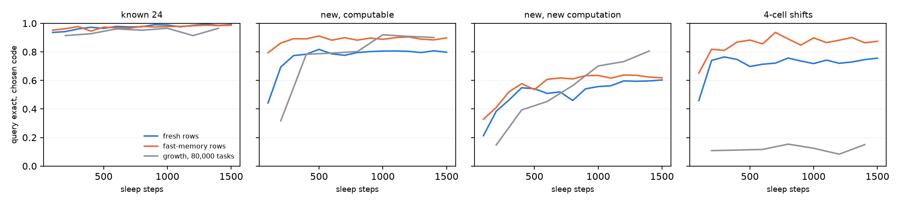

랩 NEO와 다른 점: 파란 선과 주황 선은 codebook 새 줄의 출발만 다르다. 회색 선은 과제 8만 개로 키운 run이다.

**Table 35.1.** 빠른 기억만, 잠, 그리고 과제 8만 개로 키운 run

| | 원래 24개 | 계산할 수 있는 새것 15개 | 새 계산이 필요한 새것 9개 | 4칸 이동 |
|---|---|---|---|---|
| 빠른 기억만, 가중치 그대로 | 97에서 100% | 77에서 82% | 11에서 22% | |
| 잠, 무작위 줄 출발, 2,000스텝 | 99% | 81% | 58% | 77% |
| 잠, 기억 줄 출발, 1,500스텝 | 99% | 90% | 62% | 87% |
| 참고: 과제 8만 개로 키운 run, 2,000스텝 | 97% | 92% | 91% | 14% |

랩 NEO와 다른 점: 첫 줄은 가중치를 바꾸지 않은 빠른 기억이다. 잠 두 줄이 이 실험의 공통 설정이고 새 줄의 출발만 다르다.

**Table 35.2.** 기억이 고른 과제와 무작위 과제, 무작위 줄 출발, 2,000스텝

| 잠에 쓴 과제 435개 | 계산할 수 있는 새것 | 새 계산이 필요한 새것 | 4칸 이동 |
|---|---|---|---|
| 기억이 고른 것, 곧 자기 code로 재현되지 않은 과제 | 81% | 58% | 77% |
| 52개 환경 학습 파일에서 무작위로 뽑은 것 | 68% | 46% | 18% |

랩 NEO와 다른 점: 같은 잠이고 과제를 고르는 방식만 다르다. 무작위 과제의 절반쯤은 이미 아는 primitive이고 4칸 이동은 그 학습 파일에 없다.

**나온 것.** 새 계산은 잠에서 배워진다. 깨어 있는 동안 20% 안팎이던 것이 60% 안팎이 된다. 기억 code로 새 줄을 시작하면 계산할 수 있는 개념이 8에서 10점 높고 그 차이가 끝까지 간다. 과제 435개는 500스텝 뒤로 더 오르지 않는다. 원래 24개는 99%로 지켜진다. 무작위로 뽑은 같은 수의 과제로 자면 13점 낮다.

### 35번째 실험까지의 insight

새로 알게 된 것.

- 빠른 기억이 풀지 못하고 모아 둔 과제로 잠에서 모든 부품을 학습하면 새 계산이 배워진다. 과제 435개로 새 계산이 필요한 개념이 20% 안팎에서 60% 안팎이 되고, 원래 환경을 재생하면 원래 24개가 99%로 지켜진다. 기억 code를 codebook 새 줄의 출발점으로 쓰면 계산할 수 있는 개념이 8에서 10점 높다. 자기 code로 재현되지 않은 과제만 기억에 담으면 같은 수의 무작위 과제보다 13점 높다.

그대로인 것.

- state 표현과 단계 사이로 넘기는 것
    - 격자 하나를 latent 하나에 담는 것은 15칸 격자에 모자라지만, 공식 NEO가 0에 머무는 이유는 그것만이 아니다
    - 단계 사이에 확률을 넘기면 격자에 보이지 않는 정보가 건너가고, code 둘이 주소가 된다
- code 형성: programmer와 codebook이 primitive마다 code를 세우는 일
    - transfer를 정하는 것은 어디서나 통하는 code 하나를 가진 primitive의 수다
    - 여러 단계로 학습하면 primitive는 여러 code로 설명되는 단계를 거쳐 차례로 code를 얻는다
    - 남는 code와 다시 뿌리기는 primitive를 입력에 따라 쪼갠다
    - 랩 programmer는 code를 늦게 찾고, 칸마다 이어 붙인 넓은 programmer가 빨리 찾는다
    - 예시를 다시 만들기만 하면 채워지는 목표 아래에서 여러 단계를 함께 학습하면 code가 primitive가 아닌 것으로 굳는다
    - 깨끗한 한 단계 code는 이어 쓸 수 있고, code가 깨끗할수록 여러 단계 과제도 나아진다
    - 여러 단계 학습은 허락된 길이로 설명할 수 없는 pair를 억지로 맞출 때 code를 휘게 한다
    - 큰 환경의 실패는 비슷한 변환이 한 code에 섞인 채 굳는 것이다
    - 같은 code가 다른 입력에서도 같은 일을 하라는 요구는 pair의 묶음에서만 나온다
    - 오래 학습하면 일부만 풀린다
    - 넷의 배정은 executor가 넷을 구별하기 전에 정해지고, 그 시기에는 넷을 가를 신호가 모델 어디에도 없다
    - 숨은 길이를 읽지 않고 한 단계 과제를 고르는 방법은 아직 없다
    - 굳은 code를 본보기 과제로 나누면 새 code가 변환이 아니라 그 물체들을 외운다
    - codebook은 굵은 묶음에서 가는 묶음으로 갈라지고, 닮은 변환일수록 늦게까지 한 묶음이다
    - E-step 후보를 줄이면 죽은 code가 후보에 들지 못해 풀리던 seed까지 굳는다
    - 초반에 과하게 쓰인 code에 가격을 붙이면 굳던 seed가 풀리지만 모든 seed는 아니다
- executor: code가 어디서나 같은 변환인가
    - code가 놓인 모양과 executor가 하는 일은 별개이고, executor는 길이가 1이 아닌 code에서도 쓸모 있는 변환을 낸다
    - executor는 정답 code가 주어지면 회전 계열을 해낸다. 용량 문제가 아니다
    - executor가 어디서나 같은 변환을 하느냐는 학습 때 본 state의 다양성이 정한다
    - 큰 물체에서의 실패도 학습 state를 넓히면 대부분 사라진다
- 여러 단계 program: programmer의 계획과 평가 때의 탐색
    - 긴 program에서 떨어지는 큰 부분은 탐색 없이 이어 쓰기 때문이고, 탐색을 넓히면 2배에서 3배가 된다
    - support를 통과한 program이 여럿이면 짧은 program에 무게를 주어 투표한다
    - executor가 함수에 가까워지면 긴 program의 병목은 다시 programmer의 탐색이다
    - 깨끗한 code가 먼저이고, 꿈 학습은 그 위에서 계획을 채운다. 더 오래 꿔도 이득은 작다
- 양과 구조를 넣은 codebook
    - 양이 더해지는 성질은 loss가 아니라 실행 방식으로 보장해야 한다
    - 구조를 넣은 codebook은 작은 이동 묶음에서만 본 적 없는 양을 말했다
- 환경이 커질 때와 아는 것 위에 쌓기
    - 환경이 커져도 배우는 속도는 느려지지 않고 닿는 높이가 갈린다
    - 새 primitive 하나의 비용은 본 pair 수로 세면 환경 크기에 거의 평평하다
    - code가 깨끗한 모델에서 키우면 옛것이 밀려나지 않는다
    - 두 pair hard EM의 seed에 따른 갈림은 52개와 64개 환경에서도 같다
    - 이어 배우면 초반은 빠르지만, 먼저 배운 개념의 경계가 새 개념을 나누는 방식을 묶는다
    - 아는 것에서 출발하면 스텝으로는 빠르지만, 적은 예시로 가중치를 고치면 오히려 무너진다
- 빠른 기억과 잠
    - executor 안에 더하는 보정으로는 executor가 못 하는 공간 계산을 고칠 수 없다
    - 새 code 벡터 하나로 붙는 것은 executor가 이미 할 줄 아는 계산의 조합뿐이다
    - 빠른 기억은 검증, 이어 쓰기, 할당의 순서여야 한다. 이어 쓰기가 없으면 code가 늘기만 한다
- 재는 방법
    - seed 하나의 값으로 말하지 않는다
    - transfer는 확률을 넘기는 방식과 격자만 넘기는 방식 둘 다로 잰다
    - 회전 계열만의 code NMI가 code 배정의 상태를 transfer와 같은 순서로 보여 준다
    - 학습에 쓰지 않은 두 pair 과제의 재현율이 잘 풀린 run을 라벨 없이 고른다. 큰 환경에서도 그렇다
    - hard EM의 계산은 codebook 크기에 비례한다

## 36. 깨기와 잠의 바퀴

2026-11-27. 근거는 `docs/reports/2026-11-27-autoresearch.md` 8.5절과 8.7절.

**물은 것.** 깨어서 모으고, 자면서 옮기고, 다시 깨면 새 과제가 더 싸게 풀리는가. 바퀴를 거듭하면 계속 오르는가.

**한 것.** 같은 흐름을 800개씩 끊어, 깨어 있는 구간과 잠을 번갈아 했다. seed 43으로 네 구간, 그리고 seed 42, 43, 44로 네 구간이다. 둘째 잠부터는 그때까지 모인 기억 전체로 1,000스텝 이어 잔다. 대조로 한 번도 자지 않고 같은 과제 2,400개를 빠른 기억만으로 받는 run과, 그 run의 기억 전체로 한 번만 자는 run을 돌렸다.

**랩 NEO와 다른 점, 이 실험의 공통 설정.**

| 항목 | 랩 NEO | 이 실험 |
|---|---|---|
| 데이터 | BabyTheorist single-A 레벨 1의 학습 파일. pair 하나씩이고 70%가 primitive 여럿짜리다 | 얼린 24개 환경 모델에 52개 환경의 한 단계 과제를 정한 순서로 하나씩 준다. 과제는 support pair 둘과 query 하나다. 800개씩 끊는다 |
| programmer | 지금 칸 token과 목표 칸 token을 따로 넣는 6층 transformer, 폭 128 | 지금 칸과 목표 칸을 칸마다 이어 붙인 token을 넣는 token_pair_transformer, 폭 256 |
| codebook | 랩 VQ. cosine으로 가장 가까운 code를 고른다. code 16개, 16차원, commitment 0.25 | code 48개에 새 줄 56개를 붙여 104개. 새 줄은 무작위이거나, 과제를 둘 이상 담은 기억 code를 길이 1로 다시 맞춘 것 |
| program 길이와 단계 사이로 넘기는 것 | 최대 다섯 단계. 단계 사이에 칸마다의 색 확률을 넘긴다 | program 한 단계 |
| code를 고르고 학습하는 방식 | programmer가 pair 하나를 보고 낸 출력에 가장 가까운 code를 쓴다. 길이는 길이마다 0.95를 곱한 cross-entropy가 가장 작은 것으로 고르고, 그 길이의 cross-entropy, grounding 항 0.1, codebook loss로 모든 부품을 함께 학습한다 | hard EM. 과제마다 codebook의 모든 code를 두 pair에 실행해 오차의 합이 가장 작은 code를 고르고, executor는 그 code로 두 pair를 학습하고 programmer는 그 code를 맞히게 학습한다. 아무도 고르지 않는 code는 오차를 깎아 주는 보너스로 구제한다 |
| 학습 일정 | 학습률 3e-4, batch 256 episode, 78,200스텝, 가중치 평균 0.999 | 첫 잠 2,000스텝, 그 뒤 잠마다 1,000스텝. 가격은 쓰지 않는다 |
| 평가 때의 추론 | programmer가 support pair 하나를 보고 고른 code 열을 query에 그대로 실행한다. 탐색하지 않는다 | 깨어 있는 동안 support 둘을 재현하는 code로 답한다 |
| 학습이 읽는 정보 | 입력과 출력 격자만 읽는다 | 입력과 출력 격자, 어느 pair 둘이 같은 규칙인지, 그리고 한 단계 과제만 남기는 데 숨은 길이 |
| 랩 NEO에 없는 단계 | 없다 | 온라인 빠른 기억. 모델을 얼리고 과제를 하나씩 받는다. 과제마다 자기 code와 지금까지 만든 새 code를 support 둘에 실행해 둘 다 재현하는 것을 찾는다. 없으면 손실이 낮은 새 code 셋을 그 기억과 이 과제로 다시 맞춰 보고, 그래도 없으면 새 code 벡터를 할당한다. 가중치는 바꾸지 않는다. 구간 사이에는 잔다. 깨어 있는 동안 자기 code로 재현되지 않아 기억에 들어간 과제와, 배치 절반을 채우는 원래 환경의 학습 파일로 모든 부품을 학습한다 |

표에 없는 항목은 랩 NEO와 같다.

**Figure 36.1.** 깨기와 잠을 번갈아 할 때의 새 primitive 정답률과 새로 만든 code 수, seed 43

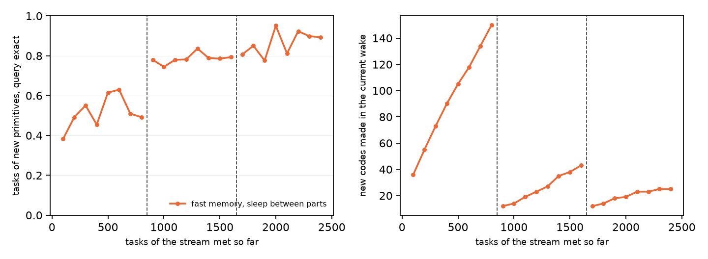

랩 NEO와 다른 점: 이 실험의 공통 설정 그대로다. 회색 선은 한 번도 자지 않은 얼린 모델이고 세로 점선이 잠이다.

**Table 36.1.** seed 43의 네 구간, 새 줄을 무작위로 채운 갈래

| 깨어 있는 구간 | 새 primitive 전체 | 계산할 수 있는 새것 | 새 계산이 필요한 새것 | 아는 24개 | 새로 만든 code | 자기 code가 답한 비율 |
|---|---|---|---|---|---|---|
| 첫 번째, 자기 전 | 51% | 71% | 19% | 99% | 150개 | 3% |
| 두 번째, 한 번 잔 뒤 | 79% | 86% | 60% | 100% | 43개 | 69% |
| 세 번째, 두 번 잔 뒤 | 86% | 90% | 76% | 99.7% | 25개 | 75% |
| 네 번째, 세 번 잔 뒤 | 89% | 91% | 85% | 100% | 23개 | 79% |

랩 NEO와 다른 점: 공통 설정 그대로다. 구간마다 그 전까지의 잠을 잔 모델을 얼려 쓴다.

**Table 36.2.** 같은 과제에서 자지 않은 모델과 잠을 사이에 넣은 모델

| 과제 구간 | 자지 않은 모델, 새 primitive | 잠을 사이에 넣은 모델 |
|---|---|---|
| 1에서 800 | 51% | 51%, 같은 모델 |
| 801에서 1,600 | 62% | 79% |
| 1,601에서 2,400 | 63% | 86% |

랩 NEO와 다른 점: 공통 설정이고 두 열은 구간 사이에 잠이 있느냐만 다르다.

**Figure 36.2.** seed 셋의 바퀴, 가는 선은 seed이고 굵은 선은 평균

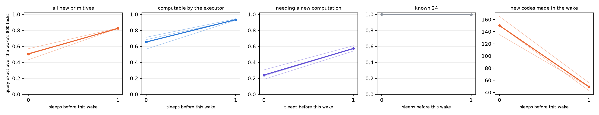

랩 NEO와 다른 점: 공통 설정이고 새 줄을 기억 code로 채운 갈래다.

**Table 36.3.** seed 셋의 네 구간

| seed | 자기 전, 새 primitive | 한 번 잔 뒤 | 두 번 잔 뒤 | 세 번 잔 뒤 | 새 code |
|---|---|---|---|---|---|
| 42 | 57% | 83% | 81% | 85% | 135개, 49개, 44개, 39개 |
| 43 | 51% | 82% | 87% | 90% | 150개, 43개, 29개, 19개 |
| 44 | 43% | 82% | 81% | 80% | 165개, 56개, 47개, 40개 |
| 평균 | 50.5% | 82.4% | 83.0% | 85.0% | 150개, 49개, 40개, 33개 |

랩 NEO와 다른 점: 위 그림과 같은 run들이다.

**Table 36.4.** 사이사이 자는 것과 몰아서 자는 것

| | 기억 과제 | 계산할 수 있는 새것 | 새 계산이 필요한 새것 | 아는 24개 |
|---|---|---|---|---|
| 800개마다 자기, 세 번 | 684개 | 86% | 75% | 99% |
| 2,400개 뒤 한 번 자기 | 1,305개 | 94% | 77% | 99% |

랩 NEO와 다른 점: 공통 설정이고 두 줄은 잠을 언제 자느냐만 다르다. 흐름을 뺀 같은 평가에서 고른 code로 쟀다.

**나온 것.** 세 seed 평균으로 새 primitive 정답률이 자기 전 50.5%, 한 번 잔 뒤 82.4%, 그 뒤 83.0%, 85.0%다. 새로 만드는 code는 150개에서 49개, 40개, 33개로 준다. 아는 24개는 내내 99% 이상이다. 자지 않으면 같은 과제에서 62%에서 멈춘다. 첫 잠의 상승은 세 seed에서 같고 그 뒤의 상승은 작으며 seed 하나는 오르지 않았다. seed 43 하나의 곡선으로 바퀴마다 오른다고 했다가 고쳤다. 사이사이 자면 기억에 담기는 과제가 절반인데 새 계산이 필요한 개념은 같은 수준에 닿는다.

### 36번째 실험까지의 insight

새로 알게 된 것.

- 얼린 모델이 빠른 기억으로 과제를 받고, 자기 code로 풀리지 않은 과제를 잠에서 가중치로 옮기고, 다시 얼려 다음 과제를 받는 바퀴가 돈다. 세 seed 평균으로 새 primitive 정답률이 자기 전 50.5%에서 한 번 잔 뒤 82.4%가 되고, 깨어 있는 동안 새로 만드는 code가 150개에서 49개로 준다. 아는 24개는 99% 이상이다. 자지 않고 빠른 기억만 쓰면 같은 과제에서 62%에서 멈춘다. 그 뒤의 잠이 주는 이득은 작아서 세 번 잔 뒤 85.0%이고 seed 하나는 오르지 않았다.
- 800개마다 자면 세 번의 깨어 있는 동안 684개만 기억에 담기고, 자지 않고 2,400개를 받으면 1,305개가 담긴다. 새 계산이 필요한 개념은 75%와 77%로 같은 수준이고 계산할 수 있는 개념은 과제가 많은 쪽이 8점 높다. 깨어 있는 동안의 정답률은 사이사이 자는 쪽이 79%와 86%, 자지 않는 쪽이 62%와 63%다.

고쳐진 것.

- 앞서 한 말: seed마다 차이가 크다. 한 단계 모델의 이어 쓴 transfer를 seed 하나로 83%라고 했다가 여섯 seed 평균 64%로 고쳤다. seed 하나의 값으로 말하지 않는다.
  지금: seed마다 차이가 크다. 한 단계 모델의 이어 쓴 transfer를 seed 하나로 83%라고 했다가 평균 64%로 고쳤고, 깨기와 잠의 바퀴가 돌 때마다 오른다고 seed 43 하나로 말했다가 seed 셋의 평균으로 고쳤다. seed 하나의 값이나 곡선으로 말하지 않는다.
  무엇을 보고: seed 42와 44에서는 둘째 잠 뒤의 정답률이 오르지 않았다.
- 앞서 한 말: 아는 것에서 출발하면 스텝으로는 훨씬 빨리 적응하지만 예시 수로는 수만 개가 든다. 큰 물체 과제 64개로 가중치를 고치면 59%가 37%로 떨어지고 원래 세계도 61%가 된다. 적은 예시에 과적합하면서 원래 일반화하던 부분까지 무너진다. 원래 세계를 재생하는 것이 가장 낫다.
  지금: 아는 것에서 출발하면 스텝으로는 빨리 적응하지만 적은 예시로 가중치를 바로 고치면 과적합하며 원래 일반화까지 무너진다. 예시를 빠른 기억에 먼저 담고, 자기 code로 재현되지 않은 과제 수백 개만 원래 환경의 재생과 함께 잠에서 학습하면 원래 지식을 99%로 지키면서 새 primitive가 50%에서 82%가 된다.
  무엇을 보고: 깨기와 잠의 바퀴를 seed 셋에서 돌렸다.

그대로인 것.

- state 표현과 단계 사이로 넘기는 것
    - 격자 하나를 latent 하나에 담는 것은 15칸 격자에 모자라지만, 공식 NEO가 0에 머무는 이유는 그것만이 아니다
    - 단계 사이에 확률을 넘기면 격자에 보이지 않는 정보가 건너가고, code 둘이 주소가 된다
- code 형성: programmer와 codebook이 primitive마다 code를 세우는 일
    - transfer를 정하는 것은 어디서나 통하는 code 하나를 가진 primitive의 수다
    - 여러 단계로 학습하면 primitive는 여러 code로 설명되는 단계를 거쳐 차례로 code를 얻는다
    - 남는 code와 다시 뿌리기는 primitive를 입력에 따라 쪼갠다
    - 랩 programmer는 code를 늦게 찾고, 칸마다 이어 붙인 넓은 programmer가 빨리 찾는다
    - 예시를 다시 만들기만 하면 채워지는 목표 아래에서 여러 단계를 함께 학습하면 code가 primitive가 아닌 것으로 굳는다
    - 깨끗한 한 단계 code는 이어 쓸 수 있고, code가 깨끗할수록 여러 단계 과제도 나아진다
    - 여러 단계 학습은 허락된 길이로 설명할 수 없는 pair를 억지로 맞출 때 code를 휘게 한다
    - 큰 환경의 실패는 비슷한 변환이 한 code에 섞인 채 굳는 것이다
    - 같은 code가 다른 입력에서도 같은 일을 하라는 요구는 pair의 묶음에서만 나온다
    - 오래 학습하면 일부만 풀린다
    - 넷의 배정은 executor가 넷을 구별하기 전에 정해지고, 그 시기에는 넷을 가를 신호가 모델 어디에도 없다
    - 숨은 길이를 읽지 않고 한 단계 과제를 고르는 방법은 아직 없다
    - 굳은 code를 본보기 과제로 나누면 새 code가 변환이 아니라 그 물체들을 외운다
    - codebook은 굵은 묶음에서 가는 묶음으로 갈라지고, 닮은 변환일수록 늦게까지 한 묶음이다
    - E-step 후보를 줄이면 죽은 code가 후보에 들지 못해 풀리던 seed까지 굳는다
    - 초반에 과하게 쓰인 code에 가격을 붙이면 굳던 seed가 풀리지만 모든 seed는 아니다
- executor: code가 어디서나 같은 변환인가
    - code가 놓인 모양과 executor가 하는 일은 별개이고, executor는 길이가 1이 아닌 code에서도 쓸모 있는 변환을 낸다
    - executor는 정답 code가 주어지면 회전 계열을 해낸다. 용량 문제가 아니다
    - executor가 어디서나 같은 변환을 하느냐는 학습 때 본 state의 다양성이 정한다
    - 큰 물체에서의 실패도 학습 state를 넓히면 대부분 사라진다
- 여러 단계 program: programmer의 계획과 평가 때의 탐색
    - 긴 program에서 떨어지는 큰 부분은 탐색 없이 이어 쓰기 때문이고, 탐색을 넓히면 2배에서 3배가 된다
    - support를 통과한 program이 여럿이면 짧은 program에 무게를 주어 투표한다
    - executor가 함수에 가까워지면 긴 program의 병목은 다시 programmer의 탐색이다
    - 깨끗한 code가 먼저이고, 꿈 학습은 그 위에서 계획을 채운다. 더 오래 꿔도 이득은 작다
- 양과 구조를 넣은 codebook
    - 양이 더해지는 성질은 loss가 아니라 실행 방식으로 보장해야 한다
    - 구조를 넣은 codebook은 작은 이동 묶음에서만 본 적 없는 양을 말했다
- 환경이 커질 때와 아는 것 위에 쌓기
    - 환경이 커져도 배우는 속도는 느려지지 않고 닿는 높이가 갈린다
    - 새 primitive 하나의 비용은 본 pair 수로 세면 환경 크기에 거의 평평하다
    - code가 깨끗한 모델에서 키우면 옛것이 밀려나지 않는다
    - 두 pair hard EM의 seed에 따른 갈림은 52개와 64개 환경에서도 같다
    - 이어 배우면 초반은 빠르지만, 먼저 배운 개념의 경계가 새 개념을 나누는 방식을 묶는다
- 빠른 기억과 잠
    - executor 안에 더하는 보정으로는 executor가 못 하는 공간 계산을 고칠 수 없다
    - 새 code 벡터 하나로 붙는 것은 executor가 이미 할 줄 아는 계산의 조합뿐이다
    - 빠른 기억은 검증, 이어 쓰기, 할당의 순서여야 한다. 이어 쓰기가 없으면 code가 늘기만 한다
    - 새 계산은 잠에서만 배우고, 검증에 실패한 과제만 기억에 담는 선택이 예시 효율을 올린다
- 재는 방법
    - transfer는 확률을 넘기는 방식과 격자만 넘기는 방식 둘 다로 잰다
    - 회전 계열만의 code NMI가 code 배정의 상태를 transfer와 같은 순서로 보여 준다
    - 학습에 쓰지 않은 두 pair 과제의 재현율이 잘 풀린 run을 라벨 없이 고른다. 큰 환경에서도 그렇다
    - hard EM의 계산은 codebook 크기에 비례한다

## 37. 큰 물체 세계에서의 같은 바퀴

2026-11-27. 근거는 `docs/reports/2026-11-27-autoresearch.md` 8.6절.

**물은 것.** 새 primitive가 아니라 물체의 크기 분포가 다른 세계에서도 같은 바퀴가 도는가.

**한 것.** 얼린 24개 환경 모델이 큰 물체 과제를 400개씩 받고, 자기 code로 재현되지 않은 과제를 모아 잤다. primitive가 같으므로 codebook은 키우지 않았다. 세 구간이다.

**랩 NEO와 다른 점, 이 실험의 공통 설정.**

| 항목 | 랩 NEO | 이 실험 |
|---|---|---|
| 데이터 | BabyTheorist single-A 레벨 1의 학습 파일. pair 하나씩이고 70%가 primitive 여럿짜리다 | 얼린 24개 환경 모델에 큰 물체 세계의 한 단계 과제를 400개씩 준다 |
| programmer | 지금 칸 token과 목표 칸 token을 따로 넣는 6층 transformer, 폭 128 | 지금 칸과 목표 칸을 칸마다 이어 붙인 token을 넣는 token_pair_transformer, 폭 256 |
| codebook | 랩 VQ. cosine으로 가장 가까운 code를 고른다. code 16개, 16차원, commitment 0.25 | 랩 VQ 그대로이고 code 수만 primitive 수의 두 배 |
| program 길이와 단계 사이로 넘기는 것 | 최대 다섯 단계. 단계 사이에 칸마다의 색 확률을 넘긴다 | program 한 단계 |
| code를 고르고 학습하는 방식 | programmer가 pair 하나를 보고 낸 출력에 가장 가까운 code를 쓴다. 길이는 길이마다 0.95를 곱한 cross-entropy가 가장 작은 것으로 고르고, 그 길이의 cross-entropy, grounding 항 0.1, codebook loss로 모든 부품을 함께 학습한다 | hard EM. 과제마다 codebook의 모든 code를 두 pair에 실행해 오차의 합이 가장 작은 code를 고르고, executor는 그 code로 두 pair를 학습하고 programmer는 그 code를 맞히게 학습한다. 아무도 고르지 않는 code는 오차를 깎아 주는 보너스로 구제한다 |
| 학습 일정 | 학습률 3e-4, batch 256 episode, 78,200스텝, 가중치 평균 0.999 | 첫 잠 2,000스텝, 둘째 잠 1,000스텝. 가격은 쓰지 않는다 |
| 평가 때의 추론 | programmer가 support pair 하나를 보고 고른 code 열을 query에 그대로 실행한다. 탐색하지 않는다 | 깨어 있는 동안 support 둘을 재현하는 code로 답한다 |
| 학습이 읽는 정보 | 입력과 출력 격자만 읽는다 | 입력과 출력 격자, 어느 pair 둘이 같은 규칙인지, 그리고 한 단계 과제만 남기는 데 숨은 길이 |
| 랩 NEO에 없는 단계 | 없다 | 온라인 빠른 기억. 모델을 얼리고 과제를 하나씩 받는다. 과제마다 자기 code와 지금까지 만든 새 code를 support 둘에 실행해 둘 다 재현하는 것을 찾는다. 없으면 손실이 낮은 새 code 셋을 그 기억과 이 과제로 다시 맞춰 보고, 그래도 없으면 새 code 벡터를 할당한다. 가중치는 바꾸지 않는다. 구간 사이에는 잔다. 깨어 있는 동안 자기 code로 재현되지 않아 기억에 들어간 과제와, 배치 절반을 채우는 원래 환경의 학습 파일로 모든 부품을 학습한다 |

표에 없는 항목은 랩 NEO와 같다.

**Table 37.1.** 큰 물체 세계의 세 구간과 앞 실험의 가중치 적응

| | 큰 물체 과제 | 원래 세계 | 새로 만든 code |
|---|---|---|---|
| 자기 전, 과제 1에서 400 | 48% | | 125개 |
| 한 번 잔 뒤, 과제 401에서 800 | 70% | | 72개 |
| 두 번 잔 뒤, 남은 과제 288개 | 74% | | 39개 |
| 첫 잠 뒤 모델이 고른 code로, 처음 보는 과제 | 76% | 99% | |
| 둘째 잠 뒤, 같은 측정 | 78.5% | 98% | |
| 6절의 적응: 무작위 과제 256개와 재생 | 72% | 98% | |
| 6절의 적응: 무작위 과제 1,024개 | 최고 76% | 88% | |

랩 NEO와 다른 점: 위 세 줄과 잠 뒤 두 줄이 이 실험이다. 아래 두 줄은 빠른 기억 없이 무작위 과제로 가중치를 고친 앞 실험의 값이다.

**나온 것.** 깨어 있는 동안의 정답률이 48%, 70%, 74%로 오르고 새로 만드는 code가 125개, 72개, 39개로 준다. 기억에 들어간 과제 217개로 자면 처음 보는 큰 물체 과제를 76% 맞히고 원래 세계는 99%다. 무작위 과제 256개로 가중치를 고쳤을 때의 72%보다 높다. 이 세계에서는 새 code가 거의 답을 주지 못한다. 기억이 하는 일은 못 푸는 과제를 골라 잠에 넘기는 것이다. 자기 code가 support 둘을 재현한 과제에서도 query 정답률은 자기 전 70%였다.

### 37번째 실험까지의 insight

새로 알게 된 것.

- 물체의 크기 분포만 다른 세계에서도 같은 바퀴가 돈다. 큰 물체 과제의 정답률이 48%, 70%, 74%로 오르고 원래 세계는 98% 이상이다. 이 세계에서는 빠른 기억의 새 code가 답을 주지 못한다. 기억의 두 가지 일, 곧 그 자리에서 새 code로 답하는 것과 못 푸는 과제를 골라 잠에 넘기는 것 가운데 둘째 일만으로 이득이 난다. 다만 둘째 잠의 이득은 2.5점으로 작다.

고쳐진 것.

- 앞서 한 말: support 둘을 통과하고도 query에서 틀리는 program이 있고, 긴 program에서는 찾지 못하는 것이 더 큰 손실이다. 통과한 program이 여럿이면 query에 실행한 답으로 투표하되 길이가 하나 늘 때마다 무게를 반으로 하는 방식이 처음 통과한 program을 쓰는 것보다 낫다. 8개 환경 레벨 7에서 71.6%가 77.4%가 된다. 찾지 못하는 쪽은 남은 거리 예측을 순위에 더하면 준다.
  지금: support 둘을 통과하고도 query에서 틀리는 program이 있다. 통과한 program이 여럿이면 짧은 program에 무게를 주어 투표하는 것이 처음 통과한 것을 쓰는 것보다 낫고, 찾지 못하는 쪽은 남은 거리 예측으로 준다. 그래도 support 둘의 재현은 충분한 증거가 아니다. 큰 물체 세계에서는 자기 code가 support 둘을 재현한 과제에서도 query 정답률이 70%다.
  무엇을 보고: 큰 물체 세계의 깨어 있는 구간에서 자기 code가 검증을 통과한 과제만 따로 셌다.

그대로인 것.

- state 표현과 단계 사이로 넘기는 것
    - 격자 하나를 latent 하나에 담는 것은 15칸 격자에 모자라지만, 공식 NEO가 0에 머무는 이유는 그것만이 아니다
    - 단계 사이에 확률을 넘기면 격자에 보이지 않는 정보가 건너가고, code 둘이 주소가 된다
- code 형성: programmer와 codebook이 primitive마다 code를 세우는 일
    - transfer를 정하는 것은 어디서나 통하는 code 하나를 가진 primitive의 수다
    - 여러 단계로 학습하면 primitive는 여러 code로 설명되는 단계를 거쳐 차례로 code를 얻는다
    - 남는 code와 다시 뿌리기는 primitive를 입력에 따라 쪼갠다
    - 랩 programmer는 code를 늦게 찾고, 칸마다 이어 붙인 넓은 programmer가 빨리 찾는다
    - 예시를 다시 만들기만 하면 채워지는 목표 아래에서 여러 단계를 함께 학습하면 code가 primitive가 아닌 것으로 굳는다
    - 깨끗한 한 단계 code는 이어 쓸 수 있고, code가 깨끗할수록 여러 단계 과제도 나아진다
    - 여러 단계 학습은 허락된 길이로 설명할 수 없는 pair를 억지로 맞출 때 code를 휘게 한다
    - 큰 환경의 실패는 비슷한 변환이 한 code에 섞인 채 굳는 것이다
    - 같은 code가 다른 입력에서도 같은 일을 하라는 요구는 pair의 묶음에서만 나온다
    - 오래 학습하면 일부만 풀린다
    - 넷의 배정은 executor가 넷을 구별하기 전에 정해지고, 그 시기에는 넷을 가를 신호가 모델 어디에도 없다
    - 숨은 길이를 읽지 않고 한 단계 과제를 고르는 방법은 아직 없다
    - 굳은 code를 본보기 과제로 나누면 새 code가 변환이 아니라 그 물체들을 외운다
    - codebook은 굵은 묶음에서 가는 묶음으로 갈라지고, 닮은 변환일수록 늦게까지 한 묶음이다
    - E-step 후보를 줄이면 죽은 code가 후보에 들지 못해 풀리던 seed까지 굳는다
    - 초반에 과하게 쓰인 code에 가격을 붙이면 굳던 seed가 풀리지만 모든 seed는 아니다
- executor: code가 어디서나 같은 변환인가
    - code가 놓인 모양과 executor가 하는 일은 별개이고, executor는 길이가 1이 아닌 code에서도 쓸모 있는 변환을 낸다
    - executor는 정답 code가 주어지면 회전 계열을 해낸다. 용량 문제가 아니다
    - executor가 어디서나 같은 변환을 하느냐는 학습 때 본 state의 다양성이 정한다
    - 큰 물체에서의 실패도 학습 state를 넓히면 대부분 사라진다
- 여러 단계 program: programmer의 계획과 평가 때의 탐색
    - 긴 program에서 떨어지는 큰 부분은 탐색 없이 이어 쓰기 때문이고, 탐색을 넓히면 2배에서 3배가 된다
    - executor가 함수에 가까워지면 긴 program의 병목은 다시 programmer의 탐색이다
    - 깨끗한 code가 먼저이고, 꿈 학습은 그 위에서 계획을 채운다. 더 오래 꿔도 이득은 작다
- 양과 구조를 넣은 codebook
    - 양이 더해지는 성질은 loss가 아니라 실행 방식으로 보장해야 한다
    - 구조를 넣은 codebook은 작은 이동 묶음에서만 본 적 없는 양을 말했다
- 환경이 커질 때와 아는 것 위에 쌓기
    - 환경이 커져도 배우는 속도는 느려지지 않고 닿는 높이가 갈린다
    - 새 primitive 하나의 비용은 본 pair 수로 세면 환경 크기에 거의 평평하다
    - code가 깨끗한 모델에서 키우면 옛것이 밀려나지 않는다
    - 두 pair hard EM의 seed에 따른 갈림은 52개와 64개 환경에서도 같다
    - 이어 배우면 초반은 빠르지만, 먼저 배운 개념의 경계가 새 개념을 나누는 방식을 묶는다
    - 적은 예시로 가중치를 바로 고치면 무너지지만, 검증에 실패한 과제를 모아 재생과 함께 자면 무너지지 않는다
- 빠른 기억과 잠
    - executor 안에 더하는 보정으로는 executor가 못 하는 공간 계산을 고칠 수 없다
    - 새 code 벡터 하나로 붙는 것은 executor가 이미 할 줄 아는 계산의 조합뿐이다
    - 빠른 기억은 검증, 이어 쓰기, 할당의 순서여야 한다. 이어 쓰기가 없으면 code가 늘기만 한다
    - 새 계산은 잠에서만 배우고, 검증에 실패한 과제만 기억에 담는 선택이 예시 효율을 올린다
    - 깨기와 잠을 번갈아 하면 한 번의 잠이 새 과제의 정답률을 30점 넘게 올리고 원래 지식은 그대로다
    - 사이사이 자면 절반의 기억으로 같은 수준에 닿고 깨어 있는 동안의 성능이 훨씬 높다
- 재는 방법
    - seed 하나의 값이나 곡선으로 말하지 않는다
    - transfer는 확률을 넘기는 방식과 격자만 넘기는 방식 둘 다로 잰다
    - 회전 계열만의 code NMI가 code 배정의 상태를 transfer와 같은 순서로 보여 준다
    - 학습에 쓰지 않은 두 pair 과제의 재현율이 잘 풀린 run을 라벨 없이 고른다. 큰 환경에서도 그렇다
    - hard EM의 계산은 codebook 크기에 비례한다

## 38. 잠을 거듭할 때: 섞임, 외우기, 가격, 빼 둔 기억

2026-11-27. 근거는 `docs/reports/2026-11-27-autoresearch.md` 8.5절.

**물은 것.** 잠을 거듭해도 낮게 남는 primitive는 왜 남는가. 처음부터 배울 때 통한 가격이 잠에서도 통하는가.

**한 것.** 잠을 잔 모델을 그때까지의 흐름을 뺀 평가 과제에서, 빠른 기억 없이 고른 code로 다시 쟀다. 낮게 남은 primitive가 어느 code를 쓰는지 봤다. 넷째 잠을 적합도 가격이 있는 것과 없는 것으로 돌렸다. 섞인 code가 학습한 pair, 같은 과제의 query, 처음 보는 과제를 각각 얼마나 재현하는지 쟀다. 그리고 기억의 5분의 1을 학습에서 빼 둔 넷째 잠을 돌려, 빼 둔 과제로 code마다 재현율을 쟀다.

**랩 NEO와 다른 점, 이 실험의 공통 설정.**

| 항목 | 랩 NEO | 이 실험 |
|---|---|---|
| 데이터 | BabyTheorist single-A 레벨 1의 학습 파일. pair 하나씩이고 70%가 primitive 여럿짜리다 | 네 번의 깨어 있는 동안 모인 기억 과제와 24개 환경 학습 파일의 재생. 한 갈래는 기억의 5분의 1을 학습에서 빼 둔다 |
| programmer | 지금 칸 token과 목표 칸 token을 따로 넣는 6층 transformer, 폭 128 | 지금 칸과 목표 칸을 칸마다 이어 붙인 token을 넣는 token_pair_transformer, 폭 256 |
| codebook | 랩 VQ. cosine으로 가장 가까운 code를 고른다. code 16개, 16차원, commitment 0.25 | code 48개에 새 줄 56개를 붙여 104개. 새 줄은 무작위이거나, 과제를 둘 이상 담은 기억 code를 길이 1로 다시 맞춘 것 |
| program 길이와 단계 사이로 넘기는 것 | 최대 다섯 단계. 단계 사이에 칸마다의 색 확률을 넘긴다 | program 한 단계 |
| code를 고르고 학습하는 방식 | programmer가 pair 하나를 보고 낸 출력에 가장 가까운 code를 쓴다. 길이는 길이마다 0.95를 곱한 cross-entropy가 가장 작은 것으로 고르고, 그 길이의 cross-entropy, grounding 항 0.1, codebook loss로 모든 부품을 함께 학습한다 | hard EM. 과제마다 codebook의 모든 code를 두 pair에 실행해 오차의 합이 가장 작은 code를 고르고, executor는 그 code로 두 pair를 학습하고 programmer는 그 code를 맞히게 학습한다. 아무도 고르지 않는 code는 오차를 깎아 주는 보너스로 구제한다. 한 갈래는 여기에 적합도 가격을 더한다 |
| 학습 일정 | 학습률 3e-4, batch 256 episode, 78,200스텝, 가중치 평균 0.999 | 셋째 잠을 잔 모델에서 1,000스텝 |
| 학습이 읽는 정보 | 입력과 출력 격자만 읽는다 | 입력과 출력 격자, 어느 pair 둘이 같은 규칙인지, 그리고 한 단계 과제만 남기는 데 숨은 길이 |
| 랩 NEO에 없는 단계 | 없다 | 잠. 깨어 있는 동안 자기 code로 재현되지 않아 기억에 들어간 과제와, 배치 절반을 채우는 원래 환경의 학습 파일로 모든 부품을 학습한다 |

표에 없는 항목은 랩 NEO와 같다.

**Table 38.1.** 잠을 거듭한 모델을 처음 보는 과제에서 고른 code로 잰 값

| 세 seed 평균 | 원래 24개 | 계산할 수 있는 새것 | 새 계산이 필요한 새것 |
|---|---|---|---|
| 첫 잠 뒤 | 98.9% | 89.1% | 59.4% |
| 둘째 잠 뒤 | 98.8% | 92.5% | 66.2% |
| 셋째 잠 뒤 | 98.4% | 93.9% | 70.0% |
| 넷째 잠 뒤 | 99.2% | 92.8% | 75.6% |

랩 NEO와 다른 점: 새 줄을 기억 code로 채운 갈래의 잠 네 번이다. 가격은 없다.

**Table 38.2.** 넷째 잠에 적합도 가격을 넣은 것과 넣지 않은 것, 세 seed 평균

| 넷째 잠 | 원래 24개 | 계산할 수 있는 새것 | 새 계산이 필요한 새것 |
|---|---|---|---|
| 가격 없음 | 99.2% | 92.8% | 75.6% |
| 적합도 가격 | 98.7% | 92.9% | 75.7% |

랩 NEO와 다른 점: 같은 출발, 같은 기억이고 가격만 다르다.

**Table 38.3.** 섞인 code는 변환을 배웠는가, 기억 과제를 외웠는가

| seed 42, 넷째 잠 뒤 | 학습한 두 pair | 같은 과제의 query | 흐름에 없던 과제의 두 pair |
|---|---|---|---|
| 두 배 확대 | 100% | 8에서 13% | 0에서 2% |
| 오른쪽 거울상 붙이기 | 97에서 98% | 14에서 16% | 2% |
| 왼쪽 거울상 붙이기, 잘 배운 것 | 100% | 89에서 96% | 88에서 89% |

랩 NEO와 다른 점: 잠을 잔 모델에서 programmer가 고른 code로 쟀다. 숨은 primitive는 줄을 나누는 데만 썼다.

**Table 38.4.** 기억의 5분의 1을 빼 두고 그 과제로 외운 code 찾기

| seed | 살펴본 code | 표시된 code | 표시된 code의 과제, 채점용으로만 본 primitive |
|---|---|---|---|
| 42 | 21개 | 2개 | 두 배 확대와 오른쪽 거울상 붙이기를 함께 쓰는 code: 학습한 과제 100%, 빼 둔 과제 6%. 가로 늘이기와 오른쪽 거울상 붙이기를 함께 쓰는 code: 97%, 29% |
| 43 | 24개 | 0개 | |
| 44 | 23개 | 2개 | 가로 늘이기의 한 code 33%, 아래로 2칸 이동의 한 code 33% |

랩 NEO와 다른 점: 넷째 잠에서 기억의 일부를 학습에 쓰지 않은 것만 다르다. code를 표시하는 데 라벨을 읽지 않는다.

**나온 것.** 같은 잣대로 재면 새 계산이 필요한 개념이 잠마다 59%, 66%, 70%, 76%로 오르고 세 seed 모두 오른다. 낮게 남는 것은 닮은 새 primitive 둘이 한 code를 함께 쓰는 경우다. 그 code는 학습한 pair는 100% 재현하지만 처음 보는 과제는 0에서 2%다. 변환이 아니라 기억 과제를 외운 것이다. 외운 code는 학습 과제 재현율이 높아 적합도 가격이 걸리지 않았고 가격을 넣은 잠은 효과가 없었다. 기억의 5분의 1을 빼 두면 그 과제의 재현율로 섞인 code 둘이 정확히 표시됐고, 섞임이 없던 seed에서는 하나도 표시되지 않았다.

### 38번째 실험까지의 insight

새로 알게 된 것.

- 잠을 잔 모델을 처음 보는 과제에서 고른 code로 재면, 새 계산이 필요한 개념이 세 seed 평균으로 잠마다 59%, 66%, 70%, 76%다. 세 seed 모두 오른다. 계산할 수 있는 개념은 89%에서 93%, 원래 24개는 98% 이상이다.
- 잠의 hard EM에서도 닮은 새 primitive 둘이 한 code에 섞인다. 물체를 오른쪽으로 키우는 두 배 확대와 오른쪽 거울상 붙이기 같은 것들이다. 섞인 code는 학습한 pair를 100% 재현하지만 같은 과제의 query는 8에서 16%, 처음 보는 과제는 0에서 2%다. 기억 과제가 잠 동안 수십 번 반복되어 외워진 것이다. 학습 과제로 재는 적합도는 이것을 보지 못한다. 기억의 5분의 1을 학습에서 빼 두면 그 과제의 재현율로 섞인 code가 라벨 없이 찾아진다. 찾은 code를 나누는 단계는 아직 없다.

고쳐진 것.

- 앞서 한 말: 두 pair hard EM의 E-step에 최근에 많이 쓰인 code일수록 큰 가격을 붙여 초반에 과제를 여러 code로 퍼뜨리면 굳던 seed가 풀린다. 24개 환경 seed 다섯 평균이 64%에서 78%가 되고 52개 환경은 세 seed 모두 98% 이상이다. 가격을 시간표로 거두면 executor가 구별하기 전에 가격이 사라진 seed에서 오히려 나빠진다. code가 자기 과제를 재현하는 만큼만 가격을 거두면 어려운 seed 셋의 평균이 66%에서 83%로 오르지만 한 seed는 65%에 남는다.
  지금: 두 pair hard EM의 E-step에 최근에 많이 쓰인 code일수록 큰 가격을 붙이면 처음부터 배울 때 굳던 seed가 풀린다. 24개 환경 seed 다섯 평균이 64%에서 78%, 52개 환경은 세 seed 모두 98% 이상이다. 가격을 code가 자기 과제를 재현하는 만큼만 거두면 어려운 seed 셋의 평균이 66%에서 83%가 되지만 한 seed는 65%에 남는다. 이 방식은 잠에서는 듣지 않았다. 잠에서 섞인 code는 기억 과제를 외워 학습 과제 재현율이 높으므로 가격이 걸리지 않는다.
  무엇을 보고: 넷째 잠에 적합도 가격을 넣은 판의 세 seed 평균이 가격 없는 판과 같았다.
- 앞서 한 말: 굳은 뒤에 섞인 code의 과제 일부를 본보기로 삼아 새 code를 학습하면, 학습 과제 재현은 35%에서 94%로 오르지만 평가는 34%로 그대로다. 새 code가 변환이 아니라 본보기의 물체를 외운다.
  지금: 굳은 뒤에 섞인 code의 과제 일부를 본보기로 삼아 새 code를 학습하면 학습 과제 재현은 94%로 오르지만 평가는 그대로다. 잠에서 기억 과제 수십 개로 섞인 code를 학습할 때도 같은 일이 일어난다. 적은 과제를 반복하면 code가 변환이 아니라 그 과제의 격자를 외운다. 학습에 쓰지 않은 과제로 재야 드러난다.
  무엇을 보고: 잠에서 섞인 code가 학습한 pair만 재현하는 것을 쟀다.

그대로인 것.

- state 표현과 단계 사이로 넘기는 것
    - 격자 하나를 latent 하나에 담는 것은 15칸 격자에 모자라지만, 공식 NEO가 0에 머무는 이유는 그것만이 아니다
    - 단계 사이에 확률을 넘기면 격자에 보이지 않는 정보가 건너가고, code 둘이 주소가 된다
- code 형성: programmer와 codebook이 primitive마다 code를 세우는 일
    - transfer를 정하는 것은 어디서나 통하는 code 하나를 가진 primitive의 수다
    - 여러 단계로 학습하면 primitive는 여러 code로 설명되는 단계를 거쳐 차례로 code를 얻는다
    - 남는 code와 다시 뿌리기는 primitive를 입력에 따라 쪼갠다
    - 랩 programmer는 code를 늦게 찾고, 칸마다 이어 붙인 넓은 programmer가 빨리 찾는다
    - 예시를 다시 만들기만 하면 채워지는 목표 아래에서 여러 단계를 함께 학습하면 code가 primitive가 아닌 것으로 굳는다
    - 깨끗한 한 단계 code는 이어 쓸 수 있고, code가 깨끗할수록 여러 단계 과제도 나아진다
    - 여러 단계 학습은 허락된 길이로 설명할 수 없는 pair를 억지로 맞출 때 code를 휘게 한다
    - 큰 환경의 실패는 비슷한 변환이 한 code에 섞인 채 굳는 것이다
    - 같은 code가 다른 입력에서도 같은 일을 하라는 요구는 pair의 묶음에서만 나온다
    - 오래 학습하면 일부만 풀린다
    - 넷의 배정은 executor가 넷을 구별하기 전에 정해지고, 그 시기에는 넷을 가를 신호가 모델 어디에도 없다
    - 숨은 길이를 읽지 않고 한 단계 과제를 고르는 방법은 아직 없다
    - codebook은 굵은 묶음에서 가는 묶음으로 갈라지고, 닮은 변환일수록 늦게까지 한 묶음이다
    - E-step 후보를 줄이면 죽은 code가 후보에 들지 못해 풀리던 seed까지 굳는다
- executor: code가 어디서나 같은 변환인가
    - code가 놓인 모양과 executor가 하는 일은 별개이고, executor는 길이가 1이 아닌 code에서도 쓸모 있는 변환을 낸다
    - executor는 정답 code가 주어지면 회전 계열을 해낸다. 용량 문제가 아니다
    - executor가 어디서나 같은 변환을 하느냐는 학습 때 본 state의 다양성이 정한다
    - 큰 물체에서의 실패도 학습 state를 넓히면 대부분 사라진다
- 여러 단계 program: programmer의 계획과 평가 때의 탐색
    - 긴 program에서 떨어지는 큰 부분은 탐색 없이 이어 쓰기 때문이고, 탐색을 넓히면 2배에서 3배가 된다
    - support 둘의 재현은 그 code가 맞는 변환이라는 충분한 증거가 아니다
    - executor가 함수에 가까워지면 긴 program의 병목은 다시 programmer의 탐색이다
    - 깨끗한 code가 먼저이고, 꿈 학습은 그 위에서 계획을 채운다. 더 오래 꿔도 이득은 작다
- 양과 구조를 넣은 codebook
    - 양이 더해지는 성질은 loss가 아니라 실행 방식으로 보장해야 한다
    - 구조를 넣은 codebook은 작은 이동 묶음에서만 본 적 없는 양을 말했다
- 환경이 커질 때와 아는 것 위에 쌓기
    - 환경이 커져도 배우는 속도는 느려지지 않고 닿는 높이가 갈린다
    - 새 primitive 하나의 비용은 본 pair 수로 세면 환경 크기에 거의 평평하다
    - code가 깨끗한 모델에서 키우면 옛것이 밀려나지 않는다
    - 두 pair hard EM의 seed에 따른 갈림은 52개와 64개 환경에서도 같다
    - 이어 배우면 초반은 빠르지만, 먼저 배운 개념의 경계가 새 개념을 나누는 방식을 묶는다
    - 적은 예시로 가중치를 바로 고치면 무너지지만, 검증에 실패한 과제를 모아 재생과 함께 자면 무너지지 않는다
- 빠른 기억과 잠
    - executor 안에 더하는 보정으로는 executor가 못 하는 공간 계산을 고칠 수 없다
    - 새 code 벡터 하나로 붙는 것은 executor가 이미 할 줄 아는 계산의 조합뿐이다
    - 빠른 기억은 검증, 이어 쓰기, 할당의 순서여야 한다. 이어 쓰기가 없으면 code가 늘기만 한다
    - 새 계산은 잠에서만 배우고, 검증에 실패한 과제만 기억에 담는 선택이 예시 효율을 올린다
    - 깨기와 잠을 번갈아 하면 한 번의 잠이 새 과제의 정답률을 30점 넘게 올리고 원래 지식은 그대로다
    - 사이사이 자면 절반의 기억으로 같은 수준에 닿고 깨어 있는 동안의 성능이 훨씬 높다
    - 새 code가 답을 주지 못하는 세계에서도 바퀴는 돈다. 기억이 못 푸는 과제를 골라 잠에 넘기기 때문이다
- 재는 방법
    - seed 하나의 값이나 곡선으로 말하지 않는다
    - transfer는 확률을 넘기는 방식과 격자만 넘기는 방식 둘 다로 잰다
    - 회전 계열만의 code NMI가 code 배정의 상태를 transfer와 같은 순서로 보여 준다
    - 학습에 쓰지 않은 두 pair 과제의 재현율이 잘 풀린 run을 라벨 없이 고른다. 큰 환경에서도 그렇다
    - hard EM의 계산은 codebook 크기에 비례한다

## 39. 잠이 무엇을 재생해야 하는가: 원래 데이터, 모델의 꿈, 재생 없음

2026-11-27. 근거는 `docs/reports/2026-11-27-autoresearch.md` 8.8절, 도구는 `scripts/babytheorist/memory_dream_replay.py`.

**물은 것.** 잠은 원래 환경의 학습 데이터를 들고 있어야 하는가. 모델이 스스로 꾼 꿈으로 원래 지식을 지킬 수 있는가.

**한 것.** 같은 잠에서 재생만 바꿨다. 원래 환경의 학습 파일, 모델이 꾼 꿈, 재생 없음이다. 꿈은 자기 전 모델의 code를 고르게 뽑아 깨어 있는 동안 본 격자 둘에 실행한 결과로 만든 두 pair 과제다. 꿈만 재생하며 세 번 자는 바퀴도 돌렸다. 둘째 잠에서는 꿈의 code를 쓰인 빈도대로 뽑는 것과, 꿈에 원래 세계의 과제를 조금 섞는 것을 시험했다.

**랩 NEO와 다른 점, 이 실험의 공통 설정.**

| 항목 | 랩 NEO | 이 실험 |
|---|---|---|
| 데이터 | BabyTheorist single-A 레벨 1의 학습 파일. pair 하나씩이고 70%가 primitive 여럿짜리다 | 기억 과제와, 조건에 따라 24개 환경 학습 파일, 모델이 스스로 만든 꿈 과제 4만 개, 또는 재생 없음 |
| programmer | 지금 칸 token과 목표 칸 token을 따로 넣는 6층 transformer, 폭 128 | 지금 칸과 목표 칸을 칸마다 이어 붙인 token을 넣는 token_pair_transformer, 폭 256 |
| codebook | 랩 VQ. cosine으로 가장 가까운 code를 고른다. code 16개, 16차원, commitment 0.25 | code 48개에 새 줄 56개를 붙여 104개. 새 줄은 무작위이거나, 과제를 둘 이상 담은 기억 code를 길이 1로 다시 맞춘 것 |
| program 길이와 단계 사이로 넘기는 것 | 최대 다섯 단계. 단계 사이에 칸마다의 색 확률을 넘긴다 | program 한 단계 |
| code를 고르고 학습하는 방식 | programmer가 pair 하나를 보고 낸 출력에 가장 가까운 code를 쓴다. 길이는 길이마다 0.95를 곱한 cross-entropy가 가장 작은 것으로 고르고, 그 길이의 cross-entropy, grounding 항 0.1, codebook loss로 모든 부품을 함께 학습한다 | hard EM. 과제마다 codebook의 모든 code를 두 pair에 실행해 오차의 합이 가장 작은 code를 고르고, executor는 그 code로 두 pair를 학습하고 programmer는 그 code를 맞히게 학습한다. 아무도 고르지 않는 code는 오차를 깎아 주는 보너스로 구제한다 |
| 학습 일정 | 학습률 3e-4, batch 256 episode, 78,200스텝, 가중치 평균 0.999 | 첫 잠 2,000스텝, 그 뒤 잠마다 1,000스텝. 가격은 쓰지 않는다 |
| 학습이 읽는 정보 | 입력과 출력 격자만 읽는다 | 입력과 출력 격자, 어느 pair 둘이 같은 규칙인지, 그리고 한 단계 과제만 남기는 데 숨은 길이 |
| 랩 NEO에 없는 단계 | 없다 | 잠의 재생을 바꾼다. 꿈은 그 잠 직전의 모델이 자기 code를 그때까지 본 격자 둘에 실행해 만든 두 pair 과제다. 원래 환경의 데이터와 라벨을 쓰지 않는다 |

표에 없는 항목은 랩 NEO와 같다.

**Table 39.1.** 한 번의 잠에서 재생만 바꾼 결과

| 재생 | 원래 24개, 52개 환경 평가 | 원래 24개, 24개 환경 평가 | 계산할 수 있는 새것 | 새 계산이 필요한 새것 |
|---|---|---|---|---|
| 원래 환경의 학습 파일 | 98.0% | 98.1% | 89.3% | 63.7% |
| 모델이 꿈꾼 과제 | 98.2% | 97.4% | 86.5% | 57.7% |
| 없음 | 15.8% | 7.0% | 88.9% | 54.2% |

랩 NEO와 다른 점: 세 줄은 배치의 재생 쪽 절반만 다르다.

**Table 39.2.** 꿈만 재생하며 잠을 거듭할 때

| | 한 번 잔 뒤 | 두 번 잔 뒤 | 세 번 잔 뒤 |
|---|---|---|---|
| 꿈 재생: 깨어 있는 구간의 새 primitive | 82% | 83% | 83% |
| 꿈 재생: 원래 세계, 탐색 없이 고른 code | 97.4% | 85.9% | 83.9% |
| 원래 데이터 재생: 원래 세계, 같은 측정 | 98.1% | 98.3% | 97.5% |
| 꿈 재생: 원래 세계, support 둘로 검증하며 | | | 95.0% |
| 원래 데이터 재생: 원래 세계, 검증하며 | | | 98.5% |

랩 NEO와 다른 점: 꿈 재생 줄과 원래 데이터 재생 줄은 재생만 다르다. 검증하며 줄은 깨어 있을 때처럼 support 둘로 code를 고른 값이다.

**Table 39.3.** 둘째 잠에서 꿈에 원래 세계 과제를 섞는 양

| 꿈에 섞은 원래 세계 과제 | 배치에서의 몫 | 원래 세계, 탐색 없이 |
|---|---|---|
| 없음 | | 85.9% |
| 240개 | 10분의 1 | 89.7% |
| 240개 | 3분의 1 | 89.3% |
| 2,400개 | 10분의 1 | 91.9% |
| 2,400개 | 3분의 1 | 96.0% |
| 꿈 없이 원래 학습 파일 4만 개 | 절반 | 98.3% |

랩 NEO와 다른 점: 고르게 꾼 꿈에 24개 환경 과제를 섞는 수와 비율만 다르다.

**나온 것.** 재생이 없으면 원래 지식이 200스텝 만에 19%로 무너진다. 꿈을 재생하면 한 번의 잠에서는 98%로 원래 데이터를 재생할 때와 같다. 꿈만으로 잠을 거듭하면 새 세계의 성능은 82에서 83%로 유지되지만 원래 세계는 탐색 없이 재어 97%, 86%, 84%로 내려간다. code의 기능은 남아 있고 programmer가 부르는 code가 바뀐 것이다. 새 세계에서는 자기 크기만큼 옮기기와 정해진 칸 수만큼 옮기기가 구별되지 않는다. 그래서 support 둘로 검증하면 95%다. 꿈에 원래 세계 과제 2,400개를 섞으면 96%까지 회복되고 240개로는 89%다.

### 39번째 실험까지의 insight

새로 알게 된 것.

- 잠에서 재생이 없으면 원래 지식이 16%로 무너진다. 모델이 자기 code를 본 격자에 실행해 만든 꿈을 재생하면 원래 환경의 데이터 없이 한 번의 잠에서는 98%로 지켜진다. 꿈만으로 잠을 거듭하면 code의 기능은 남지만, 새 세계에서 구별되지 않는 개념들 사이에서 programmer가 부르는 code가 새 세계 쪽으로 기울어 원래 세계가 탐색 없이 84%가 된다. support 둘로 검증하면 95%다. 꿈에 원래 세계 과제를 원래 데이터의 16분의 1만큼 섞으면 96%로 회복된다.

그대로인 것.

- state 표현과 단계 사이로 넘기는 것
    - 격자 하나를 latent 하나에 담는 것은 15칸 격자에 모자라지만, 공식 NEO가 0에 머무는 이유는 그것만이 아니다
    - 단계 사이에 확률을 넘기면 격자에 보이지 않는 정보가 건너가고, code 둘이 주소가 된다
- code 형성: programmer와 codebook이 primitive마다 code를 세우는 일
    - transfer를 정하는 것은 어디서나 통하는 code 하나를 가진 primitive의 수다
    - 여러 단계로 학습하면 primitive는 여러 code로 설명되는 단계를 거쳐 차례로 code를 얻는다
    - 남는 code와 다시 뿌리기는 primitive를 입력에 따라 쪼갠다
    - 랩 programmer는 code를 늦게 찾고, 칸마다 이어 붙인 넓은 programmer가 빨리 찾는다
    - 예시를 다시 만들기만 하면 채워지는 목표 아래에서 여러 단계를 함께 학습하면 code가 primitive가 아닌 것으로 굳는다
    - 깨끗한 한 단계 code는 이어 쓸 수 있고, code가 깨끗할수록 여러 단계 과제도 나아진다
    - 여러 단계 학습은 허락된 길이로 설명할 수 없는 pair를 억지로 맞출 때 code를 휘게 한다
    - 큰 환경의 실패는 비슷한 변환이 한 code에 섞인 채 굳는 것이다
    - 같은 code가 다른 입력에서도 같은 일을 하라는 요구는 pair의 묶음에서만 나온다
    - 오래 학습하면 일부만 풀린다
    - 넷의 배정은 executor가 넷을 구별하기 전에 정해지고, 그 시기에는 넷을 가를 신호가 모델 어디에도 없다
    - 숨은 길이를 읽지 않고 한 단계 과제를 고르는 방법은 아직 없다
    - 굳은 code를 적은 과제로 나누거나 가르치면 code가 변환이 아니라 그 과제를 외운다
    - codebook은 굵은 묶음에서 가는 묶음으로 갈라지고, 닮은 변환일수록 늦게까지 한 묶음이다
    - E-step 후보를 줄이면 죽은 code가 후보에 들지 못해 풀리던 seed까지 굳는다
    - 가격은 처음부터 배울 때 굳던 seed를 풀지만, 기억을 외우는 잠에서는 듣지 않는다
- executor: code가 어디서나 같은 변환인가
    - code가 놓인 모양과 executor가 하는 일은 별개이고, executor는 길이가 1이 아닌 code에서도 쓸모 있는 변환을 낸다
    - executor는 정답 code가 주어지면 회전 계열을 해낸다. 용량 문제가 아니다
    - executor가 어디서나 같은 변환을 하느냐는 학습 때 본 state의 다양성이 정한다
    - 큰 물체에서의 실패도 학습 state를 넓히면 대부분 사라진다
- 여러 단계 program: programmer의 계획과 평가 때의 탐색
    - 긴 program에서 떨어지는 큰 부분은 탐색 없이 이어 쓰기 때문이고, 탐색을 넓히면 2배에서 3배가 된다
    - support 둘의 재현은 그 code가 맞는 변환이라는 충분한 증거가 아니다
    - executor가 함수에 가까워지면 긴 program의 병목은 다시 programmer의 탐색이다
    - 깨끗한 code가 먼저이고, 꿈 학습은 그 위에서 계획을 채운다. 더 오래 꿔도 이득은 작다
- 양과 구조를 넣은 codebook
    - 양이 더해지는 성질은 loss가 아니라 실행 방식으로 보장해야 한다
    - 구조를 넣은 codebook은 작은 이동 묶음에서만 본 적 없는 양을 말했다
- 환경이 커질 때와 아는 것 위에 쌓기
    - 환경이 커져도 배우는 속도는 느려지지 않고 닿는 높이가 갈린다
    - 새 primitive 하나의 비용은 본 pair 수로 세면 환경 크기에 거의 평평하다
    - code가 깨끗한 모델에서 키우면 옛것이 밀려나지 않는다
    - 두 pair hard EM의 seed에 따른 갈림은 52개와 64개 환경에서도 같다
    - 이어 배우면 초반은 빠르지만, 먼저 배운 개념의 경계가 새 개념을 나누는 방식을 묶는다
    - 적은 예시로 가중치를 바로 고치면 무너지지만, 검증에 실패한 과제를 모아 재생과 함께 자면 무너지지 않는다
- 빠른 기억과 잠
    - executor 안에 더하는 보정으로는 executor가 못 하는 공간 계산을 고칠 수 없다
    - 새 code 벡터 하나로 붙는 것은 executor가 이미 할 줄 아는 계산의 조합뿐이다
    - 빠른 기억은 검증, 이어 쓰기, 할당의 순서여야 한다. 이어 쓰기가 없으면 code가 늘기만 한다
    - 새 계산은 잠에서만 배우고, 검증에 실패한 과제만 기억에 담는 선택이 예시 효율을 올린다
    - 깨기와 잠을 번갈아 하면 한 번의 잠이 새 과제의 정답률을 30점 넘게 올리고 원래 지식은 그대로다
    - 사이사이 자면 절반의 기억으로 같은 수준에 닿고 깨어 있는 동안의 성능이 훨씬 높다
    - 새 code가 답을 주지 못하는 세계에서도 바퀴는 돈다. 기억이 못 푸는 과제를 골라 잠에 넘기기 때문이다
    - 잠을 거듭하면 어려운 개념이 잠마다 조금씩 더 배워진다
    - 잠에서도 닮은 새 primitive가 한 code에 섞이고, 섞인 code는 변환이 아니라 기억 과제를 외운다
- 재는 방법
    - seed 하나의 값이나 곡선으로 말하지 않는다
    - transfer는 확률을 넘기는 방식과 격자만 넘기는 방식 둘 다로 잰다
    - 회전 계열만의 code NMI가 code 배정의 상태를 transfer와 같은 순서로 보여 준다
    - 학습에 쓰지 않은 두 pair 과제의 재현율이 잘 풀린 run을 라벨 없이 고른다. 큰 환경에서도 그렇다
    - hard EM의 계산은 codebook 크기에 비례한다

## 지금의 정리

아래는 마지막 실험까지 반영한 지금의 정리다. 마지막 실험 아래의 정리와 같은 내용을 줄이지 않고 적었다. 문장마다 그것을 받치는 값이 하나씩 있고, 어느 실험에서 처음 나왔고 어디서 고쳐졌는지는 위의 실험별 정리에 있다.

### state 표현과 단계 사이로 넘기는 것

- 격자 하나를 32차원 latent 하나에 담는 랩 GridWorld 설정은 15칸 격자를 다시 그리지 못한다. 물체 셋이면 23%만 온전히 그린다. 칸마다 token을 두면 100%다. 그런데 latent를 키워도 공식 NEO의 transfer는 0에 가깝다. 표현 크기만의 문제가 아니다.
- 랩 transformer NEO는 program의 단계 사이에 칸마다의 색 확률을 넘기고, 학습된 모델은 격자에 보이지 않는 그 부분으로 정보를 넘긴다. 이 통로가 열린 채 학습하면 첫 단계가 주소의 앞자리를 확률에 적고 둘째 단계가 뒷자리와 합쳐 실행하는 program이 생긴다. 격자만 넘겨 재면 재현이 76%에서 2%로 떨어진다.

### code 형성: programmer와 codebook이 primitive마다 code를 세우는 일

- transfer는 같은 code 하나가 support pair와 query를 모두 재현할 때만 된다. 전체 transfer를 정하는 것은 어떤 입력에서도 통하는 code 하나를 가진 primitive의 수다. 랩 transformer NEO가 막히는 곳은 이어 붙이기보다 primitive마다 code 하나를 찾는 일이다.
- 여러 단계로 학습하는 랩 transformer NEO에서 primitive는 code 하나로 굳기 전에 여러 code를 이어 설명하는 단계를 거친다. code를 얻는 순서는 seed마다 같아 색 바꾸기, 이동, 뒤집기, 회전이다.
- code를 더 주거나 안 쓰는 code를 다시 뿌리면 재현은 오르고 transfer는 내려간다. 남는 code가 뒤집기 같은 primitive를 입력에 따라 쪼개는 데 쓰이기 때문이다. code 수는 primitive 수보다 조금 많은 정도가 가장 좋았다.
- 랩 transformer NEO가 느렸던 이유는 code를 못 찾아서였다. 랩 programmer는 처음 1,800스텝 동안 code를 하나만 쓰고, 지금 칸과 목표 칸을 칸마다 이어 붙인 폭 256 programmer는 300스텝부터 배운다.
- NEO의 학습 목표는 예시를 다시 만들기만 하면 채워지고, 단계마다 격자 위의 연산 하나를 하라는 요구는 어디에도 없다. 여러 단계를 한꺼번에 학습하면 code가 primitive가 아닌 것으로 굳는다. 확률을 넘기면 code 둘이 변환 하나를 가리키는 주소가 되고, 격자만 넘기면 대충 하는 단계와 고치는 단계로 나뉜다. 부품을 재현이 빨리 오르는 쪽으로 고를수록 이 해로 곧장 간다.
- primitive 하나짜리 과제로 program 한 단계만 학습한 모델은 추가 학습 없이 여러 단계로 이어 쓸 수 있다. code가 깨끗할수록 잘 된다. 24개 환경에서 길이 2의 transfer가 랩 방식 35%, 두 pair hard EM 78%다. 다만 한 단계 과제만 남기는 데 숨은 길이를 읽는다.
- 되는 한 단계 모델에서 여러 단계 학습을 이어 가면 수백 스텝 안에 무너진다. 허락된 길이로 설명할 수 없는 pair를 빼면 seed 42에서는 83%를 지킨다. 효과는 rollout 길이가 아니라 데이터 제한에서 온다. 다만 출발 code가 덜 깨끗한 seed 43과 44에서는 무너졌고, 깊이를 제한하려면 숨은 깊이를 읽어야 한다.
- 큰 환경에서 깨지는 것은 부품이 아니라 정답 없는 code 배정이다. bbox의 가로세로를 바꾸는 넷, 곧 90도와 270도 회전, 전치, 반대 전치가 처음에 한 code로 묶이면 그 code는 넷 가운데 어느 것도 맞추지 못하고, 더 나은 code가 생기지 않아 그대로 굳는다.
- 섞인 code를 푸는 데 빠져 있던 것은 같은 code가 다른 입력에서도 같은 일을 하라는 요구이고, 이 요구는 같은 규칙의 pair 둘을 묶은 과제에서만 나온다. pair 하나만 보면 EM도 가격도 풀지 못한다. pair 하나에 가격을 붙인 hard EM은 넷이 13에서 29%다. 두 pair를 주면 랩 방식도 넷이 17%에서 34%가 되고 hard EM은 seed 다섯 평균 64%다. 사용자가 두 pair 학습을 쓰기로 정했다. 근거는 같은 상황에서 연달아 본 것은 같은 규칙을 따른다는 시간 구조이고, 에이전트 환경에서는 에피소드가 이 묶음을 준다.
- 24개 환경을 여덟 배인 200,000스텝 학습하면 뒤집기 둘은 78%와 65%로 풀리지만 가로세로를 바꾸는 넷은 17에서 24%로 남는다.
- 두 pair hard EM에서 넷의 배정은 1,000에서 1,300스텝에 정해진다. 이때 executor는 넷을 거의 재현하지 못하고, 4,000스텝까지 배정, executor, 과제별 gradient 어디에도 넷을 가르는 신호가 없다. programmer의 은닉 벡터에만 약한 정보가 있다. 풀린 seed는 죽은 code 보너스가 상한에 닿은 뒤 3,000에서 5,000스텝에 넷이 하나씩 다른 code로 옮겨 가서 풀렸다. 갈라질 때는 배정이 먼저 움직이고 executor와 gradient가 뒤따른다. 굳은 뒤에는 보너스를 키워도 온도를 다시 올려도 풀리지 않는다.
- 한 단계 학습은 primitive 하나짜리 과제를 고르는 데 숨은 길이를 읽는다. 모델의 오차로 과제를 줄 세워 고르면 깊이로 고른 데이터에 못 미친다. 절반을 남기면 넷이 34% 근처이고, 30%만 남기면 넷은 오르지만 나머지가 68%로 내려간다.
- 굳은 뒤에 섞인 code의 과제 일부를 본보기로 삼아 새 code를 학습하면 학습 과제 재현은 94%로 오르지만 평가는 그대로다. 잠에서 기억 과제 수십 개로 섞인 code를 학습할 때도 같은 일이 일어난다. 적은 과제를 반복하면 code가 변환이 아니라 그 과제의 격자를 외운다. 학습에 쓰지 않은 과제로 재야 드러난다.
- 한 단계 학습에서 codebook은 굵은 묶음에서 가는 묶음으로 갈라진다. 가로세로를 바꾸는 넷은 가장 늦게까지 한 묶음으로 남는다.
- hard EM의 E-step 후보를 16개로 줄이면 2배에서 6배 빨라지지만 세 seed 모두 넷이 36에서 37%로 굳는다. 죽은 code가 후보에 들지 못해 구제 보너스가 작동하지 않기 때문으로 본다. 넷이 풀리려면 쓰이지 않던 code가 넷의 과제를 가져갈 수 있어야 한다.
- 두 pair hard EM의 E-step에 최근에 많이 쓰인 code일수록 큰 가격을 붙이면 처음부터 배울 때 굳던 seed가 풀린다. 24개 환경 seed 다섯 평균이 64%에서 78%, 52개 환경은 세 seed 모두 98% 이상이다. 가격을 code가 자기 과제를 재현하는 만큼만 거두면 어려운 seed 셋의 평균이 66%에서 83%가 되지만 한 seed는 65%에 남는다. 이 방식은 잠에서는 듣지 않았다. 잠에서 섞인 code는 기억 과제를 외워 학습 과제 재현율이 높으므로 가격이 걸리지 않는다.

### executor: code가 어디서나 같은 변환인가

- code 벡터가 놓인 모양과 executor가 그 벡터로 하는 일은 별개다. 호를 따라 한 칸 더 간 벡터를 주면 cosine이 0.94인데도 정확히 옮기는 비율이 32%다. 한편 executor는 학습 때 길이 1인 code만 받았는데도 길이가 다른 code에서 쓸모 있는 변환을 낸다. 새 code의 길이를 1로 묶으면 처음 보는 과제의 정답률이 예시 16개에서 56%가 44%로 내려간다. codebook이 code의 길이를 버리는 것은 손해일 수 있다.
- executor는 primitive마다 code 하나가 정답으로 주어지면 회전 계열을 83에서 98%, 나머지를 100% 해낸다. 큰 환경의 실패는 executor의 용량 문제가 아니다. 폭을 두 배로 해도 풀리지 않는다.
- code가 알맞게 골라져도 executor는 학습 때 본 state에서만 그 code를 같은 변환으로 실행한다. 새 물체로만 학습하면 다섯 단계 거친 물체에서 80%, 큰 물체에서 62%다. 학습 pair의 물체가 먼저 무작위 primitive를 0에서 4개 거치게 하면 97%와 90%가 된다. 52개 환경에서도 66%와 64%가 91%와 91%가 된다. executor의 일반화를 정하는 것은 학습 때 보는 state의 다양성이다.
- 같은 primitive라도 학습 때보다 큰 물체에서는 executor가 틀려 한 단계 과제가 59%다. 큰 물체를 학습에 넣지 않고도, 학습 pair의 물체가 다른 primitive를 먼저 거치게 하면 82%가 된다. 확대나 거울상 붙이기로 커진 물체를 본 덕으로 본다.

### 여러 단계 program: programmer의 계획과 평가 때의 탐색

- 한 단계 모델을 탐색 없이 이어 쓰면 길이가 늘수록 transfer가 급히 준다. 그 큰 부분은 한 번 틀리면 되돌리지 못하는 이어 쓰기 탓이다. support로 검증하는 탐색을 폭 16으로 넓히면 다시 학습하지 않고도 길이 8의 transfer가 7%에서 22%가 된다. 갈래의 순위는 support 출력과의 오차가 아니라 programmer의 선호를 누적한 점수로 매겨야 한다.
- support 둘을 통과하고도 query에서 틀리는 program이 있다. 통과한 program이 여럿이면 짧은 program에 무게를 주어 투표하는 것이 처음 통과한 것을 쓰는 것보다 낫고, 찾지 못하는 쪽은 남은 거리 예측으로 준다. 그래도 support 둘의 재현은 충분한 증거가 아니다. 큰 물체 세계에서는 자기 code가 support 둘을 재현한 과제에서도 query 정답률이 70%다.
- 긴 program의 병목은 executor가 얼마나 함수에 가까운가에 따라 옮겨 다닌다. 새 물체로만 학습한 24개 환경 모델은 상한 자체가 길이 7에서 56%라 executor가 병목이었다. 학습 state를 넓히면 상한이 80에서 87%로 오르고, 꿈 학습 뒤의 탐색은 50% 안팎이라 병목이 다시 programmer의 탐색이 된다.
- 확정된 executor로 모델이 스스로 만든 여러 단계 program과, executor가 한 code로 정확히 재현하는 실제 pair를 반씩 programmer에게만 가르치면 라벨 없이 긴 program이 오른다. 깨끗한 code가 먼저다. code가 섞인 모델에서는 거의 효과가 없다. 꿈 학습을 네 배로 늘려도 이득은 0에서 4점이다.

### 양과 구조를 넣은 codebook

- 양이 더해지는 성질은 loss로 가르칠 수 없었고 실행 방식으로 보장해야 했다. 덧셈을 loss로 건 시도는 모두 학습을 망가뜨렸고, code 하나를 여러 번 이어 실행하면 학습하지 않은 네 칸 이동이 100% 재현됐다.
- code를 종류와 양으로 부르는 codebook은 이동 24개의 작은 묶음에서 학습에서 뺀 네 칸 이동을 92%, 99%, 53% 풀었다. 그러나 커지는 환경에 넣으면 처음 8개가 5에서 39%에 머물러 그 결과가 넘어오지 않았다.

### 환경이 커질 때와 아는 것 위에 쌓기

- primitive를 8개에서 64개로 늘려도 학습 batch 정답률이 50%에 닿는 스텝은 느려지지 않는다. 갈리는 것은 닿는 높이다.
- 커지는 환경에서 랩 방식이 새 primitive 하나를 배우는 비용은 primitive 하나당 본 pair로 세면 8천에서 1만 6천으로 거의 평평하다.
- 랩 방식으로 커지는 환경을 이어 학습하면 처음 8개가 53%로 밀려났다. 두 pair hard EM과 가격으로 세운 깨끗한 code에서 출발해 키우면 원래 24개가 처음부터 끝까지 99% 안팎으로 유지된다.
- 두 pair hard EM은 환경이 커져도 같은 식으로 갈린다. 가로세로를 바꾸는 넷이 52개 환경에서 98%, 39%, 38%, 64개 환경에서 37%, 92%, 38%다.
- 아는 것에서 출발해 이어 배우면 새 primitive가 80%에 닿는 스텝이 절반 이하다. 그러나 끝 성능은 처음부터 배운 쪽이 같거나 높고, 학습에 없던 4칸 이동으로의 일반화는 30에서 43% 대 87에서 96%로 훨씬 낮다. 먼저 배운 개념의 경계가 새 환경에서 개념을 나누는 방식을 묶는다. 출발 모델의 executor가 좋아져도 이 한계는 그대로다.
- 아는 것에서 출발하면 스텝으로는 빨리 적응하지만 적은 예시로 가중치를 바로 고치면 과적합하며 원래 일반화까지 무너진다. 예시를 빠른 기억에 먼저 담고, 자기 code로 재현되지 않은 과제 수백 개만 원래 환경의 재생과 함께 잠에서 학습하면 원래 지식을 99%로 지키면서 새 primitive가 50%에서 82%가 된다.

### 빠른 기억과 잠

- 얼린 모델의 executor 안에 code 벡터, 조건 벡터, modulation의 보정을 더해 큰 물체 세계의 예시에 맞추면, code마다 둘 때는 기억 과제를 외우기만 하고 세계 전체에 하나를 둘 때는 기억 과제도 맞추지 못한다. 검증 덕에 원래 세계는 지켜지지만 이득이 없다.
- 얼린 모델에 새 code 벡터 하나만 예시 몇 개로 맞추면, executor가 이미 할 줄 아는 계산의 조합인 새 primitive는 가중치를 바꾸지 않고 붙는다. 이동 거리만 다른 이동은 예시 16개로 90% 안팎이다. 거울상 붙이기나 확대처럼 새 계산이 필요한 것은 예시 64개로도 0에서 22%다.
- 얼린 모델이 과제를 하나씩 받으며 라벨 없이 새 code를 만들어 쓸 수 있다. 순서는 자기 code와 새 code의 검증, 기존 새 code를 다시 맞춰 이어 쓰기, 그다음 할당이다. 이어 쓰기가 없으면 과제 800개에 code가 290개 생기고, 넣으면 150개로 줄며 계산할 수 있는 새 primitive를 앞서 몇 번 본 뒤 77에서 82% 맞힌다. 아는 primitive는 97에서 100%로 그대로다. executor를 더 함수답게 만들어도 code 하나로 붙는 개념의 범위는 거의 넓어지지 않는다.
- 빠른 기억이 풀지 못하고 모아 둔 과제로 잠에서 모든 부품을 학습하면 새 계산이 배워진다. 과제 435개로 새 계산이 필요한 개념이 20% 안팎에서 60% 안팎이 되고, 원래 환경을 재생하면 원래 24개가 99%로 지켜진다. 기억 code를 codebook 새 줄의 출발점으로 쓰면 계산할 수 있는 개념이 8에서 10점 높다. 자기 code로 재현되지 않은 과제만 기억에 담으면 같은 수의 무작위 과제보다 13점 높다.
- 얼린 모델이 빠른 기억으로 과제를 받고, 자기 code로 풀리지 않은 과제를 잠에서 가중치로 옮기고, 다시 얼려 다음 과제를 받는 바퀴가 돈다. 세 seed 평균으로 새 primitive 정답률이 자기 전 50.5%에서 한 번 잔 뒤 82.4%가 되고, 깨어 있는 동안 새로 만드는 code가 150개에서 49개로 준다. 아는 24개는 99% 이상이다. 자지 않고 빠른 기억만 쓰면 같은 과제에서 62%에서 멈춘다. 그 뒤의 잠이 주는 이득은 작아서 세 번 잔 뒤 85.0%이고 seed 하나는 오르지 않았다.
- 800개마다 자면 세 번의 깨어 있는 동안 684개만 기억에 담기고, 자지 않고 2,400개를 받으면 1,305개가 담긴다. 새 계산이 필요한 개념은 75%와 77%로 같은 수준이고 계산할 수 있는 개념은 과제가 많은 쪽이 8점 높다. 깨어 있는 동안의 정답률은 사이사이 자는 쪽이 79%와 86%, 자지 않는 쪽이 62%와 63%다.
- 물체의 크기 분포만 다른 세계에서도 같은 바퀴가 돈다. 큰 물체 과제의 정답률이 48%, 70%, 74%로 오르고 원래 세계는 98% 이상이다. 이 세계에서는 빠른 기억의 새 code가 답을 주지 못한다. 기억의 두 가지 일, 곧 그 자리에서 새 code로 답하는 것과 못 푸는 과제를 골라 잠에 넘기는 것 가운데 둘째 일만으로 이득이 난다. 다만 둘째 잠의 이득은 2.5점으로 작다.
- 잠을 잔 모델을 처음 보는 과제에서 고른 code로 재면, 새 계산이 필요한 개념이 세 seed 평균으로 잠마다 59%, 66%, 70%, 76%다. 세 seed 모두 오른다. 계산할 수 있는 개념은 89%에서 93%, 원래 24개는 98% 이상이다.
- 잠의 hard EM에서도 닮은 새 primitive 둘이 한 code에 섞인다. 물체를 오른쪽으로 키우는 두 배 확대와 오른쪽 거울상 붙이기 같은 것들이다. 섞인 code는 학습한 pair를 100% 재현하지만 같은 과제의 query는 8에서 16%, 처음 보는 과제는 0에서 2%다. 기억 과제가 잠 동안 수십 번 반복되어 외워진 것이다. 학습 과제로 재는 적합도는 이것을 보지 못한다. 기억의 5분의 1을 학습에서 빼 두면 그 과제의 재현율로 섞인 code가 라벨 없이 찾아진다. 찾은 code를 나누는 단계는 아직 없다.
- 잠에서 재생이 없으면 원래 지식이 16%로 무너진다. 모델이 자기 code를 본 격자에 실행해 만든 꿈을 재생하면 원래 환경의 데이터 없이 한 번의 잠에서는 98%로 지켜진다. 꿈만으로 잠을 거듭하면 code의 기능은 남지만, 새 세계에서 구별되지 않는 개념들 사이에서 programmer가 부르는 code가 새 세계 쪽으로 기울어 원래 세계가 탐색 없이 84%가 된다. support 둘로 검증하면 95%다. 꿈에 원래 세계 과제를 원래 데이터의 16분의 1만큼 섞으면 96%로 회복된다.

### 재는 방법

- seed마다 차이가 크다. 한 단계 모델의 이어 쓴 transfer를 seed 하나로 83%라고 했다가 평균 64%로 고쳤고, 깨기와 잠의 바퀴가 돌 때마다 오른다고 seed 43 하나로 말했다가 seed 셋의 평균으로 고쳤다. seed 하나의 값이나 곡선으로 말하지 않는다.
- transfer 정확도 하나로는 지름길이 가려진다. 이후 transfer는 단계 사이에 확률을 넘기는 방식과 격자만 넘기는 방식 둘 다로 잰다.
- primitive와 고른 code의 정규화 상호정보량을 회전 계열 일곱만으로 재면 transfer와 같은 순서로 갈린다. 8개 환경 0.86, 24개 환경 랩 방식 0.14다. 전체 primitive로 재면 덜 갈린다.
- 학습에 쓰지 않은 두 pair 과제에서 programmer가 첫 pair를 보고 고른 code가 두 pair를 모두 재현하는 비율은 라벨 없이 잘 풀린 run을 고른다. 24개 환경 열 run에서 순위 상관이 0.98이고, 52개와 64개 환경에서는 순위가 정확히 같다. seed 여러 개를 돌려 이 점수로 고르면 세 크기에서 넷이 96에서 98%인 run이 나온다.
- hard EM의 한 스텝은 모든 code를 실행하는 E-step이 87에서 95%를 차지한다. 24개 환경에서 랩 방식보다 여덟 배쯤 느리고 계산이 codebook 크기에 비례한다. GPU를 채우는 run은 겹쳐 띄워도 이득이 없다.

### 랩 NEO에서 지금의 최선까지 달라진 것

지금까지의 비교에서 가장 나았던 선택을 항목별로 모은 것이다. 한 모델로 전부를 함께 돌려 본 것은 아니다. 랩 NEO의 부품인 state encoder, state decoder, codebook, executor는 그대로 쓰고 있다.

| 항목 | 랩 NEO | 지금의 최선 |
|---|---|---|
| 데이터 | BabyTheorist single-A 레벨 1의 학습 파일. pair 하나씩이고 70%가 primitive 여럿짜리다 | 이 레포의 생성기로 만든 primitive 묶음. 같은 program을 다른 물체 둘에 적용한 pair 둘이 한 과제이고, 학습 pair의 물체는 먼저 무작위 primitive를 0에서 4개 거친다 |
| programmer | 지금 칸 token과 목표 칸 token을 따로 넣는 6층 transformer, 폭 128 | 지금 칸과 목표 칸을 칸마다 이어 붙인 token을 넣는 token_pair_transformer, 폭 256 |
| codebook | 랩 VQ. cosine으로 가장 가까운 code를 고른다. code 16개, 16차원, commitment 0.25 | 랩 VQ 그대로이고 code 수는 primitive 수의 두 배. 새 세계에서 잘 때는 새 줄을 붙이고 기억 code로 채운다 |
| program 길이와 단계 사이로 넘기는 것 | 최대 다섯 단계. 단계 사이에 칸마다의 색 확률을 넘긴다 | 학습은 program 한 단계. 평가 때 이어 쓰고 단계 사이에는 격자만 넘긴다 |
| code를 고르고 학습하는 방식 | programmer가 pair 하나를 보고 낸 출력에 가장 가까운 code를 쓴다. 길이는 길이마다 0.95를 곱한 cross-entropy가 가장 작은 것으로 고르고, 그 길이의 cross-entropy, grounding 항 0.1, codebook loss로 모든 부품을 함께 학습한다 | hard EM. 과제마다 모든 code를 두 pair에 실행해 오차의 합이 가장 작은 code를 고른다. 죽은 code는 보너스로 구제하고, 많이 쓰인 code에는 그 code가 자기 과제를 재현하지 못하는 만큼 가격을 붙인다 |
| 학습 일정 | 학습률 3e-4, batch 256 episode, 78,200스텝, 가중치 평균 0.999 | batch 128 과제, 24,000스텝, 가중치 평균 끔, programmer 학습률 0.25배 |
| 평가 때의 추론 | programmer가 support pair 하나를 보고 고른 code 열을 query에 그대로 실행한다. 탐색하지 않는다 | support로 검증하는 탐색에 남은 거리 예측과 길이로 무게를 준 답 투표를 더한다. 새 세계에서는 얼린 채로 온라인 빠른 기억을 쓴다 |
| 학습이 읽는 정보 | 입력과 출력 격자만 읽는다 | 입력과 출력 격자, 어느 pair 둘이 같은 규칙인지, 그리고 한 단계 과제만 남기는 데 숨은 길이 |
| 랩 NEO에 없는 단계 | 없다 | 학습에 쓰지 않은 두 pair 과제의 재현율로 run을 고른다. 검증된 실제 pair를 섞은 꿈 학습으로 programmer의 계획을 채운다. 새 세계에서는 깨기와 잠을 번갈아 하고 잠에서 원래 환경을 재생한다 |

