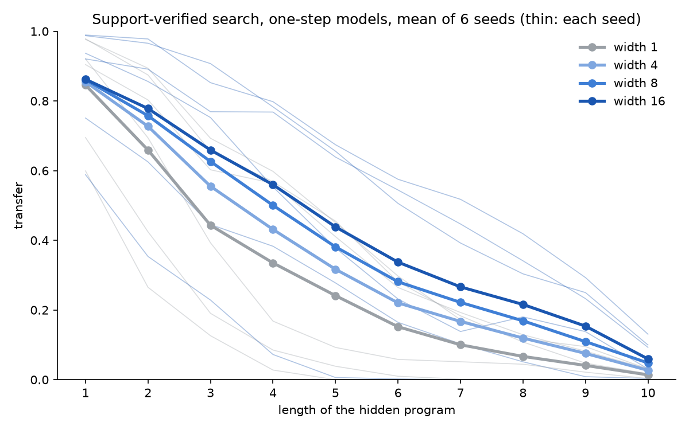
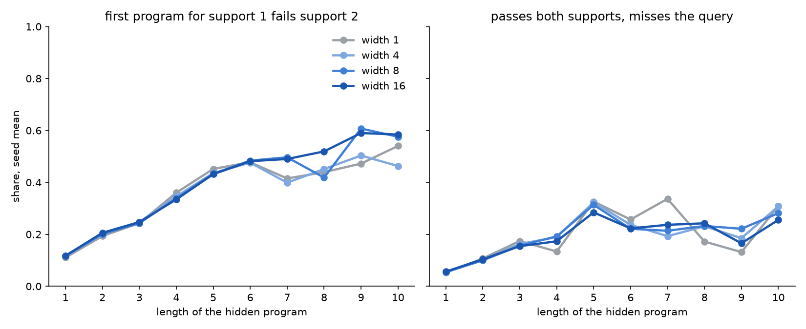
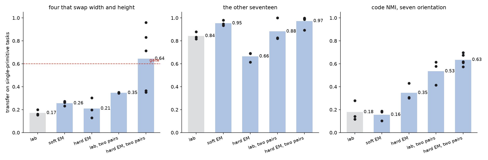
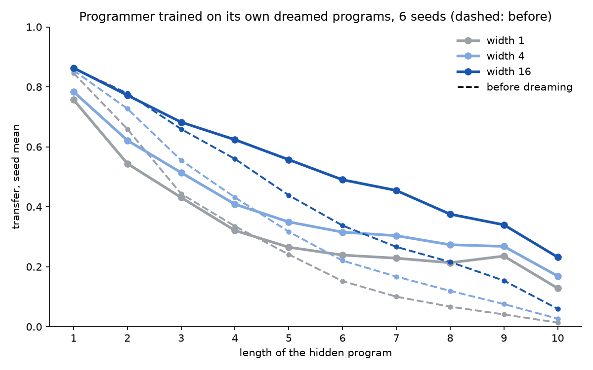

# toy-NEO 프로젝트 전체 정리

2026-11-23 KST, Claude Code가 썼고 같은 날 밤에 오후의 실험을 더했다. 2026-11-20에 레포를 만든 때부터 23일 밤까지의 모든 것을 한 파일에 모은다. 같은 내용의 HTML은 `docs/project-overview.html`이고 `scripts/build_overview_page.py`가 만든다. 근거는 레포의 문서, 보고서, 연구 로그, 코드, run 기록이다. 숫자는 모두 직접 돌려 잰 것이고, 그렇지 않은 것은 그렇다고 적었다. 따로 적지 않으면 seed 42 하나의 결과다. 같은 내용을 그림으로 본 덱은 https://minjunjee.com/autoresearch_report 에 있다.

읽는 순서를 권한다. 1절에서 결론을 보고, 3절과 4절에서 환경과 모델을 익힌 뒤, 5절의 실험을 필요한 만큼 읽는다. 실험마다 문제, 원인 분석, 해결 방안, 실험 설정, 결과의 순서로 적었다.

## 목차

1. 한눈에 보기
2. 왜 이 연구를 하는가
3. 무대: BabyTheorist와 평가 지표
4. 모델: 랩 NEO와 이 레포의 기준 설정
5. 실험
6. 지금까지 알게 된 것과 고친 해석
7. 열린 질문과 사용자가 정할 것
8. 사용자가 정한 원칙과 방향
9. 결정 기록 요약
10. 코드
11. 저장소, 서버, 공개된 정리
12. 문서 지도

## 1. 한눈에 보기

이 레포는 랩의 NEO가 더 어려운 상황에서 어디서 왜 틀리는지를 관찰하는 곳이다. 무대는 격자 퍼즐 벤치마크 BabyTheorist이고, 모델은 랩 NEO 코드를 고치지 않고 들여온 것이다. 사흘 동안 알게 된 것은 다섯 가지이고, 23일 오후와 밤에 셋을 더 알게 됐다.

첫째, NEO가 program 여러 단계를 한꺼번에 학습하면 code가 primitive가 아닌 것으로 굳는다. 단계 사이에 확률을 넘기면 code 둘이 변환 하나의 주소가 되고, 격자만 넘기게 막으면 대충 하는 code와 고치는 code로 나뉜다. 같은 부품을 primitive 하나짜리 pair로 한 단계만 학습하면 이어 쓸 수 있어서, 레벨 1 transfer가 여섯 seed 평균 64%로 랩 설정의 40%보다 높다. 다만 그 pair를 고르는 데 숨은 길이를 썼다. program 길이를 점진적으로 늘리는 일정은 세 seed 중 하나에서만 통했다.

둘째, codebook에 구조를 넣으면 본 적 없는 양이 따라온다. 종류마다 회전 평면을 배우고 각을 고정한 Lie algebra codebook에서 programmer가 종류와 횟수를 말하게 하면, 학습에서 뺀 4칸 이동을 세 seed에서 92%, 99%, 53%로 말한다. 같은 자리에 관계없는 벡터를 두면 0%에서 4%다.

셋째, 환경이 커져도 새 primitive 하나를 배우는 비용은 거의 늘지 않는다. 랩 NEO는 16개부터 64개 환경까지 primitive 하나당 8천에서 1만 6천 pair로 새 것을 반쯤 배운다. 다만 새 것이 옛것을 밀어내서, 처음 8개는 64개 단계 끝에 53%로 내려간다.

넷째, 큰 환경에서 깨지는 것은 부품이 아니라 정답 없는 code 배정이다. 24개 환경에서 회전, 뒤집기, 전치 계열 일곱 개만 15% 근처에 머문다. primitive마다 정답 code를 주면 같은 부품이 83%에서 98%를 해낸다. programmer, executor, code를 고르는 방식, 잠, soft EM 등 라벨 없이 시도한 열세 가지는 9%에서 21%였고 대부분 15% 근처였다. 8배 오래 학습하면 뒤집기 둘은 풀리지만 가로세로를 바꾸는 넷은 남는다.

다섯째, 평가가 틀리게 말하는 경우가 있었다. transfer 하나로는 단계 사이 확률로 넘기는 지름길이 가려지고, 한 단계 학습의 좋은 숫자는 숨은 길이를 쓴 진단이었다. 그래서 transfer를 두 방식으로 재고, 라벨에 기대는 설정은 진단이라고 밝혀 둔다.

여섯째, 긴 program에서 떨어지는 것은 executor가 아니라 programmer의 계획이다. code가 깨끗한 seed에서 정답 program을 그대로 실행하면 길이 8에서도 92%에서 97%를 맞히는데, programmer가 고른 program은 탐색 폭 16에서도 30%에서 42%다. 라벨 없이 programmer가 자기 executor로 만든 여러 단계 program을 꿈처럼 배우게 하면, 폭 16의 길이 8이 seed 평균 22%에서 38%로 오른다.

일곱째, 섞인 code를 푸는 데 빠져 있던 것은 같은 code가 다른 입력에서도 같은 일을 하라는 요구다. pair 하나로 학습하면 hard EM도 soft EM도 회전 계열을 풀지 못하고, hard EM은 code를 입력 모양별 전문가로 쪼갠다. 같은 program을 공유하는 pair 둘을 한 과제로 주고 두 pair를 모두 재현하는 code를 고르게 하면, 가로세로를 바꾸는 넷이 seed 평균 17%에서 seed 셋 56%, 다섯 64%가 되고 한 seed는 96%로 완전히 풀린다. 여러 단계 과제도 따라 나아져서, 24개 환경에서 길이 2의 transfer가 35%에서 78%가 된다. 숨은 program은 쓰지 않지만 pair의 묶음은 쓴다.

여덟째, 처음에 굳은 배정은 그 요구가 있어도 잘 풀리지 않는다. 두 pair hard EM의 seed 다섯 가운데 셋은 7,200스텝 무렵까지 갈라지기 시작해 71%에서 96%로 끝났고, 둘은 넷이 code 하나를 함께 쓴 채 35% 근처에서 멈췄다.

## 2. 왜 이 연구를 하는가

### 2.1 사용자와 장기 목표

사용자는 민준이다. KAIST AI컴퓨팅학과 학부생이고 NEO를 만든 MLML 랩의 인턴이다. 이전 레포의 CLAUDE.md에 적힌 장기 목표는 ASI가 아니라 AGI, 곧 어떤 과제에서든 인간 수준의 적응력과 학습력을 저비용으로 보이는 학습자다. 궁극적으로 추구하는 성질은 extremely fast reusable knowledge이고, 설계 판단에서 사람의 뇌를 강한 reference로 삼는다.

### 2.2 출발점

2026-11-20 오후, 이전 레포 `neo-vocabulary-restructuring`에서 작은 세계 실험을 보고받은 뒤 사용자가 연구를 다시 짜자고 했다.

> 우리 neo 연구 있잖아. 주제를 아무래도 두 축으로 가져가면서 완전히 재구성해야할 것 같아. 첫째는 scaling이야. multi object neo라던지, program length라던지, primitive 개수라던지, 둘째는 Evaluation이야. 지금 neo는 transferability만 있는데, 내 생각에는 Agent가 필요할 거 같아. NEO의 theory가 좋은지 판단할 방법이 없어. … 너무 날개를 달 생각을 하지 말고, 분석을 통해서 나올 수 있는 아주 당연한 질문을 던지는게 맞다고 생각해.

메인 주제는 evaluation으로, scaling은 그 아래의 일로 잡았다. 그리고 사용자가 순서를 정했다. 측정 도구를 먼저 만들지 않고, primitive가 많고 program이 길고 object가 많은 상황에서 NEO를 돌려 무슨 문제가 생기는지부터 관찰한다. 같은 날 저녁에는 NEO 모델 자체를 autoresearch하고 싶고 ARC-AGI-1과 2에서도 돌려 보자고 했다.

이전 레포에서 얻은 교훈이 이 순서의 이유다. NEO가 어디서 왜 틀리는지 모르고 새 부품을 얹으면, 결과가 나쁠 때 본체 탓인지 얹은 부품 탓인지 가를 수 없다. 이전 레포에서 열흘 동안 남아 있던 실패의 원인은 NEO가 아니라 그 위에 얹은 채점 조건에 있었다. 그래서 이전 레포의 부품은 옮기지 않고, 그 결과는 가설로만 가져왔다. 가설은 셋이다. code 둘을 이어 실행할 때 첫 결과를 격자로 풀었다가 다시 읽어야 맞았다는 것, 같은 효과가 방향마다 따로인 code 여럿으로 쪼개지면 합치기 어려웠다는 것, sample 하나에 든 executor 실행 수를 세면 비용이 어디서 드는지 보인다는 것이다.

### 2.3 방향이 바뀐 자리

연구 방향은 사용자의 말로 네 번 바뀌었다.

- 2026-11-22 00:20, 지금은 고치지 않는다. 사용자의 말은 이렇다. "일단 우리는 못하는 걸 보이는 데 집중하고, 왜 못하는지를 분석하는데 집중하자. 그러고 그 후에 그 인사이트를 이용해서 공격적으로 neo를 고쳐나가자." 잠과 새 부품으로 고치려 든 것은 순서가 일렀다.
- 2026-11-22 20:10, 확장성을 가장 먼저 본다. "지금 환경이 너무 단순한거 같은데, 점점 환경이 커지는 환경이라던지 아무튼 확장성을 최우선으로 봐야돼." 작은 환경에서 100%인지 92%인지는 중요하지 않다.
- 2026-11-22 20:24, 연산량이 아니라 적응을 본다. 학습에 쓰는 연산량은 중요하지 않고, 큰 환경에서도 쉽게 적응하는 것, 그 적응이 모든 크기에서 로그 그래프 같은 것이 중요하다. 숫자를 나란히 놓지 말고 그래프를 많이 그려 견준다.
- 2026-11-23 04:07, reuse와 pretraining을 구분한다. 지금까지 확인한 것은 처음부터 하는 pretraining이고, pretraining은 얼마나 걸리든 상관없다.

### 2.4 연구 계획의 원래 모양

`docs/research-plan.md`는 11월 20일에 결과를 보기 전에 쓴 첫 판이다. 첫 관찰로 state encoder와 state decoder가 15칸 격자를 다시 그리는지 보고, 기준 설정인 object 하나, 기본 primitive 여덟, 레벨 1에서 seed 셋을 돌리고, program 길이, primitive 수, object 수를 한 방향씩 키운다. run마다 정확도를 길이별로 나눈 값, 틀린 과제 그림, code 대 primitive 표, code 사용 횟수, 뽑은 길이와 정답 길이의 표를 남긴다. 실패 종류마다 그것을 잡는 측정을 만들고, 그 측정이 transfer를 다시 계산하는지, 쉬운 설정의 측정이 어려운 설정의 정확도를 맞히는지로 쓸모를 시험한다. 실제 진행은 primitive 수와 program 길이 쪽으로 갔고, object 수를 키운 데이터는 만들었지만 학습 결과는 아직 없다.

## 3. 무대: BabyTheorist와 평가 지표

### 3.1 과제

BabyTheorist는 격자 위 object에 숨은 program을 적용하는 벤치마크다. 공개 저장소 `ahn-ml/babytheorist`를 서버의 `/home/minjun_dev/neo-vocabulary-restructuring/runs/external/babytheorist`에 받아 두었다. 학습자는 적용 전후 격자만 본다. 격자는 15칸 곱하기 15칸이고 색은 0부터 9, 0이 배경이다. 평가 과제는 support pair 둘과 query 입력 하나로 되어 있고, 모델은 support pair를 보고 program을 적어 query에 실행한다.

기본 primitive 여덟은 90도 회전, 뒤집기 둘, 다음 색으로 바꾸기, 네 방향 이동이다. 이동은 한 칸이 아니라 object 자신의 높이나 너비만큼 움직인다. 회전은 반시계 방향이고 bbox의 왼쪽 위를 고정한다. 이름이 헷갈리는데, `flip_h`가 위아래를, `flip_v`가 좌우를 뒤집는다. 색은 1에서 9를 돌고 9 다음이 1이다.

모드는 다섯이다. `single-A`는 object 하나에 기본 여덟, `multi-A`는 object 둘에 색 맞바꾸기, 행 맞추기, 열 맞추기를 더한 열하나, `single-B`와 `multi-B`는 레벨이 오르면 속 비우기, 속 채우기, 테두리 더하기가 풀린다. 레벨은 1부터 8이고, 레벨 L의 길이는 L 더하기 1을 중심으로 한 분포에서 뽑는다. `single-A` 레벨 1의 평가 과제는 숨은 길이 1이 28%, 2가 50%다. 학습 쌍의 70%가 primitive 여럿짜리다.

벤치마크의 정해진 절차는 레벨마다 평가해 80% 이상이면 다음 레벨로 가는 것이다. 이전 레포 문서에 옮겨 둔 논문 내용으로는 NEO를 포함한 모든 기준선이 레벨 2에서 멈췄고 `single-A`에서 NEO 점수는 136.8이다. 논문은 Claude Code가 직접 읽지 않았다. 공개 저장소에는 모델 코드, 학습 코드, 체크포인트가 없고, 랩이 논문에서 쓴 NEO 설정은 받지 못했다.

### 3.2 이 레포가 만든 primitive 묶음

BabyTheorist의 object 하나짜리 primitive는 11개가 전부라서, 같은 object 모양 생성기를 쓰는 생성기 `scripts/babytheorist/generate_many_primitives.py`를 만들었다. 묶음은 앞의 것이 뒤의 것에 그대로 들어간다. 8개는 벤치마크의 기본 여덟이고, 16, 24, 32, 52, 64개로 커진다. 크기마다 더해진 primitive는 5.10절의 표에 있다. 따로 네 방향 1칸에서 6칸 이동 24개의 묶음 `shifts`가 있다. 숨은 길이 분포는 레벨 1을 따라 길이 1이 30%, 2가 50%, 3이 12%, 4가 8%이고 `--depths`로 바꾼다. `--train-without`으로 준 primitive는 학습 파일에서만 빠지고 평가 파일에는 들어간다. 평가 과제는 서로 다른 object 셋에 같은 program을 적용해 support 둘과 query 하나를 만든다. 학습 250,000 과제, 평가 20,000 과제다.

### 3.3 평가 지표

| 지표 | 무엇을 재나 |
|---|---|
| 재현, explain | 첫 support pair에서 뽑은 program을 그 pair의 입력에 실행해 출력이 칸 하나 틀리지 않고 나오는 비율. 랩 코드의 self-explanation |
| transfer | 그 program을 query 입력에 실행해 숨은 정답과 격자 전체가 같은 비율. 정답은 보여 주지 않는다. 이 문서의 숫자는 대부분 이것이다 |
| 랩 평가기의 transfer | 실행하다가 정답과 같아지면 멈춰 정답을 한 번 엿본다. transformer NEO의 rollout에서는 엄격한 값과 같다 |
| 일관 transfer | support pair마다 program을 뽑아 다른 support까지 가장 많이 맞히는 program을 쓴다 |
| 확률을 넘기는 방식과 격자만 넘기는 방식 | program의 단계 사이에 칸마다의 색 확률을 넘기는가, 확률이 가장 높은 색만 남긴 격자를 넘기는가. 11월 21일부터 transfer를 두 방식 모두로 잰다 |
| 깊이별 값 | 숨은 program의 primitive 수별로 나눈 값. 숨은 program은 결과를 나눌 때만 읽는다 |
| primitive별 표 | 깊이 1 과제에서 primitive마다 쓰인 code와 그 transfer |

transfer는 같은 code 하나가 support pair와 query 쌍을 모두 재현할 때만 된다. 학습 batch 정답률은 학습 쌍에서 고른 길이의 출력이 정확한 비율이다. 가벼운 평가는 학습 도중 평가 과제 2,000개로, 전체 평가는 학습 끝에 평가 파일 전체로 한다.

### 3.4 ARC에서의 천장

NEO와 무관하게, BabyTheorist의 기본 primitive 여덟을 이어 붙이기만 해서 풀리는 ARC 과제를 전수 탐색으로 셌다. ARC-AGI-1 학습 400개 가운데 8개, 평가 400개 가운데 0개, ARC-AGI-2 평가 120개 가운데 0개다. 결과는 `docs/reports/arc-ceiling/ceiling.json`에 있다. ARC는 모델을 고르는 데 쓰지 않는 온도계로 두자고 제안했고, 사용자의 답은 아직 없다.

## 4. 모델: 랩 NEO와 이 레포의 기준 설정

### 4.1 흐름

모델은 랩 NEO 구조 그대로다. state encoder가 격자를 칸별 token으로 바꾸고, programmer가 지금 state와 목표 state를 보고 code를 고르고, codebook이 그 출력을 가장 가까운 code로 바꾸고, executor가 그 code를 state에 적용하고, state decoder가 다시 격자로 읽는다. programmer와 executor 사이로 건너가는 것은 code 하나뿐이다. 이 점이 5.12절의 회전 계열 문제에서 핵심이 된다.

학습 loss는 다음 state의 칸별 cross-entropy와 codebook loss다. 평가 때는 programmer가 support pair 하나를 보고 가장 가까운 code를 고르고, 아무것도 탐색하지 않는다.

### 4.2 기준 run의 상세 스펙

5.6절 이후 대부분의 비교는 `onestep_s_m24_wide_s42`에서 한 군데씩만 바꾼 것이다. primitive 24개, program 한 단계, 전체 parameter 6.0M이다.

| 부품 | 설계 | 크기 | parameter |
|---|---|---|---|
| state encoder | 칸마다 token 하나, 색 embedding, 위치 정보 없음. 미리 autoencoder로 학습해 얼려 둠 | 10색 × 128 | 1.3k |
| state decoder | affine 없는 LayerNorm 뒤에 칸마다 linear map. 얼려 둠 | 128 → 10 | 1.3k |
| programmer `token_pair_transformer` | 지금 칸과 목표 칸을 칸마다 이어 붙인 token, 2D RoPE transformer, query token | 6층, 폭 256, head 8 | 4.81M |
| codebook | cosine으로 가장 가까운 code, commitment 0.25 | code 48개 × 16차원 | 0.8k |
| executor | 225칸 위의 AdaLN-Zero transformer. code는 입력이 아니라 층마다 scale, shift, gate를 만드는 조절 신호 | 4층, 폭 128, head 8 | 1.19M |
| 학습 | primitive 하나짜리 pair, program 한 단계, AdamW 3e-4에 programmer는 그 0.25배, 코사인으로 10%까지 | batch 128, 24,000스텝 | step당 0.97 TFLOPs |

code 수는 primitive 수의 두 배로 둔다. 한 run이 GPU 하나를 혼자 쓰면 수 분에서 십여 분이다.

### 4.3 랩 설정과 다른 점

랩 설정은 programmer가 지금 칸과 목표 칸을 두 token으로 따로 넣고 폭이 128이다. batch는 512, program은 다섯 단계이고, 단계 사이에 칸마다의 색 확률을 넘긴다. 이 레포는 속도 때문에 칸마다 이어 붙인 programmer를 썼고, 5.12절에서 랩 programmer로 바꿔 봤을 때 결과가 같았다. 단계 사이에 확률을 넘기는 것이 만드는 문제는 5.4절에 있다.

## 5. 실험

시간 순서다. 5.1절부터 5.4절은 랩 설정을 BabyTheorist에 옮겨 처음 본 것, 5.5절부터 5.7절은 학습을 빠르게 하고 못하는 것을 보인 것, 5.8절부터 5.12절은 사용자가 정한 방향인 program 길이, 양, 확장성을 따라간 것이다. 5.13절부터는 23일 오후와 밤에 사용자와 정한 세 실험과 그 뒤의 자율 연구다.

### 5.1 랩 NEO를 GridWorld 설정 그대로 BabyTheorist에

2026-11-20 17:01부터 19:10까지. 근거는 `docs/reports/2026-11-20-first-numbers.md`와 `docs/facts.md` 5절이다.

**문제.** 연구 계획의 첫 관찰이다. 지금의 랩 NEO가 BabyTheorist의 가장 쉬운 설정, 곧 `single-A` 레벨 1에서 무엇을 하는지부터 본다.

**원인 분석.** 랩 GridWorld 설정은 격자 하나를 32차원 latent 하나로 담는다. 15칸 격자와 여러 object를 이 크기가 담는지 모르고, 여기서 틀리면 뒤의 모든 정확도가 함께 낮아져 program이나 code의 문제와 구별되지 않는다. 그래서 state encoder와 state decoder가 격자를 그대로 다시 그리는지를 먼저 쟀다.

**실험 설정.** 랩 CNN state encoder와 state decoder는 격자 크기가 10이 아니면 오류를 내서, 층은 같고 크기 계산만 다른 `cnn_vae_any`를 만들었다. 10칸에서는 랩 부품과 출력이 같다. latent 크기 다섯과 칸마다 token을 두는 방식을 사전학습했다. 그 위에 랩 NEO를 32차원과 256차원 state로, MLP 폭을 키운 변형 둘로, 이동 넷만 쓰는 데이터로 각각 seed 셋씩 학습했다.

**결과.** 32차원 latent 하나는 15칸 격자를 다시 그리지 못한다. 완전히 같은 비율이 object 하나 0.89, 둘 0.60, 셋 0.23이다. 256차원이면 셋 모두 0.997 이상이고, 칸마다 token을 두면 모두 1.0이다. 그런데 latent를 키워도 랩 NEO의 transfer는 0에 가깝다. GridWorld 설정 그대로는 seed 셋 평균 0.02%, 예시 쌍 재현 1%였고, MLP를 넓히거나 primitive를 이동 넷으로 줄여도 0이었다.

**해석.** 격자를 담는 것만의 문제가 아니다. 이 관찰로 칸마다 token을 두는 transformer NEO로 넘어갔다. 공개된 GridWorld 설정으로는 논문의 BabyTheorist 점수가 나오지 않으며, 랩이 논문에서 쓴 설정과 코드는 끝까지 받지 못했다.

### 5.2 transformer NEO의 첫 숫자와 code 대 primitive 표

2026-11-20 19:33부터 21일 03:35까지.

**문제.** 칸마다 token을 두는 랩의 transformer NEO는 BabyTheorist 레벨 1을 얼마나 배우는가. 막힌다면 primitive 하나를 배우는 데서 막히는가, 이어 붙이는 데서 막히는가.

**실험 설정.** 랩 transformer NEO 설정을 15칸 격자로 옮겼다. 스텝당 0.6초라 랩 일정 78,200스텝이면 13시간이므로 첫 학습은 12,000스텝으로 했다. 데이터를 25번쯤 도는 양이다. seed 42부터 46, 그리고 36,000스텝 긴 학습을 돌렸다. 진단으로 primitive 하나짜리 과제만으로 학습한 run과 이동 넷만 쓰는 데이터로 학습한 run을 더했다. 길이 1 과제에서 NEO가 고른 code 번호와 정답 primitive를 센 표를 run마다 남겼다.

**결과.**

| run | 예시 쌍 재현 | transfer |
|---|---|---|
| 12,000스텝, seed 42 | 30.3% | 7.1% |
| 12,000스텝, seed 다섯 | | 7.1%, 24.5%, 17.2%, 3.0%, 16.9% |
| 36,000스텝, seed 42 | 89.8% | 39.8% |
| primitive 하나짜리 과제만으로 학습 | | 23%에서 멈춤, primitive 둘만 배움 |
| 이동 넷만 쓰는 데이터 | 24.8% | 2.3% |

seed마다 차이가 크다. seed 43은 위아래 이동을 각각 code 하나에 담아 seed 42의 세 배가 넘었다. 36,000스텝 일정은 10,800스텝 시점에 이미 12,000스텝 일정보다 훨씬 높아, 짧은 학습의 낮은 값은 학습률 일정 탓이 컸다. code를 얻는 순서는 seed마다 같아서 색 바꾸기, 이동, 뒤집기, 회전 순이다. 체크포인트 열 개를 추적하니 primitive는 code 하나로 굳기 전에 여러 code를 이어 설명하는 단계를 거친다. 길이 1 과제의 절반에서 code를 넷 이상 썼다. 처음에 초반에 갈리고 안 바뀐다고 적은 가설은 틀렸다.

transfer는 같은 code 하나가 예시 쌍과 새 입력 쌍을 모두 재현할 때만 된다. primitive 하나짜리 과제를 이 기준으로 나누면 같은 code 하나가 양쪽을 재현할 때 transfer가 100%이고, programmer가 놓친 code는 거의 없었다. primitive 둘짜리 과제의 transfer는 하나짜리 transfer의 제곱과 거의 같았다. 전체 transfer를 정하는 것은 어떤 입력에서도 통하는 code 하나를 가진 primitive의 수로 보인다.

**해석.** 막히는 곳은 이어 붙이기보다 primitive마다 code 하나를 찾는 일이다. 회전은 이 단계의 어떤 설정에서도 배우지 못했다.

### 5.3 잠: 겹친 code를 합치고 비운 code를 다시 쓰기

2026-11-21 03:20부터 22:20까지. 근거는 `2026-11-20-first-numbers.md`의 5.5절부터 5.12절이다.

**문제.** 사용자가 잠을 넣어 보자고 했다. 학습 곡선의 가로축을 학습에 든 계산으로 그리자고도 했는데, 잠을 넣으면 스텝으로는 그 비용이 보이지 않기 때문이다. 이 요청은 22일 20:24에 연산량은 보지 않는다는 방향으로 바뀌었다.

**원인 분석.** code 8개로 학습한 모델의 14,400스텝 체크포인트에서 색 바꾸기가 code 둘을 차지하고, 회전과 아래로 이동은 code를 얻지 못했다. 색 바꾸기의 두 code는 서로 바꿔 써도 전부 맞았다. 겹친 code 하나를 비우면 code가 없는 primitive에게 줄 수 있다.

**해결 방안과 실험 설정.** 이전 레포의 잠을 옮기지 않고 관찰이 가리킨 동작 하나만 만들었다. 겹친 code 둘을 합쳐 하나를 비우고, 비운 code를 설명하지 못하는 학습 쌍에 배정한다. 받아들이는 조건은 따로 떼어 둔 저장분의 재현이 합치기 전보다 1%p 넘게 떨어지지 않는 것이다. 위 체크포인트에서는 두 code를 합쳐도 저장분 재현이 100%에서 99.1%로만 내려가 받아들였다. 든 계산은 0.40 PFLOPs로 학습 24스텝 분량이다. 거기서 36,000스텝까지 이어 학습했고, 효과가 어디서 오는지 가르려고 대조 둘을 돌렸다. 합치기만 하고 비운 code를 합친 code의 복사본으로 둔 것과, 비운 code를 아무 방향에나 둔 것이다.

**결과.** seed 42 하나다.

| 조건 | 최종 transfer |
|---|---|
| code 8개, 잠 없음 | 44.2% |
| 합치기만 | 44.5% |
| 비운 code를 아무 방향에 | 47.6% |
| 비운 code를 설명하지 못하는 쌍에 배정 | 61.4% |
| code 16개, 36,000스텝 | 39.8% |

효과는 합치기가 아니라 설명하지 못하는 쌍에 code를 배정한 데서 났다. 잠을 넣은 모델은 primitive 여덟 중 일곱을 79% 이상 옮겼다. 그러나 겹친 code가 있는 때는 seed 42에서도 14,400스텝 근처뿐이었고, seed 43에는 그런 쌍이 없었다.

그래서 잠의 동작을 넓혔다. 랩 VQ에 꺼 둔 줄을 더한 자라는 codebook `vq_growable`을 만들고, 설명하지 못하는 학습 쌍이 5% 이상이면 꺼 둔 줄 하나를 켜서 배정한다. 모든 줄을 켜면 랩 VQ와 출력이 같다. seed 42에서 code가 8개에서 14개로 늘고 재현은 68%에서 80%로 올랐지만 transfer는 43.3%로 code 8개 그대로와 같았다. 새 code는 이미 code를 가진 primitive를 입력에 따라 나누는 데 쓰였다. 켤 수 있는 code를 9개로 막고 3,600스텝마다 잠을 넣은 seed 43은 14,400스텝부터 기준보다 낮아 21,600스텝에 34.6% 대 44.6%로 멈췄다.

seed 43의 잠 없는 code 8개 학습은 transfer 42.2%로 seed 42와 같은 자리에서 멈췄지만 이유가 달랐다. 겹친 code가 없고, 뒤집기 둘과 회전이 남은 code 셋을 섞어 쓰며 여러 code를 이은 program으로 설명됐다. 그 program은 새 입력에서 15%만 맞았다.

**해석.** 61%는 seed 하나의 값이었고, 바로 다음 절에서 이것도 다시 읽어야 했다.

### 5.4 단계 사이로 넘어가는 보이지 않는 정보

2026-11-21 20:05부터 22일 새벽까지.

**문제.** 잠 한 번을 넣은 모델은 위아래 뒤집기를 code 하나로, 좌우 뒤집기를 그 code 두 번으로 설명하고 85%가 옮겨 갔다. 두 번 뒤집으면 원래 격자여야 하므로 이상하다.

**원인 분석.** 중간 격자를 봤다. 첫 단계 뒤는 위아래로 뒤집힌 격자다. 둘째 단계는 칸마다의 색 확률을 넘겨받으면 좌우로 뒤집은 정답을 내고, 격자만 넘겨받으면 입력으로 되돌아간다. 랩 transformer NEO 설정은 program의 한 단계가 다음 단계에 칸마다의 확률을 넘기고, 학습된 모델은 격자에 보이지 않는 그 부분으로 정보를 넘긴다. 같은 code가 깨끗한 격자를 받으면 위아래로 뒤집고, 자기가 낸 확률을 받으면 다른 일을 한다.

**실험 설정.** 36,000스텝 학습 다섯을 격자만 넘기는 방식으로 다시 쟀다. 그리고 통로를 학습 때부터 막는 두 모델을 돌렸다. 랩 코드에 있는 `reencode_hard`는 단계 사이에 격자로 풀었다 다시 읽고 gradient를 끊는다. 새 부품 `neo_visible_state`는 다음 단계가 격자에서 시작하되 gradient는 확률을 넘긴 것처럼 흘린다.

**결과.** 격자만 넘기면 다섯의 transfer가 40.0%, 41.8%, 39.8%, 42.8%, 36.8%다. 잠 한 번의 61.4%가 36.8%가 된다. code의 수, 잠, code를 켜는 규칙 가운데 이 값을 움직인 것은 없다. 잠 학습이 18,000스텝 뒤에 배운 것은 전부 단계 사이 확률에 기댄 program이었다. 이후 transfer는 두 방식으로 모두 잰다. 통로를 막고 학습한 모델의 결과는 5.6절에 있다.

**해석.** transfer 정확도 하나로는 이런 지름길이 가려지지 않는다. 그리고 다음 질문은 남는다. 뒤집기와 회전이 어떤 입력에서도 통하는 code 하나를 얻지 못한다.

### 5.5 학습을 빠르게 하고 한 단계짜리 싼 판으로 부품 찾기

2026-11-22 00:25부터 05:00까지. 근거는 `docs/reports/2026-11-22-fast-search.md` 2절과 3절, 표는 `docs/reports/first-numbers/onestep_screens.json`과 `onestep_scale.json`이다.

**문제.** transformer NEO 하나에 6시간이 걸려서는 아무것도 찾을 수 없다. 사용자는 GPU를 제대로 쓰는지, 병목이 무엇인지 물었고, 부수적인 부품과 설정은 직접 범위를 잡아 찾으라고 했다.

**원인 분석.** GPU는 계속 일하지만 행렬곱은 시간의 15%에서 20%뿐이다. 나머지는 layer norm, attention, 원소별 연산이다. token 451개짜리 열을 다섯 단계씩 풀어 돌리면서 스텝마다 kernel을 만 번 가까이 부른다.

**해결 방안.** programmer와 executor의 forward를 `torch.compile`로 묶는 `train.compile: parts`와, 지금 칸과 목표 칸을 칸마다 이어 붙여 token을 451개에서 226개로 줄인 programmer `token_pair_transformer`를 만들었다. 둘 다 쓰면 학습 한 스텝이 batch 128에서 152ms에서 44ms로, 초당 pair가 840에서 2,898로 빨라진다. 컴파일은 숫자를 바꾸지 않는다. 그다음 primitive 하나짜리 학습 쌍만 쓰고 program을 code 하나, 한 단계로 제한한 싼 판을 만들었다. 계산이 다섯 단계짜리의 5분의 1이고 하나에 5분쯤이다. 묻는 것은 부품이 primitive 여덟을 code 하나씩으로 배울 수 있는가다.

**실험 설정.** 80개쯤의 조건을 한꺼번에 돌렸다. programmer 교체와 폭, 안 쓰는 code를 지금의 programmer 출력으로 다시 뿌리는 `vq_restart`, 평가용 가중치 평균, batch, executor 폭과 깊이, commitment 세기, code 차원, code 수를 바꿨다. 평가는 primitive 하나짜리 평가 과제 2,774개다.

**결과.**

| 조건 | 재현 | transfer |
|---|---|---|
| 랩 설정 그대로, seed 둘 | 53%, 17% | 53%, 17% |
| programmer만 교체, seed 둘 | 50%, 73% | 38%, 60% |
| 넓은 programmer와 다시 뿌리기, seed 둘 | 90%, 96% | 69%, 71% |
| 넓은 programmer, 다시 뿌리기 없음, 가중치 평균 끔 | 95% | 89% |
| 넓은 programmer와 폭 256 executor, 다시 뿌리기 | 99.5% | 85% |
| 다시 뿌리기, batch 128로 24,000스텝 | 99.7% | 92% |

느렸던 이유는 code를 못 찾아서였다. 랩 programmer는 executor 크기나 학습률과 무관하게 처음 1,800스텝 동안 code를 하나만 쓴다. programmer를 바꾸면 300스텝부터 배운다. commitment를 0.25에서 1.0으로 올리면 code 셋에서 멈춘다. 다시 뿌리기는 code를 전부 쓰게 해 재현을 올리지만, 뒤집기를 code 다섯에서 일곱으로 쪼개 transfer를 깎는다. 같은 데이터 양이면 batch 512로 6,000스텝보다 batch 128로 24,000스텝이 낫다. 71% 대 92%다. 이동 넷과 색 바꾸기는 모든 조건에서 code 하나로 100% 옮겨 간다. 쪼개지는 것은 뒤집기와 회전이다. 회전은 가로로 긴 object를 돌리는 code와 세로로 긴 object를 돌리는 code로 갈리고, executor 폭을 256으로 하면 100%가 된다. code 수는 primitive 여덟에 code 8개면 40%로 code를 다 찾지 못하고, 10개 97%, 12개 93%, 16개 90%, 32개 84%다. 남는 code가 적을수록 쪼개기가 줄어 transfer가 오른다.

**해석.** 이 판에서 고른 부품이 4.2절의 기준 run이 됐다. 폭 256 `token_pair_transformer`, 다시 뿌리기 없음, 가중치 평균 끔, batch 128, 24,000스텝, code는 primitive 수의 두 배다.

### 5.6 찾은 부품을 다섯 단계 모델에 넣기: code가 주소가 된다

2026-11-22 새벽부터 13:44까지. 근거는 `2026-11-22-fast-search.md` 4절부터 6절, 10절이다.

**문제.** 싼 판에서 고른 부품이 랩의 다섯 단계 모델도 고치는가.

**실험 설정과 결과.** 단계 사이에 랩처럼 확률을 넘기는 다섯 단계 모델 `fast_neo`에 넣었다. code 차원 4에 끌어당기는 gradient를 끈 조건이 7,200스텝에 재현 81%로, 랩 설정이 36,000스텝에 닿은 재현에 다섯 배 빨리 닿았다. 그런데 transfer는 13%다. 6,000스텝 체크포인트를 격자만 넘겨 재면 재현이 76.3%에서 2.3%로 떨어진다. 이 모델이 primitive 하나짜리 과제에 쓰는 program에는 code 하나짜리가 없다. 전부 code 둘이고, 같은 primitive에 쓰는 code 쌍이 색 바꾸기 17가지, 좌우 뒤집기 78가지다.

**원인 분석.** code 하나가 격자 위의 연산이 아니라, code 두 개가 합쳐져 변환 하나를 가리키는 주소가 된다. 첫 단계가 주소의 앞자리를 확률에 적고 둘째 단계가 뒷자리와 합쳐 실행한다. 부품을 재현이 빨리 오르는 쪽으로 고를수록 이 해로 곧장 간다. NEO의 학습 목표는 예시를 다시 만들기만 하면 채워지고, 단계마다 격자 위의 연산 하나를 하라는 요구는 어디에도 없다.

**격자만 넘기며 학습하기.** 같은 빠른 부품으로 랩의 `reencode_hard`와 새 `neo_visible_state`를 돌렸다. 랩 programmer로는 둘 다 20% 근처에서 불안정했던 것들이다.

| 모델 | 재현 | transfer | 숨은 길이 1, 2, 3, 4의 transfer |
|---|---|---|---|
| 랩 설정, 36,000스텝, 격자만 넘겨 평가 | 83.2% | 40.0% | 57%, 39%, 28%, 21% |
| 빠른 부품, `reencode_hard`, 12,000스텝 | 84.1% | 37.6% | 54%, 36%, 26%, 20% |
| 빠른 부품, `neo_visible_state`, 10,800스텝 | 69.6% | 29.6% | 49%, 28%, 15%, 9% |

랩 설정의 자리에 3분의 1의 스텝으로 닿지만 transfer는 같은 40% 근처다. 주소는 막혔지만 이번에는 code가 primitive 하나를 온전히 하는 연산이 아니라, 대충 하는 단계와 고치는 단계로 나뉜다. 마지막 격자만 맞으면 loss가 0이므로 학습은 이것을 막지 않는다. seed 셋으로 재면 code 16개가 평균 31.9%, 12개가 44.6%다.

### 5.7 한 단계로만 배운 모델은 이어 쓸 수 있다

2026-11-22 오전부터 14:04까지. 근거는 `2026-11-22-fast-search.md` 7절부터 13절이다.

**문제.** 여러 단계를 한꺼번에 학습하는 방식이 code를 망가뜨린다면, 한 단계로 배운 code는 이어 쓸 수 있어야 한다.

**실험 설정.** 5.5절의 한 단계 모델을 추가 학습 없이 평가 때만 program 다섯 단계까지 쓰게 하고 격자만 넘겼다. programmer가 목표를 보고 첫 primitive의 code를 고르고, executor가 낸 격자를 다시 본 programmer가 다음 code를 고른다.

**결과.**

| 모델 | 재현 | 레벨 1 transfer | 숨은 길이 1, 2, 3, 4, 5 이상 |
|---|---|---|---|
| 랩 설정, 여러 단계 36,000스텝 | 83.2% | 40.0% | 57%, 39%, 28%, 21%, 10% |
| 한 단계로만 학습, code 16개, seed 42 | 87.2% | 83.2% | 97%, 87%, 69%, 62%, 29% |

seed 여섯의 이어 쓴 레벨 1 transfer는 83.9%, 83.2%, 76.9%, 64.3%, 42.8%, 31.4%로 평균 63.8%다. primitive 하나짜리 transfer를 따라간다. seed 46은 code를 6개만 찾았고 seed 43은 위아래 이동이 code 둘로 쪼개졌다. 레벨 3 전체 transfer는 랩 설정 17%, 한 단계 모델 56%다. 레벨 5와 7에서는 38.8%와 20.5%이고, 길이 하나마다 0.8배쯤으로 줄다가 길이 6부터 빨리 준다.

**한계.** 한 단계 학습은 숨은 program의 길이를 읽어 primitive 하나짜리 학습 쌍만 골랐다. 진단이지 벤치마크 점수가 아니다. 길이 정보 없이 전체 학습 쌍으로 한 단계 학습을 하면 이어 쓴 transfer가 code 16개 18.7%, 32개 34.8%다. 학습 쌍의 70%가 primitive 여럿짜리라 code가 그쪽에 쓰인다.

**여러 단계 학습이 망가뜨린다.** 되는 한 단계 모델에서 여러 단계 학습을 이어 가면, 전부 학습하든 programmer만 학습하든, 학습률이 3e-4든 3e-5든, grounding 항을 켜든 끄든 150스텝에서 300스텝 사이에 무너진다. 끝의 transfer는 6%에서 19%다. 학습률 3e-5에 grounding 항을 끈 조건만 천천히 내려가 2,400스텝에 50%다. 같은 부품으로 처음부터 여러 단계 학습을 6,000스텝 돌린 대조는 transfer 5.6%다. 망가지는 것은 programmer가 code를 고르는 능력이다. 격자만 넘기면 gradient가 단계를 건너지 못해 loss가 고른 길이의 마지막 단계에만 닿고, programmer가 받는 신호는 "지금 격자에서 code 하나로 최종 목표에 가장 가깝게 만들어라"가 된다. 목표가 두 단계 이상 떨어져 있으면 이것은 다음 primitive를 고르라는 요구와 다르다. 이 해석은 실험으로 가르지 않았다.

**primitive 수와 program 길이를 늘리기.** 사용자가 22일 00:20에 정한 대로, 고치기 전에 못하는 것부터 보였다. BabyTheorist의 object 하나짜리 primitive는 11개가 전부라 같은 object 모양으로 32개까지 늘린 데이터를 직접 만들었다.

| primitive 수 | code 수 | primitive 하나짜리 transfer | code 하나로 90% 넘게 옮겨 가는 primitive |
|---|---|---|---|
| 8, 직접 만든 데이터 | 16 | 96.4% | 8개 중 7개 |
| 11, BabyTheorist | 22 | 97.9% | 9개 |
| 16 | 32 | 58.9% | 16개 중 6개 |
| 24 | 48 | 62.8% | 24개 중 9개 |
| 32 | 64 | 73.2% | 32개 중 17개 |
| 32, executor 폭 256 | 64 | 85.3% | 32개 중 21개 |

11개까지는 거의 다 되고 16개부터 무너진다. 회전, 뒤집기, 전치는 16개 이상에서 8%에서 24%이고 primitive 하나에 code가 넷에서 일곱 개 붙는다. 이동은 code의 기준이 바뀌면서 무너진다. 24개에서는 맨 위까지 붙이는 이동이 더해지자 위로 가는 code가 primitive가 아니라 칸 수로 나뉜다. 위로 2칸인 과제 89개가 두 primitive에 걸쳐 같은 code 하나다. 예시 하나로는 "위로 3칸"과 "자기 높이인 3칸만큼 위로"가 구별되지 않는다. 속 비우기, 테두리, 확대, 거울 같은 모양을 바꾸는 primitive는 88%에서 100%로 잘 배운다.

**해석.** 이 시점의 정리는 넷이다. 여러 단계 학습이 code를 망가뜨린다. 한 단계 학습은 숨은 길이를 읽어야 하고 seed에 따라 31%에서 84%로 갈린다. primitive가 16개를 넘으면 회전과 뒤집기 계열이 빠지고 이동의 기준이 칸 수로 바뀐다. program이 길어지면 길이 6부터 급히 떨어진다. NEO가 40%에서 멈추는 이유를 codebook 크기, 잠, 단계 사이 통로에서 찾았는데 그것들은 곁가지였다. 예시 하나를 여러 code로 한꺼번에 설명하게 학습시키면, 설명만 되면 되는 목표 아래에서 code가 primitive가 아닌 것으로 굳는다.

### 5.8 program 길이를 점진적으로 늘리기

2026-11-22 23:02부터 23일 02:40까지.

**문제.** 한 단계 모델은 이어 쓰면 잘 풀지만, 거기서 다섯 단계 학습을 이어 가면 수백 스텝 안에 83%에서 16%로 무너진다. 사용자는 program 길이를 1, 2, 4, 8처럼 점진적으로 키워 데이터를 주는 방식을 제안했다.

**원인 분석.** 앞 절의 관찰대로 단계 사이에 확률을 넘기면 code 둘이 primitive가 아니라 주소가 되고, 격자만 넘기게 막으면 대충 맞춘 뒤 다음 code가 고치는 식이 된다. 모델이 primitive 대신 loss를 낮추는 지름길을 배운다. 학습률을 10분의 1로 낮추고 grounding 항을 꺼도 48%까지 내려가 늦춰질 뿐 막히지 않는다. Claude Code는 점진적 일정도 같은 지름길을 만날 것이라 예측했다.

**해결 방안과 실험 설정.** 한 단계 모델에서 출발해 먼저 rollout 길이 2까지, 숨은 깊이 2 이하인 pair로 3,000스텝, 그다음 길이 4까지, 깊이 4 이하인 pair로 3,000스텝 학습한다. 학습률 3e-5에 grounding 항을 끈 쪽과 기본 학습률 쪽을 함께 돌렸다. 효과가 어디서 오는지 가르는 대조 둘을 넣었다. rollout은 길이 2로 줄이되 모든 깊이의 pair를 주는 것과, rollout은 길이 5인데 깊이 2 이하 pair만 주는 것이다. 데이터 생성기에 `--depths` 옵션을 더했다.

**결과.**

| 조건 | 3,000스텝 끝 transfer |
|---|---|
| seed 42, 길이 2 단계 | 82% |
| seed 42, 길이 4 단계 | 84% |
| rollout 길이 2, 모든 깊이 pair | 25%. 300스텝에 15%로 무너짐 |
| rollout 길이 5, 깊이 2 이하 pair | 85% |
| seed 43, 출발 43%에서 길이 2 뒤, 길이 4 뒤 | 41%, 12% |
| seed 44, 출발 64%에서 길이 2 뒤, 길이 4 뒤 | 28%, 25% |

seed 42에서는 두 단계 내내 83% 근처를 지켜 예측과 반대였다. 그런데 효과는 rollout 길이가 아니라 지금 허락된 길이로 설명할 수 없는 pair를 빼는 데서 나왔다. 그런 pair를 억지로 맞추려 할 때 code가 휜다는 것이 해석이다. 그리고 seed 43과 44에서는 무너졌다. 세 seed 평균은 출발 63%, 길이 2 뒤 50%, 길이 4 뒤 40%다. seed 42의 한 단계 모델은 primitive마다 code가 거의 하나씩이었고, 43과 44는 이동이나 뒤집기가 code 둘로 갈라져 있었다. 출발 모델의 code가 깨끗해야 길이를 늘려도 버티는 것으로 보이지만 세 seed로는 확정할 수 없다. 깊이를 제한하려면 숨은 program의 깊이를 알아야 하므로, 이 방식은 지금 형태로는 라벨에 기댄다.

### 5.9 양을 code에 담기: 학습하지 않은 칸 수를 말할 수 있는가

2026-11-22 18:10부터 23일 04:42까지. 글로 된 기록은 `docs/reports/2026-11-22-kind-and-amount.md`의 1절부터 8절이고, 9절 이후는 연구 로그와 덱에만 있다.

**문제.** 사용자가 낸 생각에서 출발했다. 잠에서 action 공간을 일반화할 때 회전이 들어간다면, 회전을 so(n)의 반대칭 행렬에 지수사상을 씌워 나타낼 수 있다. 그렇다면 한 칸, 두 칸, 세 칸 이동을 배운 모델이 네 칸 이동을 학습하지 않고도 말할 수 있어야 한다. 묻는 것은 하나다. 학습에서 뺀 양이 따라 나오는가.

**원인 분석.** 학습 없이 이미 있는 24개 모델부터 들여다봤다. 위로 1칸부터 5칸까지 옮기는 pair가 가장 많이 고르는 code 다섯은 이웃끼리 cosine이 0.85에서 0.92이고, 퍼진 정도의 85%가 한 직선에, 95%가 한 평면에 있다. 시키지 않아도 code를 한 평면의 호 위에 순서대로 늘어놓는 것이다. 그런데 2칸 code를 3칸 code로 옮기는 회전을 한 번 더 적용한 벡터는 학습된 4칸 code와 cosine이 0.94인데도, executor에 주면 정확히 4칸 옮기는 비율이 32%다. code가 놓인 모양과 executor가 하는 일은 별개다.

**해결 방안과 실험 설정.** 데이터는 `generate_many_primitives.py --primitives shifts`로 만든 네 방향 한 칸에서 여섯 칸 이동 24개다. `data/babytheorist/shifts24_without4`는 네 칸 이동 넷을 학습 파일에서 뺐고 평가 파일에는 24개가 다 있다. 학습 15만 과제, 평가 12,000 과제, program은 모두 primitive 하나짜리다. 학습은 program 한 단계, code 48개, batch 128, 24,000스텝, 폭 256 `token_pair_transformer` programmer다. 시도는 네 갈래였다.

1. 종류와 양으로 부르는 codebook `vq_orbit`. code를 종류 g와 정수 양 t로 부르고, 종류마다 16차원 시작 벡터 b_g와 16×16 행렬 M_g만 배운다. A_g = M_g − M_g^T는 반대칭이라 exp(A_g)는 회전이다. code는 c(g, t) = exp(t·A_g)·b_g다. 양 1, 2, 3, 5, 6이 학습되면 고른 적 없는 양 4의 자리도 계산식으로 정해진다. 대조로 직선 위에 놓는 형태와 번호만 붙이고 벡터는 독립으로 두는 형태를 같은 부품에 넣었다. 독립으로 두면 랩 VQ와 출력이 같다는 것을 테스트로 확인했다.
2. 양이 더해지게 하는 학습 항 `neo_compose`. 같은 종류의 code (g, a)와 (g, b)를 뽑아, (g, a)를 실행한 격자에서 (g, b)를 실행한 결과를 목표로 두고, 같은 입력에서 (g, a+b)를 한 번 실행한 출력이 그 목표와 같아지도록 칸별 cross-entropy로 학습한다. 목표 쪽에는 gradient를 흘리지 않는다.
3. code 하나와 실행 횟수로 된 program `neo_repeat`. 한 칸 code를 네 번 이어 실행하면 네 칸이 된다는 관찰에서 나왔다. 횟수는 1에서 6이고, 횟수는 support pair를 가장 잘 재현하는 값을 탐색해 고른다.
4. 종류와 양을 programmer가 함께 말하는 모델 `neo_counted`. 사용자가 "3칸 이동을 1칸 이동 세 번으로 설명하게 하면 되지 않느냐"고 물어서 만들었다. programmer가 종류와 양을 고르고, executor는 그 종류의 단위 code를 양만큼 반복 실행한다. codebook은 Lie algebra 형태다. 처음에는 회전 각까지 배우게 했는데 학습 중 각이 줄어 양 1부터 6의 항목이 cosine 0.94에서 1.00으로 모였다. 그래서 각을 0.4 rad로 고정하고 회전 평면만 배우는 형태로 바꿨다. 아래에서는 이것을 회전 각을 고정한 Lie algebra codebook이라고 부른다.

**결과.** codebook에 구조만 넣은 첫 시도는 학습하지 않은 양을 내지 못했다. primitive마다 평가 과제 300개로 쟀고 seed 42 하나다.

| 모델 | 학습한 20개, 설명 / transfer | 네 칸, code 하나 | 네 칸, code 둘짜리 program | 네 칸, code 하나를 반복 |
|---|---|---|---|---|
| 랩 VQ | 90.5% / 85.7% | 0% / 0% | 51.1% / 42.6% | 100% / 95.3% |
| 회전 codebook | 100% / 100% | 3.4% / 1.7% | 84.0% / 77.9% | 100% / 93.8% |

회전 codebook에서도 어느 code를 주어도 네 칸 pair를 재현하는 비율이 8%를 넘지 않았다. 같은 종류 안에서 이웃한 양끼리 이웃한 자리에 앉았지만, 종류가 방향과 맞지 않았고 네 칸 자리를 비워 두지 않았다. 데이터에 네 칸이 없으니 그 자리를 비울 이유가 모델에게 없다. 한편 회전 codebook은 code를 훨씬 빨리 찾았다. 2,400스텝의 설명률이 랩 VQ 7%에 비해 82%였다.

덧셈을 loss로 건 시도는 모두 학습을 망가뜨렸다. 네 칸 설명률은 회전 6%, 부호 있는 양 0%, 직선 0%, 독립 벡터 0%였고 학습한 20개도 69%, 74%, 28%, 0%로 내려갔다. 3,000스텝부터 켜면 82%에서 19%로 떨어졌다. 원인은 번호의 덧셈과 primitive의 합성이 맞지 않는 데 있다. 이 항은 양 1 자리와 양 3 자리를 이은 결과를 양 4 자리에 요구하는데, 어느 primitive가 어느 번호에 앉을지는 가장 가까운 code를 고르는 규칙이 우연히 정한다. executor가 두 요구를 다 맞추는 길은 code를 무시하는 것이고, 독립 벡터 조건이 실제로 그렇게 무너졌다.

양은 실행 횟수에 이미 들어 있었다. code 하나를 1번에서 6번 이어 실행하는 탐색으로는 네 칸을 학습하지 않은 두 모델 모두 네 칸 pair를 100% 재현했다. 한 칸 code를 네 번, 또는 두 칸 code를 두 번 실행한 것이다. 한 단계로만 학습한 executor가 같은 code를 여섯 번 이어 실행해도 틀리지 않는다. `neo_repeat`는 code 12개와 6개에서 끝 checkpoint에 학습한 20개와 네 칸 4개가 설명률과 transfer 모두 100%였다. 방향마다 code 하나를 쓰고 칸 수를 횟수로 적는다. code 8개는 같은 code가 pair마다 다른 칸 수를 옮기는 상태로 끝나 transfer 50%였고, code 4개는 8%였다. 다만 이 모델은 횟수를 정답 격자와 견줘 고르므로, 모델이 pair를 보고 양을 말하는 것은 아니다.

회전 각을 고정한 Lie algebra codebook은 programmer가 스스로 고른 종류와 횟수로 학습에서 뺀 4칸 이동을 풀었다. checkpoint마다 잰 값이다.

| seed | 끝 checkpoint의 4칸 transfer | 비고 |
|---|---|---|
| 42 | 92% | 21,600스텝 94% |
| 43 | 99% | |
| 44 | 53% | 21,600스텝 76%였다가 끝에 학습한 이동까지 57%로 떨어짐 |
| 대조: 항목을 관계없는 벡터로 둠, 세 seed | 0%에서 4% | 학습한 20개는 78%까지 감 |

두 조건의 차이는 항목이 회전으로 묶였는지 하나뿐이다. 양 4의 자리는 학습 중 한 번도 골라지지 않지만 계산식 때문에 3과 5 사이에 놓이고, 관계없는 벡터는 초기값 자리에 남는다. 앞서 사용자에게 seed 44를 94%라고 한 것은 학습한 이동까지 합친 가벼운 평가를 잘못 읽은 것이라 고쳤다.

**해석과 한계.** codebook에 구조를 넣으면 본 적 없는 양이 따라온다. 양이 더해진다는 성질은 loss로 가르치지 않고 실행 방식으로 보장해야 했다. 이 결과는 이동 24개라는 작은 묶음에서만 본 것이고, seed 44가 불안정했으며, 커지는 환경에 넣은 같은 모델은 처음 8개를 지키지 못했다. 5.11절에서 다시 다룬다.

### 5.10 크기 사다리: primitive 8개에서 64개까지

2026-11-22 20:10부터 22:30까지. 그림은 `docs/reports/2026-11-22-scaling.html`에 있다.

**문제.** 사용자가 정한 방향이다. 토이 환경에서 100%냐 92%냐는 중요하지 않고, 환경이 커져도 잘 적응하는지, 성능이 크게 떨어지지 않으면서 학습하는지를 봐야 한다. 그래서 primitive 수만 늘려 같은 모델이 어떻게 변하는지 그래프로 봤다.

**실험 설정.** primitive 묶음을 8, 16, 24, 32, 52, 64개의 여섯 크기로 만들고, 앞 크기의 묶음이 뒤 크기에 그대로 들어가게 했다. 크기마다 더해진 primitive는 다음과 같다.

| 크기 | 더해진 primitive |
|---|---|
| 8 | rot90, flip_h, flip_v, next_color, translate_up, translate_down, translate_left, translate_right |
| 16 | shift_up, shift_down, shift_left, shift_right, rot180, rot270, transpose, prev_color |
| 24 | to_top, to_bottom, to_left, to_right, anti_transpose, color_plus3, hollow, add_border |
| 32 | fill_bbox, invert_in_bbox, scale2, stretch_w, mirror_right, mirror_left, mirror_down, mirror_up |
| 52 | 네 방향 2, 3, 5, 6칸 이동 16개. 4칸 이동 넷은 학습에서 뺐다 |
| 64 | color_plus2, color_plus4, color_plus5, color_plus6, 대각선 1칸과 2칸 이동 8개 |

데이터는 `SET_52`, `SET_64`와 `many_p{8,16,24,32,52,64}`이고, 학습은 primitive 하나짜리 pair로만, 크기마다 처음부터 같은 24,000스텝이다. 랩 NEO, code 하나 반복, 회전 각을 고정한 Lie algebra codebook을 같은 사다리에 올렸다.

**결과.** 랩 NEO의 학습 batch 정답률은 여섯 크기에서 처음 5,000스텝 근처까지 거의 겹친다. 50%에 닿는 스텝은 8, 16, 24, 32개에서 4,250에서 4,750이고 52개와 64개는 3,500이다. 환경이 커져도 배우는 속도는 느려지지 않는다. 갈리는 것은 닿는 높이다.

| 크기 | 8 | 16 | 24 | 32 | 52 | 64 |
|---|---|---|---|---|---|---|
| 학습 batch, 끝 | 99% | 93% | 80% | 92% | 93% | 93% |
| transfer, 끝 | 97% | 59% | 61% | 74% | 80% | 80% |

처음 8개의 transfer는 8개 환경에서 96%인데 16개 환경에서 60%이고 그 뒤로 53%에서 61%다. 같은 primitive에 같은 학습량이다. 16개에서 들어온 것은 rot180, rot270, transpose처럼 기존 회전과 뒤집기와 비슷한 일을 하는 primitive다. 32개에서 들어온 bbox 채우기나 확대처럼 기존 것과 겹치지 않는 것은 98% 근처이고 해를 끼치지 않는다. 52개와 64개에 더한 것은 대부분 쉬운 이동이라 64개 환경의 transfer가 16개와 24개보다 높다. primitive 수만으로는 환경의 어려움을 잴 수 없다.

숨은 program 길이별로 보면, 모든 모델이 primitive 하나짜리로만 학습했으므로 길이 2 이상은 처음 보는 과제다. 단계마다 격자로 읽어 다음 code를 고르는 방식으로 잰 transfer다.

| 크기 | 길이 1 | 길이 2 | 길이 3 | 길이 4 |
|---|---|---|---|---|
| 8 | 97% | 84% | 62% | 35% |
| 16 | 58% | 33% | 16% | 7% |
| 24 | 61% | 33% | 14% | 4% |
| 32 | 74% | 34% | 11% | 4% |

16개 이상에서는 길이가 하나 늘 때마다 대략 절반이 된다. 길이 1의 transfer를 길이만큼 곱한 값에 가깝다.

### 5.11 커지는 환경: 새 primitive 하나를 배우는 비용

2026-11-22 20:57부터 23일 01:30까지.

**문제.** 사용자가 예로 든 점점 커지는 환경이다. 사용자는 학습 연산량은 중요하지 않고, 큰 환경에서도 쉽게 적응하는 것, 그 적응이 모든 크기에서 로그 그래프처럼 보이는 것이 중요하다고 했다.

**실험 설정.** 모델 하나가 학습을 멈추지 않는 동안 환경이 8, 16, 24, 32, 52, 64개로 커진다. 단계마다 6,000스텝이고 그 단계의 전체 묶음으로 학습한다. codebook은 처음부터 마지막 크기인 128개다. 모델은 랩 NEO, code 하나 반복, 반복 실행 사이 gradient를 끊은 것, 공유 up-projection과 code별 low-rank를 둔 executor, 회전 각을 고정한 Lie algebra codebook이다. 대조는 환경을 8개로 둔 채 단계만 나눈 사슬로, 단계가 바뀔 때의 하락이 학습률 일정의 재시작 때문인지 새 primitive 때문인지 가른다. 새 primitive 하나의 비용은 새로 들어온 묶음이 transfer 50%에 닿을 때까지 primitive 하나당 본 pair 수로 센다. batch 128에 그 단계의 학습 primitive 수로 나눈 값이다.

**결과.** 랩 NEO는 환경이 커질 때마다 기존 묶음이 잠깐 떨어졌다가 1,000에서 2,000스텝 안에 돌아온다. 환경을 8개로 둔 대조에는 단계가 바뀔 때 하락이 없으니, 하락은 새 primitive 때문이다.

| 모델 | 16 | 24 | 32 | 52 | 64 |
|---|---|---|---|---|---|
| 랩 NEO, 50%까지 스텝 | 1,000 | 3,000 | 2,000 | 4,000 | 5,000 |
| 랩 NEO, primitive 하나당 pair | 8,000 | 16,000 | 8,000 | 10,667 | 10,667 |
| 랩 NEO, 처음 8개의 단계 끝 transfer | 73% | 71% | 74% | 62% | 53% |
| 환경을 8개로 둔 대조, 같은 시점 | 79% | 98% | 98% | 98% | 98% |

스텝으로 세면 늘지만 그것은 batch가 더 많은 primitive에 나뉘기 때문이고, primitive 하나당 본 pair로 세면 16개부터 64개까지 8천에서 1만 6천으로 거의 평평하다. 이 의미에서 랩 NEO의 적응 비용은 로그보다 완만하다. 다만 새 것이 옛것을 밀어낸다. 처음 8개는 52개와 64개 단계 끝에 62%와 53%로, 같은 시간 8개만 본 대조의 98%보다 크게 낮다. 회전 계열은 이 사슬에서 끝까지 5%에서 44%였다.

code 하나 반복 모델은 52개와 64개 단계에서 새 것을 primitive 하나당 2천에서 3천 pair로 배워 더 싸지만, 그 묶음이 한 칸 이동을 반복하면 되는 여러 칸 이동이라 유리하게 생겼다. 일반적인 성질로 읽으면 안 된다. 같은 모델은 16개로 커질 때 처음 8개를 잃었다. gradient를 끊은 형태에서 74%가 37%로 떨어졌다. 회전 각을 고정한 Lie algebra codebook 모델은 이 사슬에서 처음 8개가 단계 끝마다 5%에서 39%에 머물러 작은 이동 묶음에서의 결과가 넘어오지 않았다. code별 network로 처음부터 학습한 사슬은 첫 단계 3,000스텝에 transfer 1%라 멈췄다.

### 5.12 회전 계열: 큰 환경에서 무너지는 일곱 개

2026-11-22 22:30부터 23일 05:31까지. 이번 라운드의 마지막 절반을 이 원인을 찾는 데 썼다.

**문제.** 회전, 뒤집기, 전치 계열 일곱 개는 rot90, rot180, rot270, flip_h, flip_v, transpose, anti_transpose다. 8개 환경에서는 이 계열이 셋뿐이고 91%에서 99%다. 24개 환경에서는 일곱 개 모두 12%에서 20%이고 나머지 17개는 82%다. 큰 환경에서 무너지는 것이 거의 이 계열 하나다. 이 계열은 90도 회전과 뒤집기로 다 만들어진다는 것을 생성기에서 확인했다.

**원인 분석.** 의심한 것을 하나씩 확인했다. 이 계열이 쓰는 code 여덟의 cosine 평균은 0.24로 나머지 code끼리의 0.28보다 높지 않아, code 벡터가 너무 비슷한 것은 아니다. 같은 입력에서 다른 계열 primitive가 똑같은 출력을 내 pair 하나로 구별이 원리적으로 안 되는 경우는 4%에서 23%로 일부다. 회전 계열의 생성원인 rot90, flip_h, flip_v만 학습시키면 셋의 transfer가 38%, 77%, 95%이고, 학습에서 뺀 넷은 여러 단계로 조합해 36%다. 일곱을 다 학습시켰을 때 13%에서 20%이던 것보다 높다. 비슷한 것이 함께 있을 때 섞인다는 신호다.

처음에는 executor가 이 계열을 한꺼번에 담지 못한다고 해석했다. codebook의 어느 code로도 90도 회전을 5% 넘게 재현하지 못했고, executor 폭을 두 배로 하면 일부 돌아왔기 때문이다. 32개 환경에서 폭 256 executor는 이 계열 평균 49%였다. 이 해석은 뒤에서 틀린 것으로 드러났다.

결정적인 확인은 둘이다. primitive마다 code 하나를 정답으로 정해 주는 진단 `neo_oracle`에서 같은 공유 랩 executor가 이 계열을 83%에서 98%, 나머지를 100%로 해낸다. 그리고 programmer 출력에 선형 분류기를 붙여 일곱을 가르는 정확도는 보통 학습에서 38%, 우연 수준 14%인데, 정답 code로 학습한 programmer에서는 82%다. 8개 환경 모델은 셋을 97%로 가른다. 세 부품 모두 배울 수 있다.

원인은 programmer가 이 계열을 어느 code로 보내는지 세어서 찾았다. 90도 회전, 270도 회전, 전치, 반대 전치 넷이 모두 code 39와 8로 간다. 넷은 object의 bbox 가로세로를 바꾼다는 공통점이 있다. 이렇게 되면 스스로 유지되는 고리가 생긴다. code 하나가 네 변환을 맡고, executor는 그 평균을 맞추려다 어느 것도 맞추지 못하고, 그래서 90도 회전에 더 나은 code가 생기지 않고, programmer는 넷에 대해 같은 목표를 받는다. VQ를 k-means로 보면 덩어리 하나를 쪼개야 하는데, 점에 해당하는 programmer 출력이 서로 다르지 않은 상황이다. 정답 없는 code 배정이 비슷한 변환끼리 섞인 채 굳는 것이 원인이다.

**해결 시도와 실험 설정.** 모두 24개 환경, seed 42다. 처음부터 학습한 시도는 기준 run과 같은 24,000스텝이다. 이어 가는 시도는 랩 run의 24,000스텝 끝에서 학습률 1e-4로 12,000스텝을 더 학습했고, 같은 12,000스텝을 그냥 이어 학습한 대조와 견준다. 표의 출발 열이 그 구분이다.

| 시도 | 출발 | 무엇을 바꿨나 | 회전 계열 평균, 범위 | 나머지 17개 |
|---|---|---|---|---|
| 랩 NEO, 출발점 | 처음부터 | 기준 run | 16%, 13%에서 20% | 82% |
| 랩 programmer | 처음부터 | 지금 칸과 목표 칸을 두 token으로 넣는 원래 구조 | 16% | 79% |
| 두 배 깊은 programmer | 처음부터 | 12층 | 16% | 88% |
| code마다 executor 하나 | 이어서 | 다 배운 랩 executor를 code 48개에 복사해 이어 학습. 사용자의 제안 | 17% | 90% |
| 공유 executor와 code별 low-rank | 처음부터 | up-projection은 공유, down-projection은 code별, rank 8. 사용자의 제안 | 16% | 82% |
| 공유 2층, code별 2층 | 처음부터 | 층 단위로 공유와 code별을 나눔. 사용자의 제안 | 9% | 49% |
| 실행으로 code 고르기, 후보 4개 | 이어서 | programmer가 낸 가까운 후보를 executor로 모두 실행해 가장 잘 재현한 code만 학습 | 17% | 91% |
| 실행으로 code 고르기, 후보 8개 | 이어서 | 같은 방식 | 16% | 89% |
| 잠: 섞인 code 옆에 새 code | 이어서 | 자주 쓰이는데 자기 pair를 60% 미만으로 재현하는 code를 섞인 것으로 보고, 옆에 조금 비튼 code 셋을 놓음 | 15% | 89% |
| 잠: 무작위 새 code, 한 사이클 | 이어서 | 새 code를 무작위 벡터로 놓고 부모가 가장 가까우면 모두 후보에 넣음 | 20%, 11%에서 47% | 90% |
| 잠: 네 사이클 | 이어서 | 같은 절차를 네 번 | 19% | 88% |
| programmer와 executor 번갈아 얼리기 | 이어서 | 1,000스텝마다 | 16% | 82% |
| soft EM, 온도 10에서 0.1 | 이어서 | 아래 설명 | 20% | 94% |
| soft EM, 온도 100에서 1 | 이어서 | 같은 방식, 더 뜨거운 시작 | 21% | 86% |
| 대조: 그냥 12,000스텝 더 | 이어서 | | 16% | 89% |
| 진단: primitive마다 정답 code | 처음부터 | 라벨을 쓰므로 해결책이 아님 | 90%, 83%에서 98% | 100% |

층 분리 쓸어 보기에서는 code별 층이 많을수록 늦게 배웠다. 네 층을 모두 code별로 둔 run은 13,000스텝에 학습 batch 3%였다. 실행으로 code를 처음부터 고른 run은 code 사용률 12%에서 transfer 11%로 멈췄다. 섞인 code 옆에 놓은 새 code는 쓰이긴 했지만 부모처럼 여러 변환이 섞인 채로 쓰였다. 학습 batch에서는 후보 여섯 중 하나가 98%를 재현하는데 programmer가 고른 code로는 66%였다. 무작위 새 code 한 사이클에서 상하 뒤집기가 47%로 오른 것은 같은 절차를 네 번 한 run의 첫 사이클에서 24%라 seed의 운이었다. 첫 사이클 뒤에는 60% 기준이 섞인 code를 하나도 잡지 못했다. 이 기준은 pair 하나를 재현하는지만 보고, 같은 code가 다른 입력에도 같은 일을 하는지는 보지 않는다.

soft EM은 사용자가 "EM처럼은 못하나"라고 물어서 합의한 시도다. 라벨이 없는 데이터에서 쓸 수 없는 방법은 의미가 없다는 사용자의 기준을 따른다. 각 pair의 code를 숨은 변수로 본다. E 단계에서 code 48개를 모두 executor로 실행해 재현 오차 L_k를 재고, 책임 비율을 exp(−L_k/T)에 비례하게 둔다. 정확히 맞는 code가 없어도 덜 틀린 code가 조금 더 가져가고, 그 차이가 자라면 갈라진다. M 단계에서 executor는 비율 상위 네 code로 가중 학습하고, programmer는 비율을 맞히도록 cross-entropy로 배운다. 온도 T를 기하급수적으로 내린다. 덩어리 하나가 어느 온도에서 둘로 갈라진다는 것이 deterministic annealing의 원리다. 부품은 `neo_em` 모델과 `neo_em` method이고, 번갈아 얼리기는 같은 파일의 `neo_alternate`다.

**결과.** 열한 가지와 soft EM 둘 모두 일곱의 평균이 15%에서 21% 사이다. soft EM은 대조 16%보다 조금 높은 20%와 21%이고, programmer 출력으로 일곱을 가르는 정확도도 38%에서 41%와 45%로 조금 올랐다. code가 더 여러 개로 퍼졌지만 변환별로 갈라지지는 않았다. 정답 code를 준 진단만 90% 근처다. 막히는 곳이 부품이 아니라 정답 없는 code 배정이라는 것을 이 차이가 보여 준다.

**오래 학습하기.** 사용자가 지적했다. 이건 reuse가 아니라 처음부터 하는 pretraining이고, pretraining은 얼마나 걸리든 상관없으니 반복하면 100%에 갈 수도 있다. 그때까지의 근거는 32개 환경에서 24,000스텝과 48,000스텝이 같았고 24개 환경에서 이어서 72,000스텝까지 같았다는 것뿐이었다. 그래서 24개 환경을 원래의 8배인 200,000스텝 학습하는 run 둘을 돌렸다. 코사인 학습률 일정도 길이에 맞게 늘렸다.

| 200,000스텝 run, 끝 | rot90 | flip_h | flip_v | rot180 | rot270 | transpose | anti_transpose | 평균 | 나머지 17개 |
|---|---|---|---|---|---|---|---|---|---|
| 랩 executor | 17% | 78% | 65% | 28% | 24% | 24% | 19% | 36% | 82% |
| 폭 두 배 executor | 18% | 20% | 25% | 31% | 23% | 18% | 16% | 22% | 88% |

랩 executor는 30,000스텝 근처에서 평균 33%로 오르고 끝에서 36%다. 두 뒤집기는 풀렸지만, 가로세로를 바꾸는 넷은 8배를 학습해도 17%에서 24%로 남았다. 오래 학습한 효과와 늘린 학습률 일정의 효과는 아직 가르지 않았다. 폭 두 배 executor는 오히려 낮다.

**해석.** 큰 환경에서 깨지는 것은 부품이 아니라 정답 없는 code 배정이다. 비슷한 변환들이 처음에 한 code로 묶이면 지금의 학습 신호 안에는 그것을 떼어 놓는 힘이 없다. 남은 후보는 같은 code가 다른 입력에서도 같은 변환을 하는지를 보는 기준이다.

### 5.13 support로 검증하는 program 탐색

2026-11-23 16:40부터 17:15까지. 스크립트는 `scripts/babytheorist/support_search.py`, 그림은 `docs/reports/2026-11-23-search/`다.

**문제.** 한 단계로 배운 모델을 greedy로 이어 쓰면 숨은 길이 5에서 transfer가 24%, 길이 8에서 7%다. 사용자가 가져온 외부 분석은 길이 8의 급락이 greedy rollout의 오차 누적에서 오고, 탐색으로 막을 수 있다고 했다.

**해결 방안.** 모델을 다시 학습하지 않고 탐색만 바꾼다. 단계마다 programmer가 낸 action에 가장 가까운 code 여러 개를 executor로 실행하고, 그중 상위 몇 갈래만 남긴다. 남기는 갈래의 수를 폭이라고 부른다. 폭 1은 지금까지의 greedy와 같다. support 출력과 정확히 같은 격자가 나오면 그 code 열을 후보로 기록하고, 둘째 support pair로 거른 뒤 둘 다 재현하는 첫 program을 query에 쓴다. 처음에는 갈래를 support 출력과의 칸별 오차로 줄 세웠다. 그런데 여러 단계 program의 중간 격자는 목표와 멀어도 맞는 길일 수 있어서 맞는 길이 잘렸고, 폭 4가 폭 1보다 나빴다. 그래서 programmer가 각 code를 얼마나 선호했는지를 단계마다 누적한 점수로 줄 세운다.

**실험 설정.** 8개 primitive에서 한 단계로만 학습한 seed 여섯, 레벨 1, 5, 7의 평가 과제 2,000개씩, 최대 10단계, 폭 1, 4, 8, 16이다. 숨은 길이별로 모았다.

**결과.**

| 숨은 길이 | 폭 1 | 폭 4 | 폭 8 | 폭 16 |
|---|---|---|---|---|
| 1 | 85% | 85% | 86% | 86% |
| 3 | 44% | 56% | 63% | 66% |
| 5 | 24% | 32% | 38% | 44% |
| 6 | 15% | 22% | 28% | 34% |
| 7 | 10% | 17% | 22% | 27% |
| 8 | 7% | 12% | 17% | 22% |



길이 5에서 8 사이는 탐색만으로 2배에서 3배가 된다. seed별 차이가 크다. code가 깨끗한 seed 42, 45, 47은 길이 5에서 8을 모은 transfer가 25% 근처에서 47%에서 55%로 오르고, code가 갈라진 seed 43, 44, 46은 0%에서 6%이던 것이 0%에서 23%다.

첫 support를 재현한 첫 program이 둘째 support에서 걸러지는 비율은 길이 1의 11%에서 길이 5 이후 45%에서 50%로 늘고, 폭과 거의 무관하다. 두 support를 다 통과하고도 query에서 틀리는 비율은 길이 1의 5%에서 길이 5 이후 20%에서 30%다. 길이 8에서는 폭 16이어도 과제의 70%쯤이 두 support를 다 통과하는 program을 찾지 못한다. 긴 program에서는 거짓 통과보다 찾지 못하는 것이 더 큰 손실이다.



### 5.14 정답 program을 그대로 실행한 상한

2026-11-23 17:45. 스크립트는 `scripts/babytheorist/oracle_program.py`이고 라벨을 쓰는 진단이다.

**문제.** 길이 8에서 탐색이 program을 찾지 못하는 이유가 executor의 누적 오차인지, programmer가 맞는 code를 후보에 올리지 못하는 것인지 가른다.

**실험 설정.** primitive마다 깊이 1 과제에서 가장 자주 정확히 재현한 code를 그 primitive의 code로 정한다. 숨은 program을 그 code의 열로 바꿔 query 입력에 그대로 실행하고, 단계 사이에는 격자만 넘긴다. 같은 seed 여섯, 같은 평가 과제다.

**결과.** 길이 8의 query 정답률이다.

| seed | 정답 program 실행 | 탐색 폭 16 | greedy |
|---|---|---|---|
| 42 | 92% | 30% | 11% |
| 45 | 97% | 42% | 12% |
| 47 | 66% | 34% | 13% |
| 44 | 49% | 18% | 4% |
| 43 | 39% | 5% | 0% |
| 46 | 1% | 0% | 0% |

**해석.** code가 깨끗한 seed의 executor는 여덟 단계를 이어 실행해도 92%에서 97%를 맞힌다. 긴 program에서 떨어지는 것은 executor가 아니라 programmer가 여러 단계 떨어진 목표를 보고 첫 code를 고르지 못하는 데서 온다. programmer는 학습 때 한 단계 떨어진 목표만 봤다. code가 갈라진 seed는 이 상한부터 낮다. 가장 자주 쓰인 code 하나가 그 primitive를 온전히 맡지 못하기 때문이고, 이것은 code 배정의 문제다.

### 5.15 code NMI를 평가에 넣기

2026-11-23 16:45.

**문제.** transfer 하나로는 code가 primitive와 어떻게 대응하는지 보이지 않는다. 회전 계열 문제의 판정에 쓸 숫자가 필요했다.

**해결 방안.** 평가 `babytheorist_observe`가 매번 code NMI와 code 사용 엔트로피를 낸다. NMI는 깊이 1 과제에서 primitive와 고른 code의 정규화 상호정보량, 2I를 두 엔트로피의 합으로 나눈 값이다. primitive마다 자기 code를 하나씩 쓰면 1이고, primitive끼리 code를 나눠 쓰거나 한 primitive가 여러 code로 흩어지면 낮다. 사용 엔트로피는 code 사용 빈도의 엔트로피를 log codebook 크기로 나눈 값이다.

**결과.** 이미 끝난 run의 표로 잰 회전 계열 일곱만의 NMI는 8개 환경 0.86, 정답 code를 준 진단 0.67, 200,000스텝 0.37, soft EM 0.16과 0.20, 랩 설정 0.14다. transfer와 같은 순서로 갈린다. 전체 primitive로 잰 NMI는 0.73에서 0.95로 덜 갈려서, 판정에는 회전 계열만의 NMI를 쓴다.

### 5.16 처음부터 학습하는 hard EM과 soft EM

2026-11-23 17:19부터 19:37까지.

**문제.** 섞인 code를 라벨 없이 푸는 시도가 모두 실패했다. 사용자가 가져온 외부 분석은 앞선 soft EM이 이미 넷이 한 code로 굳은 run의 끝에서 시작해서, 모든 code가 섞인 pair에 비슷하게 틀린 상태였다고 짚었다. 처음부터 EM으로 학습한 적은 없다.

**해결 방안.** 두 형태를 처음부터 돌렸다. soft EM은 앞의 것과 같다. code 48개를 모두 실행해 재현 오차로 책임 비율을 정하고, 온도를 10에서 0.1로 20,000스텝에 걸쳐 내린다. hard EM은 같은 부품에 온도를 0.01로 두고 executor를 첫 code로만 학습한다. 외부 분석이 제안한 Sinkhorn 균형 할당은 쓰지 않았다. code 48개에 primitive 24개라 모든 code가 같은 양을 갖게 하면 primitive마다 code 둘로 쪼개라고 강요하게 되기 때문이다. 대신 아무도 고르지 않는 code만 구제한다. code별 첫 자리 비율의 이동평균이 균등 몫의 10%보다 작으면 그 code의 E 단계 오차를 한 스텝에 0.05 nats씩, 20 nats까지 깎아 주고, 쓰이면 0으로 되돌린다. 쓰이는 code끼리의 경쟁에는 개입하지 않는다. 이 방식은 사용자가 진동을 막으려고 제안한 것이다.

**실험 설정.** 24개 환경, 24,000스텝, seed 42, 43, 44다. 대조는 같은 설정의 랩 run이고 seed 43과 44를 새로 돌렸다. 판정 기준은 미리 정한 대로 가로세로를 바꾸는 넷, 곧 90도와 270도 회전, 전치, 반대 전치의 seed 평균 60%다.

**결과.**

| 조건 | 가로세로를 바꾸는 넷 | 회전 계열 일곱 | 나머지 17개 | 회전 계열 NMI |
|---|---|---|---|---|
| 랩 설정, seed 셋 | 17% | 17% | 84% | 0.18 |
| soft EM 처음부터 | 25% | 25% | 95% | 0.16 |
| hard EM 처음부터 | 21% | 27% | 66% | 0.35 |



둘 다 기준에 못 미친다. 실패로 기록한다. hard EM은 회전 계열 NMI를 두 배로 올렸지만 transfer가 거의 그대로이고 나머지 17개를 깎았다. 들여다보면 나머지 17개는 support를 98%에서 100% 재현하는데 transfer는 69%이고, primitive 하나에 code가 평균 2.8개 붙는다. pair마다 그 pair를 가장 잘 재현하는 code를 주면 code가 변환이 아니라 입력 모양별 전문가가 된다. soft EM은 회전 계열을 조금만 올렸지만 나머지 17개를 랩 설정보다 11%p 높였다.

**해석.** 지금의 학습 신호에는 같은 code가 다른 입력에서도 같은 일을 하라는 요구가 없다. pair 하나를 재현하는 것만 요구하면, 더 잘게 쪼갤수록 재현은 쉬워지고 transfer는 떨어진다. 섞인 code를 나누려는 이번의 모든 시도가 이 자리에서 막혔다.

### 5.17 꿈 학습: programmer가 스스로 만든 여러 단계 program으로 배우기

2026-11-23 18:30부터 20:59까지. method는 `src/methods/neo_dream.py`, 그림은 `docs/reports/2026-11-23-dream/`다. 자율 연구 중에 정했다.

**문제.** 5.14절에서 code가 깨끗한 seed는 정답 program을 그대로 실행하면 길이 8에서도 92%에서 97%를 맞혔다. 같은 executor로 programmer가 고른 program은 탐색 폭 16에서 30%에서 42%였다. 병목은 programmer다.

**원인 분석.** 한 단계 모델의 programmer는 학습 때 한 단계 떨어진 목표만 봤다. 목표가 여러 단계 떨어지면 지금 격자에서 무엇을 먼저 해야 하는지 배운 적이 없다.

**해결 방안.** 라벨 없이 모델 자신이 만든 데이터로 가르친다. 학습 입력 격자에서 출발해 programmer가 실제 학습 pair에서 고르는 code를, 고르는 빈도에 비례해 1개에서 8개 뽑는다. 얼린 executor로 그 열을 실행하고, 단계마다 격자로 읽어 다음 단계에 넘긴다. 마지막 격자를 목표로 삼고, 중간 격자마다 다음에 실행한 code를 programmer가 맞히게 cross-entropy로 학습한다. 격자가 바뀌지 않은 단계와 이미 지난 격자로 돌아오는 단계는 다음 code가 목표로 가는 길이 아니므로 뺀다. 스텝마다 그런 위치 512개를 뽑는다. programmer만 배우고 state encoder, state decoder, executor, codebook은 얼린다. 깨어 있는 동안 확정된 executor로 잠에서 꿈을 꾸어 programmer만 고치는 것에 해당한다. 아래에서는 이것을 꿈 학습이라고 부른다.

**실험 설정.** 8개 primitive 한 단계 모델 seed 여섯 각각의 끝에서 6,000스텝, batch 128, programmer 학습률 7.5e-5다. 처음에는 원래 run의 batch 512를 그대로 받아 GPU 메모리가 모자랐고, 다음에는 스텝마다 예시 수가 달라 메모리가 32GB까지 커져서 위치 수를 고정했다. 평가는 5.13절과 같은 탐색이다.

**결과.** seed 여섯의 평균 transfer다.

| 숨은 길이 | 폭 16, 전 | 폭 16, 후 | greedy, 전 | greedy, 후 |
|---|---|---|---|---|
| 1 | 86% | 86% | 85% | 76% |
| 2 | 78% | 77% | 66% | 54% |
| 5 | 44% | 56% | 24% | 27% |
| 6 | 34% | 49% | 15% | 24% |
| 8 | 22% | 38% | 7% | 21% |
| 10 | 6% | 23% | 1% | 13% |



폭 16에서 길이 8은 seed 45가 42%에서 67%, seed 42가 30%에서 53%, seed 44가 18%에서 46%로 올랐다. code가 많이 갈라진 seed 46은 0%에서 그대로다. 대가도 둘 있다. greedy로 쓰면 짧은 program이 나빠져 길이 1이 85%에서 76%가 됐다. 먼 목표를 배우면서 한 단계짜리 결정이 흐려진 것으로 보인다. 그리고 두 support를 통과하고도 query에서 틀리는 비율이 길이 8에서 24%에서 36%로 늘었다. programmer가 support를 맞히는 다른 길도 많이 내게 됐기 때문이다.

**해석.** 긴 program의 병목이 programmer의 계획이라는 5.14절의 진단이 맞았고, 라벨 없이 자기 executor로 만든 꿈으로 그 일부를 채울 수 있다. 상한인 92%에서 97%까지는 아직 멀다. 짧은 program의 손실은 꿈의 길이 분포를 바꾸거나 실제 한 단계 pair를 섞어 다룰 수 있을 것이다.

### 5.18 같은 program의 pair 둘을 한 학습 과제로

2026-11-23 19:23부터 23:12까지. 데이터는 `data/babytheorist/many_p24_pairs2`와 `many_p32_pairs2`, 부품은 `babytheorist_episodes`, `neo_episode`, 두 pair 기준의 `neo_em`이다. 자율 연구 중에 정했다.

**문제.** 5.16절에서 hard EM은 code를 입력 모양별 전문가로 만들었다. 섞인 code를 나누려는 모든 시도가 같은 자리에서 막혔다. 지금의 학습 신호에는 같은 code가 다른 입력에서도 같은 일을 하라는 요구가 없다.

**원인 분석.** 학습 과제가 pair 하나뿐이면, 어떤 code가 그 pair를 재현하기만 하면 loss가 0이다. 회전 계열 넷을 한 code가 맡아도, 한 primitive를 모양별로 여러 code가 나눠 맡아도 학습은 그것을 구별하지 못한다. 평가는 다르다. support에서 고른 code가 다른 object의 query에도 맞아야 한다.

**해결 방안.** 학습 과제를 같은 program을 다른 object 둘에 적용한 pair 둘로 준다. 숨은 program 이름은 쓰지 않지만 어느 pair끼리 같은 규칙인지는 알려 준다. ARC의 과제와 랩 GridWorld의 episode가 같은 형식이다. 랩 모델 `neo_episode`는 첫 pair에서 고른 code를 두 입력에 모두 실행해 두 출력을 학습한다. hard EM은 code를 고르는 기준이 두 pair의 재현 오차의 합이 되고, executor도 두 pair로 학습한다. 입력별 전문가 code는 두 번째 pair에서 틀리므로 선택받지 못한다.

**실험 설정.** 24개 묶음의 깊이 1 과제 4만 개, pair 8만 개다. 한 pair 학습이 쓰던 깊이 1 pair 약 7만 5천 개와 비슷하게 맞췄고, 평가 파일의 pair는 학습에서 뺐다. 평가 파일은 한 pair 학습과 같다. 24,000스텝, seed 42, 43, 44다. 같은 것을 32개 묶음 5만 3천 과제로 seed 42 하나 돌렸다. code는 primitive 수의 두 배다.

**결과.** 24개 환경, 끝값이다.

| 조건 | 가로세로를 바꾸는 넷, seed별 | seed 평균 | 나머지 17개 | 회전 계열 NMI |
|---|---|---|---|---|
| 랩 모델, 한 pair | 16%, 15%, 20% | 17% | 84% | 0.18 |
| 랩 모델, 두 pair | 35%, 34%, 34% | 34% | 88% | 0.53 |
| hard EM, 한 pair | 30%, 13%, 20% | 21% | 66% | 0.35 |
| hard EM, 두 pair | 96%, 35%, 37%, 83%, 71% | seed 셋 56%, 다섯 64% | 97% | 0.64 |


미리 정한 대로 seed 셋으로 보면 평균 56%라 판정 기준 60%에 못 미친다. seed 사이의 차이가 효과만큼 커서 seed 45와 46을 더 돌렸고, 다섯으로 보면 평균 64%로 기준을 넘는다. 둘 다 그대로 적는다. 회전 계열 일곱은 seed 다섯 평균 74%다. seed 42는 회전 계열 일곱이 97%, 나머지가 99%로, primitive마다 정답 code를 준 진단과 같은 수준까지 라벨 없이 갔다. 이 seed는 7,200스텝에 이미 넷이 95%였다. seed 43과 44는 같은 시점부터 35%와 37%에서 멈췄고, 들여다보면 넷이 여전히 code 하나를 함께 쓴다. 처음에 갈라지지 않으면 쓰이지 않는 code가 남지 않아 구제가 작동하지 않는 것으로 보인다. 나머지 17개는 한 pair의 hard EM과 달리 96%로, 입력별 전문가 code가 사라졌다.

code가 깨끗해지면 여러 단계 과제도 나아진다. 24개 환경 평가 파일의 과제 4,000개를, 한 단계로 학습한 모델이 단계마다 격자를 보고 다음 code를 고르는 greedy 방식으로 최대 4단계까지 이어 쓴 transfer다.

| 모델 | 숨은 길이 1 | 2 | 3 | 4 | 전체 |
|---|---|---|---|---|---|
| 랩 설정, 한 pair, seed 42 | 61% | 35% | 14% | 4% | 41% |
| 랩 모델, 두 pair, seed 42 | 75% | 43% | 19% | 11% | 50% |
| hard EM, 두 pair, seed 42 | 99% | 78% | 47% | 25% | 81% |
| hard EM, 두 pair, seed 43 | 87% | 64% | 36% | 22% | 67% |

회전 계열에서 멈춘 seed 43도 길이 2에서 랩 설정의 거의 두 배다.

32개 환경은 seed 42 하나다. 가로세로를 바꾸는 넷이 한 pair 랩 모델 15%, 두 pair 랩 모델 38%, 두 pair hard EM 59%이고, 회전 계열 일곱은 19%, 61%, 71%, 나머지 25개는 89%, 93%, 98%다. 환경이 커져도 같은 방향이다.

**해석.** 섞인 code를 푸는 데 빠져 있던 것은 같은 code가 다른 입력에서도 같은 일을 하라는 요구였다. 이 요구는 pair의 묶음만으로 넣을 수 있고, 그것만으로 랩 모델도 넷이 17%에서 34%로 두 배가 된다. 이 요구로 code를 고르는 hard EM은 한 seed에서 문제를 완전히 풀었다. 남은 것은 처음에 굳은 seed를 다시 여는 일이다. 같은 기준으로 잠에서 두 pair 오차가 큰 code를 찾아 새 code를 붙이는 것이 다음 후보다. 이번에 pair의 묶음을 쓴 것은 숨은 program보다 약하지만 아무것도 없는 것보다는 강한 신호라는 점을 밝혀 둔다. BabyTheorist의 벤치마크 학습 파일은 pair 하나짜리라, 이 방식을 벤치마크 규칙 안에서 쓰려면 묶음을 데이터에서 찾아야 한다.


## 6. 지금까지 알게 된 것과 고친 해석

### 6.1 알게 된 것

| 주장 | 받치는 값 | 확실한 정도 |
|---|---|---|
| 여러 단계를 한꺼번에 학습하면 code가 primitive가 아닌 것으로 굳는다 | 확률을 넘기면 primitive 하나에 code 쌍 수십 가지, 격자만 넘기면 transfer 40% 근처 | 여러 run에서 반복됨 |
| 한 단계로 배운 code는 이어 쓸 수 있다 | 레벨 1 transfer 여섯 seed 평균 64% 대 랩 설정 40% | 숨은 길이로 pair를 고른 진단 |
| 되는 모델에 여러 단계 학습을 이어 가면 망가진다 | 300스텝 안에 83%에서 6%에서 19%로 | 조건 일곱에서 반복됨 |
| 점진적 길이 일정의 효과는 설명할 수 없는 pair를 빼는 데서 온다 | 길이 2 rollout에 모든 깊이 25%, 길이 5 rollout에 깊이 2 이하 85% | seed 42에서만 유지, 43과 44는 무너짐 |
| 양이 더해지는 성질은 loss가 아니라 실행 방식으로 보장해야 한다 | 덧셈 loss는 모두 망가짐, 반복 실행은 네 칸 100% | 작은 이동 묶음 |
| 구조를 넣은 codebook은 본 적 없는 양을 말한다 | 4칸 이동 92%, 99%, 53% 대 관계없는 벡터 0%에서 4% | seed 셋, 한 seed 불안정 |
| 환경이 커져도 새 primitive 하나의 비용은 거의 평평하다 | primitive 하나당 8천에서 1만 6천 pair | 랩 NEO 사슬 하나 |
| 새 것이 옛것을 밀어낸다 | 처음 8개 53% 대 8개만 본 대조 98% | 사슬 하나 |
| 비슷한 primitive가 함께 있으면 섞인다 | 처음 8개가 8개 환경 96%에서 16개 환경 60%로 | 크기 사다리 |
| 큰 환경의 실패는 정답 없는 code 배정이 섞인 채 굳는 것이다 | 정답 code를 주면 83%에서 98%, 넷이 code 39와 8로 감, probe 38% 대 82% | 여러 확인이 같은 방향 |
| 라벨 없이 시도한 것 중 그 덩어리를 푼 것은 없다 | 열세 가지 모두 9%에서 21% | seed 42 |
| 오래 학습하면 일부는 풀린다 | 200,000스텝에 36%, 뒤집기 둘 78%와 65% | 학습률 일정 효과와 섞임 |
| 탐색을 넓히면 긴 program이 2배에서 3배가 된다 | 길이 8 seed 평균 7%에서 22%, 폭 1에서 16 | seed 여섯, 재학습 없음 |
| 긴 program의 병목은 executor가 아니라 programmer의 계획이다 | 정답 program 상한 92%에서 97% 대 탐색 30%에서 42%, 길이 8 | code가 깨끗한 seed 둘 |
| 꿈 학습이 programmer의 여러 단계 계획을 일부 채운다 | 폭 16 길이 8 seed 평균 22%에서 38%. greedy 길이 1은 85%에서 76%로 손해 | seed 여섯, 라벨 없음 |
| pair 하나로 하는 EM은 섞인 code를 풀지 못한다 | 넷 soft 25%, hard 21% 대 랩 17%. hard EM은 code를 입력별로 쪼갬 | seed 셋, 기준 60% 실패 |
| 같은 program의 pair 둘로 code를 고르면 섞인 code가 풀리기 시작한다 | hard EM 넷 seed 셋 56%, 다섯 64%, seed 42 96%. 32개 환경 59%. 길이 2 transfer 35%에서 78% | 24개 seed 다섯, 32개 seed 하나. 미리 정한 seed 셋으로는 기준 60%에 못 미침. pair 묶음 사용 |

### 6.2 고친 해석

틀린 해석은 지우지 않고 무엇을 보고 고쳤는지 남긴다.

| 처음 한 말 | 고친 내용 | 무엇을 보고 |
|---|---|---|
| transformer NEO에서 primitive는 초반에 갈리고 안 바뀐다 | 여러 code로 설명하는 단계를 거쳐 차례로 code를 얻는다 | 체크포인트 열 개 추적 |
| 잠 한 번이 transfer를 61%로 올린다 | 격자만 넘기면 37%로, 다른 학습과 같다 | 단계 사이 확률로 정보가 넘어감 |
| 쉬운 과제만 주면 primitive를 더 못 찾는다 | 빠른 부품으로 한 단계 학습하면 오히려 잘 찾는다 | 5.7절 |
| 한 단계 모델의 이어 쓴 transfer는 83%다 | 여섯 seed 평균 64%이고 31%에서 84%로 갈린다 | seed를 더 돌림 |
| 점진적 길이 일정이 무너짐을 막는다 | seed 42에서만이고, 효과는 데이터 제한에서 온다 | seed 43, 44와 대조 둘 |
| executor가 회전 계열을 한꺼번에 담지 못한다 | executor는 정답 code가 있으면 83%에서 98%를 한다 | code별 executor 사본, 정답 code 진단 |
| Lie algebra codebook의 seed 44가 94%다 | 53%이고, 94%는 학습한 이동까지 합친 가벼운 평가였다 | checkpoint마다 다시 잼 |
| 섞인 code는 라벨 없이는 풀리지 않는다 | pair 하나만 볼 때의 이야기다. 같은 program의 pair 둘을 주면 seed 셋 중 하나에서 완전히 풀린다 | 두 pair hard EM |

### 6.3 이 결과가 장기 목표에 알려 주는 것

사용자가 바라는 학습자는 아는 것이 많아질수록 새 것을 싸게 배운다. 이번 라운드에서 그 반대편의 실패 둘이 보였다. 하나는 비슷한 것들이 처음에 한 code로 묶이면 학습 신호 안에 그것을 떼어 놓는 힘이 없다는 것이다. 다른 하나는 새 것이 들어올 때 옛것이 밀려난다는 것이다. 둘 다 code를 언제 새로 만들고 언제 나누는지를 정하는 이산 결정의 문제이고, gradient만으로는 풀리지 않았다. 다른 한편, 양을 회전으로 묶은 codebook이 본 적 없는 양을 말한 것은 구조를 넣은 codebook이 재사용을 싸게 만들 수 있다는 첫 신호다. 다만 지금까지 잰 것은 처음부터 하는 pretraining이고, 충분히 배운 뒤 primitive를 하나씩 더할 때의 비용, 곧 reuse는 아직 재지 않았다. 23일 밤의 결과는 그 이산 결정에 무엇이 필요한지를 하나 보여 준다. code를 나누고 고르는 기준은 pair 하나의 재현이 아니라 같은 code가 여러 입력에서 같은 일을 하는지여야 한다. 뇌에 빗대면 한 번의 경험이 아니라 같은 규칙의 여러 경험을 묶어 개념을 세우는 것에 해당한다. 그리고 여러 단계를 계획하는 능력은 확정된 executor로 꿈을 꾸어 programmer만 고치는 방식으로 라벨 없이 일부 얻을 수 있었다. 깨어 있을 때 확정된 지식으로 추론하고 잠에서만 고친다는 원칙과 같은 꼴이다.

## 7. 열린 질문과 사용자가 정할 것

### 7.1 다음 실험 후보

23일 밤의 결과에서 나온 후보가 먼저다.

1. 처음에 굳은 배정 다시 열기. 두 pair hard EM에서 멈춘 seed 43과 44는 넷이 code 하나를 함께 쓴다. 잠에서 두 pair 오차가 큰 code를 찾아 새 code를 붙이고, 같은 두 pair 기준으로 고르게 한다. pair 하나의 재현으로 찾던 이전의 잠과 기준만 다르다.
2. pair의 묶음을 데이터에서 찾기. 벤치마크 학습 파일은 pair 하나짜리다. 같은 code로 서로를 재현하는 pair를 모아 묶음을 스스로 만드는 방법이 필요하다.
3. 꿈 학습과 두 pair hard EM을 합치기. code가 깨끗해진 모델에 꿈 학습을 얹으면 긴 program의 상한까지 얼마나 가는지 본다. 꿈 학습의 짧은 program 손실은 꿈 길이 분포나 실제 한 단계 pair 섞기로 줄인다.
4. 두 pair 방식의 확장성. 32개 환경 seed 하나에서 59%였다. 52개와 64개, 그리고 커지는 환경에서 본다.

11월 23일 아침까지의 후보는 아래와 같다.

1. 오래 학습한 효과 확인. 학습률 일정을 고정한 긴 run을 하나 돌려 200,000스텝의 36%가 학습 길이에서 왔는지 일정에서 왔는지 가른다.
2. 섞인 code를 나누는 새 기준. 지금 잠의 기준은 pair 하나를 재현하는지만 본다. 같은 code가 다른 입력에서도 같은 변환을 하는지를 봐야 한다.
3. reuse를 제대로 재기. 충분히 pretraining한 뒤 primitive를 하나씩 더하고, 하나에 드는 pair를 아는 것의 양에 대해 그린다.
4. play data. 공유 규칙으로 만든 작은 격자 게임에서, 새 게임을 이기는 데 드는 play를 이미 아는 게임 수에 대해 그린다. 사용자가 게임 같은 play data나 reward로 아주 작은 데이터로 금방 배우는 방향을 물었고, 아직 정하지 않았다.
5. 한 단계로 설명되는 쌍을 숨은 길이 없이 골라내며 배우는 방법, 그리고 programmer를 재현 loss의 gradient가 아니라 실제로 예시를 재현한 code 열을 따라 하게 학습하는 방법. 11월 22일 오후에 고치는 단계의 첫 후보로 적어 둔 둘이다.

### 7.2 사용자의 답을 아직 받지 못한 것

- Agent가 뜻하는 것이 배운 theory로 목표에 닿는 것인가, 무엇을 실험할지 스스로 고르는 것인가.
- 랩이 논문에서 BabyTheorist에 쓴 NEO의 학습 코드와 설정을 받을 수 있는가. 모델 코드가 든 BabyTheorist 레포, learning-to-theorize, World-Theory-Model의 링크를 11월 22일 00:15에 요청했다.
- 고치는 단계로 넘어갔는가. 11월 22일 밤부터 `neo_repeat`, 잠에서 code 나누기, soft EM 같은 고치는 쪽 실험을 했다. soft EM과 번갈아 얼리기는 사용자가 하자고 했고, 나머지 일부는 Claude Code의 판단으로 진행했다.
- ARC를 모델 선택에 쓰지 않는 온도계로만 두는 것.
- 확장성 축. 지금은 primitive 수와 program 깊이만 썼고 격자 크기와 object 수는 넣지 않았다. primitive 수만으로는 어려움을 잴 수 없고, 어려움이 고르게 늘어나는 묶음은 아직 없다.
- 공개 덱의 공개 범위. 덱에는 코드는 없지만 랩 NEO의 부품 구성과 결과가 있다.

### 7.3 결과가 아직 없는 것

- object 수를 키운 데이터는 만들었지만 학습 결과가 없다.
- 커지는 환경에 넣은 code별 executor 사슬은 첫 단계에서 멈췄다.
- 섞인 code를 나누는 잠, soft EM, 오래 학습하기는 seed 42 하나다.

## 8. 사용자가 정한 원칙과 방향

규칙은 레포의 `CLAUDE.md`와 사용자의 메모에 있다. 날짜가 있는 것은 사용자가 그날 정했다.

### 8.1 연구

- 날개를 달지 않는다. 분석에서 나오는 당연한 질문을 던진다. 2026-11-20.
- 관찰이 먼저다. 더 어려운 상황에서 NEO를 돌려 무슨 문제가 생기는지부터 본다. 2026-11-20.
- 새 부품을 만들기 전에 지금 NEO를 그대로 돌리고, 한 번에 한 방향만 키운다. 비교하는 두 설정 사이에 다른 것은 하나뿐이어야 한다.
- BabyTheorist의 정답 program과 길이는 진단에만 쓰고 학습 신호로 쓰지 않는다. 라벨이 없는 데이터에서 쓸 수 없는 방법은 해결책으로 치지 않는다. 2026-11-23.
- 못하는 것을 먼저 보이고 분석한 뒤에 고친다. 실패는 먼저 보여 주고 분석하며, 고치는 것은 사용자가 하라고 한 뒤에 한다. 2026-11-22.
- 확장성을 가장 먼저 본다. 환경이 커질 때 적응이 쉬운지, 그 적응이 모든 크기에서 로그처럼 보이는지 본다. 연산량은 중요하지 않다. 2026-11-22.
- 숫자 표보다 그래프를 많이 그려 읽는다. 가로축은 학습 스텝이나 환경 크기다. 2026-11-22.
- 실험 하나에 seed는 셋쯤이고 seed 평균으로 판단한다. 퍼짐이 효과만큼 클 때만 seed를 더한다. 2026-11-20.
- 표준 부품과 설정은 싼 판에서 직접 찾아 정한다. 먼저 한 run을 빠르게 만들고 싼 판을 만든 뒤 여러 조건을 한꺼번에 돌린다. 2026-11-22.
- 새 방법, loss, 부품을 만들면 같은 답에서 단계별로 자세히 설명하고, 예시와 실패를 보일 신호를 함께 적는다.
- 사용자와 논의하는 중에는 실험을 제안하고 하라는 말을 기다린다. 자율 연구는 일을 넘겨받았을 때만 한다.

### 8.2 소통

- 한국어로 쓰고, 코드, 주석, 커밋 메시지, 그림과 슬라이드는 영어로 쓴다.
- 정직하게, 아첨 없이 쓴다. 틀린 것은 바로 인정한다.
- em dash와 괄호를 쓰지 않는다. 한 요점은 한 번만 말한다.
- 새로 정의한 모델, 조건, 집합을 M1, C3 같은 약칭으로 부르지 않는다.
- 논문에 쓸 수 없는 내부 확인용 단어를 쓰지 않는다. 2026-11-20.
- NEO 부품은 랩 코드의 이름으로 부른다. state, state encoder, state decoder, programmer, codebook, code, primitive, program, executor다.
- 직접 돌려 확인한 것, 문서에 적힌 것, 추측을 구별한다.

### 8.3 실행

- GPU는 4번과 5번만 쓰고 UUID로 고른다. 0번부터 3번은 쓰지 않는다.
- 일이 끝나지 않았으면 기다리며 확인하고, 시간을 정한 자율 연구에서는 다음 run을 미리 줄에 세운다.
- 큰 파일은 `/data/minjun_dev` 아래에 두고, 상태를 볼 때마다 디스크를 확인한다. 묶음 실험은 체크포인트를 하나만 남긴다.
- 이 세션이 띄우지 않은 프로세스는 종료하지 않는다. 되돌리기 어려운 작업은 하지 않는다.
- 레포는 비공개로 둔다. 랩 내부 코드가 들어 있다. Claude Code는 `code/<이름>` 브랜치로만 push하고, force push, 히스토리 재작성, tag push는 하지 않는다.

## 9. 결정 기록 요약

전체는 `docs/decisions.md`에 이유와 다시 볼 신호와 함께 있다. 여기서는 무엇을 정했는지만 적는다.

| 날짜 | 누가 | 정한 것 |
|---|---|---|
| 11-20 | 사용자 | scaling과 evaluation 두 축, evaluation이 메인. 측정보다 관찰이 먼저 |
| 11-20 | 사용자 | BabyTheorist를 쓰고 지금 NEO를 그대로 돌리고 한 방향씩 키운다 |
| 11-20 | 사용자 | 새 레포 `minjunjee/toy-NEO`, 비공개. chat과 code 브랜치로 번갈아 진행 |
| 11-20 | Claude Code | 랩 코드는 `ahn-ml/autoresearch-neo` commit `dca22bb`를 그대로 들여옴. 이전 레포 `b30af0d`와 같음 |
| 11-20 | Claude Code | 15칸 격자를 받는 `cnn_vae_any`. 데이터 때문에 바꿀 수밖에 없는 변경 |
| 11-20 | Claude Code | transformer NEO 첫 학습은 랩의 78,200스텝 대신 12,000스텝 |
| 11-21 | 사용자 | 잠을 넣어 보고 곡선의 가로축을 계산량으로. 뒤에 연산량은 보지 않기로 바뀜 |
| 11-21 | Claude Code | 잠은 이전 레포 것을 옮기지 않고 관찰이 가리킨 동작 하나만. 뒤에 설명 못하는 쌍에 code를 켜는 것으로 넓힘 |
| 11-21 | Claude Code | transfer를 확률을 넘기는 방식과 격자만 넘기는 방식 둘로 잰다 |
| 11-21 | Claude Code | 통로를 막는 `neo_visible_state`와 랩 `reencode_hard`를 돌린다 |
| 11-22 | 사용자 | 고치기 전에 primitive 수와 program 길이를 크게 늘려 못하는 것을 보인다 |
| 11-22 | Claude Code | 둘을 한 번에 하나씩 늘린다 |
| 11-22 | 사용자 | code를 회전으로 묶는 생각을 실험한다 |
| 11-22 | Claude Code | `vq_orbit`, `neo_compose`. 덧셈을 loss로 거는 방향은 네 형태가 모두 망가져 닫음 |
| 11-22 | Claude Code | 양을 실행 횟수로 쓰는 `neo_repeat` |
| 11-22 | 사용자 | 확장성을 가장 먼저 본다. 연산량은 보지 않고 그래프로 본다 |
| 11-22 | Claude Code | 크기 사다리 8에서 64, 그리고 6,000스텝 단계로 커지는 환경 |
| 11-22 | 사용자 제안 | Lie algebra codebook의 양을 단위 code 실행 횟수로 쓰는 `neo_counted`. 각은 0.4 rad로 고정 |
| 11-22 | 사용자 제안 | code마다 작은 executor, 공유 B와 code별 A의 low-rank, 층 단위 분리 |
| 11-22 | 사용자 제안 | program 길이를 점진적으로 늘린다. 11-23에 seed 42에서만 통했다는 단서를 담 |
| 11-23 | Claude Code | 학습 pair의 code를 실행으로 고르는 `neo_compete` |
| 11-23 | Claude Code | 섞인 code를 잠에서 찾아 새 code를 붙이고 실행으로 고르며 학습 |
| 11-23 | 사용자 | 같은 설정을 200,000스텝 학습해 본다 |
| 11-23 | 사용자와 합의 | soft EM과 programmer와 executor 번갈아 얼리기 |
| 11-23 | 사용자와 합의 | 외부 분석의 계획에서 이미 해 본 것을 걸러 내고, support로 검증하는 탐색, code NMI, 처음부터 하는 hard EM과 soft EM을 순서대로. 판정은 가로세로를 바꾸는 넷의 seed 평균 60% |
| 11-23 | Claude Code | 탐색의 순위는 programmer의 선호를 누적한 점수로 |
| 11-23 | 사용자 | 자정까지 자율 연구 |
| 11-23 | Claude Code | 꿈 학습, 그리고 학습 과제를 같은 program의 pair 둘로. pair의 묶음은 라벨보다 약한 신호로 밝혀 둠 |

## 10. 코드

### 10.1 구조

랩 코드는 commit `7f258c6`에서 고치지 않고 들어왔다. 그 뒤 랩 파일에서 바뀐 곳은 셋뿐이다. `src/core/registry.py`의 `import_all`에 새 모듈 import를 더했고, `src/core/config.py`에 `train.compile` 필드를, `src/training/trainer.py`에 programmer와 executor의 forward를 `torch.compile`로 묶는 몇 줄을 더했다. 기존 부품의 동작은 바꾸지 않고 필요한 변경은 새 부품으로 만들었다.

부품은 이름으로 등록한다. registry는 `ENCODERS`, `DECODERS`, `PROGRAMMERS`, `CODES`, `EXECUTORS`, `MODELS`, `METHODS`, `EVALS`, `DATASETS` 아홉이고, config의 `{type: 이름, ...}`이 나머지 키를 인자로 클래스를 만든다. 모르는 키는 오류다. 새 모듈은 `core.registry.import_all`에 넣어야 한다.

config는 yaml 하나이고 최상위 키는 `data`, `model`, `method`, `evals`, `train` 다섯이다. 기준 run `configs/babytheorist/onestep_s_m24_wide_s42.yaml`의 학습 설정은 AdamW, 학습률 3e-4, programmer는 그 0.25배, weight decay 0.01, 5% 선형 warmup 뒤 코사인으로 10%까지, gradient clip 1.0, grounding 가중치 0.1, code 가중치 1.0, bf16, 가중치 평균 끔이다. state encoder와 state decoder는 `runs/codec_token`에서 불러와 얼린다.

### 10.2 랩 부품

| registry | 이름 |
|---|---|
| state encoder | `token_embed`, `cnn_vae`, `vit_latent` |
| state decoder | `linear_head`, `cnn_vae`, `vit_latent` |
| programmer | `film_mlp`, `token_query_transformer` |
| codebook | `vq`, `gaussian` |
| executor | `film_mlp`, `adaln_transformer` |
| model, method | `neo`, `vae` / `neo`, `vae_pretrain` |
| eval, dataset | `self_explain_exact`, `transfer_exact` / `gridworld_pairs` |

랩 `neo` 모델은 최대 길이까지 code를 하나씩 뽑아 실행하고, 길이마다의 예측 가운데 0.95^k 곱하기 cross-entropy가 가장 작은 길이를 골라 loss를 건다. 정확히 맞는 가장 짧은 길이가 있으면 그것이 우선한다. 단계 사이 state는 `carry_latent`, `reencode_soft`, `reencode_hard` 셋 중 하나로 넘긴다. 추론 rollout은 `official`, `carry`, `hard` 셋이다.

### 10.3 이 레포가 더한 부품

| 이름 | 종류 | 하는 일 | 절 |
|---|---|---|---|
| `babytheorist_pairs` | dataset | BabyTheorist HDF5 읽기. `train_max_depth`로 숨은 깊이 이하 pair만 남김 | 3 |
| `babytheorist_pairs_labeled` | dataset | 깊이 1 pair에 primitive 번호를 붙임. 진단용 | 5.12 |
| `cnn_vae_any` | state encoder, decoder | 임의 격자 크기의 랩 CNN | 5.1 |
| `token_pair_transformer` | programmer | 지금 칸과 목표 칸을 칸마다 이어 붙인 token 226개 | 5.5 |
| `vq_growable` | codebook | 꺼 둔 줄을 켜서 자라는 codebook | 5.3 |
| `vq_restart` | codebook | 안 쓰는 code를 지금의 programmer 출력으로 다시 뿌림 | 5.5 |
| `vq_orbit` | codebook | code를 종류와 양으로 부름. rotation, circle, line, free 형태 | 5.9 |
| `per_code` | executor | code마다 작은 AdaLN-Zero network. 앞뒤 공유 층 옵션 | 5.12 |
| `lora_code` | executor | 랩 executor에 공유 B와 code별 A의 low-rank 변화 | 5.12 |
| `neo_visible_state` | model | 다음 단계가 격자에서 시작하고 gradient는 확률처럼 흐름 | 5.4 |
| `neo_repeat` | model | code 하나를 최대 여섯 번 반복 실행 | 5.9 |
| `neo_counted` | model | programmer가 종류와 양을 말하고 단위 code를 양만큼 실행 | 5.9 |
| `neo_expert` | model | `per_code` executor에 codebook을 넘겨줌 | 5.12 |
| `neo_compete` | model | 후보 code를 실행해 가장 잘 재현한 것만 학습 | 5.12 |
| `neo_oracle` | model | 숨은 primitive 번호를 code로 씀. 진단용 | 5.12 |
| `neo_em` | model, method | code에 대한 soft EM과 온도 내리기. 온도를 0 가까이 두면 hard EM이고, 아무도 고르지 않는 code를 구제하는 보너스와 두 pair 과제의 오차 합 기준이 있음 | 5.12, 5.16, 5.18 |
| `neo_alternate` | method | programmer와 executor를 일정 주기로 번갈아 얼림 | 5.12 |
| `neo_warm` | method | 체크포인트의 모든 부품을 불러와 이어 학습 | 5.7 |
| `neo_compose` | method | 양이 더해지도록 executor를 학습 | 5.9 |
| `reconstruct_exact`, `babytheorist_observe` | eval | 격자 복원률, 그리고 explain, transfer 세 가지, 깊이별 값, primitive별 표, code NMI와 사용 엔트로피 | 3.3, 5.15 |
| `babytheorist_episodes` | dataset | 같은 program을 공유하는 pair 둘을 한 학습 과제로. 첫 pair가 x, y, 둘째가 x2, y2 | 5.18 |
| `neo_episode` | model | 첫 pair에서 고른 code를 두 입력에 모두 실행해 학습하는 한 단계 랩 모델 | 5.18 |
| `neo_dream` | method | programmer가 얼린 executor로 만든 꿈 program으로 여러 단계 계획을 배움 | 5.17 |

### 10.4 도구

데이터는 `scripts/babytheorist/generate_many_primitives.py`와 벤치마크 생성기를 감싼 `generate_suite.sh`로 만든다. config는 `scripts/babytheorist/make_configs.py`가 모두 만들고, 커밋된 `configs/babytheorist/` 349개 가운데 346개가 그 출력과 같다. run은 `scripts/run_queue.py`가 GPU UUID별 작업 줄로 띄운다. GPU 메모리와 디스크의 남은 양을 보고 시작하고, 끝나면 run 폴더에 `DONE`을 쓴다.

| 스크립트 | 하는 일 |
|---|---|
| `scripts/bench_step.py`, `scripts/flops.py` | 학습 한 스텝의 시간과 계산량 |
| `scripts/prune_checkpoints.py` | 필요 없는 체크포인트 정리. 기본은 dry-run |
| `observe_rollout.py` | 다른 단계 넘김 방식, 다른 평가 파일, 더 긴 program으로 다시 평가 |
| `onestep_table.py`, `summarize.py`, `program_table.py`, `transfer_breakdown.py` | 싼 판 표, seed 평균, 쓰인 code 열, transfer 분해 |
| `codes_over_training.py`, `show_failures.py`, `intermediate_states.py` | code 추적, 틀린 과제 그림, program 중간 격자 |
| `sleep_edit_checkpoint.py`, `train_with_sleep.py`, `widen_codebook.py`, `merge_sleep.py` | 11월 21일의 잠 도구 |
| `amount_table.py`, `heldout_curve.py`, `scale_table.py` | 양 실험 표, 학습에서 뺀 primitive의 곡선, 깊이별 표 |
| `scaling_figures.py`, `build_scaling_page.py` | 확장성 그림과 그림 페이지 |
| `split_executor_checkpoint.py`, `split_mixed_codes.py`, `sleep_cycles.py` | executor를 code별로 복사, 섞인 code 찾기와 새 code 붙이기, 잠 사이클 |
| `export_deck_data.py` | 덱에 쓰는 숫자 스냅샷 |
| `scripts/arc/primitive_ceiling.py` | ARC 천장 전수 탐색 |
| `support_search.py`, `search_figures.py` | support로 검증하는 program 탐색과 그 그림 |
| `oracle_program.py` | 정답 program을 primitive별 code로 적어 실행한 상한. 라벨을 쓰는 진단 |
| `dream_figures.py` | 꿈 학습 전후 비교 그림 |
| `orientation_table.py`, `orientation_figure.py` | 회전 계열의 transfer와 NMI를 평가마다 표로, 조건별로 그림으로 |
| `generate_many_primitives.py --train-pairs 2 --train-only --exclude-from` | 같은 program의 pair 둘로 된 학습 과제 |
| `scripts/build_overview_page.py` | 이 문서를 그림을 넣은 HTML 한 파일로 |

### 10.5 실행과 테스트

```
cd /home/minjun_dev/toy-NEO
.venv/bin/python scripts/train.py --config configs/babytheorist/onestep_s_m24_wide_s42.yaml
CUDA_VISIBLE_DEVICES= .venv/bin/python -m pytest -q tests
```

`.venv`는 이전 레포의 가상환경을 가리키는 symlink다. 테스트는 377개이고, `configs/babytheorist/`의 config마다 CPU에서 한 스텝 학습하고 평가까지 도는 smoke test와 새 부품의 동작을 확인하는 테스트 11개가 들어 있다. run은 `runs/<config 이름>/`에 `config.yaml`, `resolved.json`, `train.jsonl`, `ckpt/`, `eval/`을 남긴다. `train.jsonl`에 찍히는 `lr`은 programmer group의 값이라 다른 group의 4분의 1이다.

## 11. 저장소, 서버, 공개된 정리

| 항목 | 위치 |
|---|---|
| 연구 레포 | `git@github.com:minjunjee/toy-NEO.git`, 비공개. 작업 브랜치 `code/baseline-observation` |
| 이전 레포 | `minjunjee/neo-vocabulary-restructuring`, 비공개. 마지막 상태는 `code/two-properties-round-1` |
| 서버의 작업 폴더 | `/home/minjun_dev/toy-NEO`. 큰 파일은 `/data/minjun_dev/toy-NEO` 아래 |
| BabyTheorist 원본 | `/home/minjun_dev/neo-vocabulary-restructuring/runs/external/babytheorist` |
| run 결과 | `runs/<config 이름>/`의 `train.jsonl`, `ckpt/`. 작업 줄의 기록은 `runs/queue/` |
| 데이터 | `data/babytheorist/` 아래. git에 넣지 않음 |
| 보고서 | `docs/reports/`. 그림 페이지 `2026-11-22-scaling.html`, 덱 숫자 스냅샷 `2026-11-22-scaling/deck_data.json` |
| 공개 덱 | https://minjunjee.com/autoresearch_report. 사이트 레포 `git@github.com:minjunjee/profile-site.git`의 `tools/slides-autoresearch-report`가 생성기. 26장, N 키로 한국어 발표 노트 |
| GPU | 4번 `GPU-6c3df329-6760-6320-4613-e6a25973be69`, 5번 `GPU-446f0d79-347a-62cb-f394-be4a9f8b410e`만 씀. 번호가 밀리므로 UUID로 고름. 0번부터 3번은 쓰지 않음 |
| 디스크 | 2026-11-23 아침 `/home`이 있는 SSD 58GB, `/data` 478GB 남음. 확인할 때마다 같이 봄 |

공개 덱은 누구나 볼 수 있다. 코드는 올라가 있지 않지만 랩 NEO의 부품 구성과 결과가 담겨 있으므로, 공개 범위는 사용자가 확인해야 한다.

## 12. 문서 지도

| 문서 | 내용 |
|---|---|
| `CLAUDE.md` | 이 레포의 규칙 |
| `docs/HANDOFF.md` | 시점마다의 상태와 다음 할 일. 위가 최신 |
| `docs/research-plan.md` | 11월 20일의 첫 연구 계획 |
| `docs/discussion-2026-11-20.md`, `docs/discussion-2026-11-20-autoresearch-and-arc.md` | 연구를 이렇게 잡게 된 논의, 사용자의 말 그대로 |
| `docs/facts.md` | 계획이 기대는 사실과 근거의 종류 |
| `docs/decisions.md` | 정한 것, 이유, 다시 볼 신호 |
| `docs/research-log.md` | KST 시각과 함께 적은 진행 기록 |
| `docs/lab-code-README.md` | 랩 GeneralizedL2T의 README 사본 |
| `docs/reports/2026-11-20-first-numbers.md` | 5.1절부터 5.4절 |
| `docs/reports/2026-11-22-fast-search.md` | 5.5절부터 5.7절 |
| `docs/reports/2026-11-22-kind-and-amount.md` | 5.9절의 앞부분 |
| `docs/reports/2026-11-22-scaling.html` | 5.8절부터 5.12절의 그림 |
| `docs/reports/2026-11-21-summary.html`, `2026-11-22-summary.html` | 그날까지의 정리 페이지 |
| `docs/reports/2026-11-23-search/`, `2026-11-23-dream/`, `2026-11-23-em/` | 5.13절부터 5.18절의 그림과 숫자 |
| 이 문서, `docs/project-overview.html` | 전체를 한 파일에. HTML은 그림이 들어간 같은 내용 |
