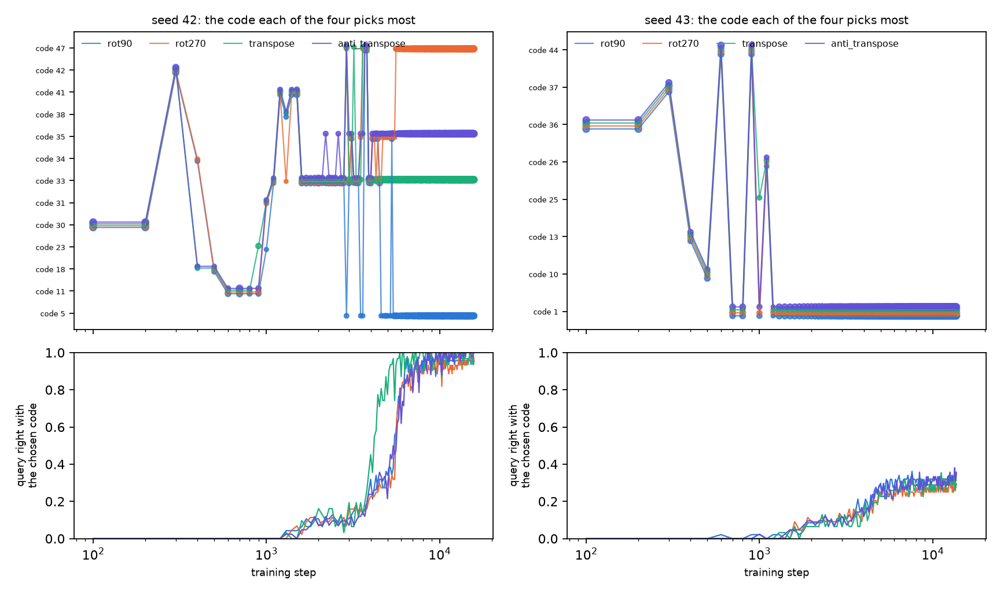

# 굳는 code를 푸는 법과 아는 것 위에 쌓기: 11월 27일의 실험

2026-11-27 Claude Code가 썼다. 자율 연구 중에 결과가 나오는 대로 고친다. 숫자는 모두 직접 돌려 잰 것이고, 근거 파일과 비교 조건은 `docs/ablations.md`에 있다.

## 1. 들어가며

이날은 두 질문으로 시작했다. 하나는 며칠째 막혀 있던 문제다. 24개 primitive 환경에서 가로세로를 바꾸는 넷, 곧 90도 회전, 270도 회전, 전치, 반대 대각선 전치가 seed에 따라 code 하나에 섞인 채 굳는다. 같은 program의 pair 둘로 학습하는 hard EM이 seed 42에서는 넷을 96%로 풀었지만 seed 43과 44에서는 35%와 37%에 멈췄다. 왜 굳는지, 어떻게 풀지가 첫 질문이다.

다른 하나는 사용자가 던진 방향의 질문이다. 무작위로 초기화한 모델이 라벨 없이 code를 세우는 문제에 매달릴 필요가 있느냐는 것이다. 사람도 빈 상태에서 배우지 않는다. 아는 것은 넣어 주고, 작은 환경에서는 정답을 보여 준 뒤, 그보다 크거나 비슷한 환경에서 빨리 배우는지를 보이면 된다. 연구가 보이려는 성질이 아는 것이 많아질수록 새것을 더 싸게 배우는 것이니, 이쪽이 그 성질을 더 직접 잰다.

결과를 먼저 말하면, 첫 질문은 절반쯤 풀렸다. 학습 초반에 과하게 쓰인 code에 가격을 붙여 과제를 여러 code로 퍼뜨리고 나중에 가격을 거두면, 굳던 seed 43과 44가 갈라졌다. 하지만 seed 45와 46에서는 오히려 덜 갈라졌다. 가격이 executor가 넷을 구별하기 전에 사라진 탓으로 보고, 가격을 더 오래 두는 형태를 시험하고 있다. 둘째 질문에 대해서는 두 가지 작은 판을 만들었다. 24개 환경 모델을 52개 환경으로 키우는 것과, 같은 primitive를 큰 물체에 적용한 비슷한 세계로 옮기는 것이다. 둘 다 아는 것에서 출발한 모델이 처음부터 배우는 모델보다 훨씬 빨랐다.

## 2. code는 왜 굳는가

### 2.1 100스텝마다 codebook을 본다

굳는 순간을 보려고 학습 중 codebook을 자주 기록하는 가벼운 평가를 만들었다. 100스텝마다 primitive별로 programmer가 어느 code를 고르는지, executor로 실행했을 때 어느 code가 그 primitive를 재현하는지, code 벡터, hard EM의 사용률과 죽은 code 보너스를 남긴다. primitive 이름은 기록을 줄 세우는 데에만 쓰고 모델은 보지 않는다. 갈라지는 seed 42와 굳는 seed 43을 같은 설정으로 다시 돌렸고, 두 run 모두 원래 결과를 재현했다.

code는 굵은 묶음에서 가는 묶음으로 갈라진다. 100스텝에는 모든 primitive가 code 하나를 쓰고, 300스텝에는 모양을 바꾸는 쪽과 크게 옮기는 쪽 둘로, 600스텝에는 색, 한 칸 이동, 가장자리 이동 같은 종류별로 갈린다. 1,000에서 2,000스텝에는 대부분의 primitive가 자기 code를 갖는다. 가로세로를 바꾸는 넷은 서로 가장 닮아 가장 늦게까지 한 묶음으로 남는다.

위 그림은 넷만 따로 본 것이다. 위 칸의 선 넷은 각 primitive가 가장 많이 고르는 code이고, 선이 겹치면 code를 같이 쓰는 것이다. 아래 칸은 고른 code로 query를 맞힌 비율이다. seed 43은 1,200스텝부터 넷이 code 1을 떠나지 않는다. 그 code는 넷의 평균 같은 변환을 배워 넷 모두를 30% 남짓만 맞힌다. seed 42도 1,600에서 2,800스텝에는 넷이 code 33 하나에 모여 있었다. 2,800스텝에 죽은 code의 보너스가 상한 20 nats에 닿은 뒤, 넷의 과제 일부가 다른 code로 옮겨 다니기 시작했고 5,000스텝 무렵 넷이 각자 code를 가졌다.

### 2.2 굳는 시기에는 넷을 가를 신호가 없다

200스텝마다 체크포인트를 남기며 두 seed를 6,000스텝까지 다시 돌리고, 모델 안 네 곳에서 넷을 가르는 정보가 있는지 쟀다. 라벨은 채점에만 썼다.

첫째, E-step이 넷의 과제를 code에 나눠 준 방식이 primitive와 얼마나 맞는지 봤다. 둘째, 넷 가운데 하나만 다른 셋보다 잘 재현하는 code가 있는지 봤다. 셋째, 과제별 재현 오차를 code 벡터로 미분한 gradient가 primitive별로 갈리는지 봤다. 넷째, programmer가 code로 양자화하기 전의 벡터에 선형 분류기를 붙여 넷을 맞히는지 봤다. 학습이 끝나 넷이 갈라진 seed 42에서 이 측정들은 0.84에서 1.0으로 넷을 가른다. 이 양성 대조로 측정 도구의 버그 하나를 찾아 고쳤다. programmer에 첫 pair의 입력과 출력 대신 두 pair의 입력을 넣고 있었다.

4,000스텝까지 두 seed 모두 앞의 셋은 우연 수준이었다. 갈라질 seed 42도 굳을 seed 43과 구별되지 않는다. 같은 code에 모인 넷은 executor가 넷의 평균을 배우게 하고, 평균을 배운 executor는 넷을 가를 오차 차이도 gradient 차이도 만들지 못한다. 닭과 달걀이다. 그래서 같은 code의 과제를 gradient 방향으로 쪼개는 방법은 쓸 수 없다. 이 시기의 gradient는 변환이 아니라 물체를 따라 갈려서, 쪼개면 물체로 갈린다. 실제로 seed 43의 E-step은 넷을 code 둘에 나눠 줬는데 두 code 모두 넷이 고루 섞여 있었다.

예외는 programmer였다. programmer의 은닉 벡터는 1,200스텝 무렵부터 넷을 선형 분류기로 0.32에서 0.44 맞혔다. 우연 수준은 0.25다. programmer는 입력과 출력 격자를 함께 보므로 회전과 전치의 차이를 조금은 본다. 하지만 code는 executor의 오차로 정해지므로 이 정보가 배정에 쓰이지 않는다.

seed 42가 갈라질 때의 순서도 잡혔다. 4,200에서 4,800스텝에 배정 순도가 0.33에서 0.41로 먼저 오르고, 5,200스텝부터 executor가 넷 가운데 하나를 다른 셋보다 17점, 5,800스텝에 39점 더 잘 재현한다. gradient의 primitive 신호는 그 뒤에 오른다. 정확히 맞히기 전에도 오차의 작은 차이가 배정을 primitive 쪽으로 기울이고, 기울어진 배정으로 executor가 구별을 배운다. seed 42에서 이 기울기의 씨앗을 준 것은 상한까지 쌓인 죽은 code의 보너스였다.

## 3. 먼저 넉넉히 가르고 나중에 합치기

### 3.1 방법

hard EM은 과제마다 재현 오차가 가장 작은 code 하나를 고르고, 그 code로만 executor를 학습한다. 여기에 code마다 가격을 하나 붙인다. 가격은 그 code가 최근에 얼마나 많이 뽑혔는지에 비례한다. 정확히는 최근 100스텝 정도의 이동 평균으로 잰 1등 점유율에 codebook 크기를 곱하고 1을 뺀 값에, 무게 2 nats를 곱한다. 고르게 쓰이는 code의 가격은 0이고, 고른 몫의 네 배를 쓰는 code는 6 nats가 붙고, 안 쓰이는 code는 2 nats 싸진다. E-step은 이 가격을 오차에 더한 값으로 고른다.

예를 들어 24개 환경에서 code 48개, 넷의 과제가 전체의 6분의 1이라고 하자. 넷이 code 하나에 몰리면 그 code의 점유율은 고른 몫의 8배쯤이라 가격이 14 nats가 된다. 굳는 시기에는 넷의 과제에서 모든 code의 오차 차이가 몇 nats에 불과하므로, 이 가격이면 과제가 다른 code로 넘어간다. 결과적으로 넷의 과제가 code 여러 개에 흩어진다. 흩어진 code들은 처음에는 모두 넷이 섞인 과제를 받지만, 2.2절에서 본 오차의 작은 차이가 생길 때 옮겨 갈 자리가 이미 여러 군데 있다.

가격은 3,000스텝까지 유지하고 8,000스텝까지 직선으로 0까지 내린다. 가격이 사라지면 hard EM의 원래 성질, 곧 많이 이긴 code가 계속 이기는 쏠림이 다시 작동한다. 이 쏠림은 초반에는 서로 다른 변환을 한 code로 섞었지만, executor가 구별할 수 있게 된 뒤에는 같은 일을 하는 code만 합친다. 합칠지 말지를 executor의 실행 결과로 판단할 수 있을 때까지 합치기를 미루는 것이다. 가르는 결정은 차이를 실행할 수 없을 때 검증할 수 없지만, 합치는 결정은 두 code를 같은 입력에 실행해 보면 검증할 수 있다는 비대칭이 이 순서의 근거다. 새 자원을 먼저 넉넉히 할당하고 공유 구조는 기능을 보존하며 천천히 통합한다는 이 연구의 원칙과도 맞는다.

이 방법이 실패한다면 두 가지 모습일 것이다. 가격이 너무 세면 primitive 하나가 물체 모양별로 여러 code에 쪼개진 채 남는다. 너무 약하면 넷은 여전히 한 code로 굳는다. 무게 2와 일정은 처음 고른 값이고 다른 값은 아직 재지 않았다.

### 3.2 결과

| seed | 가격 없이, 넷 | 가격 있음, 넷 | 가격 있음, 나머지 |
|---|---|---|---|
| 42 | 96% | 96% | 99% |
| 43 | 35% | 95% | 100% |
| 44 | 37% | 98% | 100% |

굳던 seed 43과 44는 풀렸고 다른 primitive의 손해는 없다. 그런데 seed 45와 46을 더하자 결과가 갈렸다.

| seed | 가격 없이, 넷 | 가격 있음, 넷 |
|---|---|---|
| 45 | 83% | 51% |
| 46 | 71% | 53% |

다섯 seed 평균은 가격 없이 64%, 가격 있음 78%다. seed 45와 46에서는 가격 기간 동안 넷이 여러 code를 옮겨 다니다가 전치만 자기 code를 얻었고, 나머지 셋은 둘씩 code를 나눠 쓴 채 남았다. 차이는 시점에 있었다. 가격이 사라지는 8,000스텝에 seed 43의 executor는 넷을 77에서 90% 맞혔지만, seed 45와 46은 25에서 61%였다. executor가 구별하기 전에 가격이 사라지면, hard EM의 쏠림이 덜 갈라진 code들을 다시 합친다. 3.1절의 논리, 곧 합치기를 executor가 구별할 수 있을 때까지 미룬다는 원리를 시간표로 어림한 것이 이 seed들에서는 맞지 않은 것이다. 가격을 16,000스텝까지 두는 형태를 시험하고 있다. 원리대로라면 가격을 거두는 시점을 시간이 아니라 executor가 그 code의 과제를 얼마나 잘 재현하는지로 정해야 한다.

비교로, 계산을 줄이려고 E-step 후보를 16개로 제한한 hard EM도 돌렸다. 한 스텝이 24개 환경에서 2.3배, 64개 환경에서 5.6배 빨라지지만, 세 seed 모두 넷이 36에서 37%로 굳었다. 원래 갈라지던 seed 42까지 굳었다. 죽은 code가 후보에 거의 들지 못해 보너스가 작동하지 않은 것으로 본다. 2.1절의 관찰, 곧 seed 42가 죽은 code의 보너스 덕에 갈라졌다는 것과 맞는다.

## 4. pair 없이도 되는가

진행 중이다.

## 5. 환경 키우기: 24개에서 52개로

진행 중이다.

## 6. 비슷한 세계로 옮기기

진행 중이다.

## 7. 학습 state 넓히기

진행 중이다.

## 8. 계산 효율

hard EM 한 스텝의 시간은 대부분 E-step에 든다. 과제마다 codebook의 모든 code로 executor를 돌리기 때문이다. 24개 환경에서는 0.131초 가운데 87%, 64개 환경에서는 0.317초 가운데 95%다. E-step이 없는 랩 방식은 0.017초다. 행렬 곱 커널은 77 TFLOP/s로 이 GPU의 큰 행렬 곱 405 TFLOP/s보다 낮은데, 모델 폭 128과 크기 16인 attention head 때문이라 커널을 다듬어 얻을 것은 크지 않다. hard EM run 하나가 GPU를 다 채우므로, 한 GPU에 둘을 띄우면 각각 2.16배 느려지고 전체 처리량은 8% 준다. 평가가 쓴 캐시 메모리를 놓지 않아 run 하나가 학습에 필요한 7.4GB 대신 18GB를 잡던 문제는 고쳤다.

## 9. 한계와 다음 일

진행 중이다.
