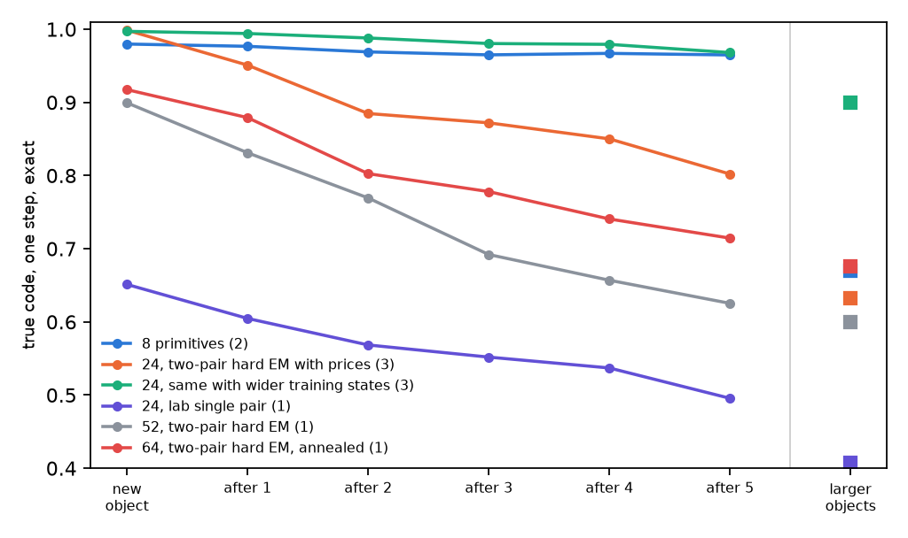
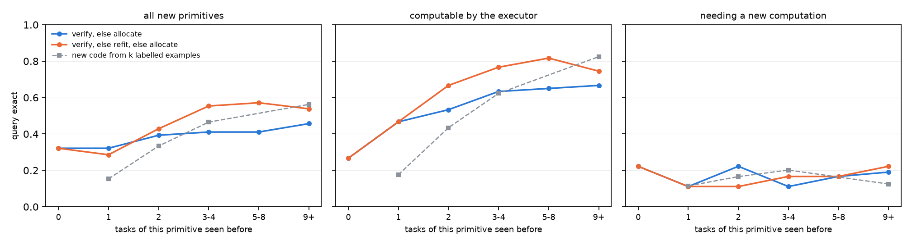
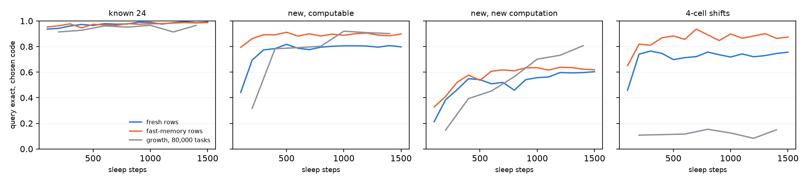

# 굳는 code를 푸는 법과 아는 것 위에 쌓기: 11월 27일의 실험

2026-11-27 Claude Code가 썼다. 자율 연구 중에 결과가 나오는 대로 고친다. 숫자는 모두 직접 돌려 잰 것이고, 근거 파일과 비교 조건은 `docs/ablations.md`에 있다.

## 1. 들어가며

이날은 두 질문으로 시작했다. 하나는 며칠째 막혀 있던 문제다. 24개 primitive 환경에서 가로세로를 바꾸는 넷, 곧 90도 회전, 270도 회전, 전치, 반대 대각선 전치가 seed에 따라 code 하나에 섞인 채 굳는다. 같은 program의 pair 둘로 학습하는 hard EM이 seed 42에서는 넷을 96%로 풀었지만 seed 43과 44에서는 35%와 37%에 멈췄다. 왜 굳는지, 어떻게 풀지가 첫 질문이다.

다른 하나는 사용자가 던진 방향의 질문이다. 무작위로 초기화한 모델이 라벨 없이 code를 세우는 문제에 매달릴 필요가 있느냐는 것이다. 사람도 빈 상태에서 배우지 않는다. 아는 것은 넣어 주고, 작은 환경에서는 정답을 보여 준 뒤, 그보다 크거나 비슷한 환경에서 빨리 배우는지를 보이면 된다. 연구가 보이려는 성질이 아는 것이 많아질수록 새것을 더 싸게 배우는 것이니, 이쪽이 그 성질을 더 직접 잰다.

결과를 먼저 말하면, 첫 질문은 절반쯤 풀렸다. 학습 초반에 과하게 쓰인 code에 가격을 붙여 과제를 여러 code로 퍼뜨리고 나중에 가격을 거두면, 굳던 seed 43과 44가 갈라졌다. 하지만 seed 45와 46에서는 오히려 덜 갈라졌다. 가격이 executor가 넷을 구별하기 전에 사라진 탓으로 보고, 가격을 더 오래 두는 형태를 시험하고 있다. 둘째 질문에 대해서는 두 가지 작은 판을 만들었다. 24개 환경 모델을 52개 환경으로 키우는 것과, 같은 primitive를 큰 물체에 적용한 비슷한 세계로 옮기는 것이다. 둘 다 아는 것에서 출발한 모델이 처음부터 배우는 모델보다 훨씬 빨랐다.

## 2. code는 왜 굳는가

### 2.1 100스텝마다 codebook을 본다

굳는 순간을 보려고 학습 중 codebook을 자주 기록하는 가벼운 평가를 만들었다. 100스텝마다 primitive별로 programmer가 어느 code를 고르는지, executor로 실행했을 때 어느 code가 그 primitive를 재현하는지, code 벡터, hard EM의 사용률과 죽은 code 보너스를 남긴다. primitive 이름은 기록을 줄 세우는 데에만 쓰고 모델은 보지 않는다. 갈라지는 seed 42와 굳는 seed 43을 같은 설정으로 다시 돌렸고, 두 run 모두 원래 결과를 재현했다.

code는 굵은 묶음에서 가는 묶음으로 갈라진다. 100스텝에는 모든 primitive가 code 하나를 쓰고, 300스텝에는 모양을 바꾸는 쪽과 크게 옮기는 쪽 둘로, 600스텝에는 색, 한 칸 이동, 가장자리 이동 같은 종류별로 갈린다. 1,000에서 2,000스텝에는 대부분의 primitive가 자기 code를 갖는다. 가로세로를 바꾸는 넷은 서로 가장 닮아 가장 늦게까지 한 묶음으로 남는다.

위 그림은 넷만 따로 본 것이다. 위 칸의 선 넷은 각 primitive가 가장 많이 고르는 code이고, 선이 겹치면 code를 같이 쓰는 것이다. 아래 칸은 고른 code로 query를 맞힌 비율이다. seed 43은 1,200스텝부터 넷이 code 1을 떠나지 않는다. 그 code는 넷의 평균 같은 변환을 배워 넷 모두를 30% 남짓만 맞힌다. seed 42도 1,600에서 2,800스텝에는 넷이 code 33 하나에 모여 있었다. 2,800스텝에 죽은 code의 보너스가 상한 20 nats에 닿은 뒤, 넷의 과제 일부가 다른 code로 옮겨 다니기 시작했고 5,000스텝 무렵 넷이 각자 code를 가졌다.

### 2.2 굳는 시기에는 넷을 가를 신호가 없다

200스텝마다 체크포인트를 남기며 두 seed를 6,000스텝까지 다시 돌리고, 모델 안 네 곳에서 넷을 가르는 정보가 있는지 쟀다. 라벨은 채점에만 썼다.

첫째, E-step이 넷의 과제를 code에 나눠 준 방식이 primitive와 얼마나 맞는지 봤다. 둘째, 넷 가운데 하나만 다른 셋보다 잘 재현하는 code가 있는지 봤다. 셋째, 과제별 재현 오차를 code 벡터로 미분한 gradient가 primitive별로 갈리는지 봤다. 넷째, programmer가 code로 양자화하기 전의 벡터에 선형 분류기를 붙여 넷을 맞히는지 봤다. 학습이 끝나 넷이 갈라진 seed 42에서 이 측정들은 0.84에서 1.0으로 넷을 가른다. 이 양성 대조로 측정 도구의 버그 하나를 찾아 고쳤다. programmer에 첫 pair의 입력과 출력 대신 두 pair의 입력을 넣고 있었다.

4,000스텝까지 두 seed 모두 앞의 셋은 우연 수준이었다. 갈라질 seed 42도 굳을 seed 43과 구별되지 않는다. 같은 code에 모인 넷은 executor가 넷의 평균을 배우게 하고, 평균을 배운 executor는 넷을 가를 오차 차이도 gradient 차이도 만들지 못한다. 닭과 달걀이다. 그래서 같은 code의 과제를 gradient 방향으로 쪼개는 방법은 쓸 수 없다. 이 시기의 gradient는 변환이 아니라 물체를 따라 갈려서, 쪼개면 물체로 갈린다. 실제로 seed 43의 E-step은 넷을 code 둘에 나눠 줬는데 두 code 모두 넷이 고루 섞여 있었다.

예외는 programmer였다. programmer의 은닉 벡터는 1,200스텝 무렵부터 넷을 선형 분류기로 0.32에서 0.44 맞혔다. 우연 수준은 0.25다. programmer는 입력과 출력 격자를 함께 보므로 회전과 전치의 차이를 조금은 본다. 하지만 code는 executor의 오차로 정해지므로 이 정보가 배정에 쓰이지 않는다.

seed 42가 갈라질 때의 순서도 잡혔다. 4,200에서 4,800스텝에 배정 순도가 0.33에서 0.41로 먼저 오르고, 5,200스텝부터 executor가 넷 가운데 하나를 다른 셋보다 17점, 5,800스텝에 39점 더 잘 재현한다. gradient의 primitive 신호는 그 뒤에 오른다. 정확히 맞히기 전에도 오차의 작은 차이가 배정을 primitive 쪽으로 기울이고, 기울어진 배정으로 executor가 구별을 배운다. seed 42에서 이 기울기의 씨앗을 준 것은 상한까지 쌓인 죽은 code의 보너스였다.

## 3. 먼저 넉넉히 가르고 나중에 합치기

### 3.1 방법

hard EM은 과제마다 재현 오차가 가장 작은 code 하나를 고르고, 그 code로만 executor를 학습한다. 여기에 code마다 가격을 하나 붙인다. 가격은 그 code가 최근에 얼마나 많이 뽑혔는지에 비례한다. 정확히는 최근 100스텝 정도의 이동 평균으로 잰 1등 점유율에 codebook 크기를 곱하고 1을 뺀 값에, 무게 2 nats를 곱한다. 고르게 쓰이는 code의 가격은 0이고, 고른 몫의 네 배를 쓰는 code는 6 nats가 붙고, 안 쓰이는 code는 2 nats 싸진다. E-step은 이 가격을 오차에 더한 값으로 고른다.

예를 들어 24개 환경에서 code 48개, 넷의 과제가 전체의 6분의 1이라고 하자. 넷이 code 하나에 몰리면 그 code의 점유율은 고른 몫의 8배쯤이라 가격이 14 nats가 된다. 굳는 시기에는 넷의 과제에서 모든 code의 오차 차이가 몇 nats에 불과하므로, 이 가격이면 과제가 다른 code로 넘어간다. 결과적으로 넷의 과제가 code 여러 개에 흩어진다. 흩어진 code들은 처음에는 모두 넷이 섞인 과제를 받지만, 2.2절에서 본 오차의 작은 차이가 생길 때 옮겨 갈 자리가 이미 여러 군데 있다.

가격은 3,000스텝까지 유지하고 8,000스텝까지 직선으로 0까지 내린다. 가격이 사라지면 hard EM의 원래 성질, 곧 많이 이긴 code가 계속 이기는 쏠림이 다시 작동한다. 이 쏠림은 초반에는 서로 다른 변환을 한 code로 섞었지만, executor가 구별할 수 있게 된 뒤에는 같은 일을 하는 code만 합친다. 합칠지 말지를 executor의 실행 결과로 판단할 수 있을 때까지 합치기를 미루는 것이다. 가르는 결정은 차이를 실행할 수 없을 때 검증할 수 없지만, 합치는 결정은 두 code를 같은 입력에 실행해 보면 검증할 수 있다는 비대칭이 이 순서의 근거다. 새 자원을 먼저 넉넉히 할당하고 공유 구조는 기능을 보존하며 천천히 통합한다는 이 연구의 원칙과도 맞는다.

이 방법이 실패한다면 두 가지 모습일 것이다. 가격이 너무 세면 primitive 하나가 물체 모양별로 여러 code에 쪼개진 채 남는다. 너무 약하면 넷은 여전히 한 code로 굳는다. 무게 2와 일정은 처음 고른 값이고 다른 값은 아직 재지 않았다.

### 3.2 결과

| seed | 가격 없이, 넷 | 가격 있음, 넷 | 가격 있음, 나머지 |
|---|---|---|---|
| 42 | 96% | 96% | 99% |
| 43 | 35% | 95% | 100% |
| 44 | 37% | 98% | 100% |

굳던 seed 43과 44는 풀렸고 다른 primitive의 손해는 없다. 그런데 seed 45와 46을 더하자 결과가 갈렸다.

| seed | 가격 없이, 넷 | 가격 있음, 넷 |
|---|---|---|
| 45 | 83% | 51% |
| 46 | 71% | 53% |

다섯 seed 평균은 가격 없이 64%, 가격 있음 78%다. seed 45와 46에서는 가격 기간 동안 넷이 여러 code를 옮겨 다니다가 전치만 자기 code를 얻었고, 나머지 셋은 둘씩 code를 나눠 쓴 채 남았다. 차이는 시점에 있었다. 가격이 사라지는 8,000스텝에 seed 43의 executor는 넷을 77에서 90% 맞혔지만, seed 45와 46은 25에서 61%였다. executor가 구별하기 전에 가격이 사라지면, hard EM의 쏠림이 덜 갈라진 code들을 다시 합친다. 3.1절의 논리, 곧 합치기를 executor가 구별할 수 있을 때까지 미룬다는 원리를 시간표로 어림한 것이 이 seed들에서는 맞지 않은 것이다. 원리대로라면 가격을 거두는 시점을 시간이 아니라 executor가 그 code의 과제를 얼마나 잘 재현하는지로 정해야 한다.

그래서 두 형태를 더 돌렸다. 하나는 가격을 그냥 오래 두는 것으로, 8,000스텝까지 유지하고 16,000스텝에 0으로 내린다. 다른 하나는 원리를 그대로 옮긴 적합도 가격이다. code마다 그 code가 이긴 과제를 executor가 두 pair 모두 정확히 재현하는 비율을 이동 평균으로 추적하고, 가격에 1에서 그 비율을 뺀 값을 곱한다. 자기 과제를 잘 재현하는 code는 많이 쓰여도 가격이 없고, 여러 primitive가 섞여 재현을 못 하는 code는 가격이 남는다. 시간표는 없다.

| seed | 기본 가격, 최종 | 오래 둔 가격, 14,400스텝 | 적합도 가격, 14,400스텝 |
|---|---|---|---|
| 43 | 95% | 94% | 96% |
| 45 | 58% | 44% | 66% |
| 46 | 57% | 48% | 77% |

가격을 오래 두는 것은 어려운 seed를 돕지 못했다. 적합도 가격은 두 seed를 모두 올렸지만 좋은 seed의 96%에는 아직 못 미친다. 학습 중간값이고 끝나면 고친다.

환경이 커지면 가격은 더 잘 통했다. 52개 환경에서 기본 가격은 세 seed 모두 넷을 98에서 100%로 갈랐고 나머지도 98에서 99%다. 가격이 없으면 같은 seed가 98%, 26%, 31%다. 24개 환경에서 가격이 실패한 seed 45와 46은 52개 환경에서 돌리지 않았으므로, 큰 환경이라서 풀린 것인지 seed 탓인지는 가르지 못한다.

비교로, 계산을 줄이려고 E-step 후보를 16개로 제한한 hard EM도 돌렸다. 한 스텝이 24개 환경에서 2.3배, 64개 환경에서 5.6배 빨라지지만, 세 seed 모두 넷이 36에서 37%로 굳었다. 원래 갈라지던 seed 42까지 굳었다. 죽은 code가 후보에 거의 들지 못해 보너스가 작동하지 않은 것으로 본다. 2.1절의 관찰, 곧 seed 42가 죽은 code의 보너스 덕에 갈라졌다는 것과 맞는다.

## 4. pair 없이도 되는가

두 pair 학습은 같은 규칙의 pair 둘이 묶여 있다는 정보를 쓴다. 벤치마크의 학습 파일은 pair를 하나씩 따로 주므로 이 정보가 없다. 가격 방식이 이 묶음 없이도 되는지 보려고, pair 하나짜리 학습 데이터에 같은 가격을 썼다.

| seed | 넷 | 나머지 |
|---|---|---|
| 42 | 29% | 67% |
| 43 | 28% | 64% |
| 44 | 13% | 65% |

가격 없이 pair 하나로 배운 hard EM과 같은 수준이다. pair 하나로 배우면 그 pair의 입력을 그 출력으로 바꾸기만 하면 오차가 0이라서, code가 변환이 아니라 특정 모양의 입력을 다루는 전문가로 쪼개진다. 가격은 code를 넉넉히 쓰게 할 뿐, 같은 code가 다른 물체에서도 같은 일을 하라는 요구를 대신하지 못한다. 그 요구는 묶음 정보에서만 나온다. 사용자와 상의해 두 pair 학습을 쓰기로 했다. 근거는 같은 상황에서 연달아 본 것은 같은 규칙을 따른다는 시간 구조이고, 에이전트 환경에서는 한 에피소드가 이 묶음을 준다. 랩 모델과 숫자를 견줄 때는 이 차이를 밝힌다.

## 5. 환경 키우기: 24개에서 52개로

24개 환경에서 가격 방식으로 학습을 마친 모델에서 출발해 52개 환경으로 키웠다. 모든 부품을 가져오고, 학습된 code 48개는 그대로 두고 새 code 56개를 덧붙여 104개로 만든 뒤, 52개 환경의 두 pair 데이터로 이어 배운다. 비교 대상은 같은 데이터, 같은 방법, 같은 스텝으로 처음부터 배우는 run이다. 52개 환경에는 24개에 없던 primitive가 28개 있고, 그중 4칸 이동 넷은 학습 데이터에서 뺐다. 아래 표의 새 primitive는 학습 데이터에 있는 24개다. 먼저 같은 스텝끼리의 비교다.

| seed, 스텝 | 이어 배운 run: 원래 24개, 새 24개, 가로세로를 바꾸는 넷 | 처음부터 run: 같은 셋 |
|---|---|---|
| 42, 400 | 95%, 49%, 95% | 0%, 0%, 0% |
| 42, 3,200 | 98%, 74%, 91% | 65%, 94%, 11% |
| 42, 10,000 | 98%, 75%, 99% | 95%, 99%, 91% |
| 43, 400 | 93%, 64%, 95% | 0%, 0%, 0% |
| 43, 3,200 | 98%, 92%, 92% | 70%, 92%, 18% |
| 43, 10,000 | 99%, 94%, 97% | 95%, 99%, 91% |
| 44, 400 | 93%, 62%, 92% | 0%, 0%, 0% |
| 44, 3,200 | 97%, 98%, 92% | 65%, 92%, 10% |
| 44, 10,000 | 99%, 99%, 97% | 92%, 99%, 77% |

끝 무렵의 값도 적는다. 이어 배운 run은 21,000에서 23,000스텝, 처음부터 run은 24,000스텝 근처다.

| seed | 이어 배운 run: 새 24개, 학습에 없는 4칸 이동, 새것이 80%에 닿는 스텝의 중앙값 | 처음부터 run: 같은 셋 |
|---|---|---|
| 42 | 79%, 30%, 800스텝 | 100%, 88%, 1,400스텝 |
| 43 | 94%, 28%, 600스텝 | 99%, 97%, 1,600스텝 |
| 44 | 100%, 45%, 700스텝 | 99%, 85%, 1,600스텝 |

새것을 배우는 초반 속도는 이어 배운 쪽이 두 배쯤 빠르다. 하지만 끝 성능은 seed 42와 43에서 처음부터 배운 쪽이 높고, 학습에 없던 4칸 이동으로의 일반화는 세 seed 모두 처음부터 배운 쪽이 훨씬 높다. 아래에 그 이유를 적는다.

이어 배운 run은 원래 지식을 처음부터 갖고 시작해 끝까지 유지한다. 가장 어려운 넷도 처음부터 90%를 넘는다. 처음부터 run은 넷을 8,000에서 10,000스텝에야 77에서 91%로 배운다. 새 primitive는 seed 43과 44에서 이어 배운 쪽이 2,000스텝에 92에서 99%로 처음부터 run보다 빠르지만, 3,200에서 4,800스텝에는 처음부터 run도 94%를 넘는다. 새로 붙인 primitive가 이동 거리만 다른 이동, 거울상, 확대처럼 비교적 쉬운 것들이라 처음부터도 빨리 배운다. 이어 배우는 것의 이득은 새것을 배우는 속도보다 원래 지식, 특히 어려운 지식을 처음부터 갖는 데 있다.

seed 42에서는 새 primitive가 75에서 77%에 멈췄다. 막힌 것은 여러 칸 이동이다. 아래로 4, 5, 6칸 이동이 code 하나를, 위로 2, 3, 4칸 이동이 다른 code 하나를 함께 쓴다. 가로세로를 바꾸는 넷에서 본 섞임이, 이동 거리만 다른 새 primitive들 사이에서 다시 일어났다. 처음부터 run은 같은 이동을 잘 가른다. 이어 배울 때는 executor가 이미 학습을 마친 상태에서 새 code가 무작위로 시작하고 가격도 8,000스텝에 사라지므로, 비슷한 새것끼리 가를 시간이 부족한 것으로 본다. 섞인 code가 재현을 못 하는 동안 가격을 유지하는 적합도 가격으로 seed 42를 다시 키우자, 6,000스텝에 새 primitive가 87%로 24개 가운데 20개가 80%에 닿았다. 기본 가격으로 키운 같은 seed는 끝까지 78%에 16개였다. 키울 때의 섞임에도 같은 원리가 통한다.

먼저 배운 개념은 새 환경에서 개념을 나누는 방식도 정한다. 학습 데이터에 없는 4칸 이동을, 처음부터 run은 2,000스텝에 73% 맞혔다. 물체를 자기 높이만큼 올리는 translate_up을 이동 칸 수별 code로 나눴고, 높이 4인 물체의 translate_up을 맡은 code가 4칸 이동을 풀었다. 이어 배운 run은 24개 환경에서 굳힌 자기 높이만큼 이동이라는 code를 유지해 4칸 이동을 그 code에 주고 27%를 맞혔다. primitive 이름으로 채점하면 처음부터 run이 translate_up을 쪼갠 것으로 보이지만, 효과로 보면 칸 수로 나눈 쪽이 학습에 없던 이동을 푼다.

## 6. 비슷한 세계로 옮기기

사용자가 말한 만족할 결과는, 바탕이 같은 두 환경에서 한쪽에서 배운 것이 다른 쪽에서 아주 빠른 적응으로 이어지는 것이다. 이것을 작은 판으로 만들었다. 같은 24개 primitive를 학습 때보다 큰 물체, 곧 16에서 29칸에 가로세로 7칸까지의 물체에 적용한 세계다. 규칙은 같고 물체의 크기 분포만 다르다.

보통 크기 세계에서 배운 모델은 이 세계에서 한 단계 과제를 57에서 59%만 맞힌다. 보통 크기에서는 100%다. 사다리 측정에서 정답 code의 큰 물체 정확도가 60%대였던 것과 같은 현상이다. code는 알맞게 골라지지만 executor가 큰 물체에서 그 변환을 제대로 실행하지 못한다.

큰 물체 두 pair 과제 4만 개로 이어 배우면 빠르다. 세 seed 모두 200스텝에 74에서 77%, 1,000스텝에 93%, 6,000스텝에 98%다. 같은 데이터로 처음부터 배우면 6,000스텝에 83%, 22,000스텝에 93%다. 대가로 원래 세계를 93에서 95%로 조금 잊는다. 배치의 절반을 원래 세계 과제로 채워 다시 재생하면 큰 세계는 같은 속도로 배우고 원래 세계는 98에서 99%로 유지된다.

하지만 한 스텝은 과제 128개다. 200스텝이면 이미 과제 2만 5천 개를 본 셈이다. 예시 수로 재려고 큰 물체 과제를 64개, 256개, 1,024개만 주고 적응시켰다.

| 큰 물체 학습 과제 | 큰 세계 | 원래 세계 |
|---|---|---|
| 0개, 출발점 | 59% | 99% |
| 64개 | 37%로 떨어짐 | 61% |
| 256개 | 58% | 77% |
| 1,024개 | 최고 76% | 88% |
| 256개, executor만 학습 | 62% | 92% |
| 256개, 학습률 10분의 1 | 57% | 88% |
| 256개, 원래 세계 절반 재생 | 72% | 98% |

예시가 적으면 적응이 거의 되지 않고, 64개로는 오히려 망가진다. 적은 과제를 반복해 배우는 동안 그 과제에 과적합하면서, 원래 일반화하던 부분까지 무너진다. 덜 바꾸는 방법 가운데에서는 원래 세계 재생이 가장 나아서, 과제 256개로 72%까지 오르고 원래 세계를 지킨다.

이 결과가 보이려는 성질과의 거리를 보여 준다. 아는 것에서 출발하면 스텝으로는 훨씬 빠르지만, 예시 수로는 아직 수만 개가 필요하다. 사람이라면 큰 물체를 몇 번 보고 같은 회전을 적용할 수 있다. 큰 물체에서 실패하는 것은 code가 아니라 executor가 학습 때 본 물체 크기에 묶인 변환을 배웠기 때문으로 보인다. 그렇다면 이 문제는 예시 몇 개로 고치기보다, 변환을 물체 크기나 위치와 상관없이 실행하는 executor 구조로 풀어야 할 가능성이 크다. 이것은 아직 추측이다.

## 7. 학습 state 넓히기

code가 자리를 잡아도 executor가 그 code를 모든 state에서 같은 변환으로 실행하는 것은 아니다. 11월 26일의 사다리 측정에서, 정답 code를 한 번 실행한 정확도가 새로 뽑은 물체에서는 99%지만, 무작위 primitive를 다섯 번 거친 물체에서는 79%, 학습 때보다 큰 물체에서는 63%였다. 긴 program의 중간 격자는 바로 이렇게 다른 primitive를 거친 물체다. 그래서 24개 환경의 긴 program은 executor가 상한을 정했다.

사용자의 방향대로 작은 환경에서는 정답을 넉넉히 보여 주기로 했다. 생성기에 선택지를 하나 더해, 학습 pair의 물체가 먼저 무작위 primitive를 0에서 4개 거친 뒤 그 물체에 과제의 primitive를 적용하게 했다. 큰 물체는 일부러 넣지 않았다. 학습 방법은 가격 방식 그대로다.

| 모델 | 새 물체 | 1단계 거친 물체 | 3단계 | 5단계 | 큰 물체 |
|---|---|---|---|---|---|
| 가격 run, seed 42 | 100% | 95% | 87% | 80% | 62% |
| 가격 run, seed 43 | 100% | 95% | 87% | 80% | 65% |
| 넓힌 학습, seed 42 | 100% | 99% | 98% | 97% | 90% |
| 넓힌 학습, seed 43 | 99% | 99% | 97% | 95% | 86% |
| 넓힌 학습, seed 44 | 100% | 100% | 99% | 98% | 94% |

사다리가 거의 평평해졌고, 학습에 넣지 않은 큰 물체에서도 62에서 65%가 86에서 94%로 올랐다. 무작위 primitive를 거친 물체에는 확대, 거울상, 테두리 붙이기로 커진 물체가 섞여 있어서, executor가 넓은 크기 분포를 본 덕으로 본다. 모델이 새 물체에서 스스로 보이던 되돌림 관계도 5단계 거친 물체에서 61%였던 것이 82에서 85%로 유지된다. code 배정은 그대로 좋다. 가로세로를 바꾸는 넷이 95%, 93%, 97%, 나머지가 모두 100%다.

큰 물체 세계로의 전이도 따라 올랐다. 넓힌 학습 seed 43 모델은 적응 없이 큰 세계의 한 단계 과제를 82% 맞힌다. 같은 seed의 가격 모델은 59%였다. 다만 큰 물체 과제 256개나 64개로 더 적응시키면 82%에서 오르지 않거나 조금 떨어진다. 넓은 state로 학습한 것은 처음 보는 세계로의 전이를 올렸지만, 적은 예시로 더 배우는 능력은 바꾸지 못했다.

executor가 함수에 가까워지자 긴 program의 상한도 올랐다. 24개 환경 긴 평가 파일에서 정답 program을 primitive마다 가장 자주 쓰인 code로 적어 그대로 실행한 정확도다.

| 모델 | 길이 5 | 길이 6 | 길이 7 |
|---|---|---|---|
| 가격 run, seed 42, 43, 44 | 69에서 73% | 59에서 65% | 54에서 57% |
| 넓힌 학습, seed 42, 43, 44 | 90에서 96% | 87에서 94% | 80에서 87% |

상한이 오르자 꿈 학습 뒤의 탐색도 따라 올랐다. 같은 넓힌 학습 모델 위에 11월 24일과 같은 꿈 학습, 곧 얼린 executor로 만든 긴 program과 검증된 실제 pair로 programmer를 6,000스텝 학습하고, 같은 긴 평가 파일을 폭 16으로 탐색했다.

| 모델 | 꿈 전 탐색, 길이 5, 6, 7 | 꿈 후 탐색 |
|---|---|---|
| 넓힌 학습 seed 42 | 51%, 37%, 26% | 64%, 55%, 50% |
| 넓힌 학습 seed 43 | 42%, 27%, 19% | 63%, 46%, 43% |
| 넓힌 학습 seed 44 | 측정 중 | 64%, 50%, 38% |
| 이전 최고, hard EM pair 둘 seed 42에 꿈과 남은 거리 예측기 | | 52%, 41%, 27% |

남은 거리 예측기 없이도 이전 최고를 넘었다. 그래도 상한 80에서 96%와의 거리가 남아, 긴 program의 병목은 다시 programmer의 탐색으로 옮겨 갔다.

위 그림의 다른 선들도 같은 이야기를 한다. 환경이 24개에서 52개, 64개로 커질수록 사다리가 더 가파르게 떨어진다. primitive가 많을수록 중간 격자가 학습 분포에서 더 멀어지기 때문으로 본다. 그렇다면 큰 환경일수록 학습 state를 넓히는 것이 더 중요해야 한다. 52개 환경에서 같은 시험을 하고 있다. 꿈 학습 뒤의 탐색이 올라간 상한을 얼마나 따라가는지도 재고 있다.

## 8. 빠른 기억: 가중치를 바꾸지 않고 새 세계에 적응하기

6절의 결론은 아는 것에서 출발해도 예시 수로는 아직 수만 개가 든다는 것이었다. 적은 예시로 가중치를 고치면 그 예시에 과적합하면서 원래 일반화하던 부분까지 무너졌다. 그래서 사용자와 정한 다음 방향은 새 세계의 예시를 가중치에 바로 쓰지 않고 빠른 기억에 담아 두고, 쓸 때는 탐색과 검증으로 쓰는 것이다. 사람의 해마가 새 일화를 한 번에 담고 피질은 천천히 바꾸는 나눔을 따른 것이다. 이 절의 모든 실험에서 모델의 가중치는 얼어 있고, 바뀌는 것은 기억에 딸린 작은 값뿐이다.

### 8.1 executor 안을 보정하는 기억은 큰 물체를 고치지 못했다

첫 시도는 6절의 큰 물체 세계였다. 큰 물체 과제 256개를 기억에 담고, 기억 속 과제를 programmer가 첫 pair에 붙인 code로 묶은 뒤, code마다 그 code의 과제를 executor가 재현하도록 보정 값을 맞췄다. 보정을 더하는 자리로 셋을 시험했다. code 벡터의 16개 숫자, executor 안에서 code가 바뀐 조건 벡터의 128개 숫자, 층마다 정규화 뒤의 크기와 위치를 정하는 modulation 3,072개 숫자다. 새 과제에서는 원래 code와 보정한 code를 모두 support에 실행하고, 보정한 판만 support를 재현할 때 그 판으로 query에 답한다.

어느 자리도 통하지 않았다. modulation 보정은 기억 과제를 100% 재현했지만 새 과제에서는 38.8%로 원래의 45.6%보다 낮았다. code마다 과제 7개쯤을 외운 것이다. 큰 물체라는 차이는 모든 code에 공통이므로 세계 전체에 보정 하나를 두고 기억 과제 전부로 맞춰 보았지만, 이번에는 기억 과제조차 65%만 재현했다. 검증으로 고르는 덕에 원래 세계는 지켜졌지만 큰 세계의 이득은 없었다. 큰 물체에서의 실패는 executor가 학습 때 보지 못한 먼 칸 사이의 관계를 계산해야 하는 문제라서, 조건 쪽 값으로는 고치기 어려운 것으로 본다. 7절에서 학습 state를 넓히자 큰 물체가 거의 풀린 것과 맞는 해석이다.

### 8.2 새 code 하나로 새 primitive를 붙이기

빠른 기억이 맞는 자리는 감각 수준의 변화보다 새 개념을 붙이는 경우일 수 있다. 그래서 24개 환경 모델을 얼린 채로, 52개 환경에만 있는 새 primitive마다 예시 과제 k개로 새 code 벡터 하나만 맞췄다. 손실은 executor가 예시의 두 pair를 재현하는 cross entropy이고, 처음 보는 같은 primitive 과제의 query로 잰다. primitive 이름은 예시를 묶는 데만 쓰므로 이것은 라벨을 쓰는 진단이다.

| 예시 과제 수 | 1 | 2 | 4 | 16 | 64 |
|---|---|---|---|---|---|
| 0에서 출발 | | | 31% | 50% | 54% |
| 가장 잘 맞는 기존 code에서 출발 | 15% | 33% | 47% | 56% | 56% |

기존 code 가운데 가장 나은 것은 19%다. 평균보다 primitive별 차이가 중요하다. 이동 거리만 다른 이동은 예시 16개로 90% 안팎까지 가고, 거울상 붙이기 넷, 두 배 확대, 가로 늘이기는 예시 64개로도 0에서 22%다. executor가 이미 할 줄 아는 계산의 조합인 개념은 가중치를 바꾸지 않고 code 하나로 붙고, 새 계산이 필요한 개념은 붙지 않는다.

### 8.3 라벨 없이 하나씩 받는 온라인 기억

실제로 쓰려면 라벨 없이, 과제가 하나씩 올 때 기억을 키워야 한다. 52개 환경 평가 파일의 한 단계 과제 800개를 정한 순서로 하나씩 주었다. 과제마다 support pair 둘과 query 하나가 있고, 모델은 얼린 24개 환경 가격 seed 43 모델이다. 과제 하나를 이렇게 처리한다.

먼저 검증한다. 모델 자신의 code 48개와 지금까지 만든 새 code를 모두 support 두 pair에 실행해, 두 pair를 다 재현하는 code를 찾는다. 자기 code가 통과하면 programmer가 가장 선호하는 것으로 query에 답한다. 새 code만 통과하면 그 code의 기억에 이 과제를 더하고, 기억 전체로 그 code를 100스텝 다시 맞춘 뒤 답한다. 아무 code도 통과하지 않으면 새 code를 할당한다. 이 과제의 support 두 pair에 맞도록 0과 가장 잘 맞는 자기 code 셋에서 출발해 300스텝씩 맞추고, 손실이 가장 낮은 것을 새 code로 삼아 답한다.

이 첫 판은 code를 늘리기만 했다. 과제 800개에 새 code가 290개 생겼다. 새 primitive가 28개이니 primitive마다 열 개 꼴이다. 아래로 5칸 이동을 처음 보고 두 pair로 맞춘 code는, 다음에 온 아래로 5칸 이동 과제의 support를 정확히 재현하지 못하는 일이 많다. pair 둘로 맞춘 code는 일반화가 약하기 때문이다. 그러면 검증에 떨어지고 새 code가 또 생기고, 새 code마다 기억이 하나뿐이라 일반화가 약한 채로 남는다.

연구 원칙은 새 자원을 할당하기 전에 이미 있는 것을 이어 써 보라고 한다. 그래서 검증과 할당 사이에 한 단계를 넣었다. 아무 code도 통과하지 않으면, 이 과제의 support에서 손실이 가장 낮은 새 code 셋을 차례로 골라 그 code의 기억에 이 과제를 더한 전체로 100스텝 다시 맞춘다. 다시 맞춘 code가 이 과제의 두 pair를 재현하고 원래 기억 과제의 75% 이상을 재현하면 그 code를 이어 쓴다. 셋 다 실패해야 새 code를 할당한다. 두 primitive가 한 code에 섞이면 이 조건을 넘기 어렵다. 같은 입력에서 다른 출력을 내야 하기 때문이다. 실제로 끝에 두 primitive를 함께 담은 code는 150개 가운데 하나였다.

그림의 가로축은 같은 primitive의 과제를 흐름에서 앞서 몇 번 봤는지이고, 세로축은 그다음 과제 query의 정답률이다. 회색 점선은 8.2절의 라벨을 쓴 진단으로, k개 예시로 맞춘 새 code다. 가운데 칸은 그 진단에서 예시 16개로 50%를 넘은 primitive 15개, 곧 이동 거리만 다른 이동과 bbox 채우기 같은 것들이고, 오른쪽 칸은 넘지 못한 9개, 곧 거울상 붙이기 넷, 두 배 확대, 가로 늘이기, 그리고 맞추기가 불안정했던 이동 셋이다.

이어 쓰는 판은 새 code를 150개로 절반만 만들었다. executor가 계산할 수 있는 primitive는 앞서 3에서 4번 본 뒤 77%, 5에서 8번 본 뒤 82%를 맞힌다. 이어 쓰지 않는 판은 63%와 65%다. 라벨로 예시를 모아 맞춘 진단과 비슷하거나 낫다. 온라인에서는 지금 과제의 support도 맞추기에 들어가므로, 앞서 i번 봤다는 것은 예시 i+1개에 가깝다. 이 primitive들의 새 code는 primitive마다 2.4개로, 이어 쓰지 않을 때의 6.8개보다 훨씬 적다. 새 계산이 필요한 primitive는 두 판 모두 11에서 22%에 머물고, primitive마다 code가 11개씩 쌓인다. 아는 primitive는 두 판 모두 97에서 100%로, 기억은 원래 지식을 건드리지 않는다.

7절의 넓힌 학습 모델로 같은 흐름을 돌렸다. 그림의 초록 선이다. 계산할 수 있는 primitive는 앞서 한두 번 본 뒤 73%와 80%로 가격 모델보다 빨리 오르지만, 9번 이상 본 뒤에는 73%로 비슷하다. 새 계산이 필요한 primitive는 25에서 31%로 조금 높을 뿐이다. executor가 학습 분포 밖의 state에서 더 함수답게 움직여도, code 하나로 붙일 수 있는 개념의 범위는 크게 넓어지지 않았다.

이 결과에서 두 가지를 읽는다. 하나는 빠른 기억과 이어 쓰기만으로, 라벨 없이, 가중치를 바꾸지 않고, 계산할 수 있는 새 개념을 예시 몇 개로 붙일 수 있다는 것이다. 6절의 큰 물체 세계에서는 가중치를 고쳐 적응하면 과제 256개로도 오히려 나빠졌다. 세계가 달라 숫자를 직접 견줄 수는 없지만, 적은 예시에서 가중치를 건드리지 않는 쪽이 안전하다는 점은 같다. 다른 하나는 이 방식의 한계가 executor가 이미 할 줄 아는 계산에 있다는 것이다. 새 계산이 필요한 개념에 대해 빠른 기억은 실패한 code를 쌓을 뿐이다. 그 과제들은 기억에 남아 있으므로, 잠에서 executor를 바꾸는 재료가 될 수 있다.

맞춘 새 code의 길이도 보았다. codebook은 code를 길이 1로 정규화해 읽는데, 빠른 기억의 code는 길이를 묶지 않고 맞춰서 1.1에서 4.1, 평균 2.1이었다. 이 벡터를 길이 1로 정규화하면 기억 과제 327개 가운데 2개만 재현한다. 정규화 전에는 325개다. 길이 1로 묶은 채 원래 방향에서 다시 맞추면 156개다. 빠른 기억은 학습 때 쓰지 않은 길이를 표현력으로 쓰고 있었고, codebook에 그대로 옮길 수는 없다.

### 8.4 잠에서 가중치로 옮기기

빠른 기억은 새 계산이 필요한 개념을 풀지 못하지만, 그 과제들을 모아 둔다. 이어 쓰는 판의 흐름 800개 가운데 모델 자신의 code로 재현되지 않아 기억에 들어간 과제는 435개다. 새 primitive마다 15개쯤이다. 이 과제를 고르는 데 라벨은 쓰이지 않았다. 검증에 실패했다는 사실만 썼다.

잠은 이 435개로 모든 부품을 학습한다. 5절의 키우기와 같은 방식으로 codebook을 48개에서 104개로 늘리고, hard EM으로 2,000스텝, 가격 없이 학습한다. 배치의 절반은 24개 환경 학습 파일을 재생해 원래 지식을 지킨다. 평가는 흐름에 나온 800개를 뺀 52개 환경 평가 파일로 하므로, 잰 것은 외운 과제가 아니라 처음 보는 과제다. 두 출발을 비교했다. codebook의 새 줄 56개를 무작위로 채운 것과, 과제를 둘 이상 담은 기억 code 42개로 채운 것이다. 기억 code는 길이 1로 묶어 다시 맞춘 벡터를 썼다.

| | 원래 24개 | 계산할 수 있는 새것 15개 | 새 계산이 필요한 새것 9개 | 4칸 이동 |
|---|---|---|---|---|
| 빠른 기억만, 가중치 그대로 | 97에서 100% | 77에서 82% | 11에서 22% | |
| 잠, 무작위 줄 출발, 2,000스텝 | 99% | 81% | 58% | 77% |
| 잠, 기억 줄 출발, 1,500스텝 | 99% | 90% | 62% | 87% |
| 참고: 과제 8만 개로 키운 run, 2,000스텝 | 97% | 92% | 91% | 14% |

세 가지를 읽는다. 첫째, 새 계산은 잠에서 배워진다. 깨어 있는 동안 20% 안팎이던 것이 잠 뒤에 60% 안팎이 된다. 둘째, 기억 code로 시작하면 계산할 수 있는 개념과 4칸 이동에서 10점쯤 높고, 이 차이는 100스텝부터 끝까지 유지된다. 빠른 기억이 찾아 둔 code가 잠의 출발점으로 쓸모가 있다. 새 계산이 필요한 개념에서는 두 출발이 같다. 기억 code가 그 개념을 담지 못했으니 당연하다. 셋째, 과제 435개의 한계가 있다. 무작위 줄 출발은 500스텝에 이미 82%와 54%이고 그 뒤로 거의 오르지 않는다. 학습 과제 정확도는 100%라 기억을 다 외운 상태다. 과제 8만 개로 키운 run은 500스텝까지는 같은 곡선을 그리다가 1,000스텝부터 앞선다. 4칸 이동은 8만 개 run의 학습 파일에 없어서 14%이고, 잠을 잔 모델은 흐름에서 만난 4칸 이동을 기억에 담았으므로 77에서 87%다.

원래 24개는 두 출발 모두 99%로, 잠이 원래 지식을 해치지 않았다. 연구 원칙의 잠의 게이트, 곧 확정 지식은 원래 세계를 해치지 않고 새 세계를 올릴 때만 바꾼다는 조건을 이 잠은 통과한다.

기억의 크기와 고르는 방식이 이 천장을 얼마나 정하는지를 두 run으로 재고 있다. 하나는 기억이 고른 과제 대신 52개 환경 학습 파일에서 무작위로 뽑은 과제 435개로 자는 대조 run이다. 다른 하나는 흐름을 2,400개로 늘려 기억을 키운 뒤 자는 run이다.

### 8.5 깨기, 잠, 다시 깨기

빠른 기억과 잠을 이으면 한 바퀴가 된다. 깨어 있는 동안 얼린 모델이 빠른 기억으로 과제를 받고, 자기 code로 풀리지 않은 과제를 기억에 모은다. 잠에서 그 기억으로 가중치를 고친다. 다시 깨면 고친 모델을 얼리고 같은 방식으로 다음 과제를 받는다. 연구가 보이려는 성질, 곧 아는 것이 많아질수록 새 과제를 더 싸게 배운다는 것을 이 바퀴로 직접 잴 수 있다. 다시 깬 모델이 같은 종류의 과제를 더 잘 풀고, 새 code를 덜 만들어야 한다.

이것을 세 번 이어서 돌렸다. 흐름은 52개 환경의 한 단계 과제를 정한 순서로 800개씩 끊은 것이다. 첫 번째 깨어 있는 동안은 24개 환경 모델이 과제 1에서 800을 받는다. 첫 잠은 8.4절의 무작위 줄 출발 잠이다. 두 번째는 그 모델이 과제 801에서 1,600을 받고, 둘째 잠은 두 번의 기억을 합친 569개로 1,000스텝 이어 잔다. 세 번째는 과제 1,601에서 2,400을 받는다. 구간마다 과제는 다르지만 같은 primitive들에서 같은 방식으로 뽑힌 과제다.

| 깨어 있는 구간 | 새 primitive 전체 | 계산할 수 있는 새것 | 새 계산이 필요한 새것 | 아는 24개 | 새로 만든 code | 자기 code가 답한 비율 |
|---|---|---|---|---|---|---|
| 첫 번째, 자기 전 | 51% | 71% | 19% | 99% | 150개 | 3% |
| 두 번째, 한 번 잔 뒤 | 79% | 86% | 60% | 100% | 43개 | 69% |
| 세 번째, 두 번 잔 뒤 | 86% | 90% | 76% | 99.7% | 25개 | 75% |

바퀴가 돌 때마다 새 과제가 더 잘 풀리고, 빠른 기억이 새로 할당해야 하는 code가 줄어든다. 가장 크게 오르는 것은 새 계산이 필요한 개념이다. 깨어 있는 동안에는 풀지 못하고 기억에 쌓이기만 하던 과제가 잠에서 executor를 바꾸고, 다음에 깨면 자기 code로 풀린다. 둘째 깨어 있는 동안 기억에 더해진 과제 134개는 대부분 아직 덜 배운 개념의 과제였고, 둘째 잠 뒤에 왼쪽 거울상 붙이기는 29%에서 87%, 두 배 확대는 43%에서 82%가 됐다. 기억이 무엇을 담을지를 검증 실패로 정하니, 잠은 모델이 아직 못 하는 것에 학습을 모은다. 아는 24개는 세 번 모두 99% 이상으로, 재생이 원래 지식을 지켰다.

잠을 잔 뒤에도 빠른 기억은 값을 더한다. 한 번 잔 모델이 탐색 없이 고른 code로는 계산할 수 있는 새것을 81% 맞히는데, 깨어서 support로 검증하고 빠른 기억으로 보충하면 86%다.

기억 줄로 잔 모델로 둘째 구간을 받으면 새 primitive 전체 82%, 계산할 수 있는 새것 94%로 무작위 줄로 잔 모델보다 조금 높다.

기억이 고르는 것의 값은 대조 run으로 쟀다. 52개 환경 학습 파일에서 무작위로 뽑은 과제 435개로 같은 잠을 자면, 1,000스텝에 계산할 수 있는 새것 64%, 새 계산이 필요한 새것 51%다. 기억이 고른 435개로는 81%와 56%였다. 무작위 435개의 절반쯤은 이미 아는 primitive의 과제라 배울 것이 없다. 검증에 실패한 과제만 담는다는 규칙이 같은 과제 수에서 더 많이 배우게 한다.

남은 비교가 있다. 구간마다 과제가 다르므로, 한 번도 자지 않은 모델이 같은 과제 801에서 2,400을 빠른 기억만으로 받은 값과 견줘야 잠의 몫이 정확히 나온다. 그 run은 과제 1,200까지 왔고 801에서 1,200 사이의 새 primitive 정답률은 56, 57, 68, 62%다. 같은 구간에서 한 번 잔 모델은 78, 75, 78, 78%다. 같은 세 바퀴를 seed 42와 44로도 돌리고 있다.

## 9. 계산 효율

hard EM 한 스텝의 시간은 대부분 E-step에 든다. 과제마다 codebook의 모든 code로 executor를 돌리기 때문이다. 24개 환경에서는 0.131초 가운데 87%, 64개 환경에서는 0.317초 가운데 95%다. E-step이 없는 랩 방식은 0.017초다. 행렬 곱 커널은 77 TFLOP/s로 이 GPU의 큰 행렬 곱 405 TFLOP/s보다 낮은데, 모델 폭 128과 크기 16인 attention head 때문이라 커널을 다듬어 얻을 것은 크지 않다. hard EM run 하나가 GPU를 다 채우므로, 한 GPU에 둘을 띄우면 각각 2.16배 느려지고 전체 처리량은 8% 준다. 평가가 쓴 캐시 메모리를 놓지 않아 run 하나가 학습에 필요한 7.4GB 대신 18GB를 잡던 문제는 고쳤다.

## 10. 한계와 다음 일

진행 중이다.
