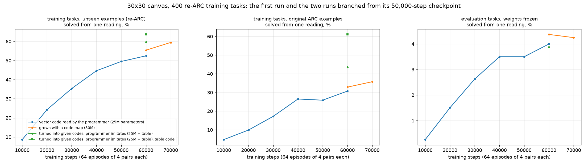
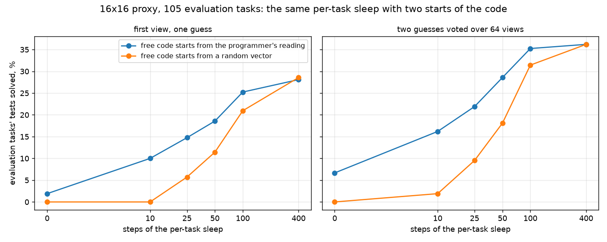

# ARC-AGI-1 첫 실험 보고

2026-11-28 새벽부터 쓴다. 실험이 도는 동안 이어서 고친다. 설계의 이유는 `docs/arc-agi-1-design.md`에, 비교마다의 숫자는 `docs/ablations.md` 9절에, 시각별 기록은 `docs/research-log.md`에 있다.

## 1. 지금 어디까지 왔나

기준은 사용자가 정했다. ARC-AGI-1 평가 과제 400개 전체, 한 변 30칸, 두 번의 시도에서의 정답률이다.

지금까지 평가 과제 쪽에서 잰 값은 이렇다. 모두 30칸이고, 평가 과제의 test 답은 채점에만 썼다.

| 무엇을 했나 | 과제 수 | 두 번 시도 정답률 |
|---|---|---|
| 과제마다 따로 재우기 100스텝, 본학습 2만 5천 스텝 checkpoint | 200 | 26.2 |
| 같은 것, 5만 스텝 checkpoint | 200 | 27.3 |
| 위의 둘과 방식이 다른 둘, 모두 넷의 답을 합친 다수결 | 200 | 32.8 |
| 과제마다 따로 재우기 400스텝, 5만 스텝 checkpoint | 67 | 37.3 |
| 같은 것 1,000스텝 | 67 | 38.8 |

과제 67개는 200개보다 쉬운 쪽이다. 같은 67개에서 100스텝의 값이 32.8%다. 그래서 400스텝의 값을 과제 200개로 옮기면 32%쯤으로 본다.

TRM은 같은 기준에서 44.6%다. 아직 12점쯤 모자란다. 오늘 밤 설계가 다른 본학습 둘이 끝나면 그 답을 합쳐 전체 400개의 값을 낸다.

## 2. 견줄 대상

조사해서 원문으로 확인한 값이다. 2026년 하반기의 결과는 조사 보고에만 기댄다.

| 방법 | parameter | 두 번 시도 정답률 | 평가 과제의 예시 pair를 쓰는 방식 | 계산 |
|---|---|---|---|---|
| TRM | 7M, 과제 embedding까지 455M | 44.6 | 학습 데이터에 넣고 처음부터 학습 | H100 넉 장으로 사흘 |
| VARC | 18M | 54.5, 앙상블 60.4 | 과제마다 따로 weight를 고침 | H100 여덟 장 4.8시간과 과제당 70초 |
| LoopViT, Loop-OWM | 4M에서 18M | 60에서 68.5 | VARC와 같음 | |
| transductARC | 75M | 76 | 예시 pair 하나를 문맥에 넣음 | H100 한 장 4시간 남짓 |
| CHARM | 14M, 과제 기억까지 44M | 78.6에서 84.0 | 학습 데이터에 넣음 | H100 여덟 장 88시간 |

TRM을 넘는 선은 45%이고 선두는 84%다. 우리 모델은 2,480만 parameter다.

## 3. 방법을 순서대로

### 3.1 모델과 사전 학습

과제의 규칙을 code vector 하나로 둔다. programmer가 입력과 출력의 pair 하나를 읽고 code를 쓰고, 과제의 code는 pair들의 code의 평균이다. executor는 입력 state와 code를 받아 출력 state를 낸다. 격자는 한 변 30칸의 canvas 왼쪽 위에 놓고 나머지는 pad 값으로 채우며, executor가 pad 칸까지 예측하므로 출력의 크기도 함께 맞혀야 한다.

학습의 한 묶음은 과제 하나에서 뽑은 pair 넷이고, pair마다 자기를 뺀 나머지 셋의 평균 code로 예측한다. 예를 들어 모든 물체를 오른쪽 벽까지 미는 과제에서 pair 넷을 뽑았다면, 첫 pair의 출력을 예측할 때 executor가 받는 code는 나머지 세 pair를 읽은 것의 평균이다. 첫 pair의 출력 격자는 그 code에 들어가지 않았으므로, code에는 세 pair가 공유하는 규칙만 들어갈 수 있다.

데이터는 re-ARC다. ARC 학습 과제 400개마다 예시 1,000개가 있다. 묶음마다 정사각형의 대칭 여덟 가지 가운데 하나와 색 순열 512가지 가운데 하나를 입력과 출력에 똑같이 적용한다.

### 3.2 깨어 있을 때: 읽기, code 옮기기, 다수결

weight는 그대로 둔다. 예시 pair를 programmer가 한 번씩 읽어 code의 평균을 내고, 그 code로 test 입력을 실행한다. 다음으로 code vector만 고친다. 읽은 code에서 출발해, 그 code로 예시 pair의 입력을 실행한 결과가 출력과 같아지도록 Adam을 100스텝 돌린다. 마지막으로 과제를 여덟 방향으로 보고 각각 풀어 답을 되돌린 뒤 가장 많이 나온 격자 둘을 낸다.

16칸 탐색에서 본 적 없는 평가 과제 210개에 대해, 한 번 읽기 4.3%, code 옮기기 12.9%, 다수결 두 번 시도 17.9%였다. executor 폭 384에 8층, code 256차원인 모델의 값이다.

### 3.3 잠: 모든 과제를 함께, 그리고 과제마다 따로

잠은 평가 과제의 예시 pair로 weight를 고치는 것이다. 두 가지가 있다.

모든 과제를 함께 재우기는 평가 과제 전체의 예시 pair와 학습 과제를 한 배치에 반씩 섞어 모든 부품을 학습한다. 30칸에서 4,000스텝 뒤 평가 과제를 한 번 읽어 푸는 비율이 2%대에서 12.5%가 되고, 학습 과제의 처음 보는 예시는 떨어지지 않는다. 학습 과제를 섞지 않으면 16칸에서 학습 과제의 처음 보는 예시가 38%에서 8%로 무너진다.

과제마다 따로 재우기는 과제 하나를 받으면 사전 학습된 weight의 복사본을 그 과제의 예시 pair만으로 학습하고, 그 과제의 test에 답한 뒤 복사본을 버린다. 한 스텝의 배치는 그 과제를 대칭과 색 순열로 본 방향들이고, 답은 방향 64개의 다수결이다. 버릴 weight이므로 원래 것을 잊는 문제가 없다.

둘의 역할은 다르다. 함께 재우기는 지식이 공유 weight에 쌓이는 쪽이고, 따로 재우기는 그 과제를 푸는 동안만 쓰는 임시 적응이다. 정답률은 따로 재우기가 높다. 16칸에서 23%와 29.5%였다.

## 4. 30칸에서 잰 것

### 4.1 사전 학습의 양은 거의 상관이 없다

본학습의 2만 5천 스텝과 5만 스텝 checkpoint에서 같은 평가 과제 200개에 과제별 잠을 걸면 26.2%와 27.3%다. 그 사이 학습 과제의 처음 보는 예시는 30%에서 49.5%로 올랐다. 사전 학습을 두 배 해도 잠 뒤의 값은 1점 오른다. 16칸에서도 같았다. 이미 2만 스텝을 학습한 모델을 1만 스텝 더 학습해도 잠 뒤의 값은 그대로였다.

### 4.2 30칸에서는 잠이 길어야 한다

16칸 탐색에서는 과제별 잠 100스텝과 300스텝이 같았다. 30칸에서는 다르다. 같은 과제 67개에서 100스텝 32.8%, 400스텝 37.3%, 1,000스텝 38.8%다. 400스텝을 최종 설정으로 한다.

### 4.3 서로 다른 출발점의 답을 합치면 크게 오른다

두 checkpoint가 푼 과제는 42개가 겹치고 한쪽만 푼 것이 10개와 12개다. 그래서 여러 잠의 답을 한 통에 넣고 다수결하면 26%에서 27%이던 것이 32%에서 33%가 된다. 16칸에서 설계가 다른 모델 셋을 합치면 하나씩 33%에서 36%이던 것이 42.9%가 됐다.

### 4.4 값을 바꾸지 못한 것

30칸에서 과제별 잠의 학습률, 예측에 쓰는 code를 나머지 pair에서 읽을지 모든 pair에서 읽을지, 함께 재운 뒤 따로 재우는 것은 1점 안쪽이었다. 16칸에서 답하는 방향을 64개에서 256개로 늘리는 것, 잠 안에서만 고치기를 켜는 것, 학습된 모델에 고치기를 붙여 이어 학습하는 것도 값을 바꾸지 못했다.

## 5. 어떻게 틀리는가

과제별 잠 뒤에 틀린 과제의 예측을 그려 보면 규칙의 큰 줄기는 맞고 칸 단위의 계산에서 어긋난다. 같은 간격으로 점을 이어 찍는 과제에서는 두 점 가운데 하나를 한 칸 옆에 찍는다. 3칸 무늬를 9칸 격자의 정해진 블록에 복사하는 과제에서는 블록의 자리는 맞고 무늬의 칸 몇 개가 틀린다. 가장 많이 나온 답이 틀린 test 76개 가운데 1에서 2칸 틀린 것이 10개, 3에서 10칸이 23개, 그보다 많이 틀린 것이 32개, 크기가 틀리거나 유효한 답이 없는 것이 11개였다.

예시 pair는 98% 재현한다. 못 외운 것이 아니라, 예시 pair에서 배운 것을 본 적 없는 위치와 간격으로 정확히 옮기지 못하는 것이다.

답을 보지 않고도 맞았는지를 가늠하는 신호가 하나 있다. 가장 많이 나온 답에 방향 64개 가운데 몇 개가 동의하느냐다. 맞았을 때는 평균 53개가 동의하고 틀렸을 때는 10개가 동의한다.

## 6. 탐색에서 값을 올린 세 가지 설계

16칸 탐색, 같은 평가 과제 105개에서 과제별 잠 뒤의 두 번 시도 정답률이다. 기준은 executor 폭 256에 6층, code 256차원, 한 번에 답하는 모델의 29.5%다.

| 설계 | 학습 과제의 처음 보는 예시 | 과제별 잠 뒤 | 기준과 한쪽만 푼 과제 |
|---|---|---|---|
| 기준 | 43.8 | 29.5 | |
| code에 지도를 더하기 | 50.3 | 36.2 | 지도 11개, 기준 4개 |
| 방향마다 주어진 code | 56.8 | 35.2 | 주어진 code 11개, 기준 5개 |
| 답을 세 번 고치기 | 48.9 | 35.7 | 고치기 9개, 기준 3개 |

과제 105개에서 6점은 과제 여섯 개쯤이라 하나씩은 확정이 아니다. 셋이 모두 같은 방향이라는 점과 학습 과제 쪽의 차이가 뚜렷하다는 점이 근거다.

### 6.1 code에 지도를 더하기

지금의 code는 vector 하나이고 executor의 모든 층을 같은 값으로 조절한다. 격자 전체에 하나의 설정만 줄 수 있어서, 찍을 무늬나 색 대응표처럼 자세한 내용이 필요한 규칙은 그 vector에 눌러 담아야 한다. 새 조건에서는 programmer가 vector와 함께 칸마다 32개 숫자를 쓴 지도를 낸다. state와 같은 모양이다. executor의 블록마다 칸 토큰이 이 지도를 attention으로 읽는다.

예를 들어 예시 pair의 출력 왼쪽 위에 늘 같은 3칸 무늬가 붙는 과제라면, programmer가 지도의 그 자리에 무늬를 적어 두고 executor의 그 칸들이 읽어 갈 수 있다.

읽는 단계의 출력은 0에서 시작하므로 처음에는 지도 없는 모델과 똑같이 움직인다. 그래서 이미 학습된 모델에 지도를 붙여 이어 학습할 수 있고, 30칸에서 그렇게 했다. 실패라면 같은 스텝에서 지도 없는 모델보다 학습 과제의 처음 보는 예시가 높지 않을 것이다. 30칸에서 지도를 붙이고 1만 스텝 뒤 55.4%이고 지도 없는 쪽은 52.5%다.

### 6.2 방향마다 주어진 code

학습 과제와 방향마다 표에 code vector를 하나씩 둔다. executor는 표의 code로만 실행을 배운다. programmer는 pair를 읽어 표의 code를 맞히도록 따로 배우고, executor와는 gradient를 주고받지 않는다. executor가 programmer의 실력과 무관하게 안정된 code로 변환을 배우게 하려는 것이다. TRM과 VARC의 과제 embedding에 해당하고, 다른 점은 programmer가 그 code를 pair에서 읽어 내도록 함께 배운다는 것이다.

처음에 돌린 표 조건은 표의 code와 programmer의 code를 서로 당기게 했고, 둘이 함께 줄어들어 code의 길이가 0.2가 되면서 실패했다. 이번에는 표의 code를 자유롭게 두고 programmer만 당긴다.

평가 과제에는 표가 없다. 과제별 잠에서 방향마다 자유로운 code를 하나 두고 programmer가 읽은 값으로 시작해 weight와 함께 학습한다.

흉내만 내는 programmer가 executor와 함께 배운 programmer보다 학습 과제를 더 잘 읽는다. 52.5%와 43.8%다. 대칭과 색 순열을 쓰지 않고 주어진 code로 배운 모델은 잠 뒤에 28.6%로 이득이 없었으므로, 방향을 함께 쓰는 것이 필요하다.

### 6.3 답을 여러 번 고치기

executor를 같은 weight와 같은 code로 세 번 돈다. 둘째 번부터는 입력 state에 앞 번의 출력을 더해 넣고, 매번의 출력이 답으로 읽히도록 학습한다. 처음에는 번 사이의 gradient를 끊었고 그 조건은 기준보다 낮았다. gradient가 세 번 모두를 지나가게 하자 이득이 났다.

5절의 틀리는 모습, 곧 큰 줄기는 맞고 몇 칸이 어긋나는 것에 바로 맞닿는 변경이다. 첫 번에 대강의 답을 내고 다음 번에 어긋난 칸을 고칠 수 있다.

이 변경은 사전 학습에서 배워야 한다. 잠 안에서만 켜면 30.5%로 이득이 없고, 학습된 모델에 붙여 1만 스텝 이어 학습해도 더해지지 않았다. 30칸에서는 아직 돌리지 못했다.

## 7. 지금 도는 것

첫 본학습을 6만 7천 스텝에서 멈추고, 그 5만 스텝 checkpoint에서 갈라진 둘을 GPU 한 장씩에서 돌린다. 하나는 지도를 붙인 것이고 다른 하나는 주어진 code로 바꾼 것이다. 주어진 code 쪽은 1만 스텝 뒤 학습 과제의 처음 보는 예시가 표의 code로 63.7%, programmer가 읽은 code로 59.6%이고, 원래 ARC 예시는 43.5%다. 같은 스텝의 첫 본학습은 52.5%와 30.8%였다.

둘이 끝나는 21시에서 23시 사이부터, 두 본학습의 여러 checkpoint와 첫 본학습의 checkpoint에서 평가 과제 400개 전체에 과제별 잠 400스텝을 걸고 답을 합친다.

## 8. NEO가 더한 것은 무엇인가

정직하게 적는다. 지금 정답률의 대부분은 과제별로 weight를 고치는 것과 다수결에서 나오고, 그것은 VARC가 먼저 한 일이다.

NEO의 몫으로 확인된 것은 둘이다. 하나는 weight를 얼린 채 푸는 단계다. programmer가 읽은 code와 그 code를 옮기는 것만으로 16칸에서 17.9%를 푼다. TRM과 VARC에는 이 단계가 없다. 다른 하나는 함께 재우기에서 학습 과제를 섞으면 새 과제를 배우면서 원래 것을 지킨다는 것이다.

셋째는 programmer가 과제별 잠을 싸게 만든다는 것이다. 과제별 잠에서 방향마다 자유로운 code를 두고 weight와 함께 학습할 때, 그 code를 programmer가 읽은 값에서 시작하는 것과 같은 길이의 무작위 vector에서 시작하는 것을 견줬다. 무작위 시작은 VARC가 과제 token을 새로 배우는 것에 해당한다.

| 과제별 잠의 스텝 | 읽은 값에서 시작 | 무작위에서 시작 |
|---|---|---|
| 0 | 6.7 | 0.0 |
| 10 | 16.2 | 1.9 |
| 25 | 21.9 | 9.5 |
| 50 | 28.6 | 18.1 |
| 100 | 35.2 | 31.4 |
| 400 | 36.2 | 36.2 |

16칸의 주어진 code 모델, 평가 과제 105개, 두 번 시도 정답률이다. 읽은 값에서 시작하면 곡선이 왼쪽으로 옮겨진다. 읽은 값의 25스텝이 무작위의 60스텝쯤이고, 읽은 값의 100스텝이 무작위의 350스텝쯤이다. 충분히 오래 재우면 둘은 같은 값에서 만난다. 그래서 programmer가 주는 것은 더 높은 끝 값이 아니라 같은 값에 드는 계산을 두 배에서 네 배 줄이는 것이다. 사용자가 세운 방향, 곧 아는 것이 많을수록 새 과제를 싸게 배운다는 것과 같은 모양의 결과다.

## 9. 아직 모르는 것

- 평가 과제 400개 전체에서의 최종 값. 오늘 밤부터 잰다.
- 세 가지 설계가 30칸에서도 6점씩 올리는지. 지도와 주어진 code는 본학습이 끝나면 나온다.
- seed는 조건마다 하나다. 평가 과제 200개에서 표준오차는 3점쯤이다.
- 얼린 채 푸는 단계의 30칸 값과 과제당 계산.
