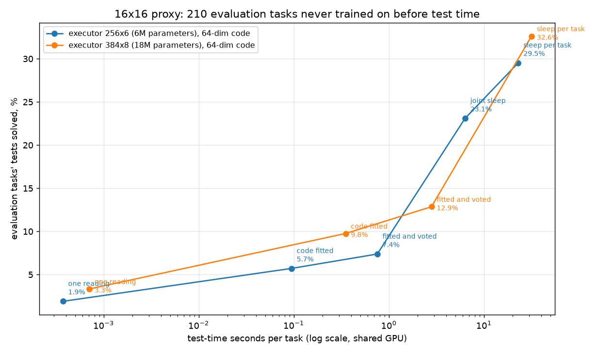
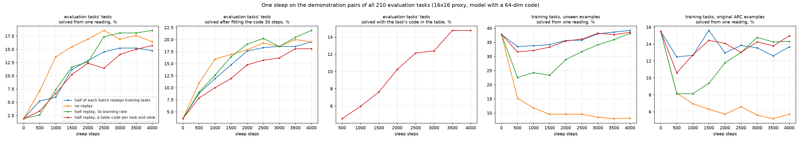
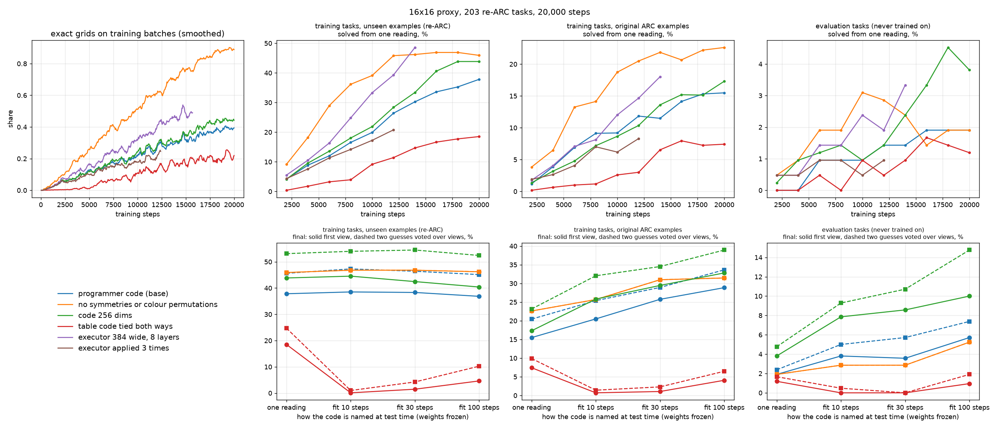

# ARC-AGI-1 첫 실험 보고

2026-11-28 새벽부터 쓴다. 실험이 도는 동안 이어서 고친다. 설계의 이유는 `docs/arc-agi-1-design.md`에, 비교마다의 숫자는 `docs/ablations.md` 9절에 있다.

## 1. 지금 어디까지 왔나

한 변 16칸에 들어가는 예시만 쓴 싼 탐색이 끝나 가고, 한 변 30칸에 과제 400개를 모두 쓰는 본학습이 GPU 4에서 돈다. 본학습은 토요일 19시쯤 끝난다. 아래 숫자는 모두 싼 탐색의 것이다. 평가 과제는 400개 가운데 16칸에 들어가는 210개이고, 격자가 작은 쪽이라 전체보다 쉽다. 전체 400개의 값은 본학습의 checkpoint가 나와야 잴 수 있다.

싼 탐색에서 본 적 없는 평가 과제를 푸는 비율은 쓰는 방법에 따라 이렇게 올라간다. 두 모델 모두 code가 64차원이다.

| 모델 | 예시 pair를 한 번 읽기 | code를 100스텝 옮기기 | 여덟 방향 다수결, 두 번 시도 | 모든 과제를 함께 재우기 | 과제마다 따로 재우기 |
|---|---|---|---|---|---|
| executor 폭 256에 6층 | 1.9 | 5.7 | 7.4 | 23.1 | 29.5 |
| executor 폭 384에 8층 | 3.3 | 9.8 | 12.9 | | 32.6 |

앞의 세 칸은 weight를 건드리지 않은 값이고 뒤의 두 칸은 평가 과제의 예시 pair로 weight를 고친 값이다. 어느 칸도 평가 과제의 test 답은 쓰지 않았다.

## 2. 견줄 대상

사용자가 03:14에 기준을 정답률로 정했다. 평가 과제 400개 전체, 두 번의 시도 조건이다. 조사해서 원문으로 확인한 값은 다음과 같다. 2026년 하반기의 결과는 조사 보고에만 기댄다.

| 방법 | parameter | 두 번 시도 정답률 | 평가 과제의 예시 pair를 쓰는 방식 | 계산 |
|---|---|---|---|---|
| TRM | 7M, 과제 embedding까지 455M | 44.6 | 학습 데이터에 넣고 처음부터 학습 | H100 넉 장으로 사흘 |
| VARC | 18M | 54.5, 앙상블 60.4 | 과제마다 따로 weight를 고침 | H100 여덟 장 4.8시간과 과제당 70초 |
| LoopViT, Loop-OWM | 4M에서 18M | 60에서 68.5 | VARC와 같음 | |
| transductARC | 75M | 76 | 예시 pair 하나를 문맥에 넣음 | H100 한 장 4시간 남짓 |
| CHARM | 14M, 과제 기억까지 44M | 78.6에서 84.0 | 학습 데이터에 넣음 | H100 여덟 장 88시간 |

TRM을 넘는 선은 45%이고 선두는 84%다. 싼 탐색의 32.6%는 쉬운 절반에서 잰 값이므로 아직 어느 줄과도 견줄 수 없다.

VARC의 실험에서 우리에게 바로 쓸모 있는 것이 셋 나온다. 과제마다 따로 고치면 54.5%이고 모든 과제를 함께 고치면 44.8%다. 한 방향의 한 번 시도는 35.9%이고 510개 방향 다수결의 두 번 시도가 54.5%다. 사전 학습이 없으면 26.4%다.

## 3. 방법을 순서대로

### 3.1 모델과 학습

과제의 규칙을 code vector 하나로 둔다. programmer가 입력과 출력의 pair 하나를 읽고 code를 쓰고, 과제의 code는 pair들의 code의 평균이다. executor는 입력 state와 code를 받아 출력 state를 낸다. 학습의 한 묶음은 과제 하나에서 뽑은 pair 넷이고, pair마다 자기를 뺀 나머지 셋의 평균 code로 예측한다.

예를 들어 모든 물체를 오른쪽 벽까지 미는 과제에서 pair 넷을 뽑았다고 하자. 첫 pair의 출력을 예측할 때 executor가 받는 code는 둘째, 셋째, 넷째 pair를 programmer가 읽은 것의 평균이다. 첫 pair의 출력 격자는 그 code를 만드는 데 들어가지 않았다. 그래서 code에는 세 pair가 공유하는 것, 곧 오른쪽으로 민다는 규칙만 들어갈 수 있다.

이것이 실패하고 있다면 학습 과제의 처음 보는 예시를 풀지 못한다. 싼 탐색에서 이 값은 2만 스텝에 38%에서 58%이고 스텝에 따라 아직 오르는 중이다.

### 3.2 code를 옮기기

본 적 없는 과제에서는 programmer가 읽은 code가 조금 틀린다. 그래서 weight는 그대로 두고 code vector만 고친다. programmer가 읽은 code에서 출발해, 그 code로 예시 pair의 입력을 실행한 결과가 예시 pair의 출력과 같아지도록 cross-entropy를 줄이는 방향으로 Adam을 돌린다. 바뀌는 숫자는 64개 또는 256개뿐이다.

토이 환경에서 빠른 기억에 새 code를 할당하던 것과 같은 일이고, LPN이 latent를 gradient로 탐색하는 것과도 같다. 싼 탐색에서 한 번 읽기 3.8%가 100스텝 뒤 10.0%가 됐다. code가 256차원인 모델의 값이다. 과제당 0.09초가 든다.

실패의 모습은 둘이다. 학습 과제의 처음 보는 예시에서는 옮겨도 오르지 않는다. 거기서는 읽은 code가 이미 맞거나 executor가 그 변환을 못 하기 때문이다. 그리고 code의 길이가 아주 짧게 학습된 모델에서는 같은 학습률이 너무 커서 옮기면 무너진다. 표의 code를 양쪽으로 묶은 조건에서 그랬다.

### 3.3 여러 방향의 다수결

과제를 90도씩 돌리고 뒤집은 여덟 방향으로 각각 풀고, 답을 원래 방향으로 되돌려 가장 많이 나온 격자를 낸다. 두 번의 시도가 허용되므로 가장 많이 나온 둘을 낸다. 방향마다 틀리는 칸이 다르면 맞는 답이 가장 자주 나온다.

이 방법은 모델이 대칭과 색 순열로 본 과제도 학습했을 때만 쓸 수 있다. 원래 방향만 학습한 조건에서는 다른 방향의 예측이 쓸모가 없다.

### 3.4 모든 과제를 함께 재우기

평가 과제 210개의 예시 pair 765개를 모아, 그것으로 만든 묶음과 학습 과제의 묶음을 한 배치에 반씩 섞어 모든 부품을 4,000스텝 학습한다. 평가 과제에서도 pair 하나를 나머지 pair의 code로 예측한다. 예시 pair가 둘뿐인 과제는 하나를 다른 하나의 code로 예측한다.

평가 과제의 test 정답률이 한 번 읽기 기준 1.9%에서 15%로 오르고, 학습 과제의 처음 보는 예시는 38%에서 39%로 유지된다. 학습 과제를 섞지 않으면 평가 쪽은 2점 높지만 학습 과제의 처음 보는 예시가 8%로 무너진다. 토이 환경에서 잠이 원래 세계를 섞지 않으면 원래 것을 잃은 것과 같은 모습이다.

잠 뒤에는 답 없이 하는 확인이 정답을 가리키지 못한다. 예시 pair 하나를 나머지의 code로 재현하는 과제가 30%인데 test를 실제로 푼 것은 15%다. 잠이 바로 그 예시 pair로 학습했기 때문이다.

평가 과제와 방향마다 표에 code를 따로 두고 함께 학습하는 조건도 돌렸다. 표의 code로 낸 값은 programmer가 읽은 code로 낸 값보다 높지 않았다.

### 3.5 과제마다 따로 재우기

VARC의 실험에서 가장 큰 차이를 낸 것을 우리 구조로 옮겼다. 과제 하나를 받으면 사전 학습된 weight의 복사본을 그 과제의 예시 pair만으로 100스텝 학습하고, 그 과제의 test에 답한 뒤 복사본을 버린다. 다음 과제는 다시 사전 학습된 weight에서 시작한다. 한 스텝의 배치는 그 과제를 대칭과 색 순열로 본 방향 16개이고, 방향마다 예시 pair 하나를 나머지 pair의 code로 예측한다. 답은 64개 방향의 다수결이다.

모든 과제를 함께 재우면 과제 210개가 weight 하나를 나눠 써야 한다. 따로 재우면 weight 전체가 과제 하나에만 맞춰진다. 버릴 weight이므로 원래 것을 잊는 문제가 없어서 학습 과제를 섞을 필요도 없다.

같은 모델에서 함께 재우면 23.1%, 따로 재우면 29.5%다. 재우지 않고 64방향 다수결만 하면 3.3%다.

실패의 모습. 과제별 잠 뒤에도 출력이 입력과 크기가 같은 과제는 25%만 풀리고 크기가 바뀌는 과제는 44%가 풀린다. 격자가 클수록 덜 풀린다. 가장 긴 변이 6칸 이하면 58%, 14칸에서 16칸이면 25%다. 평가 과제 400개 전체는 격자가 더 크므로 전체 값은 싼 탐색의 값보다 낮을 것으로 본다. 그리고 사전 학습 모델을 키워 학습 과제의 처음 보는 예시가 38%에서 58%로 올라도 과제별 잠 뒤에는 3점만 오른다.

## 4. 사전 학습 쪽의 비교

한 번에 하나씩 바꿔 2만 스텝씩 돌렸다. 숫자는 `docs/ablations.md` 9절에 있다. 본 적 없는 과제에 좋은 것은 code를 64차원에서 256차원으로 키우는 것, executor를 키우는 것, 색 순열을 8가지에서 512가지로 늘리는 것이다. 버린 것은 executor를 같은 weight로 세 번 도는 것, 학습률 1e-3, 과제 이름의 code를 programmer와 양쪽으로 묶는 것이다.

30칸 본학습은 이 셋을 합친 설정이다. executor 폭 384에 8층, code 256차원, 색 순열 512가지다.

### 3.6 과제별 잠은 금방 포화하고, 출발점이 결과를 정한다

과제별 잠을 100스텝에서 300스텝으로 늘려도 평가 과제 105개에서 34.3%로 같았고, 학습률을 세 배로 올려도 35.2%였다. 푼 과제도 거의 같았다. 그래서 어떤 과제가 풀리는지는 잠을 얼마나 오래 하느냐가 아니라 어떤 weight에서 출발하느냐가 정한다.

출발점을 바꾸면 달라진다. 작은 모델을 먼저 모든 평가 과제로 함께 재우고, 거기서 과제마다 따로 재우면 33.3%가 37.6%가 된다. 함께 재우는 동안 평가 과제들이 서로 공유하는 것을 weight가 배우고, 과제별 잠은 그 위에서 과제 하나에 맞춘다. VARC는 함께와 따로 가운데 하나를 골랐고 둘을 이어 붙인 값은 보고하지 않았다.

가장 많이 나온 답에 방향 64개 가운데 몇 개가 동의하는지가 답 없이 쓸 수 있는 신호다. 맞았을 때는 평균 53개가 동의하고 틀렸을 때는 10개가 동의한다.

### 3.7 code를 넓히는 두 조건

과제별 잠이 포화한다는 것은 모델이 표현하고 일반화할 수 있는 것 자체가 한계라는 뜻이다. code를 64차원에서 256차원으로 키웠을 때 본 적 없는 과제의 정답률이 두 배가 됐으므로, code가 좁아서 잃는 것이 얼마인지를 두 방향으로 잰다. 둘 다 16칸 탐색에서 도는 중이다.

첫째는 code에 지도를 더하는 것이다. 지금의 code는 vector 하나이고 executor의 모든 층을 같은 값으로 조절한다. 격자 전체에 하나의 설정만 줄 수 있다. 찍을 무늬나 색 대응표처럼 자세한 내용이 필요한 규칙은 그 vector 하나에 눌러 담아야 한다. 새 조건에서는 programmer가 vector와 함께 칸마다 32개 숫자를 쓴 지도를 낸다. state와 같은 모양이다. executor의 블록마다 칸 토큰이 이 지도를 attention으로 읽는다. 예를 들어 예시 pair의 출력 왼쪽 위에 늘 같은 3칸 무늬가 붙는 과제라면, programmer가 지도의 그 자리에 무늬를 적어 두고 executor의 그 칸들이 읽어 갈 수 있다. 읽는 단계의 출력은 0에서 시작하므로 학습 초기에는 지금의 모델과 똑같이 움직인다. 이 조건이 실패라면 같은 스텝에서 256차원 vector 조건보다 학습 과제의 처음 보는 예시와 평가 과제의 값이 높지 않을 것이다.

둘째는 code 하나 대신 code 여러 개의 program을 쓰는 것이다. 랩 NEO의 여러 단계 program과 같다. programmer가 code 셋을 내고, executor가 첫 code로 입력 state를 바꾸고, 그 결과에 둘째 code를, 다시 그 결과에 셋째 code를 적용한다. executor의 weight는 세 번 모두 같다. 물체를 벽까지 민 뒤 색을 바꾸는 과제라면 미는 단계와 칠하는 단계가 나뉠 수 있다. 앞서 버린 조건, 곧 같은 code로 executor를 세 번 돌리되 단계 사이의 gradient를 끊은 것과 달리 단계마다 code가 다르고 gradient가 끝까지 흐른다. TRM과 LoopViT가 작은 network를 여러 번 돌려 얻은 이득이 이 구조에서도 나는지를 본다.

## 5. 아직 모르는 것

- 평가 과제 400개 전체에서의 값. 본학습의 첫 checkpoint가 나오는 06시쯤부터 잰다.
- 과제별 잠의 길이와 학습률. 300스텝과 학습률 3e-4를 띄웠다가 GPU가 붐벼 내렸고 다시 돌린다.
- code를 vector 여러 개로 두고 executor가 attention으로 읽는 조건. 4,000스텝까지는 vector 하나보다 느리다.
- seed는 조건마다 하나다. 평가 과제 210개에서 1점은 과제 둘이므로 2에서 3점의 차이는 seed를 더 돌려야 말할 수 있다.
